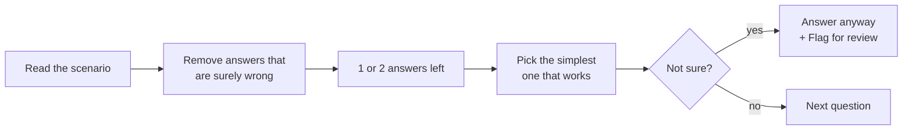
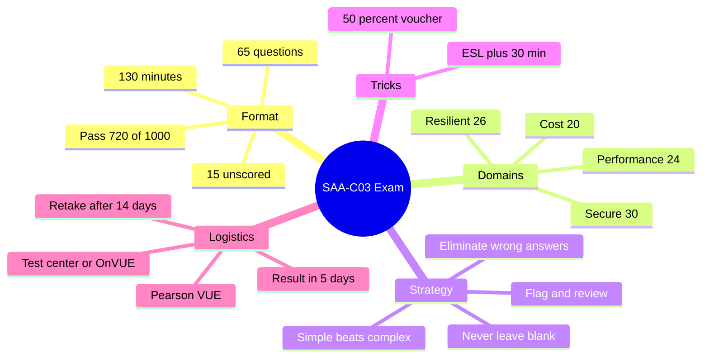

# AWS SAA-C03 — Exam Preparation

> **Core idea:** The exam has 65 questions in 130 minutes, and you need 720 out of 1000 to pass. There is no penalty for a wrong answer, so answer every question. Most questions are scenarios: remove the wrong answers first, and choose the simple answer.

---

## 1. Exam Format (Memorise This Table)

|Item|Detail|
|---|---|
|Questions|**65** total|
|Scored questions|**50** (the other **15 are unscored** test questions — you can't tell which ones)|
|Time|**130 minutes** (+30 min with ESL accommodation)|
|Question types|**Multiple choice** = 1 correct out of 4 · **Multiple response** = 2+ correct out of 5|
|Score range|100 – 1000|
|Passing score|**720**|
|Wrong answer penalty|**None** → never leave a question blank|
|Cost|**$150**|
|Result|Within **5 days** (not immediate)|
|If you fail|Retake after **14 days**|

**What the result shows you:**

|You get|You do NOT get|
|---|---|
|Total score|Which questions were right or wrong|
|Pass / not pass for each domain|Score number for each domain|

> Answer every question. A blank answer and a wrong answer both give zero.

---

## 2. The Four Exam Domains

| Domain                            | Weight  | What it really asks                                  |
| --------------------------------- | ------- | ---------------------------------------------------- |
| **Secure** architectures          | **30%** | IAM, encryption, network security — the biggest part |
| **Resilient** architectures       | 26%     | High availability, Multi-AZ, disaster recovery       |
| **High-performing** architectures | 24%     | Best service + best option for the use case          |
| **Cost-optimized** architectures  | 20%     | How to save money in the cloud                       |

**Takeaway: Security is the largest domain. When two answers look equal, check which one is more secure.**

---

## 3. How to Answer Questions

| Rule                                 | Why                                                      |
| ------------------------------------ | -------------------------------------------------------- |
| **Elimination first**                | Removing 2 wrong answers makes the right one easy to see |
| **Too complicated = probably wrong** | AWS prefers simple, managed solutions                    |
| **Few trick questions**              | Don't overthink; long scenarios just give hints          |
| **Flag + answer**                    | Always give an answer, then come back later              |
| **Review before submit**             | After submit, you **cannot** change anything             |

---

## 4. Booking and Test-Day Rules

**Booking path:** `aws.training/certification` → sign in with **AWS Builder ID** → Exam Registration → Schedule → **Pearson VUE** (AWS's exam partner).

| |Test Center|Online (OnVUE)|
|---|---|---|
|Where|A room at a test center|Your home|
|Need|Photo ID|Computer + webcam + good internet + ID|
|Before exam|Arrive on time|Run **system test** early · check in **30 min** before|
|Room|Provided|Desk fully empty · you must scan the room|

**Rules for everyone:** 1 ID document (ID card or passport). No notes, no pen, no speaking.

---

## 5. Two Useful Tricks

| Trick           | How                                                                                   | Benefit                                                                                                                                                         |
| --------------- | ------------------------------------------------------------------------------------- | --------------------------------------------------------------------------------------------------------------------------------------------------------------- |
| **ESL +30**     | Certification portal → Exam Accommodation → select **ESL +30** → request              | **+30 minutes** for non-native English speakers. Approved once, never expires. Request **before** scheduling (if already scheduled, cancel and schedule again). |
| **50% voucher** | After passing any AWS exam → Benefits → Claim → copy voucher code → paste at checkout | **50% off** your next AWS exam (voucher has an expiry date)                                                                                                     |

> Not a native English speaker? Request ESL +30 before you book. 160 minutes instead of 130 is a big advantage.

---

## 6. Study Tips

| Tip                          | Detail                                                                                                  |
| ---------------------------- | ------------------------------------------------------------------------------------------------------- |
| **Practice, don't rush**     | Hands-on experience matters most. It's not a race.                                                      |
| **Service FAQs**             | Many exam questions come from them. Example: `aws.amazon.com/vpc/faqs`                                  |
| **3 whitepapers** (optional) | Architecting for the Cloud: AWS Best Practices · AWS Well-Architected Framework · AWS Disaster Recovery |
| **Practice exam**            | Take a full practice test to check if you are ready                                                     |
| **Exam guide appendix**      | Lists services that _might_ appear. Not all of them will.                                               |
| **Community**                | Q&A forums, blogs, local meetups, re:Invent videos on YouTube                                           |

---

## 7. Summary

1. 65 questions, 130 minutes, pass mark 720/1000.
2. Only 50 questions count; 15 are hidden test questions.
3. No penalty for guessing — answer every question.
4. Security is the biggest domain (30%).
5. Use elimination; a too-complicated answer is usually wrong.
6. Flag unsure questions, but still answer them.
7. Non-native speakers: request ESL +30 before booking.
8. After passing, you get a 50% voucher for the next exam.

---

## 8. Check Yourself

1. How many questions are scored, and how many are unscored?
2. What is the passing score?
3. Should you skip a question you don't know? Why?
4. Which domain has the highest weight?
5. What is the difference between multiple choice and multiple response?
6. How do you get 30 extra minutes, and when must you request it?
7. If you fail, how long must you wait to retake?
8. Will the result tell you which questions you got wrong?
9. An answer works but is very complex. What does that usually mean?

---

## 9. Key Terms

|Term|Meaning|
|---|---|
|**Unscored question**|A test question AWS is trying out; it doesn't affect your score|
|**Multiple response**|Question with 2 or more correct answers out of 5|
|**Pearson VUE**|Company that runs AWS exam booking and delivery|
|**OnVUE**|Pearson VUE's online, take-from-home exam option|
|**AWS Builder ID**|Account used to sign in to the AWS certification portal|
|**ESL +30**|Accommodation giving non-native English speakers +30 minutes|
|**Flag for review**|Mark a question to come back to it before submitting|
|**Service FAQ**|AWS's question-and-answer page for each service; good exam source|
