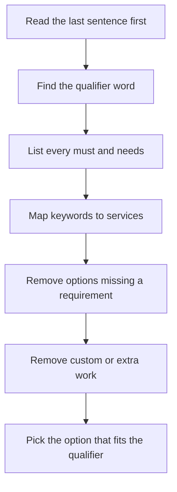
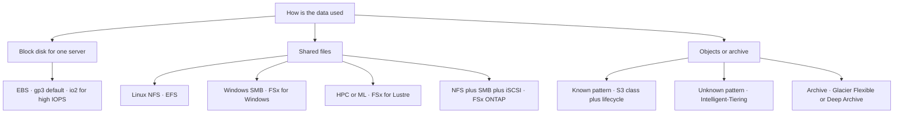
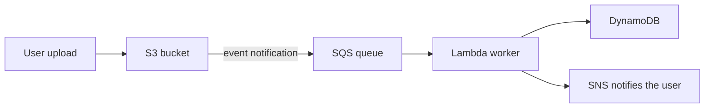
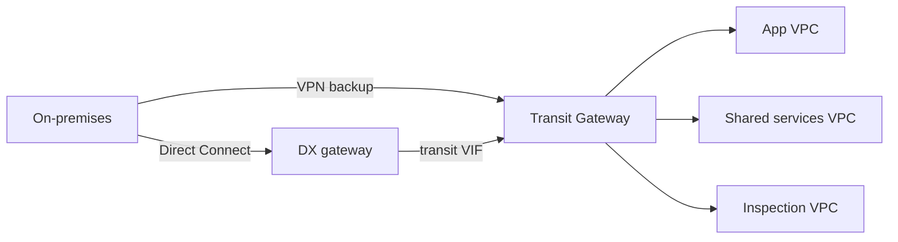
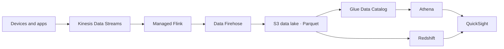
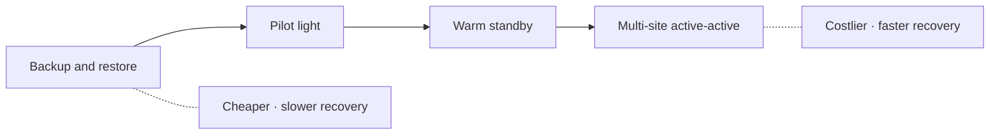
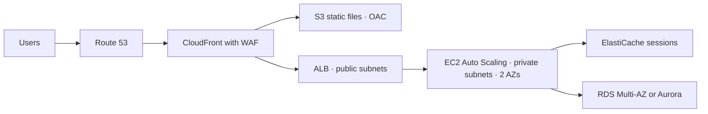
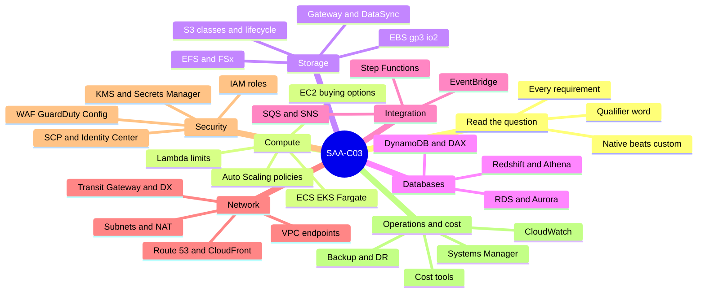

# SAA-C03 Exam Patterns: Service Decision Guide

> **Core idea:** Every exam question is a short story plus one deciding word: cheapest, least effort, fastest, most available, or most secure. Find the keywords in the story, map each keyword to a service, then remove every option that misses a requirement or adds extra work. A managed, built-in feature almost always beats a custom script.

---

## 1. How to Read an Exam Question

### 1.1 The shape of every question

Each question has three parts.

1. **The story**: what the company runs today (EC2, on-premises servers, Lambda, and so on).
2. **The requirements**: sentences with _must_, _needs_, _wants_. Each one is a filter.
3. **The qualifier**: the deciding word at the end, such as **MOST cost-effective**.

Often two or three options "work". The qualifier picks the winner.

### 1.2 Qualifier words and what they really mean

| Qualifier in the question                     | Real meaning                                           | Usually wins                                                                           | Usually loses                                                  |
| --------------------------------------------- | ------------------------------------------------------ | -------------------------------------------------------------------------------------- | -------------------------------------------------------------- |
| **LEAST operational overhead** / least effort | Fewest things to build and manage                      | Managed, serverless, built-in feature                                                  | Custom Lambda scripts, cron on EC2, self-managed software      |
| **MOST cost-effective**                       | Cheapest option that still meets **every** requirement | Spot (if interruptible), lifecycle rules, gateway endpoints, serverless for spiky load | Extra capacity, Multi-Region or Shield Advanced when not asked |
| **MOST operationally efficient**              | Same as least overhead                                 | Native integrations                                                                    | Manual steps                                                   |
| **Highly available / fault tolerant**         | Survive one AZ failure                                 | Multi-AZ, Auto Scaling across AZs, load balancer                                       | Single instance, single AZ                                     |
| **Disaster recovery / another Region**        | Survive a whole Region failure                         | Cross-Region copies, Aurora Global Database, Route 53 failover                         | Multi-AZ only                                                  |
| **Lowest latency / global users**             | Bring content or entry point close to users            | CloudFront, Global Accelerator, DAX, ElastiCache, read replicas                        | Bigger instance in one Region                                  |
| **No code change / minimal change**           | Keep the app as it is                                  | Same protocol (NFS→EFS, SMB→FSx, AMQP→Amazon MQ), lift and shift, Babelfish            | Rewrite to DynamoDB or Lambda                                  |
| **Near real time**                            | Seconds                                                | Kinesis, EventBridge, S3 events, DynamoDB Streams               | Nightly batch                                                  |
| **Loosely coupled / decoupled**               | Parts do not wait for each other                       | SQS, SNS, EventBridge                                                                  | Direct synchronous calls                                       |
| **MOST secure**                               | Least exposure, temporary credentials                  | IAM roles, private subnets, Session Manager, VPC endpoints                             | Access keys, public IPs, open SSH                              |

### 1.3 Golden rules for removing wrong options

> 1. If AWS has a native feature for the job, a custom Lambda or cron job is wrong.
> 2. Roles beat access keys. Temporary credentials beat long-term ones.
> 3. An option must meet **all** requirements. One miss kills it.
> 4. Do not pay for more than asked. "Highly available" does not need Multi-Region.
> 5. "Can be interrupted / can restart / checkpoints" → Spot. "Must not be interrupted" → never Spot.
> 6. "Unpredictable traffic" → automatic scaling (target tracking, on-demand, serverless). "Known times" → scheduled scaling.
> 7. Read the protocol: SMB → FSx for Windows. NFS → EFS. iSCSI → Volume Gateway. UDP → NLB or Global Accelerator. AMQP/MQTT → Amazon MQ.
> 8. "Prevent" → SCP, IAM, Object Lock. "Detect" → Config, GuardDuty, CloudTrail, Macie.
> 9. A job longer than 15 minutes cannot run on Lambda.
> 10. Multi-AZ = availability. Read replica = read speed. They are different tools.

### 1.4 Solving flow

### 1.5 What to study first

The table shows how often each area appears and whether it is growing in recent questions.

| Area                                                                                                     | Priority | Trend                                    |
| -------------------------------------------------------------------------------------------------------- | -------- | ---------------------------------------- |
| EC2, Auto Scaling, load balancers                                                                        | ★★★      | Stable                                   |
| S3 classes, lifecycle, security, encryption                                                              | ★★★      | Rising                                   |
| Lambda, API Gateway, SQS, SNS, EventBridge                                                               | ★★★      | EventBridge rising, SNS/SQS FIFO falling |
| RDS, Aurora, DynamoDB                                                                                    | ★★★      | Stable                                   |
| VPC networking, endpoints, hybrid links                                                                  | ★★★      | Stable                                   |
| IAM, Organizations, SCP, Identity Center                                                                 | ★★★      | Rising                                   |
| Cost tools: Cost Explorer, tags, Cost Categories, Storage Lens, Compute Optimizer, Cost Optimization Hub | ★★       | Rising fast                              |
| Systems Manager and automation                                                                           | ★★       | Rising fast                              |
| Governance and detection: Config, GuardDuty, Firewall Manager, CloudTrail + Athena                       | ★★       | Rising                                   |
| Analytics and streaming: Athena, Redshift, Glue, Kinesis, Flink                                          | ★★       | Rising                                   |
| Backup and DR: AWS Backup, Aurora Global, cross-Region copies                                            | ★★       | Stable                                   |
| CloudFront, Global Accelerator, Route 53 policies                                                        | ★★       | Stable                                   |
| Containers: ECS, EKS, Fargate                                                                            | ★★       | Falling                                  |
| Hybrid storage: Storage Gateway, DataSync, FSx                                                           | ★★       | Stable                                   |
| AI services, Outposts, Elastic Beanstalk                                                                 | ★        | Low                                      |

> With little time, master every ★★★ area first. Together they cover most questions.

**Newer features in recent questions:** EventBridge Pipes and Scheduler, ALB mutual TLS, S3 Bucket Keys, S3 Storage Lens, RDS Blue/Green Deployments, Babelfish, zero-ETL to Redshift, Lambda@Edge image resizing, Systems Manager Resource Scheduler, Cost Optimization Hub, Firewall Manager security group policies, EC2 Image Builder, Route 53 Profiles, EKS Connector.

---

## 2. Compute: EC2, Auto Scaling, Lambda, Containers

### 2.1 EC2 buying options: the hotel story

Buying EC2 works like booking a hotel room.

| Option                             | Hotel story                                                                 | Use when the question says                                 | Saving     |
| ---------------------------------- | --------------------------------------------------------------------------- | ---------------------------------------------------------- | ---------- |
| **On-Demand**                      | Walk-in guest, pay per night                                                | Short, unpredictable, must not be interrupted              | None       |
| **Standard Reserved Instance**     | 1–3 year lease of one room type                                             | Steady 24/7 load, fixed instance type                      | Up to ~72% |
| **Convertible RI**                 | Lease, but you may change room type                                         | Steady load, family may change                             | Up to ~66% |
| **EC2 Instance Savings Plan**      | Promise to spend $X/hour on one family in one Region                        | Steady, family fixed, size or OS may change                | Up to ~72% |
| **Compute Savings Plan**           | Promise to spend $X/hour in any hotel                                       | Flexibility across family, Region, **Fargate and Lambda**  | Up to ~66% |
| **Spot**                           | Empty room at a huge discount; you can be kicked out with 2 minutes' notice | Batch, stateless, checkpoints, "can tolerate interruption" | Up to ~90% |
| **Dedicated Host**                 | Rent the whole floor                                                        | Bring your own license (per socket/core), compliance       | —          |
| **Dedicated Instance**             | Hardware nobody else uses                                                   | Single-tenant hardware rule                                | —          |
| **On-Demand Capacity Reservation** | Room kept free for you                                                      | Guaranteed capacity in one AZ (no discount by itself)      | —          |

Decision points:

- Nightly batch that can retry or resume → **Spot**, best as a Spot Fleet with many instance types.
- EC2 + Fargate + Lambda and you want flexibility → **Compute Savings Plan**. SageMaker → **SageMaker Savings Plan**.
- Cost Explorer shows On-Demand usage above your RI coverage → buy **more RI or Savings Plan coverage**.

### 2.2 Auto Scaling: pick the right policy

|Policy or feature|Story|Use when|
|---|---|---|
|**Target tracking**|Thermostat: keep CPU at 50%|Unpredictable spikes; the default answer for "scale with load"|
|**Step scaling**|Bigger alarm → add more instances|Different actions for different alarm levels|
|**Simple scaling**|One action, then wait|Legacy; rarely the best answer|
|**Scheduled scaling**|Alarm clock|Known times: "spike at 8:00 AM each weekday", "business hours only"|
|**Predictive scaling**|Weather forecast|Repeating daily or weekly pattern learned from history|
|**Scale on SQS backlog**|More letters → more workers|Worker fleet reading an SQS queue|
|**Warm pool**|Staff already dressed and waiting|Instances take long to boot or warm up|
|**Lifecycle hook**|"Wait before you leave the building"|Run setup at launch, or save logs before termination|
|**Instance refresh**|Replace staff one by one|New AMI or new instance type with no downtime (minimum healthy 100%)|
|**ELB health check type**|Ask the receptionist, not only the doctor|Replace instances whose **app** fails, not only hardware|

Decision points:

- Spike at 8:00 AM and new instances need 15 minutes to warm up → **scheduled scaling** a few minutes before 8:00. Target tracking reacts too late.
- Unhealthy instances are replaced and the logs are lost → **termination lifecycle hook** + EventBridge + Systems Manager Automation to copy logs to S3.
- Always spread the group across **two or more AZs**.

### 2.3 EC2 features that appear often

|Need|Answer|
|---|---|
|Lowest latency, highest throughput between nodes (HPC)|**Cluster placement group** in one AZ|
|Critical instances must not share hardware|**Spread placement group**|
|Big distributed systems (Hadoop, Kafka, Cassandra)|**Partition placement group**|
|Keep RAM contents while stopped|**Hibernate** (RAM saved to the encrypted EBS root volume)|
|Hardware failure; keep the same IP and EBS volumes|CloudWatch alarm on **StatusCheckFailed_System** → **recover** action|
|Build, patch, test and share golden AMIs automatically|**EC2 Image Builder**, then Auto Scaling **instance refresh**|
|GPU for containers|ECS or EKS on **GPU EC2 instances** (Fargate and Lambda have no GPU)|
|Move an instance to another subnet|Not possible: launch new instances in that subnet|

### 2.4 Lambda: the taxi

Lambda is like a taxi. You pay only per ride, and one ride lasts **at most 15 minutes**.

|Feature|What it solves|
|---|---|
|**Memory setting**|CPU grows with memory. Choose the lowest memory that meets the latency target.|
|**Provisioned concurrency**|Removes cold starts. Add **Application Auto Scaling** so it shrinks when traffic is low.|
|**Reserved concurrency**|Guarantees (and caps) capacity for one function so others cannot starve it.|
|**SnapStart**|Faster start for Java and some other runtimes. Do not create unique IDs during init.|
|**Layers**|Share libraries; consistent dependency versions.|
|**Function URL**|Simple HTTPS endpoint without API Gateway; allows long synchronous calls (up to 15 min).|
|**VPC access**|Reach a private RDS; add **RDS Proxy** to avoid too many connections.|
|**KMS-encrypted env variables**|Execution role needs `kms:Decrypt`, **and** the key policy must allow that role.|
|**SQS trigger + partial batch response**|`ReportBatchItemFailures` retries only failed messages; add a DLQ.|

> Lambda is wrong when the job runs over 15 minutes, needs a GPU, needs OS control, or runs heavy 24/7.

### 2.5 Containers

|Service|Story|Pick it when|
|---|---|---|
|**ECS**|AWS's own container manager|AWS-native containers, simplest orchestration|
|**EKS**|Managed Kubernetes|Company already uses Kubernetes|
|**Fargate**|Car with a driver: you hand over the container|"No servers to manage", least overhead (no GPU)|
|**ECS/EKS on EC2**|You drive|GPU, special instances, heavy steady load|
|**Fargate Spot**|Cheap ride that may be cancelled|Interruptible tasks|
|**ECR**|Image warehouse|Store and scan images; a repository policy can deny push|
|**ECS Anywhere / EKS Anywhere**|Same manager, your own building|Run containers on on-premises servers|
|**EKS Connector**|A window into other clusters|See all Kubernetes clusters (also on-premises) in one console|
|**AWS Batch**|Job scheduler|Large or long batch jobs, often on Spot|
|**Elastic Beanstalk**|Full-service hotel|Deploy a classic web app with little ops work|

ECS permissions are a common trap:

- **Task IAM role** = what the app inside the task may do. One role per app gives isolation.
- **Task execution role** = what ECS needs to start the task (pull from ECR, write logs, read secrets).

EKS facts: the **AWS Load Balancer Controller** creates an **ALB** for HTTP path routing (cheapest, least work) or an NLB for TCP. **EKS Pod Identity / IRSA** gives each pod its own IAM role.

### 2.6 Which compute? Quick map

|Question words|Choose|
|---|---|
|Event-driven, short tasks, spiky, pay per use|Lambda|
|Containers, no server management|ECS or EKS on Fargate|
|Job runs 1–20 minutes on a schedule or at a future time|**EventBridge Scheduler** → ECS task on Fargate|
|Long or huge batch jobs|AWS Batch|
|Full OS control, special licenses|EC2|
|Visual multi-step workflow with per-step retries|Step Functions|

---

## 3. Load Balancing, DNS and Edge

### 3.1 ALB vs NLB vs GWLB

|            | **ALB**                                                                                                         | **NLB**                                                                             | **GWLB**                                                             |
| ---------- | --------------------------------------------------------------------------------------------------------------- | ----------------------------------------------------------------------------------- | -------------------------------------------------------------------- |
| Story      | Receptionist who reads the letter                                                                               | Fast toll gate that reads only the address                                          | Airport security scanner                                             |
| Layer      | 7: HTTP, HTTPS, gRPC                                                                                            | 4: TCP, UDP, TLS                                                                    | 3: IP packets (GENEVE)                                               |
| Key powers | Path/host routing, HTTP→HTTPS redirect, sticky sessions, Cognito login, **WAF**, **mutual TLS**, Lambda targets | **Static IP / Elastic IP per AZ**, UDP, extreme speed, PrivateLink endpoint service | Sends all traffic through third-party firewalls or IDS appliances    |
| Pick when  | Web apps, microservices, EKS path routing                                                                       | UDP, gaming, fixed IP allow-list, expose a service with PrivateLink                 | Central traffic inspection, also across accounts with GWLB endpoints |

ALB details that decide answers:

- **Least outstanding requests** algorithm stops sending new requests to busy, slow targets.
- **Sticky sessions**: duration-based (load balancer cookie) or application-based (app cookie).
- **Weighted target groups** move traffic between an old and a new fleet.
- WAF attaches to ALB, not to NLB.
- Path routing **plus** private access from another VPC with the CIDR hidden → **ALB behind an internal NLB** + **VPC endpoint service** (PrivateLink).
- Route 53 keeps returning dead instance IPs → put an **ALB with health checks** in front and point Route 53 (alias) at the ALB.

### 3.2 Route 53 routing policies

|Policy|Story|Use when|
|---|---|---|
|**Simple**|One answer|One resource, no health checks|
|**Weighted**|Split 80/20|A/B tests, gradual migration|
|**Latency**|Fastest road|Send users to the Region with lowest latency|
|**Failover**|Main + backup|Active-passive DR with health checks|
|**Geolocation**|Passport check|By user's country or continent (law, language, rights)|
|**Geoproximity**|Distance with a bias dial|By distance between user and resource; shift traffic with bias|
|**Multivalue answer**|Give all healthy phone numbers|Return up to 8 **healthy** IPs; the client picks|
|**IP-based**|By caller's network|Route by client CIDR|

Other Route 53 facts:

- **Alias record**: free, works at the zone apex, points to CloudFront, ALB, S3 website, API Gateway.
- **Private hosted zone**: names that resolve only inside chosen VPCs.
- **Resolver inbound endpoint**: on-premises DNS resolves names in AWS.
- **Resolver outbound endpoint + forwarding rule**: AWS resolves on-premises names.
- **Route 53 Profiles**: apply one DNS setup to many VPCs and accounts.

### 3.3 CloudFront features

CloudFront is a chain of shop branches (edge locations) near customers. Each branch keeps copies.

|Need|CloudFront answer|
|---|---|
|S3 bucket stays private; only CloudFront reads it|**Origin Access Control (OAC)**|
|Block some countries|**Geographic restriction**|
|Only paying users|**Signed URL** (one file) or **signed cookies** (many files)|
|Turn HTTP into HTTPS automatically|Viewer protocol policy **Redirect HTTP to HTTPS**|
|Stop web attacks|Attach a **WAF** web ACL|
|Resize images or choose WebP/JPEG on demand|**Lambda@Edge** with an image library|
|Tiny header or URL rewrites|**CloudFront Functions**|
|Different content per country|Use the viewer-country header in the cache key|
|TLS certificate|**ACM** certificate in **us-east-1**|

> An S3 bucket policy with `aws:SecureTransport` can only **deny** HTTP. It cannot **convert** HTTP to HTTPS. CloudFront can.

### 3.4 CloudFront vs Global Accelerator

| |**CloudFront**|**Global Accelerator**|
|---|---|---|
|Story|Shop branches with copies|Private express highway into AWS with 2 fixed gates|
|Caches content|Yes|No|
|Protocols|HTTP, HTTPS|TCP, UDP|
|IP addresses|Change|**2 static anycast IPs**|
|Best for|Websites, video, APIs|Gaming, VoIP, IoT, fixed IPs, fast Region failover with no DNS caching problems|

---

## 4. Storage

### 4.1 Block, file or object?

|Type|Service|Story|Pick when|
|---|---|---|---|
|Block, one instance|**EBS**|USB drive plugged into one computer (one AZ)|Boot disk, database on EC2, data must survive stop and terminate|
|Block, temporary|**Instance store**|Scratch paper|Cache and temp data; lost when the instance stops|
|File, Linux, shared|**EFS**|Shared Linux network drive (NFS)|Many EC2, containers or Lambda share files across AZs|
|File, Windows|**FSx for Windows File Server**|Windows shared drive (SMB + Active Directory)|Windows apps, SMB protocol|
|File, HPC and ML|**FSx for Lustre**|Racing-car file system linked to S3|GPU training, HPC, very high throughput|
|File, multi-protocol|**FSx for NetApp ONTAP**|Swiss-army file system|NFS + SMB + iSCSI, NetApp snapshots, clones, SnapMirror|
|File, ZFS|**FSx for OpenZFS**|Linux/Unix ZFS server|Unix/Linux apps, fast snapshots and clones, lower cost|
|Object|**S3**|Unlimited warehouse of boxes|Images, backups, data lake, static website|

> Two instances in two AZs show different versions of the same file → move the files to a **shared file system (EFS)**.

### 4.2 EBS volume types

|Type|Story|Use when|
|---|---|---|
|**gp3**|Normal car; set speed apart from size|Default choice. Baseline 3,000 IOPS, cheaper than gp2.|
|**gp2**|Old car; speed tied to size|Legacy. Change gp2 → gp3 with **Elastic Volumes**, no downtime.|
|**io2 Block Express**|Race car|Sub-millisecond latency, very high consistent IOPS (up to 256,000), critical databases|
|**io1 / io2**|Sports car|High consistent IOPS; **Multi-Attach** inside one AZ|
|**st1**|Truck|Large sequential reads: logs, big data|
|**sc1**|Storage shed|Cold data, cheapest HDD|

EBS facts: snapshots are incremental and can be copied to other Regions. **EBS default encryption** encrypts all new volumes in a Region. **Data Lifecycle Manager** automates snapshots and AMIs, including cross-Region copies.

### 4.3 S3 storage classes: the shop story

Think of a shop with a front shelf, a back room, a basement and a deep cave.

|Class|Place in the shop|Retrieval|Min days stored|Use when|
|---|---|---|---|---|
|**S3 Standard**|Front shelf|Instant|—|Frequent access|
|**S3 Intelligent-Tiering**|A robot moves boxes for you|Instant (archive tiers optional)|—|**Unknown or changing** access|
|**S3 Standard-IA**|Back room|Instant, small retrieval fee|30|Rare access, needs instant reads|
|**S3 One Zone-IA**|Back room in one building|Instant|30|Rare access, **easy to re-create**|
|**S3 Express One Zone**|Speed counter|Single-digit ms|—|Highest performance, one AZ|
|**Glacier Instant Retrieval**|Basement with a lift|Milliseconds|90|About once a quarter, still instant|
|**Glacier Flexible Retrieval**|Basement|Minutes to 12 hours (expedited 1–5 min)|90|Archive needed "within hours"|
|**Glacier Deep Archive**|Deep cave|12–48 hours|180|Cheapest; "can wait a day", long compliance archive|

Lifecycle rules do the moving and deleting:

- **Transition** to a cheaper class after N days (IA classes need the object to be 30 days old first).
- **Expire** objects after N days, for example "delete after 12 months".
- **Abort incomplete multipart uploads**: a hidden cost that Storage Lens reveals.
- **Expire noncurrent versions** to control versioning cost.

### 4.4 S3 protection and data tools

|Need|Answer|
|---|---|
|Recover overwritten or deleted objects|**Versioning**|
|Nobody, not even root, can delete until a date|**Object Lock, compliance mode** (needs versioning)|
|Block deletes, but special admins may override|**Object Lock, governance mode**|
|Keep with no end date until released|**Legal hold**|
|Copy new objects to another Region|**Cross-Region Replication** (versioning on both buckets)|
|Copy **existing** objects too|**S3 Batch Replication**|
|Downloaders pay the download and request cost|**Requester Pays**|
|Temporary access for someone without AWS credentials|**Presigned URL**|
|Separate permissions per team, partner or prefix|**S3 Access Points** (can be limited to one VPC)|
|Org-wide view of usage, waste, buckets without versioning or lifecycle rules|**S3 Storage Lens** (advanced metrics for prefix level and activity)|
|Very high request rate|Spread keys over **more prefixes** (about 3,500 writes and 5,500 reads per second per prefix)|
|Faster uploads from far away|**Transfer Acceleration**; big files use **multipart upload**|
|React when an object arrives|**S3 Event Notifications** → Lambda, SQS, SNS or EventBridge|
|Find personal data in buckets|**Macie**|
|Exact dollar cost per bucket|**Cost and Usage Report** with resource-level data|

### 4.5 S3 encryption

| Option                      | Who holds the key                             | Pick when                                                            |
| --------------------------- | --------------------------------------------- | -------------------------------------------------------------------- |
| **SSE-S3**                  | AWS                                           | Default, simplest                                                    |
| **SSE-KMS**                 | KMS key you control; use logged in CloudTrail | Need key control or audit                                            |
| **SSE-KMS + S3 Bucket Key** | Same, but far fewer KMS calls                 | Many objects; cuts KMS request cost (up to ~99%)                     |
| **DSSE-KMS**                | Two layers of KMS encryption                  | Rule demands dual-layer encryption                                   |
| **SSE-C**                   | You send the key with every request           | Keys must stay outside AWS                                           |
| **Client-side encryption**  | You encrypt before upload                     | Nobody (partners, AWS) may see plaintext, even before it lands in S3 |

### 4.6 Hybrid storage and data transfer

|Service|Story|Pick when|
|---|---|---|
|**S3 File Gateway**|A door from the office file share into S3|On-premises apps write NFS/SMB files that become S3 objects; minimal change; local cache|
|**Volume Gateway, cached**|Hot data at home, everything in S3|iSCSI block storage; only recent data stays local|
|**Volume Gateway, stored**|Everything at home, backup copy in S3|iSCSI; all data must stay local|
|**Tape Gateway**|Fake tape library|Existing backup software writes to tape|
|**DataSync**|Online moving truck on a schedule|Copy or sync NFS, SMB, HDFS to S3, EFS or FSx (also over Direct Connect with a private VIF)|
|**Transfer Family**|Managed SFTP / FTPS / FTP server|Partners keep using FTP tools; files land in S3 or EFS|
|**Snowball Edge**|Hard-drive suitcase sent by courier|Many TB or PB with slow or no network|

---

## 5. Databases

### 5.1 Which database?

| Data or need                             | Service                                                          | Story                                         |
| ---------------------------------------- | ---------------------------------------------------------------- | --------------------------------------------- |
| Relational, SQL, joins, existing engine  | **RDS** (MySQL, PostgreSQL, Oracle, SQL Server, MariaDB)         | Hired database caretaker                      |
| Relational, high performance, global     | **Aurora**                                                       | RDS with a faster engine and 6 copies of data |
| Key-value, huge scale, single-digit ms   | **DynamoDB**                                                     | Giant locker system                           |
| Microsecond reads on DynamoDB            | **DAX**                                                          | Sticky note on the locker                     |
| Cache, sessions, leaderboards            | **ElastiCache** (Redis OSS / Valkey; Memcached for simple cache) | Whiteboard next to the desk                   |
| Relationships, fraud rings, social graph | **Neptune**                                                      | Map of who knows whom                         |
| MongoDB-compatible documents             | **DocumentDB**                                                   | —                                             |
| Cassandra workloads                      | **Keyspaces**                                                    | —                                             |
| Time-series sensor data                  | **Timestream**                                                   | —                                             |
| Data warehouse, complex SQL, MPP         | **Redshift**                                                     | Big analytics library                         |
| Full-text search, log search             | **OpenSearch Service**                                           | —                                             |
| Occasional SQL on files in S3            | **Athena** (query engine, not a database)                        | —                                             |

### 5.2 RDS: availability and scaling

| Feature                                     | What it does                                                | Readable? | Answer for                                             |
| ------------------------------------------- | ----------------------------------------------------------- | --------- | ------------------------------------------------------ |
| **Multi-AZ instance**                       | Standby in another AZ, synchronous copy, automatic failover | **No**    | High availability                                      |
| **Multi-AZ DB cluster** (MySQL, PostgreSQL) | 1 writer + 2 readable standbys, faster failover             | Yes       | HA plus some read offload                              |
| **Read replica**                            | Asynchronous copy, same or another Region                   | Yes       | Read-heavy load, reports, DR (promote it)              |
| **RDS Proxy**                               | Pools and shares connections                                | —         | "Too many connections", Lambda surges, faster failover |

RDS rules that are tested again and again:

- Read-heavy → add **read replicas** and send reads to the replica endpoint.
- Encrypt an existing unencrypted DB → **snapshot → copy the snapshot with encryption → restore**. There is no checkbox.
- Share an encrypted snapshot with another account → use a **customer managed KMS key**, add that account to the **key policy**, then share. AWS managed keys cannot be shared.
- Each account may decrypt only its own snapshots → one KMS key per account; each key policy allows only that account's role.
- Encrypt **in transit** → download the AWS **certificate bundle**; use SSL/TLS settings in the connection string.
- No long-lived passwords → **IAM database authentication** (short-lived token).
- Rotate passwords every N days → **Secrets Manager** automatic rotation.
- Upgrade the engine version safely and test first → **RDS Blue/Green Deployments** (switchover in about a minute, no data loss).
- Automated backups keep **at most 35 days**. Longer retention (1 year, 7 years) → **AWS Backup** plan or manual snapshots.
- A stopped RDS instance **starts again after 7 days**. Idle for months → take a snapshot, delete, restore later.
- Unpredictable or idle database → **Aurora Serverless v2**.

### 5.3 Aurora

| Feature                                          | Use when                                                                                          |
| ------------------------------------------------ | ------------------------------------------------------------------------------------------------- |
| **Aurora Replicas** (up to 15) + reader endpoint | Scale reads; fast failover (set failover priority tiers)                                          |
| **Aurora Serverless v2**                         | Spiky, unpredictable or dev/test load; pay for what you use                                       |
| **Aurora Global Database**                       | DR in another Region with **RPO about 1 second, RTO about 1 minute**; fast reads for global users |
| **Babelfish for Aurora PostgreSQL**              | Move from SQL Server with **minimal app code change** (understands T-SQL)                         |
| **Cloning**                                      | Quick copy for testing                                                                            |
| **Zero-ETL to Redshift**                         | Analytics on live Aurora data with no pipeline to build                                           |

### 5.4 DynamoDB

| Feature                               | Story                           | Use when                                                                   |
| ------------------------------------- | ------------------------------- | -------------------------------------------------------------------------- |
| **On-demand capacity**                | Pay per request                 | Unpredictable traffic, sudden spikes                                       |
| **Provisioned + auto scaling**        | Rent lanes, adjust slowly       | Predictable traffic, lower cost                                            |
| **DAX**                               | Sticky-note cache               | Microsecond reads, read-heavy, throttled reads                             |
| **Streams**                           | CCTV of item changes            | Trigger Lambda on change, track changes                                    |
| **TTL**                               | Expiry-date sticker             | Delete old items for free; with Streams + Lambda, archive what TTL deleted |
| **Global Tables**                     | Same table live in many Regions | Multi-Region active-active, low latency worldwide                          |
| **Point-in-time recovery**            | Time machine (35 days)          | Undo bad writes                                                            |
| **BatchGetItem / BatchWriteItem**     | One trip instead of many        | Code makes many small calls in a row                                       |
| **Kinesis Data Streams for DynamoDB** | Change feed to a stream         | Real-time analytics on changes without loading the table                   |

### 5.5 Database migration

|Need|Tool|
|---|---|
|Same engine (MySQL → RDS MySQL)|**DMS** or native tools|
|Different engine (Oracle → Aurora PostgreSQL)|**SCT / DMS Schema Conversion** for schema, **DMS** for data|
|Source stays live; copy ongoing changes|**DMS with CDC** (change data capture)|
|SQL Server app to Aurora PostgreSQL, keep code|**Babelfish** + schema/data migration|
|Whole servers, lift and shift|**Application Migration Service (MGN)**|

---

## 6. Decoupling and Event-Driven Integration

### 6.1 Message services and their stories

|Service|Story|Keywords in the question|
|---|---|---|
|**SQS Standard**|A to-do box; workers take tasks when free|Buffer, decouple, absorb spikes, "no requests lost", unlimited throughput|
|**SQS FIFO**|A to-do box with a strict line|**Exactly-once** processing, **exact order**|
|**SNS**|Loudspeaker; every subscriber hears at once|**Fan-out**, notify many, push, email/SMS/mobile push, message filtering|
|**SNS FIFO**|Loudspeaker that keeps order|Ordered publish-subscribe to several subscribers|
|**EventBridge**|Smart post-office sorter|Route events by content, AWS and SaaS events, **schema registry**, archive and replay|
|**EventBridge Pipes**|Pipe with a filter and a mixer|Point to point: source (SQS, Streams) → filter → transform → target|
|**EventBridge Scheduler**|Alarm clock for AWS|Cron jobs, one-time future runs, many schedules|
|**EventBridge API destinations**|Courier to outside apps|Send events to external HTTP or SaaS APIs (OAuth, API key)|
|**Kinesis Data Streams**|Conveyor belt that keeps items for days|Real-time stream, many readers, replay, order per shard|
|**Amazon MQ**|Familiar post office in a new building|Apps already using **AMQP, MQTT, JMS, STOMP**; move with no code change|
|**Step Functions**|Recipe card with steps, checks and retries|Multi-step workflow, visual monitoring, retry one step, human approval|

### 6.2 SQS details that decide answers

|Problem|Fix|
|---|---|
|Message processed twice, duplicate database rows|**Raise the visibility timeout** above the processing time (`ChangeMessageVisibility`)|
|Paying for many empty receives|**Long polling** (wait up to 20 s)|
|A bad message fails again and again|**Dead-letter queue**|
|Workers cannot keep up|Auto Scaling group that scales on **queue backlog per instance**|
|Lambda batch partly fails|**Partial batch response** + DLQ|
|Keep messages for N days|Retention period (default 4 days, maximum 14 days)|
|Strict order and no duplicates|**FIFO queue**|

### 6.3 API Gateway

|Type|Pick when|
|---|---|
|**REST API**|Full features: API keys, **usage plans and throttling**, caching, WAF, request validation, private APIs|
|**HTTP API**|Cheaper and faster; Lambda proxy or **VPC link** to a private ALB/NLB (for example EKS in private subnets)|
|**WebSocket API**|Two-way, real-time chat or live updates|

|Need|Feature|
|---|---|
|Rate limiting and per-client quotas|**Usage plans + API keys + throttling**|
|Login with Google, Facebook or other social IdPs|**Cognito user pool** authorizer|
|Custom auth logic (header token)|**Lambda authorizer**|
|Only my VPC may call the API|**Private API** + interface VPC endpoint + resource policy|
|Less load on the backend|**Caching** (REST) or CloudFront|
|Work takes minutes|Answer fast, process **asynchronously** (SQS, async Lambda, Step Functions); the default integration timeout is about 29 seconds|

### 6.4 The upload-and-process pattern

> Put a **queue between the producer and the worker**. If the worker is slow or fails, nothing is lost.

---

## 7. Networking: VPC and Hybrid

### 7.1 VPC building blocks

|Part|Story|Key fact|
|---|---|---|
|**Public subnet**|Room with a door to the street|Route `0.0.0.0/0` → internet gateway|
|**Private subnet**|Back room|No direct internet route|
|**Internet gateway**|Front door|Two-way internet for public subnets|
|**NAT gateway**|One-way exit door|Outbound only; sits in a **public subnet**; for HA use **one per AZ** and one route table per private subnet|
|**Egress-only internet gateway**|Exit door for IPv6|IPv6 outbound only|
|**Security group**|Door guard with a guest list who remembers who left|Instance level, **allow only**, **stateful**, can reference another security group|
|**Network ACL**|Neighborhood gate|Subnet level, **allow and deny**, **stateless**, ordered rules|
|**Flow Logs**|Visitor book|Records IP traffic metadata|

> The database should accept only the app tier → the DB security group allows the **app tier's security group** as the source, not a CIDR range.

### 7.2 VPC endpoints

|Type|Story|Services|Cost|
|---|---|---|---|
|**Gateway endpoint**|Free private tunnel added to the route table|**S3 and DynamoDB only**|Free|
|**Interface endpoint** (PrivateLink)|Private door with a private IP|Most services: ECR, CloudWatch Logs, SQS, SSM, KMS, and more|Per hour + per GB|
|**Endpoint service** (PrivateLink behind NLB or GWLB)|Your own private door for customers|Share your app with other VPCs or accounts; CIDR hidden; overlapping CIDRs are fine|Per hour + per GB|

Patterns:

- Private EC2 needs S3, no internet, no app change → **S3 gateway endpoint**.
- High NAT gateway cost for S3 traffic → **gateway endpoint**.
- ECS tasks in private subnets pull ECR images and send logs → **interface endpoints** (ECR API, ECR Docker, CloudWatch Logs) + **S3 gateway endpoint** (image layers live in S3).
- Third-party SaaS hosted on AWS, reach it privately → **PrivateLink** to the provider's endpoint service.
- Many VPCs need the same endpoints → shared services VPC with interface endpoints + **Route 53 Profiles** for DNS.

### 7.3 Connecting VPCs

|Option|Story|Pick when|
|---|---|---|
|**VPC peering**|Direct bridge between two houses|Few VPCs; not transitive; CIDRs must not overlap|
|**Transit Gateway**|Central airport hub|Many VPCs (up to thousands), on-premises via VPN or DX, transitive routing|
|**VPC sharing (RAM)**|One building, many tenants|Network team owns one VPC; other accounts use its subnets; one NAT gateway saves cost|
|**PrivateLink**|One private door to one service|Expose a single service; overlapping CIDRs; one direction only|

### 7.4 Hybrid connections

|Option|Story|Pick when|
|---|---|---|
|**Site-to-Site VPN**|Encrypted tunnel over the public internet|Quick, cheap, small or temporary links, backup for DX|
|**Direct Connect (DX)**|Private dedicated road|Steady low latency, high bandwidth; takes weeks; not encrypted by default (add VPN or MACsec)|
|**Client VPN**|Personal tunnel for each employee|Remote users reach the VPC|
|**Verified Access**|Zero-trust door check|Users reach internal apps without a VPN; checks identity and device|
|**DX gateway**|Road junction|One DX link to VPCs in many Regions|
|**Transit VIF**|DX lane to the hub|DX → DX gateway → **Transit Gateway**|
|**Private VIF**|DX lane to one VPC gateway|DX → one VPC (or via DX gateway)|
|**Public VIF**|DX lane to public AWS|Reach public endpoints such as S3 over DX|

### 7.5 Inspect and protect traffic

|Tool|Where|Pick when|
|---|---|---|
|Security group|Instance|Allow-list ports and sources|
|Network ACL|Subnet|Need an explicit **deny** for an IP range|
|**AWS Network Firewall**|Whole VPC, stateful, IPS, domain filtering|Managed firewall; block domains; inspect all VPC traffic|
|**GWLB**|Whole VPC, third-party appliance|Company's own firewall or IDS appliance, deep packet inspection|
|**WAF**|HTTP layer|SQL injection, XSS, rate limits, geo blocks on ALB, CloudFront, API Gateway|
|**Shield**|DDoS|Standard is free; **Advanced** adds a 24/7 response team, cost protection, attack insights|

### 7.6 Admin access to servers

|Option|Verdict|
|---|---|
|**Systems Manager Session Manager**|**Most secure.** No SSH port, no bastion, no keys; controlled by IAM; sessions logged. Needs the SSM Agent, an IAM role (or Default Host Management Configuration), and a path to SSM (NAT or interface endpoints).|
|EC2 Instance Connect|Short-lived SSH keys, but port 22 must be open|
|Bastion host|Old way; one more server to secure|

---

## 8. Security, Identity and Governance

### 8.1 IAM essentials

- An **IAM role** is a visitor badge with temporary credentials. Give roles to EC2 (**instance profile**), Lambda (**execution role**) and ECS (**task role**).
- One role **per microservice** = least privilege.
- **Cross-account access**: create a role in the target account with a **trust policy** for the other account. Add an **external ID** for third-party vendors. Never share access keys.
- **Resource-based policies** (S3 bucket policy, KMS key policy, SNS, SQS, Lambda policies) give other accounts access directly.
- Evaluation: an **explicit deny always wins**, then an allow, otherwise denied. A `Deny` with `NotIpAddress` blocks every caller outside the allowed range (HTTP 403).
- **Permissions boundary** = the maximum one user or role can ever get.
- **IAM Access Analyzer** finds resources shared outside the account or organization, and unused access.
- Root user: strong password, **MFA**, no access keys, not for daily work.

### 8.2 Multi-account governance

| Tool                              | Story                                   | Use for                                                                                                                                              |
| --------------------------------- | --------------------------------------- | ---------------------------------------------------------------------------------------------------------------------------------------------------- |
| **Organizations**                 | Head office with departments (OUs)      | Group accounts, consolidated billing, SCPs                                                                                                           |
| **SCP** (Service Control Policy)  | Maximum limit (ceiling) for accounts    | **Prevent** actions: deny Regions, deny unencrypted EBS (`ec2:Encrypted` false), deny tag changes, require tags at creation, deny creating IAM users |
| **Tag policies**                  | Spelling rules for tags                 | Standard tag keys and values                                                                                                                         |
| **Control Tower**                 | Ready-made landing zone with guardrails | New multi-account setup, Region deny, data residency controls                                                                                        |
| **IAM Identity Center**           | One company badge for all accounts      | Workforce single sign-on with **permission sets**; connects to a SAML IdP or Active Directory                                                        |
| **RAM** (Resource Access Manager) | Lending tool                            | Share subnets, Transit Gateways, resolver rules across accounts                                                                                      |
| **Delegated administrator**       | Deputy manager                          | Run GuardDuty, Security Hub, Firewall Manager, Cost Optimization Hub from a member account                                                           |
| **Separate accounts**             | Separate houses                         | Strongest isolation between dev and prod                                                                                                             |

> SCPs never grant permissions. They only limit. They do not affect the management account.

### 8.3 Who is the user?

|User type|Answer|
|---|---|
|Employees, many accounts, corporate IdP|**IAM Identity Center** + permission sets|
|Employees in Active Directory, no new identity|**SAML 2.0 federation** mapping AD groups to IAM roles (or Identity Center with AD)|
|Real AD inside AWS (FSx for Windows, RDS SQL Server)|**AWS Managed Microsoft AD**; **AD Connector** is only a proxy to on-premises AD|
|App users sign up or use social login|**Cognito user pool**|
|App users need temporary AWS credentials (direct S3 upload)|**Cognito identity pool**|

### 8.4 Keys, secrets and certificates

| Service                       | Story                                           | Pick when                                                                    |
| ----------------------------- | ----------------------------------------------- | ---------------------------------------------------------------------------- |
| **KMS, AWS managed key**      | Key safe AWS fully manages                      | Easy default; cannot edit the policy or share across accounts                |
| **KMS, customer managed key** | Key safe you control                            | Own key policy, cross-account sharing, rotation, audit                       |
| **KMS multi-Region keys**     | Twin keys in two Regions                        | Encrypt in one Region, decrypt in another; tags + ABAC for per-tenant access |
| **CloudHSM**                  | Your own private, single-tenant safe            | FIPS Level 3 HSM, full key control, AWS has no access                        |
| **Secrets Manager**           | Password vault that changes passwords by itself | Database credentials with **automatic rotation**                             |
| **Parameter Store**           | Settings notebook                               | Config values, SecureString, no built-in rotation, cheaper                   |
| **ACM**                       | Free TLS certificate shop with auto-renew       | HTTPS on ALB, CloudFront (us-east-1), API Gateway                            |

> The **KMS key policy** decides first. A role needs an IAM permission **and** a key policy that allows it.

### 8.5 Detect and protect

| Service              | Story                            | Answer for                                                                                                             |
| -------------------- | -------------------------------- | ---------------------------------------------------------------------------------------------------------------------- |
| **WAF**              | Bouncer reading each web request | SQL injection, XSS, bad IPs, rate-based rules, geo match                                                               |
| **Shield Advanced**  | Flood barrier with a rescue team | DDoS on CloudFront, ALB, Route 53, Global Accelerator; response team; detailed insights                                |
| **GuardDuty**        | AI security camera on logs       | Threats from **CloudTrail, VPC Flow Logs, DNS logs**; odd logins to RDS/Aurora; whole organization via delegated admin |
| **Macie**            | PII-sniffing dog                 | Sensitive data in S3                                                                                                   |
| **Inspector**        | Health check-up                  | Software vulnerabilities in EC2, ECR images, Lambda                                                                    |
| **Security Hub**     | Security dashboard               | Collect all findings; best-practice checks                                                                             |
| **Detective**        | Investigator                     | Root cause of a finding                                                                                                |
| **Config**           | History book + rule checker      | Record configuration items; **detect** missing tags, unencrypted RDS, no versioning; auto-remediate                    |
| **CloudTrail**       | CCTV of API calls                | Who did what and when; organization trail; query with Athena                                                           |
| **Firewall Manager** | Central policy manager           | Same WAF, Shield and **security group** rules in all accounts; find unused or too-open security groups                 |
| **Audit Manager**    | Evidence collector               | Continuous audit evidence                                                                                              |
| **Artifact**         | Download center                  | AWS compliance reports (SOC, PCI)                                                                                      |

### 8.6 Shared responsibility

|AWS does|You do|
|---|---|
|Hardware, data centers, physical access, infrastructure of managed services (for example patching the ALB)|Guest OS patches on EC2, your application, IAM, security groups, encryption choices, your data|

---

## 9. Monitoring, Operations and Automation

### 9.1 CloudWatch and X-Ray

|Feature|Use for|
|---|---|
|Metrics + alarms|CPU, latency, queue depth; alarm actions: SNS, Auto Scaling, EC2 stop, reboot, **recover**|
|**CloudWatch agent**|Memory and disk-space metrics and logs from EC2 (not collected by default)|
|**Composite alarm**|Alert only when **two conditions happen together** (CPU high AND disk IOPS high) → fewer false alarms|
|**Logs + metric filter**|Count error lines → alarm → SNS|
|**Logs Insights**|Query logs|
|**Container Insights**|ECS and EKS metrics and logs in one place|
|**Synthetics canaries**|Test endpoints from outside|
|**X-Ray**|Follow one request through services to find the slow part|

### 9.2 Systems Manager: remote control for the fleet

|Tool|Story|Pick when|
|---|---|---|
|**Session Manager**|Secure remote terminal|Shell access with no SSH and no bastion|
|**Run Command**|Shout one instruction to everyone, now|Urgent fix on many instances immediately; restart an app|
|**Patch Manager + Maintenance Windows**|Planned patch day|Scheduled OS patching with patch baselines|
|**State Manager**|Keep the room tidy, always|Keep the desired setup; **fix drift** (agents installed and up to date)|
|**Automation runbooks**|Step-by-step repair manual|Multi-step remediation, started by EventBridge, Config or alarms|
|**Parameter Store**|Settings notebook|Config values, latest AMI ID|
|**Quick Setup, Resource Scheduler**|Office lights timer|Start and stop EC2 by **tags** on a schedule|
|**Default Host Management Configuration**|Auto-registration desk|Manage all EC2 instances without attaching a role to each one|

### 9.3 Automation recipes

|If this happens|Then use|
|---|---|
|App hangs but the instance is reachable|Alarm → **EventBridge** → **SSM Automation** runbook (restart process, collect logs)|
|Underlying hardware fails|Alarm on StatusCheckFailed_System → **EC2 recover**|
|Instance is about to be terminated|**Lifecycle hook** → EventBridge → runbook saves logs|
|Recovery has many steps, needs retries and history|**Step Functions**, started by EventBridge|
|A backup restore finished and must be tested|**EventBridge** restore-completed event → Lambda → Run Command tests|
|A resource becomes non-compliant|**Config rule** → EventBridge → SNS or auto-remediation|
|Run a task every day at a set time|**EventBridge Scheduler**|

### 9.4 Infrastructure as code and safe rollouts

|Need|Tool|
|---|---|
|Templates for infrastructure|**CloudFormation**|
|Same stack in many accounts and Regions|**CloudFormation StackSets**|
|Preview changes before deploying|**Change sets** or `cdk diff`|
|Find manual changes to stacks|**Drift detection**|
|Infrastructure written in a programming language|**CDK** (creates CloudFormation templates) + pipeline with a manual approval step|
|Approved product catalog for teams|**Service Catalog**|
|Golden AMI pipeline|**EC2 Image Builder** → AMI ID in Parameter Store → launch template → **instance refresh**|

---

## 10. Cost Optimization and Billing

### 10.1 Billing tools

|Tool|Story|Pick when|
|---|---|---|
|**Cost Explorer**|Bank statement with charts|Group costs by service, account or **tag**; RI/SP coverage; forecasts|
|**Cost allocation tags**|Labels on receipts|Must be **activated in the management account** before you can group by them|
|**Cost Categories**|Folders for costs|Group costs by rules (for example account → department) with no tagging work|
|**Budgets**|Spending-limit alarm|Alert on actual or **forecasted** cost; budget actions can stop resources|
|**Cost Anomaly Detection**|Smoke alarm for spending|ML finds unusual spend|
|**Cost and Usage Report** (Data Exports)|Every line of every receipt|Most detailed, **resource-level** data; query with Athena|
|**Compute Optimizer**|Fitness coach|Right-size EC2, Auto Scaling groups, EBS, Lambda, Fargate, RDS|
|**Cost Optimization Hub**|One page of all saving tips|Central recommendations for all accounts; enable at org level; can use a **delegated administrator**|
|**Trusted Advisor**|General inspector|Best-practice checks: cost, security, service limits|
|**S3 Storage Lens**|X-ray of S3|Org-wide S3 usage, waste, missing lifecycle rules|

> **Unblended** cost shows charges when they happen. **Amortized** cost spreads upfront RI/SP fees over the term. Rising cost from On-Demand usage beyond your commitments → buy **more RI or Savings Plan coverage**.

### 10.2 Cost-saving moves that repeat

| Situation                                   | Cheaper choice                                                 |
| ------------------------------------------- | -------------------------------------------------------------- |
| gp2 volumes                                 | Modify to **gp3** (no downtime)                                |
| Private subnet → S3 or DynamoDB through NAT | **Gateway endpoint** (free)                                    |
| Interruptible batch                         | **Spot**                                                       |
| Steady base load                            | **Savings Plans or RIs**                                       |
| Dev/test used only in office hours          | Stop on a schedule (**Resource Scheduler**), scheduled scaling |
| Unknown S3 access pattern                   | **Intelligent-Tiering**                                        |
| Known S3 aging                              | **Lifecycle** to IA or Glacier; abort incomplete uploads       |
| Many SSE-KMS calls                          | **S3 Bucket Keys**                                             |
| Others download your data                   | **Requester Pays**                                             |
| Spiky or idle database                      | **Aurora Serverless v2**, DynamoDB **on-demand**               |
| Empty SQS polling                           | **Long polling**                                               |
| Lambda too costly                           | Right-size **memory**; Arm (Graviton)                          |
| Global static content                       | **CloudFront**                                                 |
| Several accounts need a network             | **VPC sharing** with one NAT gateway                           |

---

## 11. Analytics, Streaming and AI

### 11.1 Streaming

|Service|Story|Pick when|
|---|---|---|
|**Kinesis Data Streams**|Conveyor belt|Real-time, sub-second ingest; custom consumers; replay; **on-demand mode** for changing traffic; **enhanced fan-out** gives each consumer its own throughput|
|**Data Firehose**|Delivery truck with no driver|Load streams into **S3, Redshift, OpenSearch** (near real time); Lambda transform; convert to **Parquet**|
|**Managed Service for Apache Flink**|Live calculator on the belt|Real-time analytics: time windows, aggregates, "top items in the last 24 hours"|
|**MSK**|Managed Kafka|App already uses Kafka|
|**Kinesis Video Streams**|Video conveyor|Camera and video streams|

### 11.2 Analytics

|Service|Story|Pick when|
|---|---|---|
|**Athena**|Ask SQL questions to files in S3|Occasional SQL, serverless, pay per data scanned (CloudTrail, ALB and VPC logs, CUR)|
|**Glue**|Kitchen that cleans data + a menu (Data Catalog)|ETL, CSV/JSON → Parquet, crawlers find the schema|
|**Glue DataBrew**|Visual data cleaning|No-code data preparation|
|**Lake Formation**|Data-lake guard|**Column- and row-level** permissions (hide PII columns)|
|**Redshift**|Big analytics library|Complex joins and aggregations, BI, MPP warehouse|
|**Redshift Spectrum**|Library card for S3|Query S3 from Redshift without loading|
|**Redshift Serverless**|Library that opens when you arrive|No cluster to manage, pay for use|
|**Redshift ML**|Train models with SQL|Analysts build ML models with SQL|
|**EMR**|Big-data factory (Spark, Hadoop)|Custom big-data jobs, existing Spark code|
|**OpenSearch**|Search engine + dashboards|Full-text search, log analytics, live search and charts|
|**QuickSight**|BI dashboard|Business charts and reports|

> Athena cost tip: store data as **Parquet**, **partitioned** (for example by date) and compressed. Less data scanned means a smaller bill.

### 11.3 AI services: ready-made brains

|Need|Service|
|---|---|
|Objects, faces, **unwanted or unsafe content** in images and video, no training|**Rekognition**|
|Text, forms and tables from scanned documents|**Textract**|
|Sentiment, entities, key phrases, PII in text|**Comprehend**|
|Speech to text, **who spoke when**|**Transcribe**|
|Translation|**Translate**|
|Text to speech|**Polly**|
|Chatbot|**Lex**|
|Smart enterprise search|**Kendra**|
|Recommendations|**Personalize**|
|Build and train your own model; batch inference|**SageMaker AI**|

---

## 12. Migration, Hybrid and Disaster Recovery

### 12.1 Migration tools

| Need                                        | Tool                                             |
| ------------------------------------------- | ------------------------------------------------ |
| Lift and shift servers with little downtime | **Application Migration Service (MGN)**          |
| Databases                                   | **DMS** (+ SCT / Schema Conversion)              |
| Files, online                               | **DataSync**                                     |
| Files, offline and huge                     | **Snowball Edge**                                |
| FTP/SFTP users                              | **Transfer Family**                              |
| On-premises apps keep using cloud storage   | **Storage Gateway**                              |
| Discover on-premises servers                | **Application Discovery Service, Migration Hub** |
| AWS services inside your data center        | **Outposts**                                     |
| Containers on-premises                      | **ECS Anywhere, EKS Anywhere**                   |
| Server DR with fast recovery                | **Elastic Disaster Recovery**                    |

### 12.2 DR strategies

**RPO** = how much data you may lose, measured in time. **RTO** = how long you may be down.

|Strategy|Story|RPO / RTO|Cost|
|---|---|---|---|
|**Backup and restore**|Photos in a safe; rebuild after a fire|Hours|Lowest|
|**Pilot light**|Pilot flame: database live, servers off|Minutes to tens of minutes|Low|
|**Warm standby**|Small copy always running; scale up on failover|Minutes|Medium|
|**Multi-site active-active**|Two full kitchens cooking|Near zero|Highest|

### 12.3 RPO and RTO → service

| Requirement                         | Cheapest answer that works                                                                     |
| ----------------------------------- | ---------------------------------------------------------------------------------------------- |
| RPO/RTO of 24 hours                 | Copy snapshots to another Region daily (RDS snapshot copy or **AWS Backup** cross-Region copy) |
| RPO of a few hours                  | **AWS Backup** plan every N hours + cross-Region copy                                          |
| RPO of minutes                      | Cross-Region **read replica** (promote on disaster); **Elastic Disaster Recovery** for servers |
| Aurora with RPO ~1 s and RTO ~1 min | **Aurora Global Database**                                                                     |
| NoSQL active-active in many Regions | **DynamoDB Global Tables**                                                                     |
| S3 objects in two Regions           | **Cross-Region Replication** (+ Batch Replication for existing objects)                        |
| Redshift in another Region          | **Cross-Region snapshots**                                                                     |
| Switch user traffic                 | **Route 53 failover** with health checks, or Global Accelerator                                |

### 12.4 AWS Backup

- One **backup plan** sets schedule, retention and resources (selected by **tags**).
- **Cross-Region** and **cross-account** copies.
- **Backup Vault Lock**: compliance mode = nobody can delete before retention ends; governance mode = permitted admins can.
- Covers EC2, EBS, RDS, Aurora, DynamoDB, EFS, FSx, S3 and more.
- Sends **EventBridge** events (for example restore completed); restore testing is built in.

---

## 13. Ready-Made Architectures

|Pattern|Build it with|
|---|---|
|Global static website|S3 + **one CloudFront distribution** (OAC) + Route 53 alias + ACM|
|Serverless web app|S3/CloudFront + API Gateway + Lambda + DynamoDB|
|Classic 3-tier, highly available|ALB + EC2 Auto Scaling in 2+ AZs + RDS Multi-AZ or Aurora + ElastiCache for sessions|
|Stateless web tier|Sessions in **ElastiCache or DynamoDB**, never on the instance|
|Worker fleet|SQS + Auto Scaling on queue backlog|
|Upload and process|S3 event → SQS → Lambda → SNS notification|
|Streaming analytics|Kinesis Data Streams → Flink → Firehose → S3 → Athena/QuickSight|
|Data warehouse|Glue ETL → Redshift (Serverless) → QuickSight|
|Secure data lake|S3 + Glue Data Catalog + **Lake Formation** + Athena|
|Hybrid network|DX (+ VPN backup) → DX gateway → Transit Gateway → VPCs|
|Multi-account base|Organizations + Control Tower + SCPs + Identity Center + organization CloudTrail|
|Global HA app|Route 53 failover/latency + app in 2 Regions + Aurora Global Database or DynamoDB Global Tables|

---

## 14. Classic Traps

|Looks right|Why it is wrong|Pick instead|
|---|---|---|
|Send reads to the Multi-AZ standby|That standby is not readable|Read replica|
|NAT gateway in a private subnet|NAT must sit in a public subnet|NAT in a public subnet|
|One NAT gateway for all AZs|One AZ failure breaks the others|One NAT per AZ|
|"Deny" rule in a security group|Security groups only allow|Network ACL deny|
|Lambda for a 20-minute job|15-minute limit|Fargate or Batch|
|API Gateway for a 3-minute synchronous call|About 29 s integration timeout|Lambda function URL or an async pattern|
|SNS email for reports with attachments|SNS is for notifications|SES|
|Parameter Store "automatic rotation"|No built-in rotation|Secrets Manager|
|Tick a box to encrypt an existing RDS|Not possible|Snapshot → encrypted copy → restore|
|Stop RDS for months|Starts again after 7 days|Snapshot + delete, restore later|
|Fargate or Lambda with GPU|Not supported|GPU EC2 with ECS or EKS|
|S3 interface endpoint to save money|It costs money|S3 gateway endpoint|
|Config to **prevent** actions|Config only detects|SCP or IAM|
|CloudTrail for configuration history|CloudTrail logs API calls|Config|
|Bucket policy to "redirect" to HTTPS|A policy can only deny|CloudFront redirect|
|Geolocation for "closest Region"|Geolocation is by country|Latency or geoproximity|
|DynamoDB auto scaling for sudden spikes|Reacts slowly|On-demand mode|
|Multi-AZ for "another Region"|Same Region only|Cross-Region replica, Global DB, Backup copy|
|Object Lock governance for "nobody can delete"|Some users can bypass it|Compliance mode|
|WAF on an NLB|Not supported|ALB, CloudFront or API Gateway|
|Spot for "must not be interrupted"|Can be reclaimed|On-Demand, RI or Savings Plan|
|VPC peering for hundreds of VPCs|Not transitive, too many links|Transit Gateway|
|CloudFront for UDP gaming|HTTP only|Global Accelerator|
|IAM users or access keys for apps|Long-term secrets|IAM roles|
|Deep Archive when data is needed in minutes|12–48 hour retrieval|Glacier Instant or Flexible (expedited)|
|Custom Lambda + cron when a feature exists|Extra work|Native feature: TTL, lifecycle, AWS Backup, Scheduler, Config rule|

---

## 15. Summary

1. The qualifier word picks the winner among options that all "work".
2. For "least overhead", a managed or built-in feature beats custom code.
3. IAM roles and temporary credentials always beat access keys.
4. Multi-AZ gives availability. Read replicas give read speed. Cross-Region copies give DR.
5. Match the protocol: NFS → EFS, SMB → FSx for Windows, iSCSI → Volume Gateway, AMQP → Amazon MQ, UDP → NLB or Global Accelerator.
6. A queue (SQS) between parts means no lost requests. SNS and EventBridge fan out and route events.
7. Choose the S3 class by access pattern, let lifecycle rules age the data, and use Object Lock compliance mode for true WORM.
8. Private access: gateway endpoints for S3 and DynamoDB, interface endpoints for other services, PrivateLink for apps.
9. Prevent with SCP or IAM. Detect with Config, GuardDuty and CloudTrail.
10. Spot for interruptible work, Savings Plans for steady load, schedules for office-hours systems, tags + Cost Explorer for visibility.

---

## 16. Check Yourself

1. A nightly job can resume from checkpoints. Which EC2 buying option is cheapest?
2. Traffic jumps at 8:00 AM every weekday, and new instances need 15 minutes to warm up. Which scaling policy fixes this?
3. Workers write duplicate database rows, but the SQS queue has no duplicate messages. What do you change?
4. Which two services can use a gateway endpoint, and why is it the cheap answer?
5. What is the difference between Object Lock governance mode and compliance mode?
6. A database is read-heavy. Why is "send reads to the Multi-AZ standby" wrong, and what is right?
7. How do you encrypt an existing unencrypted RDS database?
8. Which Route 53 policy returns several healthy IP addresses for one name?
9. Which service runs SQL on S3 files with no servers, and how do you make it cheaper?
10. Member accounts must never use any Region except one. Which tool enforces this?
11. Which Systems Manager tool keeps agents installed and fixes configuration drift automatically?
12. An Aurora database needs DR in another Region with RPO 1 minute and RTO 5 minutes. What do you choose?

---

## 17. Key Terms

|Term|Meaning|
|---|---|
|RPO|Maximum data loss you accept, measured in time|
|RTO|Maximum downtime you accept|
|AZ|One or more data centers inside a Region|
|Multi-AZ|A copy in another AZ for availability|
|Read replica|Readable asynchronous copy used for reads|
|Lifecycle rule|S3 rule that moves or deletes objects by age|
|WORM|Write once, read many: data cannot be changed or deleted|
|SCP|Organization policy that limits what accounts can do|
|Permission set|Identity Center template that becomes a role in each account|
|Instance profile|Wrapper that gives an IAM role to an EC2 instance|
|Trust policy|Says who may assume a role|
|Key policy|Policy on a KMS key; decides who can use it|
|Gateway endpoint|Free private route to S3 or DynamoDB|
|Interface endpoint|Private IP for an AWS service, built on PrivateLink|
|PrivateLink|Private, one-way access to a service in another VPC|
|Transit Gateway|Hub that connects many VPCs and on-premises networks|
|VIF|Virtual interface on Direct Connect: private, public or transit|
|Visibility timeout|Time a message stays hidden after a worker takes it|
|Long polling|Wait for messages instead of returning empty answers|
|DLQ|Dead-letter queue: holds messages that keep failing|
|Fan-out|One message delivered to many subscribers|
|Cold start|Delay while Lambda prepares a new environment|
|Provisioned concurrency|Lambda environments kept warm and ready|
|CDC|Change data capture: copying ongoing changes|
|ETL|Extract, transform, load|
|Parquet|Column-based file format that makes queries faster and cheaper|
|MPP|Massively parallel processing, used by Redshift|
|Golden AMI|Approved, pre-built machine image|
|Instance refresh|Rolling replacement of instances in an Auto Scaling group|
|Amortized cost|Upfront fees spread across the commitment term|
