# SAA-C03 Exam Patterns: Stories, Pictures and Answers

> **Core idea:** Every exam question is a short story about a company. A few words in the story (clue words) point to one AWS (Amazon Web Services) service. Learn one story for each service, then match the exam story to the story you know. If two answers both work, the last words of the question (cheapest, least work, fastest, safest) choose the winner.

**How each story card works**

|Part|What it gives you|
|---|---|
|**Picture**|An image from daily life, so the service is easy to remember|
|**Story**|What the exam question usually looks like. **Bold words** are the clues|
|**Answer**|The service or setting to choose|
|**Clue words**|Words that point to this answer when you see them in a question|

---

## 1. How to Read an Exam Question

### 1.1 Three parts of every question

1. **Story**: what the company runs today.
2. **Needs**: sentences with _must_, _needs_, _wants_. Every need removes some answers.
3. **Deciding words**: the last line, for example "MOST cost-effective" (cheapest).

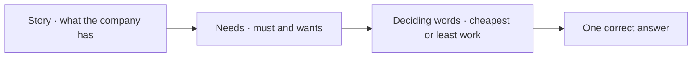

### 1.2 Deciding words

|Deciding words|Simple meaning|Right answers look like|Wrong answers look like|
|---|---|---|---|
|**LEAST operational overhead**|Least work for the team|Managed service, serverless, ready-made feature|Own scripts, cron jobs on EC2 (Elastic Compute Cloud) servers|
|**MOST cost-effective**|Cheapest answer that still meets **every** need|Spot, lifecycle rules, free gateway endpoints, serverless for up-and-down traffic|Extra servers, extra Regions nobody asked for|
|**MOST operationally efficient**|Same as least work|Services that already work together|Manual steps|
|**Highly available / fault tolerant**|Still works if one AZ (Availability Zone) fails|Multi-AZ, Auto Scaling across 2+ AZs, load balancer|One server, one AZ|
|**Disaster recovery / another Region**|Still works if a whole Region fails|Copies in a second Region|Multi-AZ only|
|**Lowest latency / global users**|Fast for users far away|CloudFront, Global Accelerator, caches, read replicas|A bigger server in one place|
|**No code change / minimal change**|Keep the app as it is|Same protocol in AWS, lift and shift|Rewrite the app|
|**Near real time**|Within seconds|Kinesis, EventBridge, S3 (Simple Storage Service) events|Nightly batch job|
|**Loosely coupled / decoupled**|Parts do not wait for each other|SQS (Simple Queue Service), SNS (Simple Notification Service), EventBridge|Direct calls between services|
|**MOST secure**|Smallest risk|IAM (Identity and Access Management) roles, private subnets, Session Manager|Access keys, public IP (Internet Protocol) addresses, open SSH (Secure Shell) port|

### 1.3 Ten golden rules

> 1. If AWS has a ready-made feature for the job, writing your own script (Lambda or a cron job) is wrong.
> 2. Roles (temporary keys) beat access keys (long-term passwords).
> 3. The answer must meet **all** needs. Missing one need makes it wrong.
> 4. Do not buy more than asked. "Highly available" does not need a second Region.
> 5. "Can stop and restart safely" → Spot. "Must not stop" → never Spot.
> 6. Traffic with no pattern → automatic scaling. Traffic at known times → scheduled scaling.
> 7. Look at the protocol: SMB (Server Message Block, Windows file sharing) → FSx for Windows. NFS (Network File System, Linux file sharing) → EFS (Elastic File System). iSCSI (Internet Small Computer Systems Interface, disks over the network) → Volume Gateway. UDP (User Datagram Protocol, fast game and voice traffic) → NLB (Network Load Balancer) or Global Accelerator. AMQP or MQTT (message protocols) → Amazon MQ.
> 8. "Prevent" → SCP (Service Control Policy), IAM, Object Lock. "Detect or alert" → Config, GuardDuty, CloudTrail, Macie.
> 9. A job longer than 15 minutes cannot run on Lambda.
> 10. Multi-AZ keeps you running when one AZ fails. A read replica makes reads faster. They are different tools.

### 1.4 Solving steps

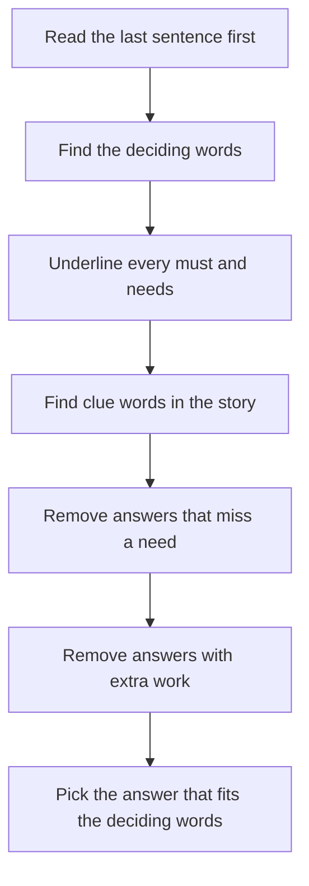

### 1.5 What to study first

|Area|Priority|Trend in recent questions|
|---|---|---|
|EC2 servers, Auto Scaling, load balancers|★★★|Stable|
|S3 storage classes, lifecycle, security, encryption|★★★|Rising|
|Lambda, API (Application Programming Interface) Gateway, SQS, SNS, EventBridge|★★★|EventBridge rising|
|RDS (Relational Database Service), Aurora, DynamoDB|★★★|Stable|
|VPC (Virtual Private Cloud) networking and hybrid links|★★★|Stable|
|IAM, Organizations, SCP, IAM Identity Center|★★★|Rising|
|Cost tools|★★|Rising fast|
|Systems Manager and automation|★★|Rising fast|
|Config, GuardDuty, Firewall Manager, CloudTrail|★★|Rising|
|Analytics: Athena, Redshift, Glue, Kinesis|★★|Rising|
|Backup and DR (Disaster Recovery)|★★|Stable|
|CloudFront, Global Accelerator, Route 53|★★|Stable|
|Containers: ECS (Elastic Container Service), EKS (Elastic Kubernetes Service), Fargate|★★|Falling|
|Hybrid storage: Storage Gateway, DataSync, FSx|★★|Stable|
|AI (Artificial Intelligence) services, Outposts|★|Low|

> With little time, learn every ★★★ area first. They cover most questions.

---

## 2. The Big Picture: One Request From Start to End

### 2.1 Where things live

- **Region**: a geographic area with AWS data centers, for example us-east-1.
- **AZ (Availability Zone)**: one or more separate data centers inside a Region. Each AZ has its own power and network.
- **Subnet**: one part of your private network, inside one AZ.

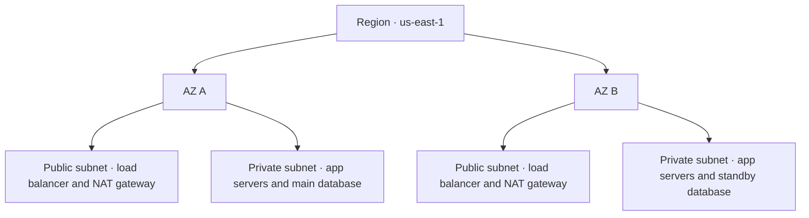

> Put a copy of everything in **two or more AZs**. If one AZ fails, the other keeps working. This is **high availability**.

|Scope|Services|Why it matters|
|---|---|---|
|Global|IAM (Identity and Access Management), Route 53, CloudFront, Organizations|One setup works in every Region|
|Regional|S3 (Simple Storage Service), DynamoDB, Lambda, SQS (Simple Queue Service), SNS (Simple Notification Service), VPC (Virtual Private Cloud)|AWS already spreads them over AZs|
|One AZ|EC2 (Elastic Compute Cloud) server, EBS (Elastic Block Store) disk, subnet, NAT (Network Address Translation) gateway, single RDS (Relational Database Service) instance|You must add copies in other AZs yourself|

### 2.2 The story of one web request

**Story:** Ana opens **shop.com** on her phone and buys shoes.

1. **Route 53** (DNS, Domain Name System) turns the name shop.com into an address.
2. The request reaches **CloudFront** (CDN, Content Delivery Network). **WAF** (Web Application Firewall) checks it for attacks.
3. Pictures and other static files come from an **S3 bucket**.
4. Other requests go to the **ALB** (Application Load Balancer). It picks a healthy server.
5. **EC2 servers in an Auto Scaling group** run the shop app. More servers start when traffic grows.
6. The app keeps login sessions in **ElastiCache** (fast memory cache) and orders in **RDS**.
7. Slow work, such as sending the receipt email, goes into an **SQS queue**. Background workers do it later.

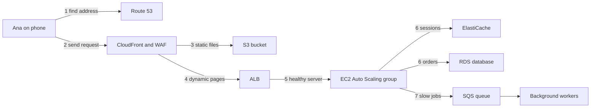

---

## 3. Compute: Servers, Auto Scaling, Lambda, Containers

**EC2 (Elastic Compute Cloud)** is a virtual server. **AMI (Amazon Machine Image)** is the template a server starts from.

### 3.1 EC2 buying options

Buying EC2 is like booking a hotel room. Follow the questions in the picture.

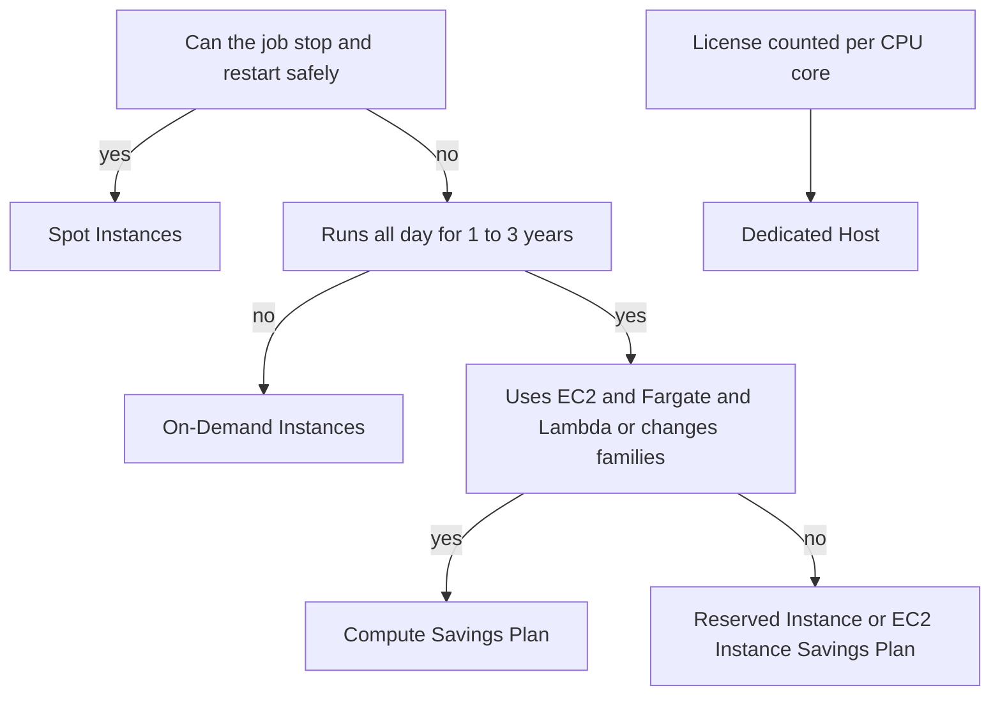

#### On-Demand Instances

- **Picture:** a walk-in hotel guest. Pay per night, leave any time.
- **Story:** A company starts a **new app**. Traffic is **unknown**. The servers **must not be interrupted**.
- **Answer:** On-Demand Instances.
- **Clue words:** short-term · unpredictable · new app · cannot be interrupted

#### Spot Instances

- **Picture:** a last-minute empty room at up to 90% off. The hotel can ask you to leave with **2 minutes' notice**.
- **Story:** Batch jobs run **every night**. If a job **fails, another server runs it again**. Jobs **save progress (checkpoints)** to S3 (Simple Storage Service).
- **Answer:** Spot Instances, best as a **Spot Fleet** with many instance types.
- **Clue words:** can be interrupted · retry · checkpoint · stateless · fault tolerant · MOST cost-effective

#### Reserved Instances and Savings Plans

- **Picture:** a 1-year or 3-year hotel contract. Big discount because you promise to stay.
- **Story:** The same web servers run **24 hours a day for years**.
- **Answer:** RI (Reserved Instance) or Savings Plan. If the company also uses **Fargate and Lambda**, or may **change instance family or Region**, choose a **Compute Savings Plan**.
- **Clue words:** steady · 24/7 · 1-year or 3-year · baseline load

#### Dedicated Host

- **Picture:** renting a whole hotel floor for yourself.
- **Story:** A software license is **counted per CPU (Central Processing Unit) core or socket**. The company wants to **bring its own license**.
- **Answer:** Dedicated Host.
- **Clue words:** BYOL (Bring Your Own License) · per-core · per-socket · own physical server

|More stories|Answer|
|---|---|
|Must be sure servers are **available in one AZ (Availability Zone)** for a big event, no long contract|On-Demand Capacity Reservation|
|Uses **SageMaker** (machine learning service) all the time|SageMaker Savings Plan|
|Cost Explorer shows **On-Demand usage beyond the RI coverage**|Buy more RI or Savings Plan coverage|
|Wants the **newest instance generation every year**, with a discount|Compute Savings Plan (not tied to one family)|

### 3.2 Auto Scaling

- **Picture:** a restaurant that calls more waiters when it gets busy and sends them home when it is quiet.
- **ASG (Auto Scaling group)**: a group of EC2 servers that grows and shrinks by itself.
- **Launch template**: the recipe for each new server (AMI, instance type, security group).

How a scale-out happens, step by step:

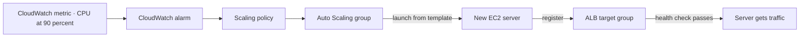

The life of one server, with the two "wait" points (lifecycle hooks):

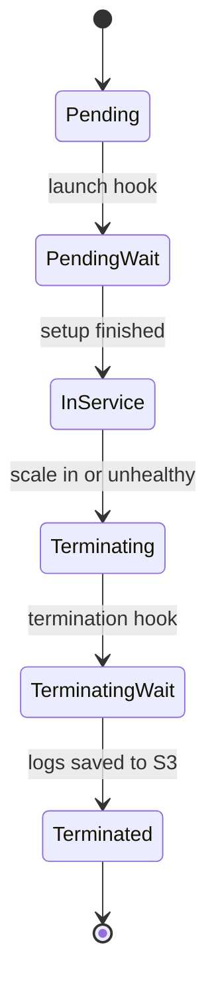

|Story|Answer|
|---|---|
|Traffic goes **up and down with no pattern**. CPU often reaches 95%.|**Target tracking** policy: keep average CPU near a target such as 50%|
|Traffic **jumps at 8:00 AM every weekday**. New servers need **15 minutes to warm up**.|**Scheduled scaling**: add servers a few minutes before 8:00 AM|
|App is used **only in business hours** and must not be interrupted then.|**Scheduled scaling**: scale out in the morning, scale in at night|
|The **same busy pattern repeats** every day and week.|**Predictive scaling** (learns from history)|
|Workers read jobs from an SQS (Simple Queue Service) queue and **jobs pile up**.|Scale on **queue size per server**|
|Servers take **a long time to start**.|**Warm pool** (servers prepared in advance)|
|Unhealthy servers are replaced and **the logs are lost**.|**Termination lifecycle hook** → EventBridge → Systems Manager Automation copies logs to S3|
|Roll out a **new AMI or new instance type** (m5 → m6i) with **no downtime**.|Update the launch template → **instance refresh** (minimum healthy 100%)|
|App returns errors, but EC2 says the server is fine. **Replace it**.|Use **ELB (Elastic Load Balancing) health checks** in the Auto Scaling group|

> Always spread the Auto Scaling group across **two or more AZs**.

### 3.3 More EC2 stories

|Story|Answer|
|---|---|
|HPC (High Performance Computing) app. Nodes talk a lot. Needs **lowest latency between servers**.|**Cluster placement group** in one AZ|
|A few **critical servers must not fail together**.|**Spread placement group**|
|Hadoop, Kafka or Cassandra cluster **spread over racks**.|**Partition placement group**|
|Dev servers hold **big data in memory (RAM, Random Access Memory)**. Stop them at night but **keep the memory**.|**Hibernate**, scheduled with EventBridge + Lambda|
|Hardware under the server fails. **Keep the same IP address and disks**.|CloudWatch alarm on **StatusCheckFailed_System** → **recover** action|
|50 accounts need the **same patched "golden" AMI every month**.|**EC2 Image Builder** pipeline, then share the AMI|
|Containers need a **GPU (Graphics Processing Unit)**.|ECS or EKS on **GPU EC2 instances** (Fargate and Lambda have no GPU)|
|Move a running server **to another subnet**.|Not possible. Launch new servers in the new subnet.|

### 3.4 Lambda

#### Lambda

- **Picture:** a taxi. You pay only for the ride. One ride lasts **at most 15 minutes**.
- **Story:** When a user **uploads a photo** to S3, make a **thumbnail**. Traffic is **spiky**. The company wants **no servers to manage**.
- **Answer:** S3 event → Lambda function.
- **Clue words:** event-driven · serverless · spiky traffic · pay per use · short task

Why the first request can be slow (cold start):

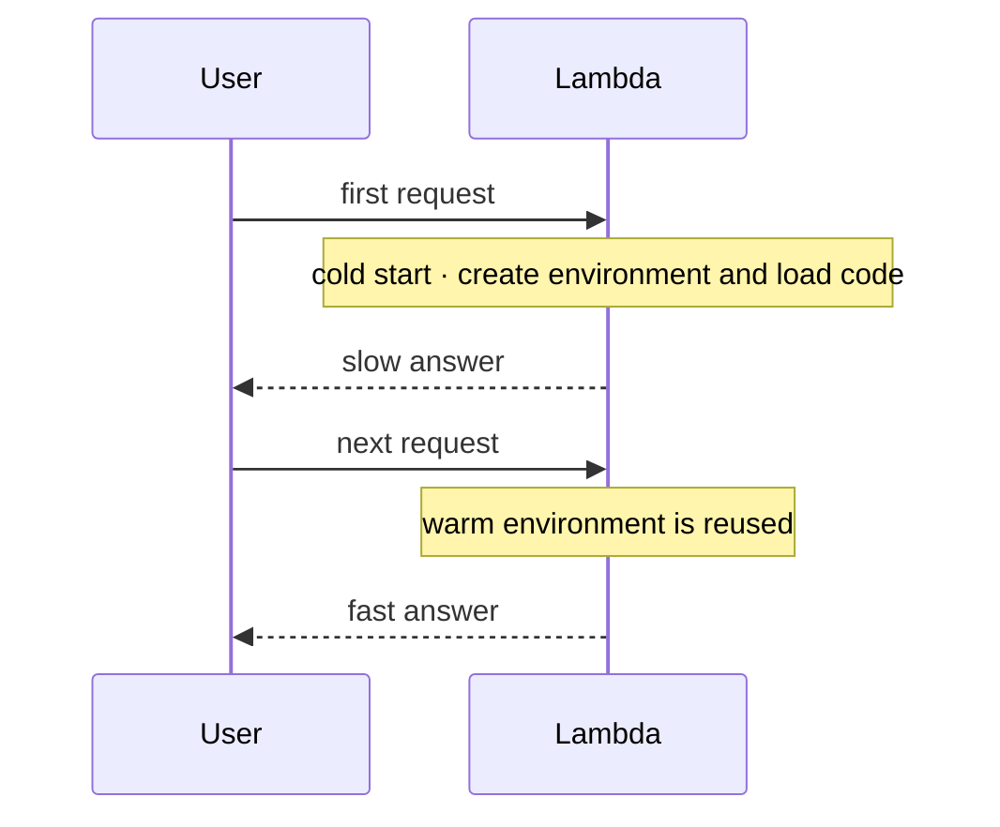

**Provisioned concurrency** keeps environments warm, so every answer is fast.

|Story|Answer|
|---|---|
|Traffic spikes cause **slow first requests (cold starts)**. Save money when traffic is low.|**Provisioned concurrency** + Application Auto Scaling|
|**Java** functions start slowly.|**SnapStart** (do not create unique IDs during start-up code)|
|One important function **must always have capacity**; others must not use it all.|**Reserved concurrency**|
|Many functions **share the same libraries**.|**Lambda layers**|
|A report takes **5–10 minutes**. An admin starts it with a link and **gets it by email**.|**Lambda function URL** (Uniform Resource Locator, a web address) + **SES** (Simple Email Service)|
|Lambda opens **too many database connections**.|**RDS (Relational Database Service) Proxy**|
|Lambda reads SQS and **some messages in a batch fail**.|**Partial batch response** + **DLQ** (Dead-Letter Queue)|
|Lambda must reach a **private database**.|Connect the Lambda function to the **VPC (Virtual Private Cloud)**|
|Must meet a speed target **at the lowest cost**.|Pick the **lowest memory** that meets the target (more memory = more CPU)|
|Secret values in **environment variables encrypted with KMS (Key Management Service)**.|Execution role allows `kms:Decrypt` **and** the KMS key policy allows the role|

> Lambda is wrong when the job runs **over 15 minutes**, needs a **GPU**, needs **OS (Operating System) control**, or runs heavy work **24/7**.

### 3.5 Containers

- **Picture:** a container is a lunch box. It holds the app and everything it needs, so it runs the same everywhere.

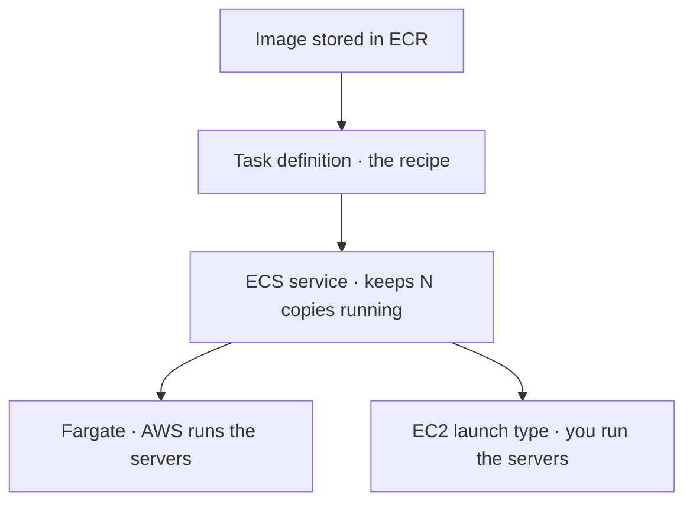

#### ECS (Elastic Container Service) on Fargate

- **Picture:** a car with a driver. You give the destination (the container). AWS drives (runs the servers).
- **Story:** Move a containerized app to AWS with **no servers to manage**. The containers need a **shared file system**.
- **Answer:** ECS on Fargate, plus **EFS (Elastic File System)** for shared files.
- **Clue words:** containers · serverless · least operational overhead

#### EKS (Elastic Kubernetes Service)

- **Picture:** the same car, but with the Kubernetes dashboard the team already knows.
- **Story:** The company **already uses Kubernetes** and wants to keep its tools.
- **Answer:** EKS.
- **Clue words:** Kubernetes · pods · already running K8s (Kubernetes)

|Story|Answer|
|---|---|
|Same container tool **on-premises and in the cloud**, with an HTTP (web traffic) load balancer|**ECS Anywhere** on-premises + **Fargate** in the cloud + **ALB (Application Load Balancer)**|
|Kubernetes on **own on-premises servers**, simpler management|**EKS Anywhere**|
|See **all Kubernetes clusters** (cloud and on-premises) in one place|**EKS Connector**|
|EKS microservices need **URL path routing**, cheapest|**AWS Load Balancer Controller** → ALB|
|Apps on the same host need **different permissions**; block the host's role|**One task IAM (Identity and Access Management) role per app**|
|Cheap containers that **can be stopped**|**Fargate Spot**|
|Store and scan container images|**ECR (Elastic Container Registry)**|
|Push to a new repository fails with "not authorized"|The **repository policy denies push**|
|Huge batch jobs that run for hours|**AWS Batch**|

Two different roles in ECS:

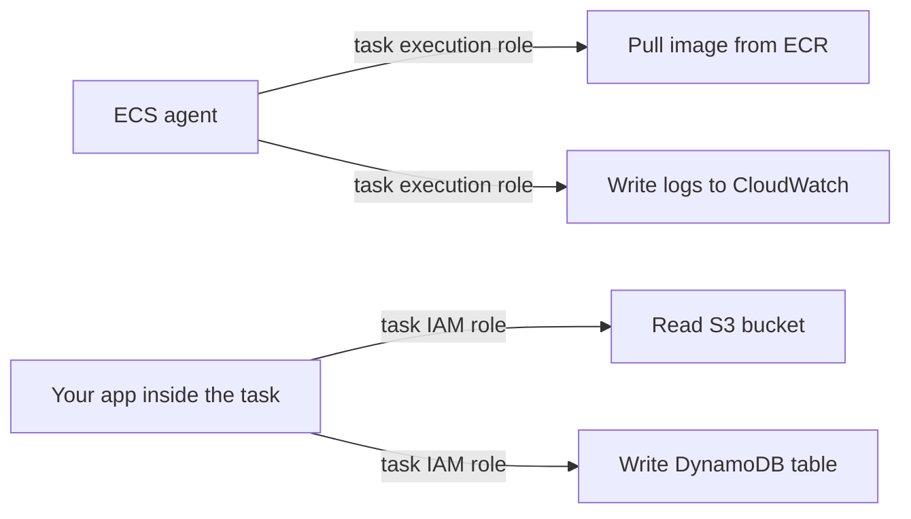

### 3.6 Which compute? Decision tree

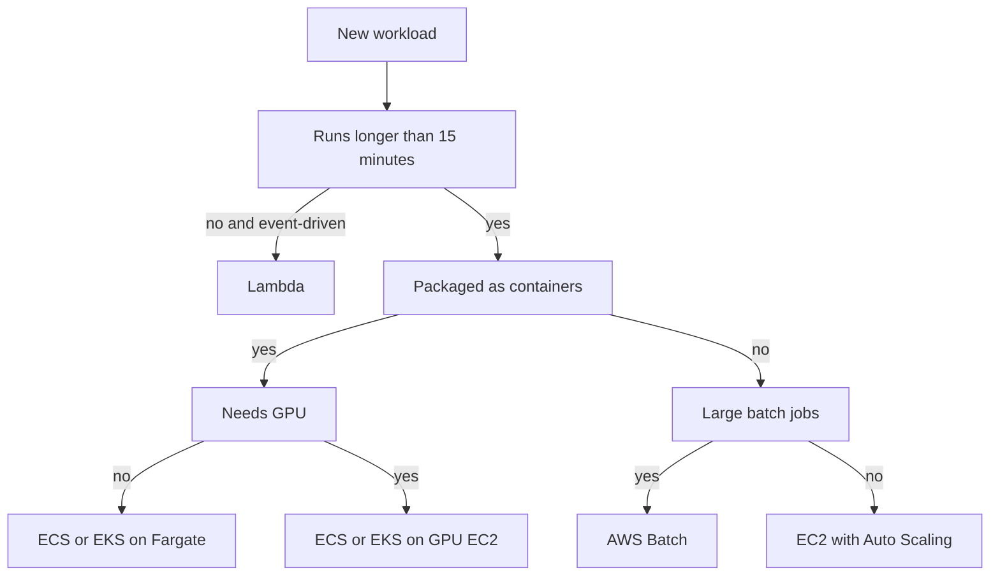

|Story|Answer|
|---|---|
|**Hundreds of cron jobs** of 1–20 minutes; some must run **at a future time**|**EventBridge Scheduler** → ECS tasks on Fargate|
|Multi-step process; **see each step visually**; **retry one step**|**Step Functions**|
|Classic web app, **deploy with almost no ops work**|**Elastic Beanstalk**|

---

## 4. Load Balancing, DNS and Edge

### 4.1 Load balancers

A load balancer receives all user traffic and shares it between healthy servers.

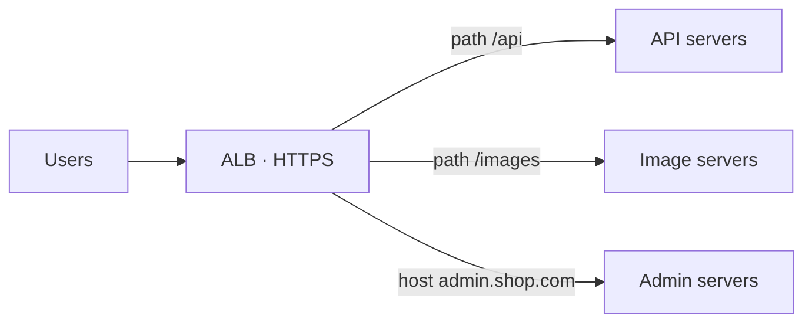

#### ALB (Application Load Balancer)

- **Picture:** a receptionist who **reads your letter** and sends you to the right department.
- **Story:** A web shop has **/orders and /products microservices**. It needs **HTTPS** (HyperText Transfer Protocol Secure), users who **stay on the same server after login**, and protection from **SQL (Structured Query Language) injection**.
- **Answer:** ALB with path routing, sticky sessions and WAF (Web Application Firewall).
- **Clue words:** HTTP/HTTPS · path-based · host-based · sticky sessions · WAF · mutual TLS (Transport Layer Security)

#### NLB (Network Load Balancer)

- **Picture:** a very fast toll gate. It reads only the address, not the letter.
- **Story:** An online game uses **UDP** (User Datagram Protocol). Customers must **allow-list fixed IP (Internet Protocol) addresses**.
- **Answer:** NLB (static IP address in each AZ, Availability Zone).
- **Clue words:** TCP (Transmission Control Protocol) · UDP · static IP · millions of requests per second · PrivateLink

#### GWLB (Gateway Load Balancer)

- **Picture:** airport security. Every bag goes through the scanner.
- **Story:** The security team must send **all traffic through its own firewall appliances**, also traffic **from other accounts**.
- **Answer:** GWLB + GWLB endpoints.
- **Clue words:** third-party appliance · deep packet inspection · inspect all traffic

|Story|Answer|
|---|---|
|Some servers are **overloaded with slow requests**. Send new requests to less busy servers.|ALB **least outstanding requests** algorithm|
|Users must **stay on the same server after login**, and the app needs protection from common attacks.|ALB **sticky sessions** + **WAF**|
|Client and server must **both prove identity with certificates**.|ALB **mutual TLS**, servers in private subnets|
|Route 53 sends users to **dead servers**. Also need **SSL (Secure Sockets Layer) termination**.|Put an **ALB with health checks** in front; Route 53 alias → ALB|
|Move traffic **slowly from the old fleet to the new fleet**.|ALB **weighted target groups**|
|Share an app **privately** with a customer VPC (Virtual Private Cloud), **hide your IP range (CIDR, Classless Inter-Domain Routing)**, keep path routing.|Internal ALB behind an NLB + **VPC endpoint service (PrivateLink)**|

How the private sharing works:

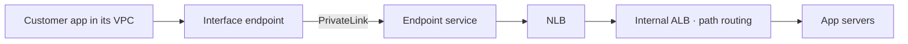

### 4.2 Route 53 (DNS)

- **Picture:** a phone book with smart rules. You ask for a name; it gives the best number.
- **DNS (Domain Name System)** turns a name like shop.com into an IP (Internet Protocol) address.

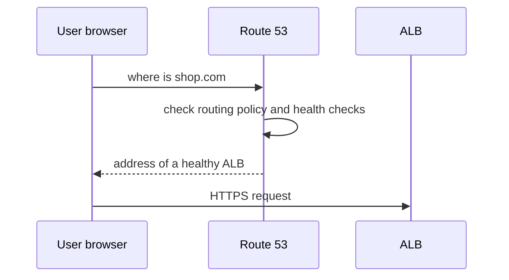

|Routing policy|Story|
|---|---|
|**Simple**|One website, one server group, no health checks|
|**Weighted**|Send **10% of users to the new version** to test it|
|**Latency**|Users in Asia and the US; send each user to the **fastest Region**|
|**Failover**|Main site in us-east-1; **backup site** in us-west-2 when the main one fails|
|**Geolocation**|German users **must see the German site** (law or language)|
|**Geoproximity**|Send users to the **nearest** place; move more traffic to one Region with a "bias"|
|**Multivalue answer**|Video app wants the **IP addresses of all healthy servers** so the client can pick|
|**IP-based**|Users from a **partner's network** go to a special endpoint|

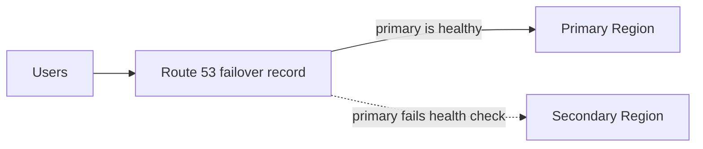

|More DNS stories|Answer|
|---|---|
|Point the root name **shop.com** to CloudFront or an ALB, free|**Alias record**|
|Names must work **only inside the company VPC**|**Private hosted zone**|
|**On-premises DNS servers** must find names inside the VPC|Route 53 Resolver **inbound endpoint**|
|**Servers in the VPC** must find on-premises names|Route 53 Resolver **outbound endpoint** + forwarding rule|
|**100 VPCs** need the same DNS settings|**Route 53 Profiles**|

Which direction uses which endpoint:

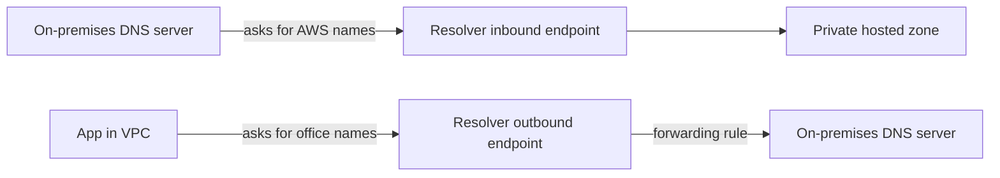

> Remember: **IN**bound = traffic comes **IN** to AWS from the office. **OUT**bound = AWS goes **OUT** to the office.

### 4.3 CloudFront

- **Picture:** shop branches near customers. Each branch keeps copies of popular items, so customers do not travel to the main warehouse.
- **CDN (Content Delivery Network)** = this network of nearby copies.

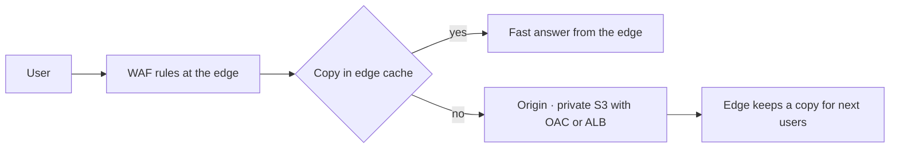

|Story|Answer|
|---|---|
|**Static website** for users **all over the world**, fast and highly available|S3 (Simple Storage Service) bucket + **one CloudFront distribution** + Route 53 alias|
|S3 bucket must **stay private**; only CloudFront may read it|**OAC (Origin Access Control)**|
|Users in **some countries must not download** files|CloudFront **geographic restriction**|
|Only **paying (premium) users** can watch|**Signed URLs** (Uniform Resource Locators: special web links, one file each) or **signed cookies** (many files)|
|HTTP requests must be **turned into HTTPS automatically**|Viewer protocol policy: **Redirect HTTP to HTTPS**|
|**Inspect all traffic** for attacks|Attach **WAF** to the distribution|
|**Resize images on demand**; serve **WebP or JPEG** based on the browser|**Lambda@Edge** with an image library|
|Small header or URL change, very fast and cheap|**CloudFront Functions**|
|Show **different content per country**|Use the viewer-country header in the cache key|
|HTTPS certificate for CloudFront|**ACM (AWS Certificate Manager)** certificate in **us-east-1**|

> An S3 bucket policy with `aws:SecureTransport` can only **block** HTTP. It cannot **turn** HTTP into HTTPS. CloudFront can.

### 4.4 Global Accelerator

#### Global Accelerator

- **Picture:** a private express highway into AWS with **two fixed entry gates**.
- **Story:** An online game uses **UDP**. Players are **worldwide**. The company needs **fixed IP addresses** and **fast failover between Regions**, without problems from **DNS caching** on phones.
- **Answer:** Global Accelerator with the NLBs as endpoints.
- **Clue words:** static IP · TCP/UDP · gaming · VoIP (Voice over IP) · fast Regional failover

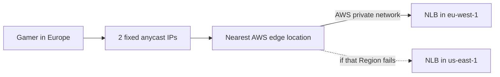

| |**CloudFront**|**Global Accelerator**|
|---|---|---|
|Picture|Shop branches with copies|Express highway with 2 fixed gates|
|Keeps copies (cache)|Yes|No|
|Traffic type|HTTP, HTTPS|TCP, UDP|
|IP addresses|Change|**2 static IPs**|
|Best for|Websites, video, APIs (Application Programming Interfaces)|Games, voice calls, IoT (Internet of Things), fixed IPs|

---

## 5. Storage

### 5.1 Three kinds of storage

- **Block storage** = a hard disk for one server. **EBS (Elastic Block Store)**.
- **File storage** = a shared folder many servers open at once. **EFS (Elastic File System)** and the **FSx** family (AWS-managed file systems).
- **Object storage** = a huge warehouse of labeled boxes, reached over the internet. **S3 (Simple Storage Service)**.

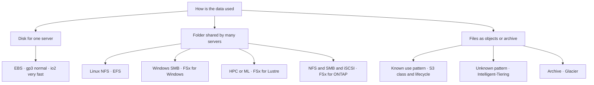

#### EBS (Elastic Block Store)

- **Picture:** a USB hard drive plugged into **one computer**, in one AZ (Availability Zone).
- **Story:** A database on **one EC2 (Elastic Compute Cloud) server** needs a disk with **steady, fast speed**. Data must **survive a stop**.
- **Answer:** EBS volume (gp3 for normal use, io2 for very high speed).
- **Clue words:** block storage · one instance · IOPS (Input/Output Operations Per Second) · boot disk

#### Instance store

- **Picture:** scratch paper. Fast, but thrown away when the server stops.
- **Story:** Temporary cache files; the **fastest** disk; **losing the data is fine**.
- **Answer:** Instance store.
- **Clue words:** temporary · scratch · lost on stop

#### EFS (Elastic File System)

- **Picture:** a shared Linux folder on the office network.
- **Story:** Two servers in two AZs **show different versions of the same file**, and users get **404 errors**.
- **Answer:** Move the files to EFS, mounted on all servers.
- **Clue words:** shared · Linux · NFS (Network File System) · many servers · auto-grows

#### FSx for Windows File Server

- **Picture:** the Windows shared drive `\\server\share`.
- **Story:** A **Windows** app needs a **shared, resilient** drive over **SMB** (Server Message Block) with **AD (Active Directory)** users.
- **Answer:** FSx for Windows File Server, **Multi-AZ** deployment.
- **Clue words:** Windows · SMB · Active Directory · NTFS (Windows file system format)

#### FSx for Lustre

- **Picture:** a racing-car file system connected to S3.
- **Story:** An **ML (Machine Learning)** training cluster loads **terabytes from S3**. The **GPUs sit idle** waiting for data.
- **Answer:** FSx for Lustre, linked to S3 (data repository association).
- **Clue words:** HPC (High Performance Computing) · ML training · high throughput · S3 integration

#### FSx for NetApp ONTAP and FSx for OpenZFS

- **Story (ONTAP):** One storage must serve **NFS + SMB + iSCSI** together, or the team uses **NetApp** features.
- **Story (OpenZFS):** A **Unix/Linux** app needs **many fast snapshots and clones** for testing, at low cost.

### 5.2 EBS volume types

|Story|Answer|
|---|---|
|Normal app disk, best price|**gp3** (General Purpose SSD, Solid State Drive)|
|Old **gp2** disks; **cut cost, same speed, no downtime**|Change to **gp3** with Elastic Volumes|
|Database needs **sub-millisecond latency** and **very high steady IOPS** (32,000 or more)|**io2 Block Express** (Provisioned IOPS SSD)|
|Several servers in **one AZ attach the same disk**|**io1/io2 Multi-Attach**|
|**Big log files read in order**, cheap|**st1** (Throughput Optimized HDD, Hard Disk Drive)|
|Rarely used data, **cheapest disk**|**sc1** (Cold HDD)|
|**Encrypt every new disk** automatically|**EBS default encryption**|
|Daily snapshots, **copied to another Region**|**Data Lifecycle Manager** or **AWS Backup**|

### 5.3 S3 storage classes

- **Picture:** a shop. The front shelf holds what people buy daily. The back room, the basement and a deep cave hold older stock. Further away = cheaper, but slower to bring back.

A typical life of one file, moved by **lifecycle rules**:

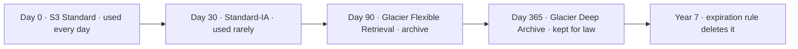

|Class|Story|Get data back in|Minimum days|
|---|---|---|---|
|**S3 Standard**|Photos **used every day**|Instant|—|
|**S3 Intelligent-Tiering**|**Nobody knows** how often data is used|Instant|—|
|**S3 Standard-IA** (Infrequent Access)|Old files **used rarely**, but must **open instantly**|Instant|30|
|**S3 One Zone-IA**|Rarely used copies you **can create again**|Instant|30|
|**S3 Express One Zone**|**Fastest** storage for heavy jobs in one AZ|Single-digit milliseconds|—|
|**Glacier Instant Retrieval**|Medical images opened **about once a quarter**, needed at once|Milliseconds|90|
|**Glacier Flexible Retrieval**|Archive; can **wait some hours**|1–5 minutes (expedited) up to 12 hours|90|
|**Glacier Deep Archive**|Keep **7–10 years** for law; can **wait a day or two**|12–48 hours|180|

Lifecycle rules can also:

- **Abort incomplete multipart uploads** (hidden cost from broken uploads).
- **Expire old versions** of objects to control versioning cost.

### 5.4 Protecting S3 data

|Story|Answer|
|---|---|
|Users **overwrote files by mistake**; get the old version back|**Versioning**|
|Financial records: **nobody, not even the root user, may delete or change** them for 7 years|**Object Lock, compliance mode**|
|Block deletes, but **some admins may remove** the lock|**Object Lock, governance mode**|
|Keep emails **exactly 12 months**, then **delete automatically**|Object Lock + lifecycle **expiration** after 12 months|
|Every document, **old and new**, must exist **in two Regions**|**Cross-Region Replication** (new objects) + **S3 Batch Replication** (existing objects)|
|Researchers download big datasets; **they should pay the download cost**|**Requester Pays**|
|Give a partner a **temporary download link**; the partner has **no AWS account**|**Presigned URL**|
|Each partner may use **only its own folder (prefix)**, only **from a shared VPC**|**One S3 Access Point per partner**|
|Find buckets with **no versioning, no lifecycle rules, or wasted space**, in **all accounts**|**S3 Storage Lens**|
|Uploads from **far countries are slow**|**Transfer Acceleration** (+ multipart upload)|
|**Very high write rate** to one bucket|Use **more prefixes** (each prefix handles about 3,500 writes per second)|
|**Run code when a file arrives**|**S3 Event Notification** → Lambda or SQS|
|Find **PII (Personally Identifiable Information)**, such as names and card numbers, in buckets|**Macie**|
|Know the **exact dollar cost of each bucket**|**CUR (Cost and Usage Report)** with resource IDs|

### 5.5 S3 encryption

|Story|Answer|
|---|---|
|Simple default encryption|**SSE-S3** (Server-Side Encryption with S3-managed keys)|
|Must **control and audit** the key|**SSE-KMS** (Server-Side Encryption with KMS, Key Management Service, keys)|
|**KMS bill is high** because millions of objects are read|**S3 Bucket Key** with SSE-KMS|
|Rules demand **two layers** of encryption|**DSSE-KMS** (Dual-layer Server-Side Encryption with KMS)|
|Company must **keep its own keys outside AWS** and send them with each request|**SSE-C** (Server-Side Encryption with Customer-provided keys)|
|Partners must **never see the data before the company encrypts it**|**Client-side encryption** (encrypt before upload)|
|All downloads must use **HTTPS** (secure web traffic), and HTTP must be **turned into HTTPS**|**CloudFront** redirect HTTP → HTTPS|

Why the Bucket Key saves money:

```mermaid
flowchart LR
    APP["App reads 1 million objects"] --> S3["S3 with SSE-KMS"]
    S3 -- "no Bucket Key · one KMS call per object" --> K1["KMS · high bill"]
    S3 -- "with Bucket Key · few KMS calls" --> K2["KMS · low bill"]
```

### 5.6 Hybrid storage and moving data

```mermaid
flowchart LR
    subgraph OFFICE["On-premises office"]
        NFSAPP["App writes to NFS share"]
        DBISCSI["Database on iSCSI disks"]
        BKP["Backup software writes tapes"]
        FS["File server"]
    end
    NFSAPP --> FGW["S3 File Gateway"] --> S3A["S3 bucket"]
    DBISCSI --> VGW["Volume Gateway"] --> S3B["S3 and EBS snapshots"]
    BKP --> TAPE["Tape Gateway"] --> GL["S3 Glacier"]
    FS -- "DataSync agent" --> DST["S3 or EFS or FSx"]
```

|Story|Answer|
|---|---|
|Legacy app writes files to an **NFS share every night**; a new AWS app needs them; **minimal change**|**S3 File Gateway**|
|Back up office **NFS** files to S3; **archive after 5 days**; can **wait days** to restore|S3 File Gateway + lifecycle to **Deep Archive**|
|**iSCSI** (Internet Small Computer Systems Interface) storage; keep **recent data local**, old data in the cloud|**Volume Gateway, cached mode**|
|iSCSI; **all data must stay local**, backup copy in AWS|**Volume Gateway, stored mode**|
|Backup software writes to a **tape library**|**Tape Gateway**|
|Copy office NFS files to EFS **every night over Direct Connect**|**DataSync** (agent + private VIF, Virtual Interface + interface endpoint)|
|Partners send files with **SFTP (SSH File Transfer Protocol) or FTP (File Transfer Protocol)**|**Transfer Family** → S3|
|**500 TB (terabytes)**, slow internet|**Snowball Edge** (shipped device)|

---

## 6. Databases

### 6.1 Which database?

|Story|Answer|
|---|---|
|Orders, customers, **joins, SQL (Structured Query Language)**|**RDS (Relational Database Service)** or **Aurora**|
|Shopping cart for **millions of users**, **key-value**, single-digit millisecond speed|**DynamoDB**|
|DynamoDB reads must take **microseconds**|**DAX (DynamoDB Accelerator)**|
|Keep **login sessions**, **leaderboards**, cache slow queries|**ElastiCache** (Redis OSS, open-source Redis)|
|Find **fraud rings**: links between accounts, cards and devices|**Neptune** (graph database)|
|App uses **MongoDB**|**DocumentDB**|
|App uses **Cassandra**|**Keyspaces**|
|**Sensor readings over time**|**Timestream**|
|**Complex reports**, joins over years of data, **BI (Business Intelligence)**|**Redshift** (data warehouse)|
|**Search text and logs**|**OpenSearch Service**|
|**Occasional SQL on files in S3** (Simple Storage Service)|**Athena** (query tool, not a database)|

### 6.2 RDS: Multi-AZ, read replicas and RDS Proxy

- **Multi-AZ picture:** a spare tire. It is only used when the main tire fails. You cannot drive on it at the same time.
- **Read replica picture:** photocopies of a book, so many people can read at once.

```mermaid
flowchart LR
    APP["App writes and reads"] --> P["Primary DB · AZ A"]
    P -- "synchronous copy" --> SB["Standby · AZ B · no reads"]
    P -- "asynchronous copy" --> RR["Read replica · open for reads"]
    REP["Reports and read traffic"] --> RR
    SB -.->|"takes over if primary fails"| NP["New primary"]
```

#### Multi-AZ (Availability Zone) deployment

- **Story:** The production database **must keep running if one AZ fails**, with **automatic failover**.
- **Answer:** RDS Multi-AZ.
- **Clue words:** highly available · automatic failover · standby

#### Read replica

- **Story:** **Reports slow down** the shop database. Reports need **near real-time data** and must work **even if the primary is offline**.
- **Answer:** Add a read replica; point reports to the replica endpoint.
- **Clue words:** read-heavy · reports · analytics queries · offload reads

#### RDS Proxy

- **Picture:** a receptionist who keeps a few phone lines open and shares them with many callers.
- **Story:** Lambda traffic spikes open **thousands of database connections**. The database fails with **"too many connections"**.
- **Answer:** RDS Proxy between Lambda and the database.
- **Clue words:** too many connections · Lambda · connection pooling · faster failover

```mermaid
flowchart LR
    L1["Lambda"] --> PX["RDS Proxy · shares connections"]
    L2["Lambda"] --> PX
    L3["Lambda"] --> PX
    PX -- "a few steady connections" --> DB["RDS or Aurora"]
```

|More RDS stories|Answer|
|---|---|
|An existing database is **not encrypted**|Snapshot → **copy the snapshot with encryption** → restore a new DB|
|**Alert** if any unencrypted database appears in the future|**AWS Config** rule → EventBridge → SNS (Simple Notification Service)|
|Give an **auditor account** an encrypted backup|**Customer managed KMS (Key Management Service) key**; allow the auditor account in the **key policy**; share the snapshot|
|Each account may **decrypt only its own** snapshots|One KMS key per account; each key policy allows only that account's role|
|**Encrypt data in transit** to the database|Download the AWS **certificate bundle**; use SSL/TLS (Secure Sockets Layer / Transport Layer Security) in the connection string|
|**No passwords** stored in the app|**IAM (Identity and Access Management) database authentication**|
|Change the database password **every 30 days automatically**|**Secrets Manager** automatic rotation|
|**Upgrade the DB version**, test first, almost **no downtime**, **no data loss**|**RDS Blue/Green Deployments**|
|Keep backups **1 year or 7 years**|**AWS Backup** plan (automatic RDS backups keep at most 35 days)|
|DB is used **one week, four times a year**|Snapshot and delete; restore before the next use (a stopped DB restarts after 7 days)|
|PostgreSQL connections fail during an **unpredictable** sale|**Aurora Serverless v2**|

How Blue/Green works:

```mermaid
flowchart LR
    APP["App"] -- "today" --> BLUE["Blue DB · current version"]
    BLUE -- "copies every change" --> GREEN["Green DB · new version"]
    TEAM["Team tests Green"] --> GREEN
    APP -.->|"after switchover · about 1 minute"| GREEN
```

### 6.3 Aurora

#### Aurora Global Database

- **Picture:** a live mirror of the database in another country.
- **Story:** A bank database runs in us-east-1. It must **recover in another Region within 5 minutes** and **lose at most 1 minute of data**.
- **Answer:** Aurora Global Database (RPO, Recovery Point Objective, about 1 second; RTO, Recovery Time Objective, about 1 minute).
- **Clue words:** another Region · RPO in seconds · RTO in minutes · global reads

```mermaid
flowchart LR
    W["Writer · us-east-1"] -- "storage copy in under 1 second" --> R["Readers · us-west-1"]
    U1["East users read and write"] --> W
    U2["West users read"] --> R
    R -.->|"promote if us-east-1 fails"| NW["New writer"]
```

|More Aurora stories|Answer|
|---|---|
|Scale reads; fast failover inside the Region|**Aurora Replicas** (up to 15) + reader endpoint|
|Load is **spiky or unpredictable**; pay only for use|**Aurora Serverless v2**|
|Move from **SQL Server** to Aurora PostgreSQL with **minimal code change**|**Babelfish** for Aurora PostgreSQL|
|Run analytics on live data **without building pipelines**|**Zero-ETL** (Extract, Transform, Load) integration to Redshift|

### 6.4 DynamoDB

```mermaid
flowchart LR
    APP["App"] --> DAX["DAX cache · microseconds"]
    DAX --> T["DynamoDB table"]
    T -- "item changes" --> ST["DynamoDB Streams"]
    ST --> L["Lambda · archive or notify"]
    T -- "TTL deletes expired items" --> ST
    T -- "Global Tables copy" --> T2["Same table in another Region"]
```

|Story|Answer|
|---|---|
|Social app gets **sudden huge write spikes**; respond in the **shortest time**|**On-demand** capacity mode|
|**Steady, predictable** traffic; lower cost|**Provisioned** capacity + auto scaling|
|**Read-heavy**, "throughput exceeded" errors, need **microseconds**|**DAX**|
|**Delete expired items automatically** with the least code, and **archive** them|**TTL (Time To Live)** + Streams + Lambda|
|A user asks to **delete their data within a month**|Set a **TTL** on that user's items|
|**Global users**, low latency, many Regions, **track changes**|**Global Tables** + Streams|
|A function makes **many small queries one after another** and is slow|**BatchGetItem** (one call for many items)|
|Show "**most bids in the last 24 hours**" in near real time **without slowing the table**|Kinesis Data Streams for DynamoDB → **Managed Service for Apache Flink**|
|**Undo bad writes**|**PITR (Point-In-Time Recovery)**|

### 6.5 Database migration

```mermaid
flowchart LR
    SRC["Source DB · Oracle on-premises"] -- "1 convert tables and code" --> SCT["Schema Conversion"]
    SCT --> TGT["Target · Aurora PostgreSQL"]
    SRC -- "2 DMS full load then CDC" --> TGT
```

|Story|Answer|
|---|---|
|MySQL → RDS MySQL (**same engine**)|**DMS** (Database Migration Service)|
|Oracle → Aurora PostgreSQL (**different engine**)|**SCT (Schema Conversion Tool) / DMS Schema Conversion** + DMS|
|Old database **keeps running**; copy **ongoing changes** during migration|DMS with **CDC (Change Data Capture)**|
|SQL Server app → Aurora PostgreSQL, **almost no code change**|**Babelfish**|
|Oracle; many reports slow it; **no rewrite**; **less management**|**RDS for Oracle** + read replicas|
|Move **whole servers as they are**|**MGN (Application Migration Service)**|

---

## 7. Connecting App Parts: Queues, Topics and Events

Three basic patterns: a queue (SQS, Simple Queue Service), a fan-out (SNS, Simple Notification Service) and an event bus (EventBridge). Learn the picture of each one.

**Queue:** one message, one worker.

```mermaid
flowchart LR
    WEB["Website"] -- "send order" --> Q["SQS queue"]
    Q -- "pull when free" --> W1["Worker 1"]
    Q -- "pull when free" --> W2["Worker 2"]
    Q -- "fails many times" --> DLQ["Dead-letter queue"]
    QL["Queue length metric"] --> ASG["Auto Scaling adds workers"]
```

**Fan-out:** one message, many receivers.

```mermaid
flowchart LR
    ORD["Order service"] --> SNS["SNS topic"]
    SNS --> K1["SQS · shipping"]
    SNS --> K2["SQS · billing"]
    SNS --> LE["Lambda · send email"]
```

**Event bus:** route each event by its content.

```mermaid
flowchart LR
    S1["AWS services"] --> BUS["EventBridge event bus"]
    S2["Your apps"] --> BUS
    S3["SaaS apps"] --> BUS
    BUS -- "rule · type is OrderPlaced" --> T1["Lambda"]
    BUS -- "rule · amount over 1000" --> T2["Step Functions"]
    BUS -- "rule · source is partner" --> T3["SQS queue"]
```

### 7.1 Story cards

#### SQS (Simple Queue Service)

- **Picture:** a waiting line at a bank counter.
- **Story:** An online shop gets a **sudden rush** of orders on sale day. The order system is slow. **No order may be lost.**
- **Answer:** Put an SQS queue between the website and the order workers.
- **Clue words:** buffer · decouple · sudden spikes · "no requests lost" · unlimited throughput

#### SQS FIFO (First-In-First-Out) queue

- **Picture:** a single line where nobody can skip ahead, and each person is served once.
- **Story:** Microservices send payment steps. Each step must run **exactly once** and **in the exact order** it was sent.
- **Answer:** SQS FIFO queue.
- **Clue words:** exactly once · in order · no duplicates

#### SNS (Simple Notification Service)

- **Picture:** a loudspeaker. Everyone who subscribed hears the message at the same time.
- **Story:** When an order is placed, **shipping, billing and email all must know**. New receivers will be added later **without changing the sender**.
- **Answer:** SNS topic (often with SQS queues as subscribers: "fan-out").
- **Clue words:** fan-out · notify many · push · email or SMS alerts · message filtering
- **Extra stories:** each seller must get **only their own** updates → SNS **message filtering**. Events must reach many subscribers **in order** → **SNS FIFO** topic.

#### EventBridge

- **Picture:** a smart post office. It reads each letter and sends it to the right desk.
- **Story:** Many teams' services **send and receive events** independently. All events must follow **one shared format (schema)**. Route by **content**.
- **Answer:** EventBridge with rules and the schema registry.
- **Clue words:** event-driven · route by content · schema · SaaS (Software as a Service) events · cross-account

#### EventBridge Pipes, Scheduler and API destinations

- **Pipes story:** Keep requests for **2 days**, **transform** them, then send them to an **approval workflow** → SQS (retention 2 days) + **EventBridge Pipes** → Step Functions.
- **Scheduler story:** **Hundreds of cron jobs**, also jobs that must run **at a future time** → **EventBridge Scheduler**.
- **API destinations story:** Send orders to an outside system like **Salesforce** that uses **OAuth** (Open Authorization) → **EventBridge API destination**.

#### Amazon MQ

- **Picture:** the same post office brand you already use, in a new building.
- **Story:** An existing app talks with **AMQP (Advanced Message Queuing Protocol)**. Move it to AWS **without code change**.
- **Answer:** Amazon MQ.
- **Clue words:** AMQP · MQTT (Message Queuing Telemetry Transport) · JMS (Java Message Service) · ActiveMQ · RabbitMQ

#### Step Functions

- **Picture:** a recipe card with numbered steps, checks and "try again" notes.
- **Story:** A recovery process has steps: stop the failed server, move its disk, attach it to a standby. The team wants a **visual view**, **retry of one step only**, and **history** of every run.
- **Answer:** Step Functions (started by EventBridge).
- **Clue words:** workflow · orchestrate · visual · retry a step · human approval

```mermaid
flowchart TD
    ST["Start"] --> A["Stop failed server"]
    A --> B["Detach disk"]
    B --> C["Attach disk to standby"]
    C --> D{"Did it work"}
    D -- "no" --> R["Retry this step only"]
    R --> C
    D -- "yes" --> FIN["Finish and save history"]
```

### 7.2 SQS problems and fixes

Why duplicates happen (visibility timeout):

```mermaid
sequenceDiagram
    participant Q as SQS queue
    participant A as Worker A
    participant B as Worker B
    A->>Q: receive message
    Note over Q: message hidden for the visibility timeout
    Note over A: work takes longer than the timeout
    Note over Q: timeout ends so the message shows again
    B->>Q: receive the same message
    Note over A,B: both write to the database so rows are duplicated
```

|Problem|Fix|
|---|---|
|Message processed twice; **duplicate database rows**|**Raise the visibility timeout** above the work time|
|Paying for **many empty receives** at night|**Long polling** (wait up to 20 seconds)|
|One bad message **fails again and again**|**DLQ (Dead-Letter Queue)**|
|Workers **cannot keep up**|Auto Scaling on **queue length per worker**|
|Lambda batch **partly fails**|**Partial batch response** + DLQ|
|Keep messages for some days|**Retention period** (default 4 days, maximum 14 days)|

### 7.3 API Gateway

```mermaid
flowchart LR
    C["Mobile or web client"] --> AG["API Gateway · login check · rate limit · cache"]
    AG -- "check token" --> COG["Cognito user pool"]
    AG --> L["Lambda"]
    L --> DB["DynamoDB"]
```

|Story|Answer|
|---|---|
|Microservices need **REST APIs** (web APIs), **auto scaling**, **client access control** and **rate limiting**, least work|**API Gateway + Lambda** with usage plans and throttling|
|Users log in with **Google or Facebook** (social IdP, Identity Provider)|**Cognito user pool** + API Gateway authorizer|
|**Custom login check** using a header|**Lambda authorizer**|
|Block **SQL (Structured Query Language) injection** on the API|**WAF (Web Application Firewall)** on the API Gateway REST API|
|API may be called **only from inside the VPC** (Virtual Private Cloud)|**Private API** + interface VPC endpoint|
|HTTP API must reach **EKS (Elastic Kubernetes Service) services in private subnets**|**VPC link** to an internal ALB (Application Load Balancer)|
|**Two-way chat** app|**WebSocket API**|
|Work takes **minutes**|Answer fast and work **in the background** (SQS or Step Functions); API Gateway waits only about **29 seconds** by default|

### 7.4 Upload-and-process pattern

```mermaid
flowchart LR
    U["User upload"] --> S3["S3 bucket"]
    S3 -- "event notification" --> Q["SQS queue"]
    Q --> L["Lambda worker"]
    L --> DB["DynamoDB"]
    L --> N["SNS tells the user"]
```

> Put a **queue between the sender and the worker**. If the worker is slow or fails, nothing is lost.

---

## 8. Networking: VPC and Hybrid Links

- **Picture:** a **VPC (Virtual Private Cloud)** is your own private building inside AWS. **Subnets** are rooms. **Route tables** are signboards that say where each path goes. The **internet gateway** is the front door. The **NAT (Network Address Translation) gateway** is an exit-only door.

### 8.1 Inside one VPC

```mermaid
flowchart TB
    NET["Internet"] <--> IGW["Internet gateway"]
    subgraph VPC["VPC · your private network"]
        subgraph PUB["Public subnet"]
            ALB["ALB"]
            NAT["NAT gateway"]
        end
        subgraph PRI["Private subnet"]
            APP["App servers"]
        end
        subgraph DBS["Private database subnet"]
            RDS["RDS"]
        end
    end
    IGW --> ALB
    ALB --> APP
    APP --> RDS
    APP -- "outbound only" --> NAT
    NAT --> IGW
```

Read the picture in order:

1. **Inbound:** user → internet gateway → ALB (Application Load Balancer) in the public subnet → app servers in the private subnet → database.
2. **Outbound** (for example, downloading patches): app server → NAT gateway → internet gateway → internet.
3. Nobody on the internet can **start** a connection to the app servers.

|Story|Answer|
|---|---|
|A web server in a **private subnet**; **internet users cannot reach it**|**Internet-facing ALB in a public subnet**; the server stays private|
|Private servers must **download patches**; **no inbound** from the internet; **highly available**|**One NAT gateway per AZ** (Availability Zone) in public subnets + one route table per private subnet|
|**IPv6** (Internet Protocol version 6) servers need **outbound only**|**Egress-only internet gateway**|
|The database must accept traffic **only from the app servers**|DB security group allows the **app security group** as the source|
|**Block one bad IP (Internet Protocol) range**|**Network ACL** (Access Control List) **deny** rule|
|Record **who talks to whom** (IP traffic)|**VPC Flow Logs**|

Two guards, two jobs:

```mermaid
flowchart LR
    IN["Incoming traffic"] --> NACL["Network ACL · gate of the subnet · allow and deny · checks both ways"]
    NACL --> SG["Security group · door of the server · allow only · remembers replies"]
    SG --> EC2["EC2 server"]
```

- **Security group** = a guard at each server's door with a guest list. **Allow rules only.** It **remembers** who came in, so replies go out automatically (**stateful**).
- **Network ACL** = a guard at the subnet gate. **Allow and deny** rules. It checks **both directions every time** (**stateless**).

### 8.2 VPC endpoints: reach AWS services privately

```mermaid
flowchart LR
    EC2["EC2 in private subnet"] -- "route table entry" --> GE["Gateway endpoint · free"]
    GE --> S3["S3 or DynamoDB"]
    EC2 --> IE["Interface endpoint · private IP · paid"]
    IE --> SVC["SQS · ECR · CloudWatch · SSM · KMS"]
```

|Story|Answer|
|---|---|
|Private EC2 (Elastic Compute Cloud) server needs S3 (Simple Storage Service), **no internet**, **no app change**|**S3 gateway endpoint**|
|**NAT gateway data cost** for S3 traffic is high|**Gateway endpoint** (free)|
|ECS (Elastic Container Service) tasks in private subnets **pull images from ECR (Elastic Container Registry)** and **send logs**, no public IP|**Interface endpoints** for ECR and CloudWatch Logs + **S3 gateway endpoint** (image layers live in S3)|
|Reach a **third-party SaaS (Software as a Service) app on AWS** privately|**PrivateLink** to the provider's endpoint service|
|Many VPCs use the **same endpoints**; manage them in one place|Shared services VPC with interface endpoints + **Route 53 Profiles**|

### 8.3 Connecting VPCs

```mermaid
flowchart LR
    subgraph PEER["VPC peering · one link per pair"]
        A1["VPC A"] --- B1["VPC B"]
        B1 --- C1["VPC C"]
        A1 --- C1
    end
    subgraph HUB["Transit Gateway · one central hub"]
        H["Transit Gateway"]
        A2["VPC A"] --- H
        B2["VPC B"] --- H
        C2["VPC C"] --- H
        D2["On-premises network"] --- H
    end
```

|Story|Answer|
|---|---|
|**Two VPCs** must talk; cheap; IP ranges **do not overlap**|**VPC peering** (one-to-one, not transitive)|
|**Hundreds of VPCs** plus Direct Connect; easy to grow|**Transit Gateway**|
|Two teams' accounts; a **central network team**; **one NAT gateway** to save cost|**VPC sharing** with **RAM (Resource Access Manager)**|
|Reach **one service** in another VPC; IP ranges **overlap**|**PrivateLink**|

### 8.4 Hybrid links: office to AWS

```mermaid
flowchart LR
    ON["Office data center"] -- "Direct Connect · private line" --> DXG["Direct Connect gateway"]
    DXG -- "transit VIF" --> TGW["Transit Gateway"]
    ON -- "Site-to-Site VPN · backup tunnel" --> TGW
    TGW --> V1["VPC 1"]
    TGW --> V2["VPC 2"]
    HOME["Worker at home"] -- "Client VPN" --> V1
```

|Story|Answer|
|---|---|
|**Temporary test** environment; **no bandwidth or resilience needs**; cheapest two-way link|**One Site-to-Site VPN** (Virtual Private Network)|
|**Large, steady** data transfer; **consistent low latency**|**Direct Connect (DX)**|
|Direct Connect traffic must also be **encrypted**|**VPN over Direct Connect** (or MACsec link encryption)|
|Direct Connect must be **highly available**|Two DX links at two locations, or DX + VPN backup|
|**One DX** link to VPCs in **many Regions**|**Direct Connect gateway**|
|DX to **hundreds of VPCs**|**Transit VIF** (Virtual Interface) → DX gateway → Transit Gateway|
|Employees **work from home**|**Client VPN**|
|Employees reach internal apps **without a VPN**; check **identity and device**|**Verified Access**|

### 8.5 Layers of protection

```mermaid
flowchart LR
    U["Internet user"] --> SH["Shield · stops DDoS floods"]
    SH --> WAF["WAF · stops SQL injection and XSS"]
    WAF --> CF["CloudFront"]
    CF --> ALB["ALB with security group"]
    ALB --> NACL["Network ACL on subnet"]
    NACL --> EC2["EC2 with security group"]
```

|Story|Answer|
|---|---|
|Stop **SQL (Structured Query Language) injection** and **XSS (Cross-Site Scripting)**, limit requests per IP, block countries|**WAF (Web Application Firewall)** on CloudFront, ALB or API Gateway|
|Stop **DDoS (Distributed Denial of Service)** floods; need a **24/7 response team**, attack insights and **automatic mitigation**|**Shield Advanced** (+ WAF)|
|Managed firewall that **blocks bad domains** and inspects **all VPC traffic**|**AWS Network Firewall**|
|Use the company's **own firewall appliance** for deep inspection|**GWLB (Gateway Load Balancer)**|

### 8.6 Logging in to servers safely

```mermaid
flowchart LR
    ADM["Admin in the browser"] --> SM["Systems Manager Session Manager"]
    SM -- "through NAT or interface endpoints" --> AGENT["SSM Agent on the server"]
    AGENT --> SRV["Private EC2 · SSH port closed"]
```

#### Session Manager

- **Picture:** a secure remote terminal. No door (port) needs to be open.
- **Story:** Servers are in **private subnets**. **SSH (Secure Shell) port 22 must stay closed**. Find the **MOST secure** way to connect.
- **Answer:** Systems Manager Session Manager. Needs the **SSM (Systems Manager) Agent**, an **IAM (Identity and Access Management) role** on the instance (or Default Host Management Configuration), and a network path to SSM.
- **Clue words:** no bastion host · no SSH · no open ports · log every session

---

## 9. Security, Identity and Governance

### 9.1 IAM roles: the visitor badge

- **Picture:** an **IAM (Identity and Access Management) role** is a visitor badge. It works for a short time, then expires. Nobody keeps a permanent key.

How an app on an EC2 (Elastic Compute Cloud) server gets its badge:

```mermaid
sequenceDiagram
    participant APP as App on EC2
    participant MD as Instance metadata
    participant STS as AWS STS
    participant S3 as S3 bucket
    APP->>MD: please give me credentials
    MD->>STS: use the role from the instance profile
    STS-->>APP: temporary keys that expire
    APP->>S3: read a file with the temporary keys
```

**STS (Security Token Service)** creates the temporary keys.

How a role works across two accounts:

```mermaid
sequenceDiagram
    participant L as Lambda in Account A
    participant STS as AWS STS
    participant R as Role in Account B
    participant S3 as S3 in Account B
    L->>STS: AssumeRole for the Account B role
    STS->>R: does the trust policy allow Account A
    R-->>STS: yes
    STS-->>L: temporary keys for Account B
    L->>S3: upload a file
```

| Story                                                                                 | Answer                                                                  |
| ------------------------------------------------------------------------------------- | ----------------------------------------------------------------------- |
| App on EC2 needs S3 (Simple Storage Service) access; **no keys stored on the server** | **IAM role** + instance profile                                         |
| Each **microservice needs different access** (least privilege)                        | **One IAM role per microservice**                                       |
| Lambda in **account A** writes to S3 in **account B**                                 | Role in account B that **trusts account A**                             |
| A backup **vendor** needs **read-only** access to your snapshots                      | Cross-account role with a read-only policy + **external ID**            |
| A **403 error**; the policy has **Deny with NotIpAddress**                            | The request came from an IP **outside the allowed range**               |
| Limit the **maximum permissions** a developer can give                                | **Permissions boundary**                                                |
| Find resources **shared outside the account**                                         | **IAM Access Analyzer**                                                 |
| Secure a new account's **root user**                                                  | Strong password + **MFA (Multi-Factor Authentication)**; no access keys |

How AWS decides allow or deny:

```mermaid
flowchart TD
    REQ["Request arrives"] --> D1{"Any explicit deny"}
    D1 -- "yes" --> DENY["Denied"]
    D1 -- "no" --> D2{"SCP allows it"}
    D2 -- "no" --> DENY
    D2 -- "yes" --> D3{"Identity or resource policy allows it"}
    D3 -- "no" --> DENY
    D3 -- "yes" --> ALLOW["Allowed"]
```

> An **explicit deny always wins**.

### 9.2 Many accounts: Organizations and SCPs

- **Picture:** **Organizations** is a company head office with departments (**OUs, Organizational Units**). An **SCP (Service Control Policy)** is the **maximum limit** (a ceiling) for every account under it.

```mermaid
flowchart TD
    ROOT["Organization · management account"] --> OU1["OU Security"]
    ROOT --> OU2["OU Production"]
    ROOT --> OU3["OU Development"]
    OU2 --> A1["Shop production account"]
    OU2 --> A2["Payments production account"]
    OU3 --> A3["Developer account"]
    SCP["SCP · deny all other Regions"] -.-> OU2
```

|Story|Answer|
|---|---|
|No account may use **any Region except one**; users **cannot remove** the rule|**SCP** (or Control Tower Region deny control)|
|Every new **EBS (Elastic Block Store) volume** in all accounts must be **encrypted**|**EBS default encryption** + SCP that denies unencrypted volumes|
|**Nobody may change cost tags** (except an admin role)|**SCP**|
|Resources **must have required tags** when created|**SCP** with a tag condition (+ tag policies for standard values)|
|**Nobody may create IAM users or access keys**|**SCP**|
|Set up **many new accounts with guardrails** quickly|**Control Tower**|
|Developers in **40 accounts** log in with the company **SAML (Security Assertion Markup Language)** identity provider|**IAM Identity Center** + permission sets|
|Dev and prod must be **fully separate**, including admin access|**Separate AWS accounts**|
|Share **subnets or a Transit Gateway** with other accounts|**RAM (Resource Access Manager)**|
|Run GuardDuty or Cost Optimization Hub **from a member account**|**Delegated administrator**|

> SCPs **never give** permissions. They only **limit**. They do not affect the management account.

### 9.3 Who is the user?

Employees (workforce):

```mermaid
flowchart LR
    EMP["Employee"] --> IDP["Company IdP or Active Directory"]
    IDP -- "SAML login" --> IC["IAM Identity Center"]
    IC -- "permission set ReadOnly" --> ACC1["Role in Account A"]
    IC -- "permission set Admin" --> ACC2["Role in Account B"]
```

App customers:

```mermaid
flowchart LR
    APPU["Mobile app user"] --> UP["Cognito user pool · sign up · social login"]
    UP -- "login token" --> API["API Gateway checks token"]
    UP --> IP["Cognito identity pool"]
    IP -- "temporary AWS keys" --> S3["Upload to S3 directly"]
```

| Story                                                                                        | Answer                                                                                  |
| -------------------------------------------------------------------------------------------- | --------------------------------------------------------------------------------------- |
| Employees, **many accounts**, corporate **IdP (Identity Provider)**                          | **IAM Identity Center** (SSO, Single Sign-On) + permission sets                         |
| **1,500 users in Active Directory**; they **must not get a new identity**                    | **SAML 2.0 federation** mapping AD (Active Directory) groups to IAM roles               |
| A **real AD inside AWS** for FSx for Windows or RDS (Relational Database Service) SQL Server | **AWS Managed Microsoft AD** (**AD Connector** only forwards requests to the office AD) |
| App users **sign up** or use **social login**                                                | **Cognito user pool**                                                                   |
| App users need **temporary AWS keys** (direct S3 upload)                                     | **Cognito identity pool**                                                               |

### 9.4 Keys, secrets and certificates

Sharing an encrypted snapshot with another account:

```mermaid
flowchart LR
    SNAP["Encrypted snapshot · Account A"] --> KEY["Customer managed KMS key"]
    KEY -- "key policy allows Account B" --> B["Account B"]
    SNAP -- "share the snapshot" --> B
    B --> RES["Copy and restore in Account B"]
```

| Story                                                                              | Answer                                                                |
| ---------------------------------------------------------------------------------- | --------------------------------------------------------------------- |
| Easy default encryption; no key management                                         | **KMS (Key Management Service)**, AWS managed key                     |
| Control the **key policy**, **share across accounts**, rotate keys                 | **KMS customer managed key**                                          |
| Keys must work in **two Regions**; control access **per tenant** with tags         | **KMS multi-Region keys** + **ABAC (Attribute-Based Access Control)** |
| **Single-tenant hardware**; company **fully controls** the keys; AWS has no access | **CloudHSM** (HSM, Hardware Security Module)                          |
| Database password must **rotate automatically**                                    | **Secrets Manager**                                                   |
| Store **settings and config values** cheaply                                       | **Parameter Store** (no built-in rotation)                            |
| **Free TLS (Transport Layer Security) certificates** that **renew automatically**  | **ACM (AWS Certificate Manager)**                                     |

> The **KMS key policy** decides first. A role needs an IAM permission **and** a key policy that allows it.

### 9.5 Detect and protect

```mermaid
flowchart LR
    CT["CloudTrail · API calls"] --> GD["GuardDuty"]
    FL["VPC Flow Logs"] --> GD
    DNS["DNS logs"] --> GD
    GD -- "threat finding" --> EB["EventBridge"]
    CFG["Config rule · not compliant"] --> EB
    EB --> SNS["SNS alert to the team"]
    EB --> AUTO["Systems Manager Automation fixes it"]
```

| Service              | Picture                                                       | Story                                                                                                                                                                               |
| -------------------- | ------------------------------------------------------------- | ----------------------------------------------------------------------------------------------------------------------------------------------------------------------------------- |
| **GuardDuty**        | AI security camera on your logs                               | Watch all accounts for **unusual behavior** using CloudTrail, VPC (Virtual Private Cloud) Flow Logs and DNS (Domain Name System) logs; spot **strange login attempts** to databases |
| **Macie**            | Sniffer dog for personal data                                 | Find **PII (Personally Identifiable Information)** in S3 buckets                                                                                                                    |
| **Inspector**        | Health check-up                                               | Find **software vulnerabilities** in EC2, container images and Lambda                                                                                                               |
| **Config**           | History book + rule checker                                   | Record setting changes; **detect** missing tags, unencrypted databases, buckets without versioning                                                                                  |
| **CloudTrail**       | CCTV camera for API (Application Programming Interface) calls | **Who did what, and when**; one organization trail; search with Athena                                                                                                              |
| **Security Hub**     | Security dashboard                                            | See **all security findings** in one place                                                                                                                                          |
| **Detective**        | Investigator                                                  | Find the **root cause** of a finding                                                                                                                                                |
| **Firewall Manager** | Central security manager                                      | Apply the **same security group, WAF (Web Application Firewall) and Shield rules** in all accounts; find **unused or too-open security groups**                                     |
| **Audit Manager**    | Evidence collector                                            | Collect **audit evidence** automatically                                                                                                                                            |
| **Artifact**         | Download center                                               | Get AWS **compliance reports**, such as SOC (System and Organization Controls) and PCI (Payment Card Industry)                                                                      |

### 9.6 Shared responsibility

- **Picture:** AWS is the **building owner**. It looks after walls, power, guards and the building's doors. You are the **tenant**. You lock your own room and decide what goes inside.

|AWS does|You do|
|---|---|
|Hardware, data centers, physical security, the base of managed services (for example patching the ALB, Application Load Balancer)|Patch the OS (Operating System) on EC2, your app, IAM, security groups, encryption choices, your data|

---

## 10. Monitoring and Automation

- **Picture:** **CloudWatch** is the health monitor with an alarm bell. **Systems Manager** is a remote control for many servers. **EventBridge** connects the alarm to the fix.

How a problem gets fixed with no human, step by step:

```mermaid
flowchart LR
    BUG["App on EC2 stops responding"] --> CW["CloudWatch alarm"]
    CW --> EB["EventBridge rule"]
    EB --> RB["Systems Manager Automation runbook"]
    RB --> FIX["Restart the app process"]
    RB --> LOG["Copy logs to S3"]
```

### 10.1 CloudWatch stories

|Story|Answer|
|---|---|
|Need **memory and disk-space** numbers from EC2 (Elastic Compute Cloud) servers|**CloudWatch agent** (not collected by default)|
|Alert only when **CPU (Central Processing Unit) is high AND disk reads are high at the same time**; fewer false alarms|**Composite alarm**|
|Count **error lines in logs**; alert if too many in 5 minutes|**Metric filter** on CloudWatch Logs → alarm → SNS (Simple Notification Service)|
|One place for **container metrics and logs** from ECS (Elastic Container Service) or EKS (Elastic Kubernetes Service)|**Container Insights**|
|Find **which service is slow** inside one request|**X-Ray** tracing|
|Test a website **from outside** every few minutes|**CloudWatch Synthetics** canaries|

### 10.2 Systems Manager: which tool?

```mermaid
flowchart TD
    Q["What do you need on many servers"] --> A1["Run a command right now"]
    Q --> A2["Patch on a schedule"]
    Q --> A3["Keep settings correct all the time"]
    Q --> A4["Fix a problem in many steps"]
    Q --> A5["Log in without SSH"]
    Q --> A6["Start and stop by office hours"]
    A1 --> R1["Run Command"]
    A2 --> R2["Patch Manager and Maintenance Window"]
    A3 --> R3["State Manager"]
    A4 --> R4["Automation runbook"]
    A5 --> R5["Session Manager"]
    A6 --> R6["Quick Setup Resource Scheduler"]
```

|Story|Answer|
|---|---|
|A security bug is found; **update all servers right now**|**Run Command**|
|Patch the OS (Operating System) **every month at a quiet time**|**Patch Manager** + **Maintenance Window**|
|All servers must **always** have the newest SSM (Systems Manager) Agent and the CloudWatch agent; **fix drift automatically**|**State Manager** association|
|The app hangs; **restart it and collect logs** with no human|CloudWatch alarm → EventBridge → **Automation runbook**|
|Test servers must run **only in office hours**, chosen **by tags**|**Quick Setup Resource Scheduler** (+ Tag Editor to add the tags)|
|Manage **all servers** without attaching a role to each one|**Default Host Management Configuration**|
|Save settings and the **latest AMI (Amazon Machine Image) ID**|**Parameter Store**|

### 10.3 Automation recipes

|If this happens|Then use|
|---|---|
|Underlying **hardware fails**|Alarm on StatusCheckFailed_System → **EC2 recover** action|
|A server is **about to be terminated**|**Lifecycle hook** → EventBridge → runbook saves logs|
|Recovery has **many steps**, needs **retries and history**|**Step Functions**, started by EventBridge|
|A **backup restore finished** and must be tested|EventBridge restore-completed event → Lambda → Run Command runs tests|
|A resource becomes **not compliant**|**Config rule** → EventBridge → SNS alert or auto-fix|
|Run a task **every day at a set time**|**EventBridge Scheduler**|

### 10.4 Infrastructure as code and safe rollouts

The golden AMI pipeline, from build to rollout:

```mermaid
flowchart LR
    IB["EC2 Image Builder · monthly"] --> AMI["New patched AMI"]
    AMI --> PS["Parameter Store · latest AMI ID"]
    PS --> LT["Launch template"]
    LT --> IR["Instance refresh · replace servers one by one"]
    AMI -- "share" --> ACC["Other accounts"]
```

|Story|Answer|
|---|---|
|Build infrastructure from **templates**|**CloudFormation**|
|The **same stack** in **many accounts and Regions**|**CloudFormation StackSets**|
|**See the changes before** deploying|**Change sets** or `cdk diff`|
|Find **manual changes** made to stacks|**Drift detection**|
|Write infrastructure in a **programming language**, with **manual approval** before production|**CDK (Cloud Development Kit)** pipeline: create templates → show changes → approve → deploy|
|Teams pick from an **approved product list**|**Service Catalog**|

---

## 11. Cost Optimization and Billing

- **Picture:** **Cost Explorer** is your bank statement with charts. **Tags** are labels on receipts. **Budgets** is an alarm when you spend too much.

```mermaid
flowchart LR
    TAG["Tag resources · Project Shop"] --> ACT["Activate cost allocation tags in the management account"]
    ACT --> CE["Cost Explorer · group by tag"]
    CE --> BUD["Budgets · alert by email or SNS"]
```

|Story|Answer|
|---|---|
|See **which workloads or projects** cost the most, across accounts|**Tag** resources → **activate cost allocation tags** in the management account → group by tag in **Cost Explorer**|
|Each **department has its own account**; monthly cost per department, least work|**Cost Categories** (rules based on accounts)|
|Email when **actual or forecasted** cost passes a limit|**AWS Budgets**|
|Find **unusual spending** automatically|**Cost Anomaly Detection**|
|Need **every line** of cost, **per resource**, queried with SQL (Structured Query Language)|**CUR (Cost and Usage Report)** + Athena|
|Find **oversized or idle** EC2 (Elastic Compute Cloud), EBS (Elastic Block Store), Lambda, RDS (Relational Database Service)|**Compute Optimizer**|
|See **all saving tips for all accounts** in one place, run by a member account|**Cost Optimization Hub** + delegated administrator|
|See **S3 (Simple Storage Service) usage and waste** across the organization|**S3 Storage Lens**|
|Best-practice checks for cost, security and service limits|**Trusted Advisor**|
|Cost Explorer: **amortized cost went down** but **unblended cost went up**|More On-Demand use than your commitments cover → buy more **RI (Reserved Instance)** or Savings Plan coverage|

> **Unblended cost** = what you are charged, on the day it happens. **Amortized cost** = upfront payments spread evenly over the contract.

|Situation|Cheaper choice|
|---|---|
|Old gp2 disks|Change to **gp3** (no downtime)|
|Private subnet reaches S3 or DynamoDB **through a NAT (Network Address Translation) gateway**|**Gateway endpoint** (free)|
|Work that **can be interrupted**|**Spot**|
|**Steady** base load|**Savings Plans** or RIs|
|Dev or test servers used **only in office hours**|Stop them on a schedule (**Resource Scheduler**), scheduled scaling|
|**Unknown** S3 access pattern|**Intelligent-Tiering**|
|S3 data **gets old in a known way**|**Lifecycle** rules; abort incomplete uploads|
|Many **SSE-KMS** (Server-Side Encryption with Key Management Service) calls|**S3 Bucket Keys**|
|**Others download** your data|**Requester Pays**|
|Database is **spiky or often idle**|**Aurora Serverless v2**, DynamoDB **on-demand**|
|**Empty SQS (Simple Queue Service) polling** costs money|**Long polling**|
|Lambda costs too much|Right-size **memory**; use Arm (Graviton)|
|Several accounts each need a network|**VPC (Virtual Private Cloud) sharing** with one NAT gateway|

---

## 12. Analytics, Streaming and AI

A typical data pipeline, from devices to dashboard:

```mermaid
flowchart LR
    P["Devices and apps"] --> K["Kinesis Data Streams"]
    K --> F["Managed Service for Apache Flink"]
    F --> H["Data Firehose"]
    H --> S["S3 data lake · Parquet files"]
    S --> G["Glue Data Catalog"]
    G --> A["Athena"]
    S --> R["Redshift"]
    A --> Q["QuickSight dashboard"]
    R --> Q
```

How a data lake is cleaned, described, protected and queried:

```mermaid
flowchart LR
    RAW["Raw CSV and JSON in S3"] --> GJ["Glue job · convert to Parquet"]
    GJ --> CLEAN["Clean data in S3"]
    CLEAN --> CR["Glue crawler"]
    CR --> CAT["Data Catalog · list of tables"]
    CAT --> ATH["Athena SQL queries"]
    LF["Lake Formation · who sees which columns"] --> ATH
    ATH --> QS["QuickSight"]
```

### 12.1 Streaming

|Service|Picture|Story|
|---|---|---|
|**Kinesis Data Streams**|Conveyor belt that keeps items for days|Collect **clickstream or sensor data in real time** (under 1 second); traffic changes a lot → **on-demand mode**; each reader needs its own speed → **enhanced fan-out**|
|**Data Firehose**|Delivery truck with no driver|Load a stream into **S3, Redshift or OpenSearch** with almost no setup; can convert data to **Parquet**|
|**Managed Service for Apache Flink**|Live calculator on the belt|**Real-time numbers**: top items in the last 24 hours, moving averages, alerts|
|**MSK** (Managed Streaming for Apache Kafka)|Managed Kafka|The app **already uses Kafka**|

### 12.2 Analytics

|Service|Picture|Story|
|---|---|---|
|**Athena**|Ask SQL (Structured Query Language) questions to files in S3 (Simple Storage Service)|**Occasional queries**, no servers: CloudTrail logs, ALB (Application Load Balancer) logs, cost reports|
|**Glue**|Kitchen that cleans data, plus a menu (Data Catalog)|**ETL** (Extract, Transform, Load); turn **CSV (Comma-Separated Values) and JSON (JavaScript Object Notation)** into **Parquet**; crawlers find the table structure|
|**Glue DataBrew**|Visual cleaning tool|Clean data **without writing code**|
|**Lake Formation**|Guard of the data lake|**Hide PII (Personally Identifiable Information) columns** from users who are not allowed to see them|
|**Redshift**|Big library for analysts|**Complex joins and reports** over years of data; BI (Business Intelligence) dashboards|
|**Redshift Spectrum**|Library card for S3|Query S3 data from Redshift **without loading it**|
|**Redshift Serverless**|Library that opens when you arrive|Data warehouse with **no cluster to manage**|
|**Redshift ML** (Machine Learning)|Train models with SQL|Analysts **create ML models using SQL**|
|**EMR** (big data clusters)|Factory for Spark and Hadoop|Custom **big data jobs**, existing Spark code|
|**OpenSearch**|Search engine with dashboards|**Full-text search**, log search, live charts|
|**QuickSight**|Dashboard maker|**Business charts** for managers|

> Make Athena cheaper: store data as **Parquet**, split it into **partitions** (for example one folder per day), and compress it. Less data scanned = smaller bill.

### 12.3 AI (Artificial Intelligence) services: ready-made brains

| Story                                                                          | Service          |
| ------------------------------------------------------------------------------ | ---------------- |
| Stop users uploading **unsafe or unwanted images**, with **no model training** | **Rekognition**  |
| Read **text, forms and tables** from scanned documents                         | **Textract**     |
| Find the **feeling (sentiment)**, names and key phrases in customer reviews    | **Comprehend**   |
| Turn call recordings into text and show **who spoke**                          | **Transcribe**   |
| Translate text into other languages                                            | **Translate**    |
| Turn text into **speech**                                                      | **Polly**        |
| Build a **chatbot**                                                            | **Lex**          |
| Smart search over company documents                                            | **Kendra**       |
| Product **recommendations**                                                    | **Personalize**  |
| Build and train **your own model**; run weekly batch predictions               | **SageMaker AI** |

---

## 13. Migration and Disaster Recovery

### 13.1 Migration stories

| Story                                                                                | Answer                                                                                      |
| ------------------------------------------------------------------------------------ | ------------------------------------------------------------------------------------------- |
| Move servers **as they are** (lift and shift) with little downtime                   | **MGN (Application Migration Service)**                                                     |
| Move **databases**                                                                   | **DMS (Database Migration Service)** + **SCT (Schema Conversion Tool)** when engines differ |
| Copy **files online**, on a schedule                                                 | **DataSync**                                                                                |
| Move **hundreds of TB (terabytes)** with slow internet                               | **Snowball Edge**                                                                           |
| Partners keep using **SFTP (SSH File Transfer Protocol)**                            | **Transfer Family**                                                                         |
| Office apps keep working while data lives in AWS                                     | **Storage Gateway**                                                                         |
| Run AWS services **inside your own data center** (low latency, data must stay local) | **Outposts**                                                                                |
| Run containers **on-premises** with AWS tools                                        | **ECS Anywhere** or **EKS Anywhere**                                                        |
| Protect servers with **fast recovery** in AWS                                        | **Elastic Disaster Recovery**                                                               |

### 13.2 DR (Disaster Recovery) strategies

- **RPO (Recovery Point Objective)** = how much data you may lose, measured in time. "RPO 1 hour" = lose at most the last hour.
- **RTO (Recovery Time Objective)** = how long you may be down. "RTO 4 hours" = running again within 4 hours.

```mermaid
flowchart LR
    A["Backup and restore"] --> B["Pilot light"]
    B --> C["Warm standby"]
    C --> D["Multi-site active-active"]
    A -.- X["Cheaper · slower recovery"]
    D -.- Y["Costlier · faster recovery"]
```

|Strategy|Picture|RPO and RTO|Cost|
|---|---|---|---|
|**Backup and restore**|Photos in a safe; rebuild the house after a fire|Hours|Lowest|
|**Pilot light**|A small gas flame always on; the database copy runs, servers are off|Minutes to tens of minutes|Low|
|**Warm standby**|A small copy of the whole shop always open; grow it when needed|Minutes|Medium|
|**Multi-site active-active**|Two full kitchens cooking at the same time|Near zero|Highest|

| Story                                                          | Cheapest answer that works                                                                                 |
| -------------------------------------------------------------- | ---------------------------------------------------------------------------------------------------------- |
| RPO and RTO of **24 hours**                                    | Copy snapshots to another Region **daily** (RDS, Relational Database Service, snapshot copy or AWS Backup) |
| RPO of **6 hours**                                             | **AWS Backup** plan every 6 hours + **copy to another Region**                                             |
| RPO of **minutes**                                             | **Cross-Region read replica** (promote it in a disaster); **Elastic Disaster Recovery** for servers        |
| Aurora: **RPO 1 minute, RTO 5 minutes** in another Region      | **Aurora Global Database**                                                                                 |
| NoSQL (non-relational database) app **active in many Regions** | **DynamoDB Global Tables**                                                                                 |
| S3 (Simple Storage Service) objects in **two Regions**         | **Cross-Region Replication** (+ Batch Replication for old objects)                                         |
| **Redshift** in another Region                                 | **Cross-Region snapshots**                                                                                 |
| Send users to the healthy Region                               | **Route 53 failover** (or Global Accelerator)                                                              |

### 13.3 AWS Backup

```mermaid
flowchart LR
    RES["Tagged resources · EC2 RDS EFS FSx"] --> PLAN["Backup plan · every 6 hours"]
    PLAN --> V1["Backup vault · us-east-1"]
    V1 -- "copy" --> V2["Backup vault · us-west-2 with Vault Lock"]
```

- One **backup plan** sets the schedule, how long to keep backups, and which resources (chosen **by tags**).
- Copies go to **other Regions** and **other accounts**.
- **Backup Vault Lock, compliance mode** = nobody can delete backups before their time ends. Governance mode = allowed admins can.
- Works with EC2 (servers), EBS (disks), RDS (databases), Aurora, DynamoDB, EFS (shared file systems), FSx, S3 and more.

---

## 14. Classic Traps

| Looks right                                                                                       | Why it is wrong                           | Choose instead                                                                      |
| ------------------------------------------------------------------------------------------------- | ----------------------------------------- | ----------------------------------------------------------------------------------- |
| Send reads to the **Multi-AZ standby**                                                            | That standby cannot be read               | **Read replica**                                                                    |
| **NAT (Network Address Translation) gateway in a private subnet**                                 | NAT must sit in a public subnet           | NAT gateway in a **public** subnet                                                  |
| **One NAT gateway** for all AZs (Availability Zones)                                              | If its AZ fails, the others lose internet | **One NAT gateway per AZ**                                                          |
| A **"deny" rule in a security group**                                                             | Security groups only allow                | **Network ACL** (Access Control List) deny                                          |
| **Lambda** for a 20-minute job                                                                    | 15-minute limit                           | **Fargate** or **AWS Batch**                                                        |
| **API (Application Programming Interface) Gateway** for a 3-minute call that waits for the answer | It waits only about 29 seconds by default | **Lambda function URL**, or work in the background                                  |
| **SNS (Simple Notification Service) email** for reports with attachments                          | SNS sends simple notifications            | **SES (Simple Email Service)**                                                      |
| **Parameter Store "automatic rotation"**                                                          | It has no built-in rotation               | **Secrets Manager**                                                                 |
| **Tick a box** to encrypt an existing RDS (Relational Database Service) database                  | Not possible                              | Snapshot → encrypted copy → restore                                                 |
| **Stop RDS** for months                                                                           | It starts again after 7 days              | Snapshot + delete, restore later                                                    |
| Fargate or Lambda **with a GPU** (Graphics Processing Unit)                                       | Not supported                             | **GPU EC2** with ECS or EKS                                                         |
| **S3 (Simple Storage Service) interface endpoint** to save money                                  | It costs money                            | **S3 gateway endpoint** (free)                                                      |
| **Config** to **prevent** actions                                                                 | Config only **detects**                   | **SCP** (Service Control Policy) or IAM (Identity and Access Management)            |
| **CloudTrail** for configuration history                                                          | CloudTrail records API calls              | **Config**                                                                          |
| **Bucket policy** to turn HTTP into HTTPS                                                         | A policy can only block                   | **CloudFront** redirect                                                             |
| **Geolocation** for "closest Region"                                                              | Geolocation works by country              | **Latency** or **geoproximity**                                                     |
| DynamoDB **auto scaling** for sudden spikes                                                       | It reacts slowly                          | **On-demand** mode                                                                  |
| **Multi-AZ** for "another Region"                                                                 | It stays inside one Region                | Cross-Region replica, Global Database, Backup copy                                  |
| Object Lock **governance mode** for "nobody can delete"                                           | Some users can remove it                  | **Compliance mode**                                                                 |
| **WAF (Web Application Firewall) on an NLB** (Network Load Balancer)                              | Not supported                             | ALB, CloudFront or API Gateway                                                      |
| **Spot** for "must not be interrupted"                                                            | AWS can take it back                      | On-Demand, RI (Reserved Instance) or Savings Plan                                   |
| **VPC (Virtual Private Cloud) peering** for hundreds of VPCs                                      | Not transitive; too many links            | **Transit Gateway**                                                                 |
| **CloudFront** for a UDP (User Datagram Protocol) game                                            | CloudFront is for web traffic             | **Global Accelerator**                                                              |
| **IAM users or access keys** for apps                                                             | Long-term secrets can leak                | **IAM roles**                                                                       |
| **Deep Archive** when data is needed in minutes                                                   | It takes 12–48 hours                      | Glacier Instant or Flexible (expedited)                                             |
| **Own Lambda + cron script** when a feature exists                                                | Extra work                                | Built-in feature: TTL (Time To Live), lifecycle, AWS Backup, Scheduler, Config rule |

---

## 15. Summary

```mermaid
mindmap
  root((SAA-C03))
    Read the question
      Deciding words
      Every need
      Built-in beats custom
    Compute
      EC2 buying options
      Auto Scaling policies
      Lambda 15 minutes
      ECS EKS Fargate
    Storage
      EBS gp3 io2
      EFS and FSx
      S3 classes and lifecycle
      Gateway and DataSync
    Databases
      RDS and Aurora
      DynamoDB and DAX
      Redshift and Athena
    Connecting parts
      SQS queue
      SNS fan-out
      EventBridge
      Step Functions
    Network
      Subnets and NAT
      VPC endpoints
      Transit Gateway and DX
      Route 53 and CloudFront
    Security
      IAM roles
      SCP and Identity Center
      KMS and Secrets Manager
      WAF GuardDuty Config
    Operations and cost
      CloudWatch
      Systems Manager
      Cost tools
      Backup and DR
```

1. Find the **clue words** in the story. Each clue points to one service.
2. The **deciding words** (cheapest, least work) pick the winner between answers that both work.
3. A **built-in AWS feature** beats your own script for "least work".
4. **IAM roles** (temporary keys) always beat access keys.
5. **Multi-AZ** = stays up in one Region. **Read replica** = faster reads. **Cross-Region copy** = disaster recovery.
6. Match the **protocol**: NFS → EFS, SMB → FSx for Windows, iSCSI → Volume Gateway, AMQP → Amazon MQ, UDP → NLB or Global Accelerator.
7. A **queue (SQS)** between parts means nothing is lost. **SNS** and **EventBridge** send one event to many places.
8. Choose the **S3 class** by how often data is used. **Lifecycle rules** move and delete data by age.
9. **Private access**: gateway endpoints for S3 and DynamoDB, interface endpoints for other services, PrivateLink for apps.
10. **Prevent** with SCP or IAM. **Detect** with Config, GuardDuty and CloudTrail.

---

## 16. Check Yourself

1. Nightly jobs save checkpoints to S3 and can run again if stopped. Which EC2 buying option is cheapest?
2. Traffic jumps at 8:00 AM every weekday, and new servers need 15 minutes to get ready. Which scaling policy fixes the slow mornings?
3. Workers write duplicate rows to the database, but the SQS queue has no duplicate messages. What do you change?
4. Private servers need S3 with no internet access and no app change. What do you add?
5. Financial statements must never be changed or deleted by anyone, including admins. Which S3 feature and mode?
6. Reports slow down the main RDS database. Why is "send reports to the Multi-AZ standby" wrong, and what is right?
7. An existing RDS database is not encrypted. What are the three steps to fix it?
8. A video app needs the IP addresses of all healthy servers from DNS. Which Route 53 policy?
9. The team runs SQL on S3 files once a quarter. Which service, and how do you make it cheaper?
10. No account in the organization may use any Region except one. Which tool enforces this?
11. All servers must always keep the newest SSM Agent installed, and drift must be fixed automatically. Which Systems Manager tool?
12. Office DNS servers must find names inside the VPC. Which Route 53 Resolver endpoint?

---

## 17. Key Terms and Short Forms

### 17.1 Key terms

| Term                    | Meaning                                                                   |
| ----------------------- | ------------------------------------------------------------------------- |
| Region                  | A geographic area with AWS data centers                                   |
| Availability Zone       | One or more separate data centers inside a Region                         |
| Subnet                  | A part of your network inside one AZ                                      |
| Public / private subnet | Has / does not have a direct route to the internet                        |
| Security group          | Allow-only guard on a server; remembers replies                           |
| Network ACL             | Allow-and-deny guard on a subnet; checks both directions                  |
| Gateway endpoint        | Free private path to S3 or DynamoDB                                       |
| Interface endpoint      | Private IP address for an AWS service                                     |
| PrivateLink             | Private, one-way access to one service in another VPC                     |
| Transit Gateway         | Hub that connects many VPCs and offices                                   |
| Multi-AZ                | A standby copy in another AZ for availability                             |
| Read replica            | A readable copy used to spread read traffic                               |
| Lifecycle rule          | S3 rule that moves or deletes objects by age                              |
| Versioning              | S3 keeps every old version of an object                                   |
| Cold start              | Delay while Lambda prepares a new environment                             |
| Provisioned concurrency | Lambda environments kept warm and ready                                   |
| Visibility timeout      | Time a message stays hidden after a worker takes it                       |
| Long polling            | Waiting for messages instead of getting empty answers                     |
| Fan-out                 | One message delivered to many receivers                                   |
| Instance profile        | Wrapper that gives an IAM role to an EC2 server                           |
| Trust policy            | Says who may use (assume) a role                                          |
| Key policy              | Policy on a KMS key that decides who can use it                           |
| Permission set          | Identity Center template that becomes a role in each account              |
| Golden AMI              | Approved, pre-built server image                                          |
| Instance refresh        | Replacing Auto Scaling servers one by one                                 |
| Checkpoint              | Saved progress, so a stopped job can continue                             |
| Parquet                 | Column-based file format; faster and cheaper queries                      |
| Partition               | Splitting data into folders (for example by date) so less data is scanned |
| Amortized cost          | Upfront payments spread over the contract period                          |

### 17.2 Short forms (A–Z)

| Short form               | Full form                                                                             |
| ------------------------ | ------------------------------------------------------------------------------------- |
| ABAC                     | Attribute-Based Access Control                                                        |
| ACL                      | Access Control List                                                                   |
| ACM                      | AWS Certificate Manager                                                               |
| AD                       | Active Directory                                                                      |
| AI                       | Artificial Intelligence                                                               |
| ALB                      | Application Load Balancer                                                             |
| AMI                      | Amazon Machine Image                                                                  |
| AMQP                     | Advanced Message Queuing Protocol                                                     |
| API                      | Application Programming Interface                                                     |
| ASG                      | Auto Scaling Group                                                                    |
| AWS                      | Amazon Web Services                                                                   |
| AZ                       | Availability Zone                                                                     |
| BI                       | Business Intelligence                                                                 |
| BYOL                     | Bring Your Own License                                                                |
| CDC                      | Change Data Capture                                                                   |
| CDK                      | Cloud Development Kit                                                                 |
| CDN                      | Content Delivery Network                                                              |
| CIDR                     | Classless Inter-Domain Routing (an IP address range)                                  |
| CPU                      | Central Processing Unit                                                               |
| CSV                      | Comma-Separated Values                                                                |
| CUR                      | Cost and Usage Report                                                                 |
| DAX                      | DynamoDB Accelerator                                                                  |
| DB                       | Database                                                                              |
| DDoS                     | Distributed Denial of Service                                                         |
| DLQ                      | Dead-Letter Queue                                                                     |
| DMS                      | Database Migration Service                                                            |
| DNS                      | Domain Name System                                                                    |
| DR                       | Disaster Recovery                                                                     |
| DSSE-KMS                 | Dual-layer Server-Side Encryption with KMS                                            |
| DX                       | Direct Connect                                                                        |
| EBS                      | Elastic Block Store                                                                   |
| EC2                      | Elastic Compute Cloud                                                                 |
| ECR                      | Elastic Container Registry                                                            |
| ECS                      | Elastic Container Service                                                             |
| EFS                      | Elastic File System                                                                   |
| EKS                      | Elastic Kubernetes Service                                                            |
| ELB                      | Elastic Load Balancing                                                                |
| EMR                      | Elastic MapReduce (big data clusters)                                                 |
| ETL                      | Extract, Transform, Load                                                              |
| FIFO                     | First-In-First-Out                                                                    |
| FTP                      | File Transfer Protocol                                                                |
| GPU                      | Graphics Processing Unit                                                              |
| GWLB                     | Gateway Load Balancer                                                                 |
| HDD                      | Hard Disk Drive                                                                       |
| HPC                      | High Performance Computing                                                            |
| HSM                      | Hardware Security Module                                                              |
| HTTP / HTTPS             | HyperText Transfer Protocol / HTTP Secure                                             |
| IA                       | Infrequent Access                                                                     |
| IAM                      | Identity and Access Management                                                        |
| IdP                      | Identity Provider                                                                     |
| IoT                      | Internet of Things                                                                    |
| IOPS                     | Input/Output Operations Per Second                                                    |
| IP / IPv6                | Internet Protocol / Internet Protocol version 6                                       |
| iSCSI                    | Internet Small Computer Systems Interface                                             |
| JMS                      | Java Message Service                                                                  |
| JSON                     | JavaScript Object Notation                                                            |
| K8s                      | Kubernetes                                                                            |
| KMS                      | Key Management Service                                                                |
| MFA                      | Multi-Factor Authentication                                                           |
| MGN                      | Application Migration Service                                                         |
| ML                       | Machine Learning                                                                      |
| MQTT                     | Message Queuing Telemetry Transport                                                   |
| MSK                      | Managed Streaming for Apache Kafka                                                    |
| NACL                     | Network Access Control List                                                           |
| NAT                      | Network Address Translation                                                           |
| NFS                      | Network File System                                                                   |
| NLB                      | Network Load Balancer                                                                 |
| NTFS                     | New Technology File System (Windows disk format)                                      |
| OAC                      | Origin Access Control                                                                 |
| OAuth                    | Open Authorization                                                                    |
| OS                       | Operating System                                                                      |
| OSS                      | Open-Source Software                                                                  |
| OU                       | Organizational Unit                                                                   |
| PCI                      | Payment Card Industry                                                                 |
| PII                      | Personally Identifiable Information                                                   |
| PITR                     | Point-In-Time Recovery                                                                |
| RAM                      | Random Access Memory (server memory) **or** Resource Access Manager (sharing service) |
| RDS                      | Relational Database Service                                                           |
| REST                     | Representational State Transfer (a common web API style)                              |
| RI                       | Reserved Instance                                                                     |
| RPO                      | Recovery Point Objective                                                              |
| RTO                      | Recovery Time Objective                                                               |
| S3                       | Simple Storage Service                                                                |
| SaaS                     | Software as a Service                                                                 |
| SAML                     | Security Assertion Markup Language                                                    |
| SCP                      | Service Control Policy                                                                |
| SCT                      | Schema Conversion Tool                                                                |
| SES                      | Simple Email Service                                                                  |
| SFTP                     | SSH File Transfer Protocol                                                            |
| SMB                      | Server Message Block                                                                  |
| SNS                      | Simple Notification Service                                                           |
| SOC                      | System and Organization Controls                                                      |
| SQL                      | Structured Query Language                                                             |
| SQS                      | Simple Queue Service                                                                  |
| SSD                      | Solid State Drive                                                                     |
| SSE-S3 / SSE-KMS / SSE-C | Server-Side Encryption with S3 keys / with KMS keys / with Customer-provided keys     |
| SSH                      | Secure Shell                                                                          |
| SSL                      | Secure Sockets Layer                                                                  |
| SSM                      | Systems Manager                                                                       |
| SSO                      | Single Sign-On                                                                        |
| STS                      | Security Token Service                                                                |
| TB                       | Terabyte                                                                              |
| TCP                      | Transmission Control Protocol                                                         |
| TLS                      | Transport Layer Security                                                              |
| TTL                      | Time To Live                                                                          |
| UDP                      | User Datagram Protocol                                                                |
| URL                      | Uniform Resource Locator (a web address)                                              |
| VIF                      | Virtual Interface                                                                     |
| VoIP                     | Voice over Internet Protocol                                                          |
| VPC                      | Virtual Private Cloud                                                                 |
| VPN                      | Virtual Private Network                                                               |
| WAF                      | Web Application Firewall                                                              |
| XSS                      | Cross-Site Scripting                                                                  |
