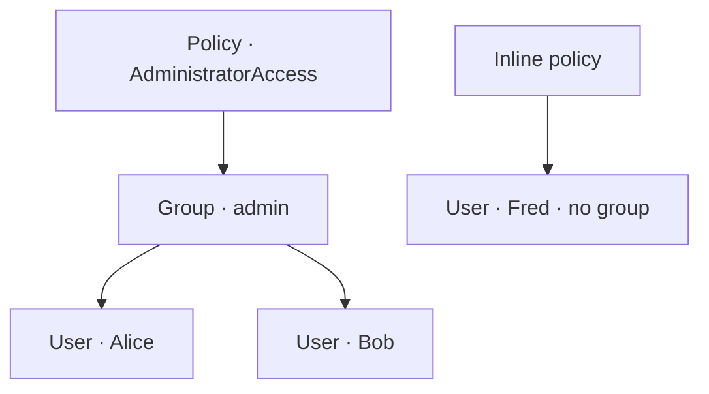
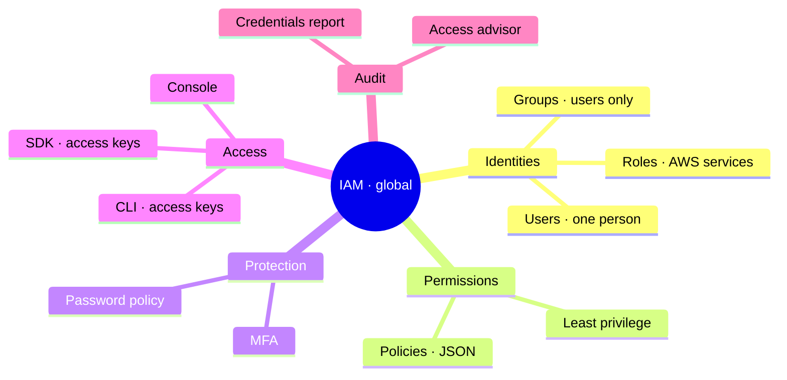

# AWS IAM — Identity and Access Management

> **Core idea:** IAM decides **who** can do **what** in your AWS account. You create **users**, put them in **groups**, and attach **policies** (JSON documents) that say what is allowed. For AWS services, you use **roles** instead of users.

---

## 1. The Basics

### 1.1 What IAM is

IAM is a **global service**. There is no region to pick. A user you create works everywhere.

### 1.2 Root user vs IAM user

|            | Root user                                | IAM user                      |
| ---------- | ---------------------------------------- | ----------------------------- |
| Created    | Automatically, when you open the account | By you, inside IAM            |
| Power      | Full, cannot be limited                  | Only what its policies allow  |
| Use it for | Setting up the account only              | Everyday work                 |
| Share it?  | Never                                    | Never — one user = one person |

> Rule: use root once to set up, then stop using it.

### 1.3 Users and groups

- A **user** = one real person in your company.
- A **group** = a bag of users that need the same permissions.
- A group can hold **only users**, never another group.
- A user can be in **many groups**, or in **no group** (allowed, but not best practice).

---

## 2. Policies — the permissions

A **policy** is a JSON document that lists what is allowed or denied. It is not programming. It is just a description.

### 2.1 How permissions reach a user



A user gets **all** permissions from **every** group it belongs to, plus any policy attached directly to it. A policy attached to one single user is called an **inline policy**.

### 2.2 Policy structure (exam favourite)

| Part        | Meaning                                   | Optional? |
| ----------- | ----------------------------------------- | --------- |
| `Version`   | Language version, usually `2012-10-17`    | No        |
| `Id`        | Name of the policy                        | Yes       |
| `Statement` | One or more permission blocks             | No        |
| `Sid`       | Name of one statement                     | Yes       |
| `Effect`    | `Allow` or `Deny`                         | No        |
| `Principal` | Which account, user or role it applies to | —         |
| `Action`    | List of API calls                         | No        |
| `Resource`  | Which resources the actions apply to      | No        |
| `Condition` | When the statement applies                | Yes       |

Remember four words: **Effect, Principal, Action, Resource.**

### 2.3 The star `*`

`*` means _anything_. `Action: "*"` with `Resource: "*"` = **administrator access**. `Get*` means every call starting with `Get`, like `GetUser`.

> **Least privilege principle:** never give more permission than the person actually needs.

---

## 3. Roles — permissions for AWS services

Some AWS services must do actions **on your behalf**. They also need permissions, but they are not people, so they cannot be users.

A **role** is like a user, but it is used by an AWS service. You attach policies to the role, then the service **assumes** the role.

Common roles: **EC2 instance role**, **Lambda function role**, **CloudFormation**.

Example: an EC2 instance (a virtual server) with a role holding `IAMReadOnlyAccess` can read IAM data.

---

## 4. Protecting the accounts

Two defences.

### 4.1 Password policy

Set in IAM account settings. Options:

- Minimum password length
- Require uppercase, lowercase, number, non-alphanumeric character
- Allow users to change their own password
- Password expiry, for example every 90 days
- Prevent password reuse

This protects against **brute force** attacks.

### 4.2 MFA — Multi-Factor Authentication

**MFA = password you know + device you own.** If a hacker steals the password, they still cannot log in without the physical device.

| MFA device                    | What it is                  | Note                                     |
| ----------------------------- | --------------------------- | ---------------------------------------- |
| Virtual MFA device            | Google Authenticator, Authy | Authy supports many tokens on one phone  |
| U2F security key              | YubiKey by Yubico           | One key can hold many root and IAM users |
| Hardware key fob              | Gemalto                     | Physical token                           |
| Hardware key fob for GovCloud | SurePassID                  | US government cloud only                 |

> Protect the **root account** with MFA first, then all IAM users.

---

## 5. Three ways to access AWS

| Way                | What it is                   | Protected by   |
| ------------------ | ---------------------------- | -------------- |
| Management Console | The website                  | Password + MFA |
| CLI                | Commands in your terminal    | Access keys    |
| SDK                | Code inside your application | Access keys    |

### 5.1 Access keys

You generate them yourself in the console, under **Security credentials**. You can download them **only once**.

- **Access key ID** = like a username
- **Secret access key** = like a password
- Never share them. Never put them in code you publish.

Access keys give **exactly the same permissions** as the user they belong to. Remove the user from a group, and the CLI stops working too.

### 5.2 Setting up the CLI

```bash
# check the CLI is installed
aws --version
```

```bash
# enter access key ID, secret access key, default region, output format
aws configure
```

```bash
# test it — lists all users in the account
aws iam list-users
```

### 5.3 SDK

A set of libraries for one programming language: JavaScript, Python, PHP, .NET, Ruby, Java, Go, Node.js, C++, plus mobile and IoT SDKs. The AWS CLI itself is built on the Python SDK, named **Boto**.

### 5.4 CloudShell

A free terminal **inside the browser**, already logged in as your user, with the CLI installed.

- Available in **some regions only**
- Files you create there **stay** after restart
- You can upload and download files

---

## 6. Security tools (auditing)

| Tool                       | Level   | What it shows                                                                                                              |
| -------------------------- | ------- | -------------------------------------------------------------------------------------------------------------------------- |
| **IAM Credentials Report** | Account | CSV of all users and the state of their credentials — password last used, MFA on or off, access keys created and last used |
| **IAM Access Advisor**     | User    | Which services this user actually accessed, and when                                                                       |

Access Advisor is how you apply least privilege in practice: see the unused services, then remove those permissions.

---

## 7. Best practices

1. Use root only to set up the account.
2. One AWS user = one physical person.
3. Put users in groups, attach permissions to the group.
4. Set a strong password policy.
5. Turn on MFA.
6. Use **roles** for AWS services, never access keys inside them.
7. Access keys only for CLI and SDK, and keep them secret.
8. Audit with the Credentials Report and Access Advisor.
9. Never share users or access keys.

---

## 8. Summary



1. IAM is global — no region selection.
2. Root is only for setup; work as an IAM user.
3. Groups contain users only; a user can be in many groups or none.
4. Policies are JSON; the key parts are Effect, Principal, Action, Resource.
5. `*` means anything; `Allow *` on `*` equals administrator.
6. Roles give permissions to AWS services like EC2 and Lambda.
7. Password policy plus MFA protect logins.
8. Access keys protect CLI and SDK, and are as secret as a password.
9. Credentials Report is account-level; Access Advisor is user-level.
10. Always follow least privilege.

---

## 9. Check yourself

1. Which region do you select when creating an IAM user?
2. Can a group contain another group?
3. Name the four policy parts you must know for the exam.
4. What does `Action: "*"` with `Resource: "*"` mean?
5. When do you use a role instead of a user?
6. What two things make up MFA?
7. Which MFA device is provided by Yubico?
8. Which two credentials does the CLI need?
9. Which tool tells you when a user last used a service?
10. Which command configures the CLI on your machine?

---

## 10. Key terms

| Term               | Meaning                                              |
| ------------------ | ---------------------------------------------------- |
| IAM                | Service that manages who can do what in AWS          |
| Root user          | The first, all-powerful account; use only for setup  |
| IAM user           | An identity for one real person                      |
| Group              | A collection of users sharing the same policies      |
| Policy             | JSON document listing allowed or denied actions      |
| Inline policy      | A policy attached to one single user                 |
| Role               | An identity used by AWS services, not people         |
| Least privilege    | Give only the permissions actually needed            |
| MFA                | Password plus a physical device for login            |
| Access key ID      | Public part of CLI/SDK credentials, like a username  |
| Secret access key  | Private part of CLI/SDK credentials, like a password |
| CLI                | Tool to run AWS commands in a terminal               |
| SDK                | Libraries to call AWS from application code          |
| CloudShell         | Free browser terminal with the CLI ready             |
| Credentials Report | Account-level CSV of all users and their credentials |
| Access Advisor     | User-level view of services used and when            |
