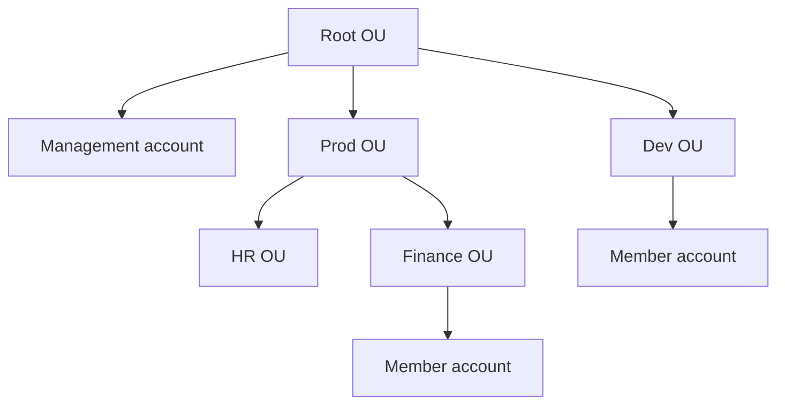
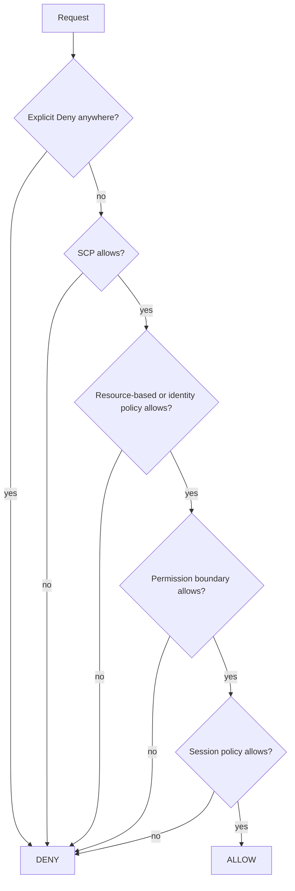
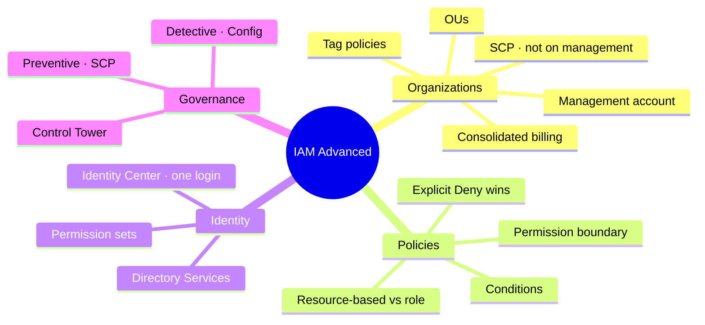

# AWS IAM Advanced

> **Core idea:** When you have **many AWS accounts**, you group them with **AWS Organizations** and limit them with **SCPs**. Inside policies, **conditions** make rules sharper, and **permission boundaries** cap what a user can ever do. AWS checks all of these with one rule: **an explicit Deny always wins**. For logins, **IAM Identity Center** gives one login for every account, and **Control Tower** sets it all up with best practices.

---

## 1. AWS Organizations

A **global service** to manage **many AWS accounts** together.

### 1.1 The parts

| Part                         | Meaning                                                                 |
| ---------------------------- | ----------------------------------------------------------------------- |
| **Management account**       | The main account that creates the organization                          |
| **Member account**           | Any other account in it. An account can be in **only one** organization |
| **OU** (Organizational Unit) | A folder of accounts. OUs can hold other OUs                            |
| **Root OU**                  | The top folder; holds everything                                        |

You can add accounts by **creating** them (there is an API to automate this) or by **inviting** existing ones.

OUs can be organized by **business unit**, **environment** (prod, test, dev), or **project**.

### 1.2 Why use it

| Benefit                       | Detail                                                          |
| ----------------------------- | --------------------------------------------------------------- |
| **Consolidated billing**      | One payment method pays for all accounts                        |
| **Volume discounts**          | EC2, S3 usage is added up across accounts                       |
| **Shared savings**            | Reserved Instances and Savings Plans discounts are shared       |
| **Better security**           | Separate accounts isolate better than separate VPCs             |
| **Central logging**           | Turn on CloudTrail for all accounts, send logs to one S3 bucket |
| **Cross-account admin roles** | Manage member accounts from the management account              |
| **SCPs**                      | Limit what accounts can do (next section)                       |

---

## 2. Service Control Policies (SCPs)

An **SCP** is an IAM-style policy attached to an **OU or account**. It limits what **all users and roles** in that account can do — **even the account's root user**.

### 2.1 Rules to remember

- SCPs **never apply to the management account**. It always keeps full power.
- An action needs an **explicit Allow at every level**: Root OU → each OU → account. If any level has no allow, it is denied.
- A **Deny at any level wins**. Lower levels inherit it.
- The default SCP is **FullAWSAccess** (allow everything).

### 2.2 Example

| Where                  | SCPs attached            | Result                                       |
| ---------------------- | ------------------------ | -------------------------------------------- |
| Management account     | Deny Athena              | **Can still use Athena** — SCPs do not apply |
| Sandbox OU             | FullAWSAccess + Deny S3  | —                                            |
| Account A (in Sandbox) | FullAWSAccess + Deny EC2 | Everything **except S3 and EC2**             |
| Account B (in Sandbox) | nothing extra            | Everything **except S3**                     |
| Test OU → Account D    | Allow EC2 only           | **Only EC2**                                 |

Two styles of SCP: a **block list** (allow all, deny some) or an **allow list** (allow only a few services).

### 2.3 Tag policies

Another Organizations policy. It **standardizes tags** across all accounts: you define allowed **tag keys and values**.

- Blocks non-compliant tagging operations (no effect on untagged resources)
- Gives a report of compliant and non-compliant resources
- Helps with **cost allocation tags** and **attribute-based access control** (ABAC)

> Exam: _"keep tags consistent across accounts"_ → **tag policies**.

---

## 3. IAM Conditions

A **condition** adds an extra check to a policy statement.

| Condition key                | Checks                                 | Example use                                                  |
| ---------------------------- | -------------------------------------- | ------------------------------------------------------------ |
| `aws:SourceIp`               | The caller's IP address                | Allow API calls only from the company network                |
| `aws:RequestedRegion`        | The region of the API call             | Deny EC2/RDS in some regions (often in an SCP)               |
| `ec2:ResourceTag`            | Tag on the **resource** (EC2 instance) | Start/stop only instances tagged `Project=DataAnalytics`     |
| `aws:PrincipalTag`           | Tag on the **user**                    | Only users tagged `Department=Data`                          |
| `aws:MultiFactorAuthPresent` | Did the user log in with MFA?          | Deny stop/terminate if MFA is `false`                        |
| `aws:PrincipalOrgID`         | Caller's organization                  | S3 bucket policy: allow only accounts in **my organization** |

### 3.1 S3: bucket vs object ARN (exam favourite)

| Level      | Actions                                     | Resource ARN          |
| ---------- | ------------------------------------------- | --------------------- |
| **Bucket** | `s3:ListBucket`                             | `arn:aws:s3:::test`   |
| **Object** | `s3:GetObject`, `PutObject`, `DeleteObject` | `arn:aws:s3:::test/*` |

---

## 4. Resource-based Policy vs IAM Role

For **cross-account** access (user in Account A uses an S3 bucket in Account B), there are two ways:

|                      | Assume an IAM role                          | Resource-based policy                      |
| -------------------- | ------------------------------------------- | ------------------------------------------ |
| How                  | User switches into a role in Account B      | Bucket policy in Account B allows the user |
| Your own permissions | **Given up** while using the role           | **Kept**                                   |
| Good when            | You only need the other account's resources | You need **both** accounts at once         |

Example: scan a DynamoDB table in Account A **and** write to S3 in Account B → use a **resource-based policy**.

**Supported by:** S3 buckets, SNS topics, SQS queues, Lambda functions, API Gateway, and more.

### 4.1 EventBridge — which one does it use?

| Target                                                            | EventBridge uses          |
| ----------------------------------------------------------------- | ------------------------- |
| Lambda, SNS, SQS, S3, API Gateway                                 | **Resource-based policy** |
| Kinesis Data Streams, EC2 Auto Scaling, SSM Run Command, ECS task | **IAM role**              |

---

## 5. Permission Boundaries

A **permission boundary** sets the **maximum** permissions a **user or role** can get. **Not for groups.**

A user can do only what is in **both** its policy **and** its boundary.

| Policy attached     | Boundary                  | Result                                           |
| ------------------- | ------------------------- | ------------------------------------------------ |
| `iam:CreateUser`    | Allow S3, CloudWatch, EC2 | **Nothing** — CreateUser is outside the boundary |
| AdministratorAccess | AmazonS3FullAccess        | **Only S3**                                      |

**Effective permissions** = the overlap of identity policy + permission boundary + SCP.

**Use cases:**

- Let non-admins create IAM users, but only inside a boundary
- Let developers manage their own permissions without making themselves admins (no **privilege escalation**)
- Restrict **one user** instead of the whole account with an SCP

---

## 6. Policy Evaluation Logic

AWS checks each request in this order. It gets **Allow only if every step allows**.

> **Three rules:** Explicit Deny beats everything. No Allow = **implicit Deny**. Allow must come from every layer.

### 6.1 Worked example

Policy: `Deny sqs:*` and `Allow sqs:DeleteQueue`.

| Action                  | Result     | Why                               |
| ----------------------- | ---------- | --------------------------------- |
| `sqs:CreateQueue`       | Denied     | Covered by `Deny sqs:*`           |
| `sqs:DeleteQueue`       | **Denied** | Explicit Deny wins over the Allow |
| `ec2:DescribeInstances` | Denied     | Nothing allows it → implicit Deny |

---

## 7. IAM Identity Center (formerly AWS SSO)

**One login** for:

- **All AWS accounts** in your Organization (most asked in the exam)
- Business apps: Salesforce, Box, Microsoft 365, any **SAML 2.0** app
- EC2 **Windows** instances

**Where users live (identity provider):** the built-in Identity Center store, or a third party — **Active Directory**, OneLogin, Okta.

### 7.1 Permission sets

A **permission set** = a group of IAM policies. You assign it to **users or groups** for **specific accounts**. When the user logs in to that account, Identity Center makes them **assume an IAM role** with those permissions.

| Permission set | Assigned to      | Accounts      | Result             |
| -------------- | ---------------- | ------------- | ------------------ |
| Admin access   | Developers group | Dev accounts  | Full access in dev |
| Read-only      | Developers group | Prod accounts | Read-only in prod  |

**ABAC** (attribute-based access control): permissions based on user attributes like cost center, title, or locale. Define permission sets once, then change access by changing the user's attributes.

---

## 8. AWS Directory Services

**Microsoft Active Directory (AD)** = a database of users, computers, printers, and file shares on Windows Server. A **domain controller** checks logins for all machines. Objects form **trees**; a group of trees is a **forest**.

**AWS Directory Services** puts an AD on AWS. Three flavors:

| Flavor                       | What it is                         | Users managed              | MFA | Links to on-premises AD?    |
| ---------------------------- | ---------------------------------- | -------------------------- | --- | --------------------------- |
| **AWS Managed Microsoft AD** | A real AD in AWS                   | In AWS **and** on-premises | Yes | Yes, with a **trust**       |
| **AD Connector**             | A **proxy** to your on-premises AD | Only on-premises           | Yes | Yes, forwards every request |
| **Simple AD**                | AD-compatible, not Microsoft       | In AWS only                | —   | **No**                      |

> Exam shortcuts: _proxy to on-premises_ → **AD Connector**. _Manage users in AWS with MFA_ → **Managed Microsoft AD**. _No on-premises AD at all_ → **Simple AD**.

### 8.1 Connecting Identity Center to AD

| Your AD                    | How to connect                                                                                          |
| -------------------------- | ------------------------------------------------------------------------------------------------------- |
| AWS Managed Microsoft AD   | Built-in, out of the box                                                                                |
| Self-managed (on-premises) | **Two-way trust** with a Managed Microsoft AD, **or** an **AD Connector** (simpler, a bit more latency) |

---

## 9. AWS Control Tower

Sets up and runs a **secure, compliant multi-account environment** in a few clicks, using **best practices**. It is built **on top of AWS Organizations**.

**Benefits:** automated setup, ongoing policy management with **guardrails**, finds and fixes violations, compliance **dashboard**.

### 9.1 Guardrails

| Type           | Job                     | Uses           | Example                                                |
| -------------- | ----------------------- | -------------- | ------------------------------------------------------ |
| **Preventive** | **Stop** bad actions    | **SCPs**       | Only allow `us-east-1` and `eu-west-2`                 |
| **Detective**  | **Find** non-compliance | **AWS Config** | Find untagged resources → SNS alert → Lambda adds tags |

---

## 10. Summary

1. Organizations groups many accounts; one management account, many member accounts.
2. Consolidated billing gives volume discounts and shares RI and Savings Plans.
3. SCPs limit accounts, never the management account; they need an Allow at every level.
4. Tag policies keep tags consistent across accounts.
5. Conditions like `aws:SourceIp`, `aws:RequestedRegion`, `aws:PrincipalOrgID` sharpen policies.
6. S3 bucket actions use `bucket`; object actions use `bucket/*`.
7. Assuming a role drops your own permissions; a resource-based policy keeps them.
8. Permission boundaries cap users and roles, not groups.
9. Explicit Deny always wins; no Allow means implicit Deny.
10. Identity Center = one login for all accounts, using permission sets.
11. AD Connector = proxy; Managed AD = real AD in AWS; Simple AD = no on-premises.
12. Control Tower guardrails: preventive uses SCP, detective uses Config.

---

## 11. Check yourself

1. Does an SCP that denies Athena affect the management account?
2. An OU has `Deny S3`. Can an account inside it use S3?
3. How do you keep tag keys and values the same across all accounts?
4. Which condition lets only accounts in your organization use an S3 bucket?
5. What resource ARN does `s3:GetObject` need?
6. A user must read DynamoDB in Account A and write to S3 in Account B. Role or resource-based policy?
7. Can you attach a permission boundary to a group?
8. A user has AdministratorAccess and a boundary of S3 full access. What can they do?
9. A policy has `Deny sqs:*` and `Allow sqs:DeleteQueue`. Can the user delete a queue?
10. Which service gives one login to many AWS accounts?
11. You want to proxy logins to your on-premises AD. Which directory flavor?
12. Which AWS service does a detective guardrail use?

---

## 12. Key terms

| Term                  | Meaning                                                  |
| --------------------- | -------------------------------------------------------- |
| AWS Organizations     | Service to manage many accounts together                 |
| Management account    | Main account of the organization; SCPs never apply to it |
| Member account        | Any other account in the organization                    |
| OU                    | Organizational Unit — a folder of accounts               |
| Consolidated billing  | One bill and payment method for all accounts             |
| SCP                   | Service Control Policy — limits what an account can do   |
| Tag policy            | Rule that standardizes tags across accounts              |
| Condition             | Extra check inside a policy statement                    |
| Resource-based policy | Policy attached to a resource, like an S3 bucket policy  |
| Assume role           | Switch into a role and use only its permissions          |
| Permission boundary   | Maximum permissions for a user or role                   |
| Explicit Deny         | A written Deny; always wins                              |
| Implicit Deny         | No Allow found, so denied by default                     |
| IAM Identity Center   | One login for all accounts and apps (was AWS SSO)        |
| Permission set        | Group of policies assigned to users for chosen accounts  |
| ABAC                  | Access based on user attributes like tags or title       |
| Active Directory      | Microsoft database of users and computers                |
| AD Connector          | Proxy from AWS to your on-premises AD                    |
| Simple AD             | Standalone AD-compatible directory, no on-premises link  |
| Control Tower         | Sets up a best-practice multi-account environment        |
| Guardrail             | Ongoing rule in Control Tower: preventive or detective   |
