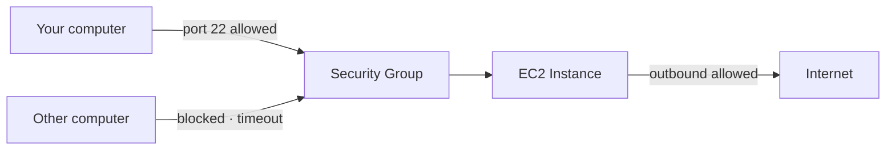
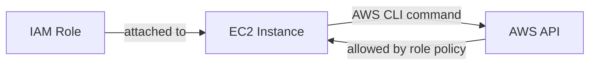
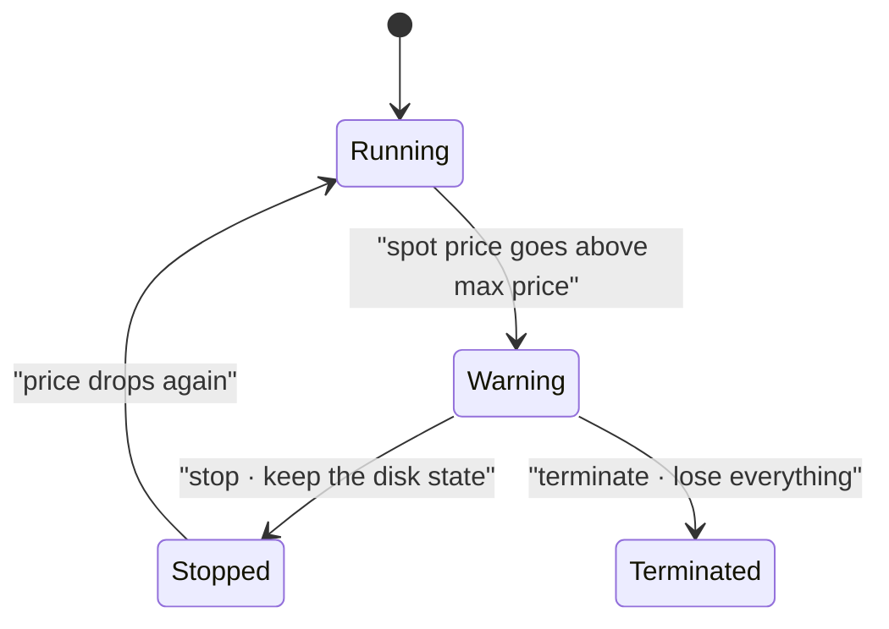
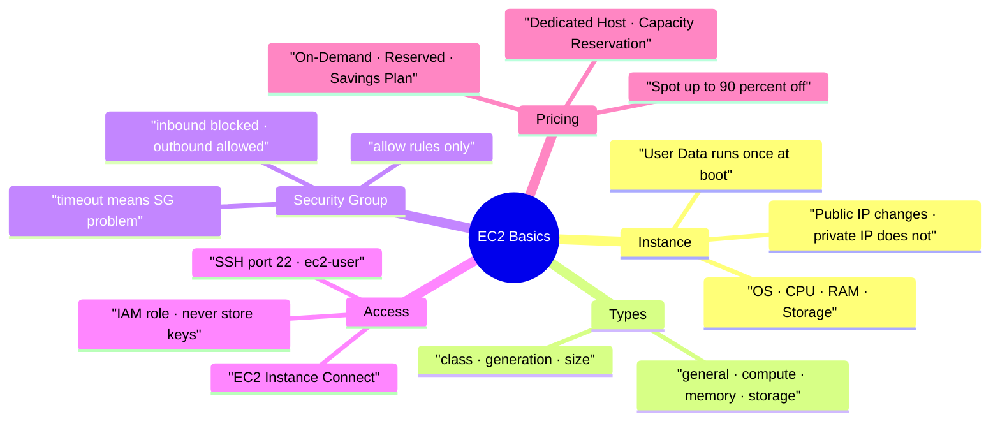

# AWS EC2 Basics

> **Core idea:** EC2 lets you rent a virtual server from AWS in seconds. You choose its OS, CPU, RAM, storage and network, protect it with a security group, give it permissions with an IAM role, and pick a purchasing option that fits how long you need it.

---

## 1. What EC2 Is

**EC2** means **Elastic Compute Cloud**. It is how AWS does **Infrastructure as a Service (IaaS)**.

EC2 is not one service. It is a group of things:

| Part                        | What it gives you                              |
| --------------------------- | ---------------------------------------------- |
| EC2 instance                | A virtual machine you rent                     |
| EBS volume                  | A virtual hard drive attached over the network |
| ELB (Elastic Load Balancer) | Spreads traffic across many machines           |
| ASG (Auto Scaling Group)    | Adds or removes machines automatically         |

### 1.1 What you choose when you create an instance

|Choice|Options / meaning|
|---|---|
|Operating system|Linux (most common), Windows, macOS|
|CPU|How many vCPUs (compute power)|
|RAM|How much memory|
|Storage|Network attached (EBS, EFS) or hardware attached (EC2 Instance Store)|
|Network|Network card speed, public IP|
|Firewall|Security group|
|Boot script|EC2 User Data|

### 1.2 EC2 User Data

**User Data** is a script that runs **only once**, the very first time the instance starts. This is called **bootstrapping**.

It is used to install updates, install software, and download files at boot. It runs as the **root user**, so every command already has `sudo` rights.

> The more you put in User Data, the slower your instance boots.

### 1.3 Public IP vs private IP

| IP type      | Behaviour                                                                                    |
| ------------ | -------------------------------------------------------------------------------------------- |
| Public IPv4  | Used to reach the instance from the internet. **Changes** if you stop and start the instance |
| Private IPv4 | Used inside the AWS network. **Never changes**                                               |

**Stopping an instance means you stop paying for it, but the attached volume stays.**

---

## 2. Instance Types

The name of an instance tells you everything. Example: `m5.2xlarge`

```text
m        5           2xlarge
class    generation  size
```

- **class** — the family, here `m` = general purpose
- **generation** — newer hardware gives a higher number (`m5` → `m6`)
- **size** — bigger size means more CPU and more RAM

| Family            | Letters         | Best for                                                                   |
| ----------------- | --------------- | -------------------------------------------------------------------------- |
| General purpose   | `t`, `m`        | Balanced work: web servers, code repositories                              |
| Compute optimised | `c`             | Heavy CPU: batch jobs, media transcoding, machine learning, gaming servers |
| Memory optimised  | `r`, `X1`, `Z1` | Big data sets held in RAM: databases, ElastiCache                          |
| Storage optimised | `I`, `D`, `H1`  | Heavy local disk reads: OLTP, NoSQL, data warehousing                      |

`t2.micro` is the **free tier** instance: 1 vCPU, 1 GB RAM. Free tier gives 750 hours per month for the first year.

---

## 3. Security Groups (the firewall)

A **security group** is a firewall that sits **outside** the instance and controls which traffic may come in and go out.



### 3.1 Rules to remember

| Fact             | Detail                                                                |
| ---------------- | --------------------------------------------------------------------- |
| Only allow rules | You can never write a deny rule                                       |
| Default inbound  | All blocked                                                           |
| Default outbound | All allowed                                                           |
| Source of a rule | An IP range, or another security group                                |
| `0.0.0.0/0`      | Means anywhere on the internet                                        |
| Attachment       | One group can serve many instances; one instance can have many groups |
| Scope            | Locked to one **region + VPC**. Switch region, create it again        |

> **Timeout = security group problem. Connection refused = the group worked, but the application is down.**

Security groups can reference other security groups. If group 1 allows group 2 inbound, any instance carrying group 2 may connect, whatever its IP. This avoids managing IP addresses.

### 3.2 Ports to memorise for the exam

| Port | Protocol | Use                             |
| ---- | -------- | ------------------------------- |
| 21   | FTP      | Upload files to a file share    |
| 22   | SSH      | Log into a **Linux** instance   |
| 22   | SFTP     | Upload files over SSH           |
| 80   | HTTP     | Unsecured website               |
| 443  | HTTPS    | Secured website                 |
| 3389 | RDP      | Log into a **Windows** instance |

---

## 4. Connecting to an Instance

You connect to a Linux instance with **SSH** (secure shell) on port 22. The default user on Amazon Linux 2 is `ec2-user`.

| Your computer        | Tool to use                                 |
| -------------------- | ------------------------------------------- |
| Mac / Linux          | `ssh` command                               |
| Windows 10 and above | `ssh` command in PowerShell                 |
| Windows 7 / 8        | PuTTY (needs a `.ppk` key file)             |
| Any computer         | EC2 Instance Connect (works in the browser) |

The key file format follows the same split: `.pem` for Mac, Linux and Windows 10; `.ppk` for PuTTY.

```bash
# fix the key file permissions first, or SSH will refuse it
chmod 0400 EC2Tutorial.pem
```

```bash
# connect using the key and the public IP of the instance
ssh -i EC2Tutorial.pem ec2-user@<public-ip>
```

**EC2 Instance Connect** uploads a temporary SSH key for you, so you manage no key files. It still uses SSH behind the scenes, so **port 22 must still be open**.

---

## 5. IAM Roles on EC2

An instance often needs to call AWS APIs. It needs credentials to do that.

> **Never run `aws configure` on an EC2 instance and never store an Access Key there.** Anyone who connects to that instance can read the keys.

Instead, attach an **IAM role** to the instance. AWS then supplies temporary credentials automatically.



Attach it from the console: **Actions → Security → Modify IAM role**. Permission changes can take a short time to take effect.

---

## 6. Purchasing Options

Think of a hotel. That makes each option easy to remember.

| Option                   | Hotel analogy                                    | Commitment             | Saving             | Use for                              |
| ------------------------ | ------------------------------------------------ | ---------------------- | ------------------ | ------------------------------------ |
| **On-Demand**            | Walk in, pay full price                          | None                   | 0%                 | Short, unpredictable workloads       |
| **Reserved Instance**    | Book a room for 1 or 3 years                     | 1 or 3 years           | up to 72%          | Steady usage, e.g. a database        |
| **Convertible Reserved** | Same, but you may change room type               | 1 or 3 years           | up to 66%          | Steady usage that may change type    |
| **Savings Plan**         | Commit to spending $X per month                  | 1 or 3 years           | up to 72%          | Steady spend, flexible instance size |
| **Spot Instance**        | Last-minute discount room, you can be kicked out | None                   | up to 90%          | Work that survives failure           |
| **Dedicated Host**       | Book the whole building                          | On-demand or 1/3 years | — (most expensive) | Licence or compliance rules          |
| **Dedicated Instance**   | Your own hardware, no visibility of it           | None                   | —                  | Hardware not shared with others      |
| **Capacity Reservation** | Book a room even if you do not sleep in it       | None                   | 0%                 | Guarantee capacity in one AZ         |

Extra details worth knowing:

- **On-Demand** is billed per second after the first minute for Linux and Windows, per hour for other operating systems.
- **Reserved** is locked to instance type, region, tenancy and OS. You can pay all upfront, partial upfront, or no upfront. All upfront gives the biggest discount. You may resell them in a marketplace.
- **Savings Plan** locks you to an instance family and region, but you can change size, OS and tenancy. Usage above the plan is charged at on-demand price.
- **Dedicated Host** gives access to the physical server itself. **Dedicated Instance** only guarantees the hardware is not shared with other customers, and you cannot control placement.
- **Capacity Reservation** gives **no discount**. You pay on-demand rates whether you use it or not. Combine it with a Reserved Instance or Savings Plan to also get a discount.

---

## 7. Spot Instances in Detail

You set a **max price** you are willing to pay. The **spot price** moves up and down with supply and demand, and differs by availability zone.



When the price goes above your max, you get a **2 minute grace period** to stop or terminate.

Good for: batch jobs, data analysis, image processing, flexible start and end times. **Not** for: critical jobs or databases. The exam tests this.

### 7.1 Spot requests

|Request type|What happens|
|---|---|
|One-time|Instances launch, then the request disappears|
|Persistent|The request stays alive and relaunches instances after an interruption|

> To remove spot instances for good: **cancel the spot request first, then terminate the instances.** Doing it the other way round makes the request launch them again.

### 7.2 Spot Fleet

A **Spot Fleet** is a set of spot instances (and optionally on-demand ones) that tries to reach a target capacity within your price limit. You define several **launch pools** (different instance types, OS, AZs) and the fleet picks the best one.

| Allocation strategy      | It picks                                                            |
| ------------------------ | ------------------------------------------------------------------- |
| Lowest price             | The cheapest pool — best for very short workloads                   |
| Diversified              | Spread across all pools — best for availability and long workloads  |
| Capacity optimised       | The pool with the best capacity                                     |
| Price capacity optimised | Highest capacity first, then lowest price — best for most workloads |

---

## 8. Summary



1. EC2 is IaaS: you rent a virtual machine and choose its OS, CPU, RAM, storage and network.
2. **User Data** runs once at first boot, as root, to install and configure software.
3. The **public IPv4 changes** when you stop and start; the **private IPv4 never changes**.
4. Instance names read as **class · generation · size**, for example `m5.2xlarge`.
5. Families: `t`/`m` general, `c` compute, `r` memory, `I`/`D`/`H1` storage.
6. Security groups hold **only allow rules**. Inbound is blocked by default, outbound is allowed.
7. A **timeout** is always a security group problem; **connection refused** is an application problem.
8. Ports to remember: 22 SSH, 21 FTP, 80 HTTP, 443 HTTPS, 3389 RDP.
9. Give an instance permissions with an **IAM role**, never with an Access Key stored on the machine.
10. Match the purchasing option to the workload: On-Demand for short, Reserved or Savings Plan for steady, Spot for interruptible, Dedicated Host for licensing rules.

---

## 9. Check Yourself

1. What does the EC2 User Data script do, and how many times does it run?
2. Which IP address changes after you stop and start an instance?
3. In `c5.4xlarge`, what does each part of the name mean?
4. Which instance family would you pick for an in-memory database?
5. What is the default inbound and outbound behaviour of a security group?
6. You try to reach your web server and the browser loads forever. Where is the fault?
7. Which ports are used for SSH, HTTPS and RDP?
8. Why is running `aws configure` on an EC2 instance dangerous, and what should you do instead?
9. Which purchasing option gives up to 90% discount, and what is the risk?
10. In what order must you cancel a spot request and terminate its instances, and why?

---

## 10. Key Terms

|Term|Meaning|
|---|---|
|EC2|Elastic Compute Cloud — rent virtual servers from AWS|
|IaaS|Infrastructure as a Service — you rent the machine, you manage the software|
|AMI|Amazon Machine Image — the base image (operating system) of an instance|
|EBS|Network attached virtual hard drive for an instance|
|Instance Store|Storage physically attached to the host hardware|
|User Data|Script that runs once at first boot, as root|
|Bootstrapping|Running commands automatically when a machine starts|
|Security Group|Firewall outside the instance controlling inbound and outbound traffic|
|Inbound / Outbound|Traffic coming into the instance / leaving the instance|
|`0.0.0.0/0`|Any IP address on the internet|
|SSH|Secure Shell — log into a Linux machine over port 22|
|EC2 Instance Connect|Browser based SSH session, no key file needed|
|IAM Role|A set of permissions attached to an instance instead of stored keys|
|Spot Price|The changing market price of a spot instance|
|Spot Fleet|A group of spot instances chosen from several launch pools|
|Tenancy|Whether hardware is shared, dedicated, or a dedicated host|
|AZ|Availability Zone — one data centre group inside a region|
