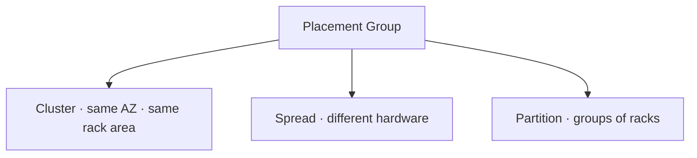
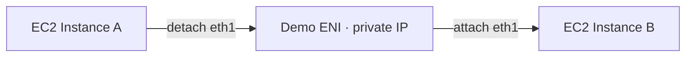
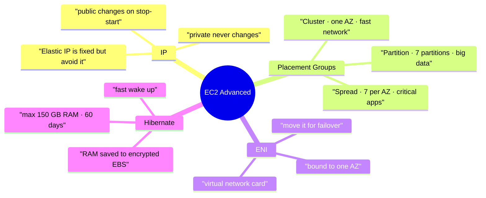

# AWS EC2 Advanced

> **Core idea:** Four extra EC2 topics decide how your instance is reached, where it sits, how its network card behaves, and how fast it wakes up. They are IP addresses, Placement Groups, Elastic Network Interfaces, and Hibernate.

---

## 1. Private, Public and Elastic IP

An **IP address** is the number that identifies a machine on a network.

|Version|Look|Note|
|---|---|---|
|IPv4|`1.160.10.240` — four numbers, each 0 to 255|Most common. About 3.7 billion public addresses, nearly used up|
|IPv6|Long string of numbers and letters|Solves the shortage. Mostly used for IoT|

### 1.1 Public vs private

|                          | Public IP                 | Private IP                                           |
| ------------------------ | ------------------------- | ---------------------------------------------------- |
| Who can reach it         | Anyone on the internet    | Only machines in the same private network            |
| Must be unique           | Across the whole internet | Only inside that private network                     |
| Same IP in two companies | Not possible              | Possible, no problem                                 |
| Reaching the internet    | Direct                    | Through a **NAT device** and an **internet gateway** |
| Allowed values           | Any public range          | Only a fixed set of ranges                           |

Every EC2 instance gets both. You **cannot SSH using the private IP** from your home computer, because you are not inside the AWS network. You must use the public IP, unless you have a VPN.

> **Stop and start an instance and the public IPv4 changes. The private IPv4 never changes.**

Rebooting is not the same as stopping and starting, so a reboot does not change the IP.

### 1.2 Elastic IP

An **Elastic IP** is a public IPv4 that you own and keep, even when the instance is stopped and started. You attach it to **one instance at a time**.

It can hide the failure of an instance: move the Elastic IP to a healthy instance and users keep the same address.

|Fact|Detail|
|---|---|
|Limit|5 per account by default. You can ask AWS for more|
|Cost|About $0.005 per hour (around $3.50 per month), charged whether you use it or not|
|Free tier|750 hours per month of public IPv4 in the first year|
|Releasing|Disassociate **and release** it, otherwise you keep paying|

> Avoid Elastic IPs. They are seen as poor architecture. Better: use a normal public IP with a **DNS name** (Route 53), or put a **Load Balancer** in front and use no public IP at all.

---

## 2. Placement Groups

A **Placement Group** tells AWS how you want your instances placed on its physical hardware compared to each other. You do not touch the hardware yourself; you only state the strategy.



|Strategy|Where instances go|Main benefit|Main limit / risk|Use case|
|---|---|---|---|---|
|**Cluster**|All in **one AZ**, very close together|10 Gbps low latency network between them|If that AZ fails, **everything fails**|Fast big data jobs needing very high throughput|
|**Spread**|Each on **different hardware**, can span many AZs|Failures are isolated from each other|Max **7 instances per AZ** per group|Small critical applications, maximum availability|
|**Partition**|Spread across **partitions**, each partition is a different rack|Scales to **hundreds** of instances; one rack failure hits one partition only|Max **7 partitions per AZ**|Partition aware big data: HDFS, HBase, Cassandra, Kafka|

Instances can read which partition they are in through the **metadata service**.

**Remember the three numbers: Cluster = 1 AZ, Spread = 7 instances per AZ, Partition = 7 partitions per AZ.**

---

## 3. Elastic Network Interfaces (ENI)

An **ENI** is a virtual network card inside a VPC. It is what gives an EC2 instance its network access.

The first one, `eth0`, is the **primary ENI** and is created with the instance. You can add more, such as `eth1`.

|An ENI can hold|Detail|
|---|---|
|Private IPv4|One primary, plus one or more secondary|
|Public IPv4 / Elastic IP|One Elastic IPv4 per private IPv4|
|Security groups|One or more|
|MAC address|One|

### 3.1 Why ENIs matter

You can create an ENI on its own, then attach it to an instance, detach it, and attach it to another instance. The private IP travels with it.



This gives a **fast network failover**: if instance A dies, move the ENI to instance B and the same private IP keeps working.

| Rule              | Detail                                                                         |
| ----------------- | ------------------------------------------------------------------------------ |
| Availability Zone | An ENI is **bound to one AZ** and cannot move out of it                        |
| Lifecycle         | An ENI created with an instance is **deleted** when the instance is terminated |
|                   | An ENI you created yourself **stays** after the instance is terminated         |

---

## 4. EC2 Hibernate

Normally, when you **stop** an instance the RAM is lost. On the next start the OS boots again, User Data has already run once so it does not run again, the application starts, and caches must warm up. All of this takes time.

**Hibernate** saves the RAM instead of losing it, so the machine wakes up exactly where it was.


The operating system is **frozen, not shut down**. A quick way to prove it: the `uptime` command keeps counting from before the hibernation instead of restarting at zero.

```bash
# how long the instance has been running since its last real boot
uptime
```

### 4.1 Requirements and limits

|Requirement|Detail|
|---|---|
|Root volume|Must be **EBS**, must be **encrypted**, and must be big enough to hold the RAM|
|RAM size|Less than 150 GB|
|Instances|Not supported on bare metal|
|OS|Linux and Windows both work|
|Purchasing options|On-Demand, Reserved and Spot all supported|
|Duration|No longer than 60 days|

Use it for long-running processes you do not want to restart, for keeping RAM state, and for services that take a long time to initialise.

---

## 5. Summary



1. Every instance has a **private IP** for the AWS network and a **public IP** for the internet.
2. Stopping and starting changes the public IPv4; the private IPv4 stays the same.
3. An **Elastic IP** keeps the public address fixed, but it costs money and is poor architecture. Prefer DNS or a Load Balancer.
4. **Cluster** placement gives the fastest network but puts everything in one AZ, so one AZ failure kills all of it.
5. **Spread** placement isolates failures but allows only **7 instances per AZ**.
6. **Partition** placement isolates racks and scales to hundreds of instances, with **7 partitions per AZ**.
7. An **ENI** is a virtual network card, bound to one AZ, that carries private IPs and security groups.
8. Moving an ENI between instances gives a quick private-IP failover.
9. **Hibernate** writes RAM into the root EBS volume, so the instance restarts in the same state.
10. Hibernate needs an **encrypted EBS root volume** large enough for the RAM, under 150 GB, for up to 60 days.

---

## 6. Check Yourself

1. Which IP of an EC2 instance changes when you stop and start it?
2. Why can you not SSH into an instance using its private IPv4 from home?
3. What problem does an Elastic IP solve, and why is it usually discouraged?
4. Which placement group strategy puts all instances in a single availability zone, and what is the risk?
5. How many instances per AZ are allowed in a spread placement group?
6. How many partitions per AZ are allowed in a partition placement group, and what does each partition map to?
7. What is an ENI, and which AWS boundary is it locked to?
8. What happens to an ENI you created yourself when its instance is terminated?
9. Where is the RAM stored when an instance hibernates?
10. Name three requirements the root volume must meet for hibernation to work.

---

## 7. Key Terms

|Term|Meaning|
|---|---|
|IPv4|Address made of four numbers, each 0 to 255|
|IPv6|Longer newer address format, mostly for IoT|
|Public IP|Address reachable from the internet, unique worldwide|
|Private IP|Address reachable only inside a private network|
|NAT device|Lets private machines reach the internet through a shared address|
|Internet Gateway|The door between a private AWS network and the internet|
|Elastic IP|A public IPv4 you own and keep across stop and start|
|Placement Group|A rule telling AWS how to place instances on hardware|
|Cluster / Spread / Partition|The three placement strategies|
|Rack|A physical set of hardware in a data centre; one partition equals one rack|
|Metadata service|Service an instance calls to learn facts about itself, such as its partition|
|ENI|Elastic Network Interface — a virtual network card|
|`eth0`|The primary network interface of an instance|
|Failover|Moving work or an address to a healthy machine when one fails|
|Hibernate|Save RAM to disk so the instance restarts in the same state|
|`uptime`|Linux command showing how long the machine has run since its last boot|
