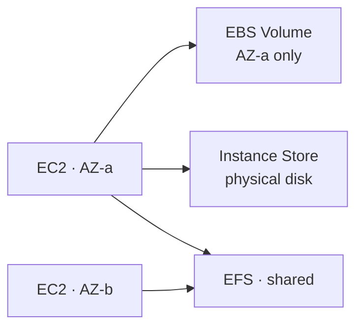
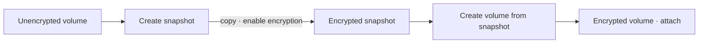
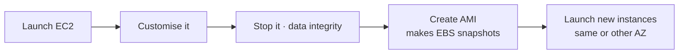
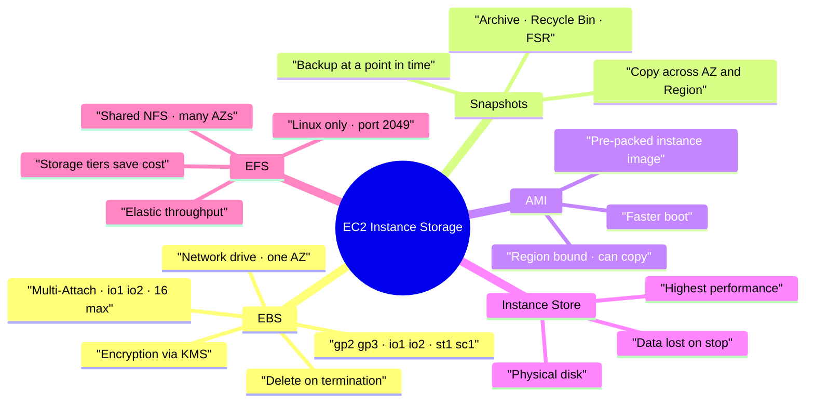

# AWS EC2 Instance Storage (EBS, Snapshots, AMI, Instance Store, EFS)

> **Core idea:** An EC2 instance needs a disk. **EBS** is a network drive locked to **one AZ** and normally **one instance**. **Instance Store** is a real physical disk — very fast, but data is lost when the instance stops. **EFS** is a shared network file system that **many instances in many AZs** can use at the same time.

---

## 1. The Three Storage Types

|                           | **EBS**              | **Instance Store**               | **EFS**                          |
| ------------------------- | -------------------- | -------------------------------- | -------------------------------- |
| What it is                | Network drive        | Physical disk on the host server | Shared network file system (NFS) |
| Attached to               | 1 instance, 1 AZ     | Only that instance               | 100s of instances, many AZs      |
| Data after stop/terminate | Survives             | **Lost (ephemeral)**             | Survives                         |
| Capacity                  | Provision in advance | Fixed by instance type           | Grows automatically, pay per use |
| OS                        | Linux + Windows      | Linux + Windows                  | **Linux only**                   |
| Cost                      | Normal               | Included                         | ~3x the price of gp2             |

> Think of **EBS as a network USB stick**, and **Instance Store as a disk screwed inside the machine**.

---

## 2. EBS — Elastic Block Store

### 2.1 Key rules

- It is a **network drive**, so there is a small latency.
- It is **bound to one Availability Zone**. A volume in `us-east-1a` cannot attach to an instance in `us-east-1b`.
- **One instance at a time** (exception: Multi-Attach, see 2.5).
- One instance **can** have many volumes attached.
- You **provision size (GB) and IOPS in advance**, and pay for what you provisioned.
- It can be detached and re-attached in seconds — good for failover.
- A volume can sit **unattached**, waiting to be used.

> To move an EBS volume to another AZ: **take a snapshot, restore it in the new AZ.**

### 2.2 Delete on Termination

This attribute decides what happens to the volume when the instance is terminated.

| Volume           | Default      | Meaning                   |
| ---------------- | ------------ | ------------------------- |
| Root volume      | **Enabled**  | Deleted with the instance |
| Any extra volume | **Disabled** | Kept after termination    |

Exam case: to **keep the root volume's data** after terminating the instance, disable delete on termination.

### 2.3 Volume Types (6 types)

| Type                        | Media | Use for                                                    | Boot volume? |
| --------------------------- | ----- | ---------------------------------------------------------- | ------------ |
| **gp2 / gp3**               | SSD   | General purpose, balance of price and performance          | Yes          |
| **io1 / io2 Block Express** | SSD   | Mission critical, databases, high IOPS                     | Yes          |
| **st1**                     | HDD   | Big data, data warehouse, log processing (high throughput) | No           |
| **sc1**                     | HDD   | Archive, rarely accessed, **lowest cost**                  | No           |

**gp2 vs gp3 — a favourite exam point:**

|               | gp2                                  | gp3                                   |
| ------------- | ------------------------------------ | ------------------------------------- |
| Generation    | Older                                | Newer                                 |
| IOPS and size | **Linked** — more GB gives more IOPS | **Independent** — set each separately |
| Baseline      | Small volumes burst to 100 IOPS      | 3,000 IOPS and 125 MiB/s throughput   |
| Max           | 16,000 IOPS (at 5,334 GB)            | 80,000 IOPS, 2,000 MiB/s              |

**Provisioned IOPS (io1 / io2):**

|          | io1                              | io2 Block Express                |
| -------- | -------------------------------- | -------------------------------- |
| Size     | 4 GB – 16 TB                     | up to 64 TB                      |
| Max IOPS | 64,000 (Nitro), 32,000 otherwise | 256,000, sub-millisecond latency |

> Over **32,000 IOPS** needs **EC2 Nitro + io1/io2**.

### 2.4 Exam mapping

| Scenario phrase                               | Answer         |
| --------------------------------------------- | -------------- |
| Cheap, general workload, boot volume          | gp2 / gp3      |
| Database, consistent high IOPS, > 16,000 IOPS | io1 / io2      |
| Big data, high throughput, cheap              | st1            |
| Archive, lowest possible cost                 | sc1            |
| Extreme disk performance, temporary data      | Instance Store |

### 2.5 EBS Multi-Attach

Attach **one volume to many instances at the same time**.

- Only for **io1 and io2**.
- Only inside **the same AZ**.
- Up to **16 instances**.
- Every instance gets full read and write access.
- Needs a **cluster-aware file system** (not XFS or EX4).

Use case: clustered Linux applications, concurrent writes.

### 2.6 EBS Encryption

An encrypted volume gives you, automatically:

- Data **at rest** encrypted inside the volume
- Data **in flight** between instance and volume encrypted
- All **snapshots** encrypted
- All **volumes created from those snapshots** encrypted

It uses **KMS keys (AES-256)**, is transparent (nothing to do), and has almost no impact on latency.

**How to encrypt an unencrypted volume (exam steps):**

---

## 3. EBS Snapshots

A **snapshot** is a backup of a volume at one point in time.

- The volume does **not** need to be detached, but it is recommended.
- Snapshots can be **copied across AZ and across Region** — this is how you move or back up data.
- Backups use IO, so avoid running them during heavy traffic.

| Feature                         | What it does                                                                                |
| ------------------------------- | ------------------------------------------------------------------------------------------- |
| **Snapshot Archive**            | Move a snapshot to an archive tier, up to **75% cheaper**. Restore takes **24 to 72 hours** |
| **Recycle Bin**                 | Deleted snapshots (and AMIs) go here instead of being lost. Retention **1 day to 1 year**   |
| **Fast Snapshot Restore (FSR)** | Full initialisation so there is **no latency on first use**. **Very expensive**             |

---

## 4. AMI — Amazon Machine Image

An **AMI** is a customised image of an EC2 instance: operating system, software, configuration, monitoring tools — all pre-packed.

Why use it: **faster boot and faster configuration**, because the software is already installed.

| AMI source          | Meaning                            |
| ------------------- | ---------------------------------- |
| **Public AMI**      | Made by AWS, e.g. Amazon Linux 2   |
| **Own AMI**         | You build and maintain it yourself |
| **Marketplace AMI** | Made and sold by someone else      |

AMIs are **built for one region** and can be **copied to other regions**.

---

## 5. EC2 Instance Store

A **hardware disk physically attached** to the server that runs your instance.

| Good                                                                | Bad                                                |
| ------------------------------------------------------------------- | -------------------------------------------------- |
| Very high IOPS and throughput (millions of IOPS vs ~32,000 for gp2) | Data is **lost on stop or terminate**              |
| Best possible disk performance                                      | If the hardware fails, data is lost                |
|                                                                     | Backup and replication are **your responsibility** |

Use for: **buffer, cache, scratch data, temporary content**. Never for long-term storage.

> Exam clue: "very high performance hardware attached volume" → **EC2 Instance Store**.

---

## 6. Amazon EFS — Elastic File System

A **managed NFS** (network file system) that can be mounted on **many EC2 instances across many AZs at the same time**.

- Highly available and scalable, **no capacity planning**, **pay per use**.
- **Linux only** (uses POSIX). Not Windows.
- Access is controlled with a **security group** (NFS protocol, **port 2049**).
- Encryption at rest with **KMS**.
- About **3x the price of gp2**.

Use cases: content management, web serving, data sharing, WordPress.

### 6.1 Performance mode

| Mode                          | Use for                                                                         |
| ----------------------------- | ------------------------------------------------------------------------------- |
| **General Purpose** (default) | Latency sensitive — web server, CMS                                             |
| **Max I/O**                   | Higher throughput, highly parallel, higher latency — big data, media processing |

### 6.2 Throughput mode

| Mode                      | Meaning                                                                 |
| ------------------------- | ----------------------------------------------------------------------- |
| **Bursting**              | Throughput grows with how much storage you use                          |
| **Provisioned**           | You set the throughput, independent of storage size                     |
| **Elastic** (recommended) | Scales up and down automatically — best for **unpredictable workloads** |

### 6.3 Storage classes and lifecycle

| Tier                           | Use for                                       |
| ------------------------------ | --------------------------------------------- |
| **Standard**                   | Frequently accessed files                     |
| **EFS-IA** (Infrequent Access) | Cheaper storage, but you pay to retrieve      |
| **Archive**                    | Rarely accessed, a few times a year, cheapest |

**Lifecycle policies** move files between tiers automatically, e.g. "not accessed for 60 days → move to EFS-IA". Correct tiers give up to **90% cost savings**.

### 6.4 Availability

| Option                  | Meaning                                                    |
| ----------------------- | ---------------------------------------------------------- |
| **Standard (Regional)** | Multi-AZ — use in **production**                           |
| **One Zone**            | One AZ only, cheaper, has backups — use in **development** |

---

## 7. EBS vs EFS vs Instance Store

|           | EBS                      | EFS                      | Instance Store      |
| --------- | ------------------------ | ------------------------ | ------------------- |
| Scope     | One AZ                   | Region (multi-AZ)        | One physical server |
| Instances | 1 (16 with Multi-Attach) | Hundreds                 | 1                   |
| OS        | Linux + Windows          | Linux only               | Linux + Windows     |
| Capacity  | Provisioned              | Automatic                | Fixed               |
| Durable   | Yes                      | Yes                      | **No**              |
| Price     | Low                      | High (use tiers to save) | Included            |

---

## 8. Summary

**The most important exam points:**

1. EBS is a **network drive locked to one AZ**; move it with a **snapshot**.
2. Root volume has **delete on termination enabled** by default; extra volumes do not.
3. **gp2** links IOPS to size; **gp3** sets IOPS and throughput **independently**.
4. **io1 / io2** for databases and high IOPS; over **32,000 IOPS needs Nitro**.
5. **st1** = high throughput cheap HDD, **sc1** = cheapest archive HDD; neither can be a boot volume.
6. **Multi-Attach**: io1/io2 only, same AZ, up to **16 instances**, cluster-aware file system.
7. Encrypt an unencrypted volume: **snapshot → copy with encryption → create volume**.
8. **Instance Store** = fastest disk, but **ephemeral** — cache and scratch data only.
9. **EFS** = shared across many instances and many AZs, **Linux only**, pay per use, 3x the cost of gp2.
10. Snapshot Archive is **75% cheaper** but restore takes **24–72 hours**; Recycle Bin protects from accidental deletion.

---

## 9. Check Yourself

1. Why can an EBS volume not be attached to an instance in another AZ, and how do you work around it?
2. Which volume is deleted by default when an instance is terminated?
3. What is the difference between gp2 and gp3 in how IOPS is set?
4. Which volume types support Multi-Attach, and how many instances maximum?
5. List the four steps to encrypt an existing unencrypted EBS volume.
6. What happens to Instance Store data when you stop the instance?
7. Which storage can be shared by instances in different AZs, and which OS does it require?
8. How long does it take to restore an archived snapshot?
9. What are the three EFS throughput modes, and which one is recommended?
10. Why would you build your own AMI?

---

## 10. Key Terms

| Term               | Meaning                                                                     |
| ------------------ | --------------------------------------------------------------------------- |
| **EBS**            | Elastic Block Store — network drive attached to one EC2 instance in one AZ  |
| **IOPS**           | Input/output operations per second — how fast a disk handles requests       |
| **Throughput**     | How much data moves per second (MB/s)                                       |
| **Snapshot**       | Point-in-time backup of an EBS volume                                       |
| **AMI**            | Amazon Machine Image — a pre-configured image used to launch instances      |
| **Instance Store** | Physical disk on the host server; fast but ephemeral                        |
| **Ephemeral**      | Temporary — data disappears when the instance stops                         |
| **Boot volume**    | The volume holding the operating system                                     |
| **Multi-Attach**   | Attaching one io1/io2 volume to many instances in the same AZ               |
| **KMS**            | Key Management Service — manages the encryption keys                        |
| **EFS**            | Elastic File System — managed shared NFS file system                        |
| **NFS**            | Network File System — protocol for sharing files over a network (port 2049) |
| **POSIX**          | Standard Linux file system interface — the reason EFS is Linux only         |
| **Mount target**   | The entry point in an AZ that instances use to reach EFS                    |
| **FSR**            | Fast Snapshot Restore — removes first-use latency, expensive                |
