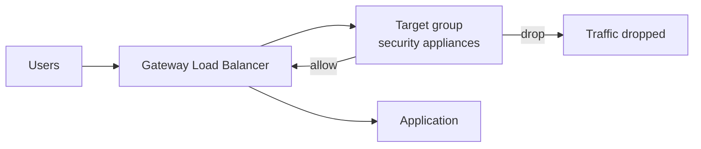
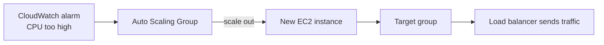
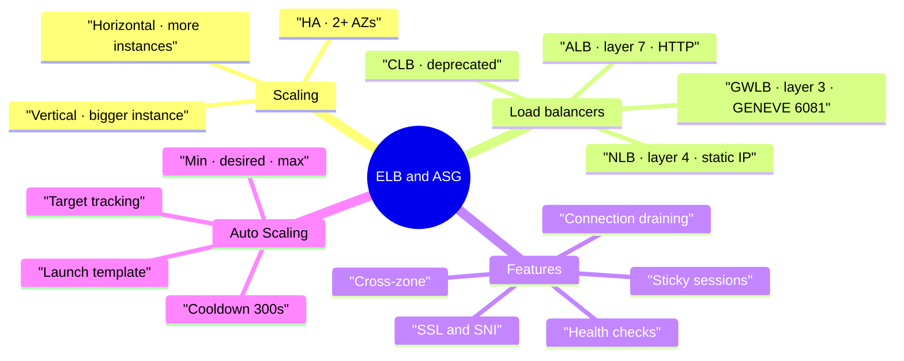

# Load Balancing and Auto Scaling

> **Core idea:** A load balancer spreads traffic over many servers and hides dead ones. An Auto Scaling Group adds or removes servers so capacity matches the load. Together they give you high availability and elasticity.

---

## 1. Scalability and High Availability

### 1.1 The two kinds of scaling

| Term                   | Meaning                 | AWS words       | Example                 |
| ---------------------- | ----------------------- | --------------- | ----------------------- |
| **Vertical scaling**   | Make one machine bigger | scale up / down | `t2.micro` → `t2.large` |
| **Horizontal scaling** | Use more machines       | scale out / in  | 1 EC2 → 6 EC2           |

Vertical scaling is used for things that cannot be split, like a database (RDS, ElastiCache). There is always a hardware limit. Horizontal scaling needs a **distributed system** — the app must work on many machines at once.

Smallest instance: `t2.nano` (0.5 GB RAM, 1 vCPU). Largest: `u-12tb1.metal` (12.3 TB RAM, 448 vCPUs).

### 1.2 High availability

**High availability (HA)** means running in at least **2 Availability Zones**, so you survive the loss of one data center.

|Type|Meaning|Example|
|---|---|---|
|Passive HA|A standby copy waits|RDS Multi-AZ|
|Active HA|All copies serve traffic|ASG + ELB across multi-AZ|

> Scalability = handle more load. High availability = survive a failure. They are linked but different.

---

## 2. Elastic Load Balancer (ELB) basics

A **load balancer** is a server that forwards incoming traffic to many backend EC2 instances. Users get **one single endpoint** and never know which instance answered.

Why use one:

- One point of access (a fixed DNS name)
- Handles instance failure using **health checks**
- SSL termination (HTTPS)
- Stickiness with cookies
- Spreads load across AZs

**Health check** = the ELB calls a port and a path (for example `HTTP :4567 /health`). No `200 OK` → the instance is marked **unhealthy** and gets no traffic.

ELB is **managed** by AWS: AWS handles upgrades, maintenance and HA.

### 2.1 The four load balancer types

|Type|Year|Layer|Protocols|Use when|
|---|---|---|---|---|
|**CLB** (Classic)|2009|4 & 7|HTTP, HTTPS, TCP, SSL|Legacy only — deprecated|
|**ALB** (Application)|2016|7|HTTP, HTTPS, WebSocket|Web apps, microservices, containers|
|**NLB** (Network)|2017|4|TCP, TLS, UDP|Extreme performance, static IP|
|**GWLB** (Gateway)|2020|3|IP / GENEVE 6081|Firewall, IDS/IPS, packet inspection|

Load balancers can be **internal** (private) or **internet-facing** (public).

### 2.2 Security group pattern (exam favourite)

The EC2 security group allows port 80 **from the load balancer's security group**, not from an IP range. Then nobody can reach the instance directly.

---

## 3. ALB — Application Load Balancer

Layer 7 only (HTTP). It routes to **target groups**.

**Routing rules** can match on:

|Rule based on|Example|
|---|---|
|Path|`/users` vs `/posts`|
|Hostname|`one.example.com` vs `other.example.com`|
|Query string / header|`?Platform=Mobile` vs `?Platform=Desktop`|

Other ALB features: HTTP/2, WebSocket, redirect HTTP → HTTPS, port mapping for ECS containers.

**Target group members can be:** EC2 instances (often managed by an ASG), ECS tasks, **Lambda functions**, or **private IP addresses** (including on-premises servers). Health checks happen at the **target group** level.

### 3.1 Client IP is hidden

The ALB terminates the connection. The backend sees the **load balancer's private IP**. The real client info arrives in headers:

|Header|Carries|
|---|---|
|`X-Forwarded-For`|Client IP|
|`X-Forwarded-Port`|Client port|
|`X-Forwarded-Proto`|Protocol used|

> One ALB can serve many applications. With CLB you needed one load balancer per application.

---

## 4. NLB and GWLB

### 4.1 NLB — Network Load Balancer

Layer 4: TCP and UDP. Millions of requests per second, ultra low latency.

Its special feature: **one static IP per AZ**, and you can attach an **Elastic IP** to each AZ.

> Exam triggers: **UDP**, **extreme performance**, or **static / whitelisted IPs** → NLB.

Target groups: EC2 instances, **private IP addresses**, or even an **ALB** (NLB in front of ALB = static IP plus HTTP rules). NLB health checks support **TCP, HTTP and HTTPS**.

### 4.2 GWLB — Gateway Load Balancer

Layer 3. Used to send all VPC traffic through third-party appliances (firewall, IDS/IPS, deep packet inspection) before it reaches the application.

It does two jobs at once: **transparent network gateway** (one entry and exit point) and **load balancer** across the appliances. Route tables in the VPC are changed so traffic passes through it. Targets: EC2 instance IDs or private IPs.

> Exam trigger: **GENEVE protocol on port 6081** → GWLB.

---

## 5. ELB features you must know

### 5.1 Sticky sessions (session affinity)

The same client keeps going to the **same backend instance**. It works with a cookie that has an expiry. Useful to keep session data such as a login, but it can make the load uneven.

Works on CLB, ALB and NLB.

|Cookie type|Created by|Name|
|---|---|---|
|Application-based|Your application, or the ALB|custom name, or `AWSALBAPP`|
|Duration-based|The load balancer|`AWSALB` (ALB), `AWSELB` (CLB)|

Reserved names you must not use: `AWSALB`, `AWSALBAPP`, `AWSALBTG`. Stickiness is enabled at the **target group** level.

### 5.2 Cross-zone load balancing

**On:** every LB node spreads traffic over **all** instances in **all** AZs. **Off:** each LB node only sends to instances in **its own AZ** — so unbalanced AZs get unbalanced traffic.

| Load balancer | Default                                    | Inter-AZ data charge |
| ------------- | ------------------------------------------ | -------------------- |
| ALB           | **Enabled** (can disable per target group) | Free                 |
| NLB / GWLB    | **Disabled**                               | Charged if enabled   |
| CLB           | Disabled                                   | Free if enabled      |

### 5.3 SSL / TLS certificates

An SSL/TLS certificate encrypts traffic **in flight** between client and load balancer. The LB does **SSL termination**, then talks HTTP to the instances inside the private VPC.

- Certificates are X.509, managed in **ACM** (AWS Certificate Manager); you can also import your own.
- An HTTPS listener needs one **default certificate**, plus an optional list of more.
- **SNI (Server Name Indication):** the client says which hostname it wants during the TLS handshake, so one load balancer can hold **many certificates for many domains**.

| Load balancer | Multiple SSL certificates?       |
| ------------- | -------------------------------- |
| CLB           | No — only one (use several CLBs) |
| ALB           | Yes, via SNI                     |
| NLB           | Yes, via SNI                     |
| CloudFront    | Yes, via SNI                     |

> Exam trigger: **multiple certificates on one load balancer** → ALB or NLB with SNI.

### 5.4 Connection draining

Gives in-flight requests time to finish while an instance is being deregistered or is unhealthy. No new connections go to it.

|Load balancer|Name of the setting|
|---|---|
|CLB|Connection Draining|
|ALB / NLB|Deregistration Delay|

Range **1–3600 seconds**, default **300 seconds**. Set `0` to disable. Short requests → low value (fast removal). Long uploads → high value.

---

## 6. Auto Scaling Groups (ASG)

An **ASG** automatically adds EC2 instances when load goes up (**scale out**) and removes them when load goes down (**scale in**).

Three numbers define it: **minimum**, **desired** and **maximum** capacity.

What it gives you:

- New instances are registered to the load balancer automatically
- An unhealthy instance is terminated and replaced
- The ASG is **free** — you pay only for the EC2 instances

A **launch template** says _how_ to launch each instance: AMI, instance type, user data, EBS volumes, security groups, key pair, IAM role, network info. (Launch configurations are the old, deprecated version.)

The ELB health check can be passed to the ASG, so the ASG terminates instances the load balancer calls unhealthy.

### 6.1 Scaling policies

| Policy                    | How it works                                                             | Use when                 |
| ------------------------- | ------------------------------------------------------------------------ | ------------------------ |
| **Target tracking**       | Keep a metric near a target, e.g. CPU at 40%                             | Simplest, most common    |
| **Simple / Step scaling** | A CloudWatch alarm adds or removes N units; step uses several thresholds | You want manual control  |
| **Scheduled**             | Change capacity at a known time, e.g. min 10 at 5 PM Friday              | Known usage pattern      |
| **Predictive**            | Forecasts load from history, then schedules ahead                        | Repeating, cyclical load |

### 6.2 Good metrics to scale on

|Metric|Use when|
|---|---|
|`CPUUtilization`|General compute load|
|`RequestCountPerTarget`|You know the best request count per instance|
|`NetworkIn` / `NetworkOut`|App is network-bound (uploads, downloads)|
|Custom CloudWatch metric|Application-specific need|

### 6.3 Scaling cooldown

After any scaling action the ASG enters a **cooldown** of **300 seconds (5 minutes)** by default. During it, no instance is launched or terminated, so metrics can settle.

To make scaling faster: use a **ready-to-use AMI** so instances boot and serve quickly, and enable **detailed monitoring** for 1-minute metrics.

---

## 7. Summary

1. Vertical = bigger machine; horizontal = more machines; HA = more than one AZ.
2. An ELB gives one endpoint, health checks and failure handling.
3. ALB = HTTP layer 7, routes by path, host, query string or header.
4. ALB targets can be EC2, ECS tasks, Lambda or private IPs.
5. The real client IP reaches the backend in `X-Forwarded-For`.
6. NLB = TCP/UDP layer 4, millions of requests, one static IP per AZ.
7. GWLB = layer 3, sends traffic through firewall/IDS appliances, GENEVE 6081.
8. Cross-zone is on by default only for ALB; on NLB/GWLB it costs money.
9. ALB and NLB support many SSL certificates through SNI; CLB supports one.
10. ASG uses a launch template, min/desired/max, and scaling policies with a 300-second cooldown.

---

## 8. Check yourself

1. What is the difference between scaling out and scaling up?
2. Which security group source should an EC2 instance allow so only the load balancer can reach it?
3. You need UDP support and two fixed IP addresses. Which load balancer?
4. Which load balancer can send traffic to a Lambda function?
5. How does the backend instance learn the real client IP behind an ALB?
6. Which load balancers have cross-zone load balancing enabled by default, and which charge for it?
7. What is SNI and which load balancers support it?
8. What is the default connection draining / deregistration delay, and what is the valid range?
9. Name the four ASG scaling policy types.
10. What happens during the ASG cooldown period, and how long is it by default?

---

## 9. Key terms

|Term|Meaning|
|---|---|
|**Vertical scaling**|Increase the size of one instance|
|**Horizontal scaling**|Increase the number of instances (scale out / in)|
|**High availability**|Running in 2 or more Availability Zones|
|**ELB**|Elastic Load Balancing — AWS managed load balancer|
|**Target group**|The set of backends (EC2, IP, Lambda, ECS) a listener forwards to|
|**Health check**|Port + path test that decides if a target gets traffic|
|**Listener**|The port and protocol the load balancer accepts traffic on|
|**Sticky session**|Cookie that keeps one client on one backend instance|
|**Cross-zone LB**|Each LB node spreads traffic to targets in every AZ|
|**SSL termination**|LB decrypts HTTPS, then talks HTTP to the backend|
|**SNI**|Client names the hostname in the TLS handshake, so one LB can hold many certificates|
|**ACM**|AWS Certificate Manager — stores and renews SSL/TLS certificates|
|**Connection draining**|Time given to finish in-flight requests before removing an instance|
|**ASG**|Auto Scaling Group — adds and removes EC2 instances automatically|
|**Launch template**|Blueprint describing how ASG instances are launched|
|**Cooldown**|Pause after a scaling action, default 300 seconds|
