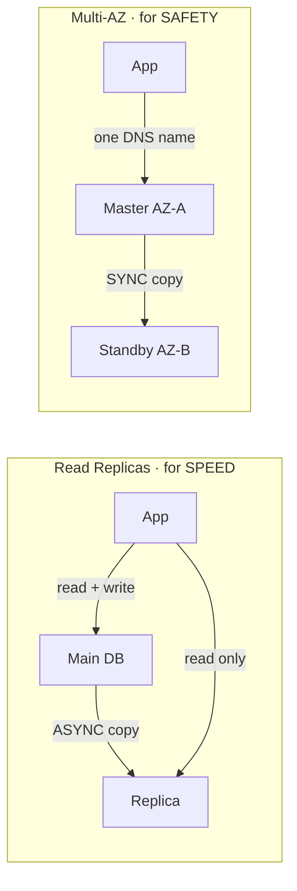
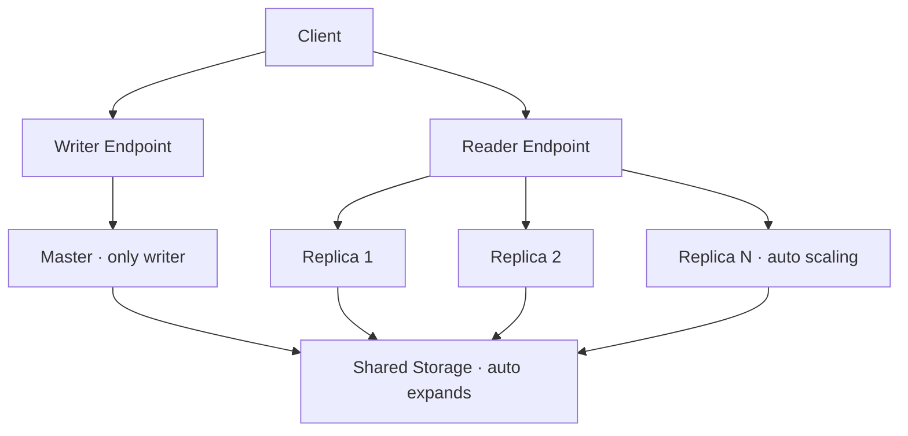
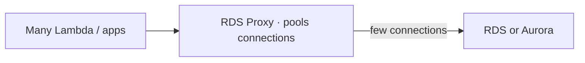
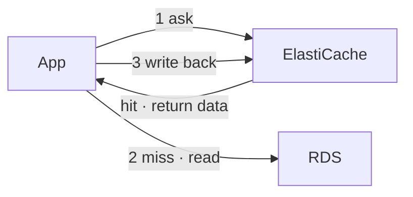
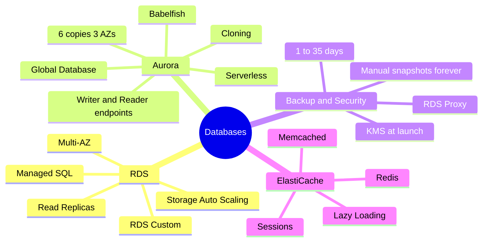

# RDS, Aurora and ElastiCache

> **Core idea:** RDS is a database that AWS manages for you. Aurora is AWS's own faster, cloud-built version of RDS. ElastiCache is a managed in-memory cache that sits in front of a database to make reads fast.

---

## 1. Amazon RDS Basics

**RDS** = Relational Database Service. A **managed** database that uses **SQL**.

### 1.1 Supported engines (memorise)

PostgreSQL · MySQL · MariaDB · Oracle · Microsoft SQL Server · IBM DB2 · **Aurora** (AWS's own)

### 1.2 RDS vs database on your own EC2

| |RDS|DB on EC2|
|---|---|---|
|Setup and OS patching|AWS does it|You do it|
|Backups + Point-in-Time Restore|Automatic|You build it|
|Read Replicas, Multi-AZ|Built in|You build it|
|Monitoring dashboards|Built in|You build it|
|**SSH into server**|**No**|Yes|
|Storage|EBS|EBS|

Scaling: **vertical** = bigger instance type. **Horizontal** = add Read Replicas.

### 1.3 Storage Auto Scaling

RDS grows the disk **automatically**, with no downtime. You must set a **maximum storage threshold**.

It grows when **all** are true:

- Free space **< 10%**
- Low space lasts **> 5 minutes**
- **6 hours** passed since last change

**Exam hint: "unpredictable workload" + "storage running out" → Storage Auto Scaling.**

---

## 2. Read Replicas vs Multi-AZ (very important)

| |Read Replicas|Multi-AZ|
|---|---|---|
|Purpose|**Scale reads**|**Disaster recovery**|
|Copy type|**Asynchronous** (eventually consistent)|**Synchronous**|
|How many|Up to **15**|1 standby|
|Location|Same AZ, cross-AZ, **cross-region**|Another AZ|
|Can app read from it?|Yes (`SELECT` only)|**No** — standby only|
|Connection|App must update connection string|**One DNS name**, auto failover|
|Special|Can be **promoted** to its own DB|Standby becomes new master|

**Network cost:** Replica in **same region** (different AZ) = **free**. **Cross-region** replica = **you pay**.

**Common exam facts:**

- Reporting/analytics team needs data → create a **Read Replica**, so production is not slowed.
- A Read Replica **can also be Multi-AZ** → Yes.
- Single-AZ → Multi-AZ = **zero downtime**. Just click _Modify_. (Behind the scenes: snapshot → restore to standby → sync.)

---

## 3. RDS Custom

Normal RDS = no OS access. **RDS Custom** = you get **OS + database access** (SSH or SSM Session Manager).

- Only for **Oracle** and **Microsoft SQL Server**.
- Before changing things: **turn off automation mode** and **take a snapshot**.

**Exam hint: "need OS access / custom patches on Oracle or SQL Server" → RDS Custom.**

---

## 4. Amazon Aurora

### 4.1 What it is

- AWS's own database (not open source).
- **Compatible with MySQL and PostgreSQL** (same drivers work).
- **5x faster** than MySQL on RDS, **3x faster** than PostgreSQL on RDS.
- Costs about **20% more** than RDS, but more efficient at scale.

### 4.2 Aurora vs RDS

| |RDS|Aurora|
|---|---|---|
|Storage|You set size (or auto scaling)|Auto grows **10 GB → 256 TB**|
|Read replicas|15|**15**, lag **< 10 ms**|
|Failover|Slower|**< 30 seconds**|
|Data copies|1 (+ standby)|**6 copies across 3 AZs**|
|Backups can be disabled?|Yes|**No**|

### 4.3 How storage stays available

- 6 copies in 3 AZs.
- Writes need **4 of 6**. Reads need **3 of 6**. So one whole AZ can fail.
- **Self-healing**: bad data is fixed by copying from peers.

### 4.4 Endpoints (must know)

| Endpoint            | Points to                   | Note                                                    |
| ------------------- | --------------------------- | ------------------------------------------------------- |
| **Writer endpoint** | Always the current master   | Works even after failover                               |
| **Reader endpoint** | All read replicas           | Load balancing at **connection level**, not query level |
| **Custom endpoint** | A chosen subset of replicas | e.g., bigger instances for analytics                    |

### 4.5 Advanced features

| Feature                     | What it does                                                            | Exam keyword                                                    |
| --------------------------- | ----------------------------------------------------------------------- | --------------------------------------------------------------- |
| **Replica Auto Scaling**    | Adds replicas when CPU/connections are high                             | "read traffic grows"                                            |
| **Custom Endpoints**        | Send a workload to specific replicas                                    | "analytics on bigger replicas"                                  |
| **Aurora Serverless**       | Auto starts and scales; pay per second                                  | "infrequent, intermittent, unpredictable"                       |
| **Global Database**         | 1 primary region + up to **10** read-only regions, **16** replicas each | "**< 1 second** cross-region replication", "RTO **< 1 minute**" |
| **Aurora Machine Learning** | ML predictions via SQL (SageMaker, Comprehend)                          | "fraud detection, sentiment, recommendations"                   |
| **Babelfish**               | Aurora PostgreSQL understands **T-SQL** (SQL Server)                    | "migrate SQL Server app with little/no code change"             |
| **Backtrack**               | Rewind data to any time, without backups                                | "go back to yesterday 4 PM"                                     |

---

## 5. Backup, Restore and Cloning

### 5.1 Backups

|              | Automated backups                  | Manual snapshots |
| ------------ | ---------------------------------- | ---------------- |
| Who triggers | AWS (daily + logs every **5 min**) | You              |
| Retention    | **1–35 days**                      | **Forever**      |
| Restore to   | Any point, up to 5 min ago         | That snapshot    |
| Disable?     | RDS: yes (set 0) · Aurora: **no**  | —                |

**Cost trick:** DB used only 2 hours/month → **snapshot + delete DB**, restore when needed. A stopped DB still charges for storage.

Restoring any backup or snapshot always creates a **new database**.

### 5.2 Restore from S3 (on-premises → AWS)

|Target|Steps|
|---|---|
|RDS MySQL|On-prem backup → S3 → new RDS instance|
|Aurora MySQL|Backup with **Percona XtraBackup** → S3 → new Aurora cluster|

### 5.3 Aurora Cloning

Make a staging DB from production **fast**. Uses **copy-on-write**: both share the same data at first; data is copied only when something changes.

**Exam hint: "test/staging copy of production Aurora, fast" → Aurora Cloning (faster than snapshot + restore).**

---

## 6. Security and RDS Proxy

### 6.1 Security (RDS + Aurora)

| Area                   | How                                 |
| ---------------------- | ----------------------------------- |
| Encryption at rest     | **KMS**, set **at launch**          |
| Master not encrypted?  | Replicas **cannot** be encrypted    |
| Encrypt existing DB    | **Snapshot → restore as encrypted** |
| In-flight              | TLS (AWS root certificates)         |
| Login                  | Username/password **or IAM roles**  |
| Network                | Security groups                     |
| SSH                    | No (only RDS Custom)                |
| Audit logs (long-term) | Send to **CloudWatch Logs**         |

### 6.2 RDS Proxy

A managed proxy between apps and DB. It **pools** many connections into a few.

|Benefit|Detail|
|---|---|
|Fewer connections|Less CPU/RAM stress, fewer timeouts|
|Faster failover|Up to **66%** less failover time|
|Force IAM login|Credentials in **Secrets Manager**|
|Security|**Never public**, only inside VPC|
|Code change|**None** — just change the endpoint|

Serverless, auto scaling, Multi-AZ.

**Exam hint: "Lambda + too many DB connections" → RDS Proxy.**

---

## 7. Amazon ElastiCache

### 7.1 What it is

Managed **Valkey**, **Redis OSS** or **Memcached**. A cache = **in-memory database**, very fast, low latency.

Two main uses:

1. **Reduce DB load** for read-heavy apps.
2. **Store user sessions** → app becomes **stateless** (user stays logged in on any instance).

> ElastiCache needs **heavy application code changes**. It is not a switch you just turn on.

### 7.2 What is Valkey?

In March 2024, Redis stopped being fully open source. So the Linux Foundation **copied Redis OSS 7.2** and made a free, open-source version called **Valkey**.

| Point | Detail |
|---|---|
| Relation to Redis | **Drop-in replacement** — same commands, same clients, no code change |
| AWS status | **Recommended** default engine for new caches |
| Price | Node-based **20% cheaper**, Serverless **33% cheaper** than Redis OSS |
| Serverless minimum | **100 MB** (Redis OSS: 1 GB) |
| Move from Redis OSS | In-place upgrade, **zero downtime** |

**Simple rule: Valkey = Redis, but open source and cheaper. Everything true for Redis is true for Valkey.**

### 7.3 Valkey / Redis vs Memcached

| | Valkey / Redis OSS | Memcached |
|---|---|---|
| High availability | **Multi-AZ + auto failover** | No |
| Replication | **Read replicas** | No (sharding only) |
| Durability | **AOF persistence**, backup/restore | Can lose data |
| Special | **Sorted Sets** (leaderboards) | **Multi-threaded** |
| Auth | **IAM**, **AUTH** password/token | **SASL** |

Simple picture: **Valkey/Redis = copies (replication). Memcached = pieces (sharding).**

### 7.4 Caching patterns

| Pattern | How it works | Downside |
|---|---|---|
| **Lazy Loading** | Read cache → miss → read DB → write to cache | Data can be **stale** |
| **Write Through** | Write to cache every time you write to DB | No stale data |
| **Session Store** | Save sessions with **TTL** (time to live) to expire | — |

**Exam hints:**

- "Real-time gaming leaderboard" → **Valkey/Redis Sorted Sets**.
- Exam questions may still say "Redis". Treat **Valkey the same as Redis**.
- "Cheapest Redis-compatible cache" → **Valkey**.

---

## 8. Exam Scenario Quick Table

|If the question says...|Answer|
|---|---|
|Scale reads / reporting workload|Read Replica|
|Disaster recovery, auto failover in another AZ|Multi-AZ|
|OS access on Oracle / SQL Server|RDS Custom|
|Storage may run out, unpredictable|RDS Storage Auto Scaling|
|Cross-region replication **< 1 second**|Aurora Global Database|
|Unpredictable, intermittent DB usage|Aurora Serverless|
|SQL Server app → Aurora, no code change|Babelfish|
|Fast staging copy of Aurora prod|Aurora Cloning|
|Encrypt an unencrypted DB|Snapshot → restore encrypted|
|Lambda with too many DB connections|RDS Proxy|
|Enforce IAM auth for DB|RDS Proxy (+ Secrets Manager)|
|Make app stateless / store sessions|ElastiCache|
|Real-time leaderboard|ElastiCache Redis Sorted Sets|

---

## 9. Summary

1. RDS = managed SQL database. No SSH (except RDS Custom).
2. Read Replica = **async**, for **reads**. Multi-AZ = **sync**, for **failover**.
3. Single-AZ → Multi-AZ has **zero downtime**.
4. Aurora = 6 copies in 3 AZs, auto storage up to 256 TB, failover < 30 s.
5. Aurora: use **writer endpoint** to write, **reader endpoint** to read.
6. Global Database = < 1 s replication, RTO < 1 min.
7. Automated backups 1–35 days; manual snapshots kept forever.
8. Encrypt existing DB = snapshot → restore encrypted.
9. RDS Proxy = connection pooling, faster failover, IAM enforcement.
10. ElastiCache = in-memory cache; Redis has HA + Sorted Sets, Memcached does not.

---

## 10. Check Yourself

1. Which replication is asynchronous: Read Replica or Multi-AZ?
2. Can you read from a Multi-AZ standby?
3. Is cross-region Read Replica traffic free?
4. Which two engines support RDS Custom?
5. How many copies of data does Aurora keep, and in how many AZs?
6. Which Aurora endpoint should an app use to send reads?
7. What hint in a question points to Aurora Global Database?
8. How do you encrypt an existing unencrypted RDS database?
9. Why use RDS Proxy with Lambda?
10. Which cache supports leaderboards, and with which feature?

---

## 11. Key Terms

|Term|Meaning|
|---|---|
|Managed service|AWS runs the servers, patching and backups for you|
|Asynchronous|Copy happens later; replica may be a little behind|
|Synchronous|Copy happens at the same time as the write|
|Eventually consistent|Data becomes correct after a short delay|
|Failover|Switching to a backup DB when the main one fails|
|Promote|Turn a replica into its own normal database|
|Point-in-Time Restore|Restore DB to an exact past moment|
|RTO|Recovery Time Objective — how fast you recover|
|Copy-on-write|Copy data only when it changes|
|T-SQL|The SQL language used by Microsoft SQL Server|
|Connection pooling|Many app connections share a few DB connections|
|Cache hit / miss|Data found in cache / not found in cache|
|Stale data|Old data in cache that no longer matches the DB|
|TTL|Time to live — when cached data expires|
|Sharding|Splitting data across many nodes|
