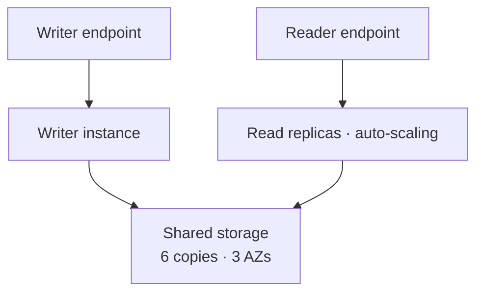
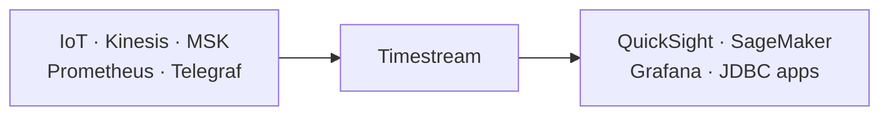
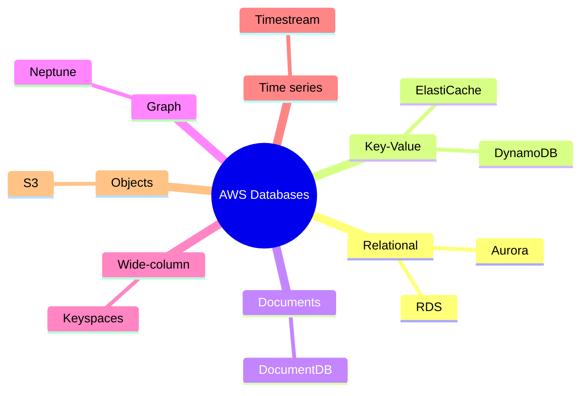

# Databases on AWS — Choosing the Right One

> **Core idea:** AWS has many managed databases. The exam gives you a workload and asks you to pick one. Learn the **one keyword** that points to each database, and you can answer most questions.

---

## 1. How to Choose a Database

### 1.1 Questions to ask about the workload

|Question|Example answers|
|---|---|
|Read-heavy or write-heavy?|Many reads → add read replicas or a cache|
|Is traffic steady or spiky?|Spiky → serverless / on-demand mode|
|What does the data look like?|Tables (SQL) · JSON · graph · time series|
|Do you need joins and SQL?|Yes → relational database|
|Do you need a strict schema?|No, schema changes fast → NoSQL|
|How fast must it answer?|Microseconds → in-memory cache|

### 1.2 The database families

| Family                        | Meaning                           | AWS services                                          |
| ----------------------------- | --------------------------------- | ----------------------------------------------------- |
| **Relational (RDBMS / OLTP)** | Tables, SQL, joins, transactions  | RDS, Aurora                                           |
| **NoSQL**                     | Flexible schema, usually no joins | DynamoDB, ElastiCache, DocumentDB, Neptune, Keyspaces |
| **Object store**              | Big files                         | S3, Glacier (archives)                                |
| **Data warehouse (OLAP)**     | Analytics and BI with SQL         | Redshift, Athena, EMR                                 |
| **Search**                    | Free-text search                  | OpenSearch                                            |
| **Graph**                     | Relationships between data        | Neptune                                               |
| **Ledger**                    | List of transactions              | QLDB                                                  |
| **Time series**               | Data points with a time           | Timestream                                            |

> **OLTP** = many small, fast transactions (an online shop). **OLAP** = big analytic queries (reports).

---

## 2. Relational Databases — RDS and Aurora

### 2.1 Amazon RDS

**RDS** is a managed SQL database. Engines: PostgreSQL, MySQL, MariaDB, Oracle, SQL Server, DB2, and RDS Custom.

- You **provision** the instance size and the EBS volume. Storage can auto-scale.
- AWS does the patching, but **scheduled maintenance causes downtime**.

| Feature           | What to remember                                                      |
| ----------------- | --------------------------------------------------------------------- |
| **Read Replicas** | Scale reads. Run analytics on a replica, not on production.           |
| **Multi-AZ**      | Standby copy for disaster only. **You cannot read from it.**          |
| Automated backups | Up to **35 days**, point-in-time restore → creates a **new** database |
| Manual snapshots  | For long-term backup                                                  |
| Security          | Security groups, KMS (at rest), SSL/TLS (in transit), IAM auth        |
| **RDS Proxy**     | Can enforce IAM authentication                                        |
| Secrets Manager   | Stores and manages DB passwords                                       |
| **RDS Custom**    | Access the underlying instance. Only **Oracle** and **SQL Server**.   |

### 2.2 Amazon Aurora

**Aurora** is AWS's cloud-native database, compatible with **PostgreSQL** and **MySQL**. Its special idea: **storage and compute are separate**.

- **Storage:** 6 copies across 3 AZs (fixed), self-healing, auto-grows.
- **Compute:** a cluster of instances. Use the **writer endpoint** to write, **reader endpoint** to read.

| Feature                     | Use it when…                                                                                                      |
| --------------------------- | ----------------------------------------------------------------------------------------------------------------- |
| **Aurora Serverless**       | Workload is **unpredictable or intermittent**, no capacity planning                                               |
| **Aurora Global**           | Multi-region. Up to **16 read instances per region**, replication **< 1 second**. Can promote a secondary region. |
| **Aurora Machine Learning** | ML on your data with SageMaker and Comprehend                                                                     |
| **Database Cloning**        | Make a test/staging DB from production. **Faster than snapshot + restore.**                                       |

### 2.3 RDS vs Aurora

|          | RDS                                  | Aurora                             |
| -------- | ------------------------------------ | ---------------------------------- |
| Engines  | Many (Oracle, SQL Server, …)         | Only PostgreSQL and MySQL          |
| Storage  | EBS you choose                       | 6 copies, 3 AZs, auto              |
| Extras   | Basic                                | Serverless, Global, Cloning, ML    |
| Best for | Need Oracle/SQL Server, simple setup | More performance, less maintenance |

---

## 3. Fast Key-Value Stores — ElastiCache and DynamoDB

### 3.1 Amazon ElastiCache

**ElastiCache** is managed **Redis** or **Memcached**. It is an **in-memory** cache with **sub-millisecond** reads.

- Redis supports clustering, Multi-AZ, read replicas, and Redis AUTH.
- Use cases: cache database queries, store **user session data**.
- **No SQL** queries.

> **Exam trap:** ElastiCache **needs application code changes**. If the question says "caching **without code change**", ElastiCache is wrong.

### 3.2 Amazon DynamoDB

**DynamoDB** is AWS's own **serverless NoSQL** database with **millisecond** latency. Multi-AZ by default. It appears **a lot** on the exam.

|Capacity mode|Use when|
|---|---|
|**Provisioned** (+ optional auto-scaling)|Smooth traffic that changes slowly|
|**On-demand**|**Unpredictable** traffic or **sudden spikes**|

|Feature|What to remember|
|---|---|
|**DAX**|Built-in cache → **microsecond** reads|
|**TTL**|Auto-delete rows after a time (good for sessions)|
|**DynamoDB Streams**|Every change → can trigger **Lambda**|
|Kinesis Data Streams|Alternative stream: longer retention (up to 1 year), Firehose|
|**Global Tables**|**Active-active**: read and write in any region|
|Backups|PITR up to 35 days, or on-demand backups → restore to a **new table**|
|Export / Import S3|Export (inside PITR window) uses **no read capacity**; import uses **no write capacity**|
|Transactions|Supported|

> **Exam keyword:** "**rapidly evolving / flexible schema**" or "**serverless app**" → DynamoDB. Items are small (hundreds of KB max).

### 3.3 ElastiCache vs DynamoDB

|               | ElastiCache            | DynamoDB                             |
| ------------- | ---------------------- | ------------------------------------ |
| Speed         | Sub-millisecond        | Milliseconds (microseconds with DAX) |
| Server        | You pick instance type | Serverless                           |
| Code change   | Needed                 | —                                    |
| Session store | Yes                    | Yes (with TTL)                       |

---

## 4. Special-Purpose Databases

Each one matches **one exam keyword**.

| Service        | What it is                             | Key facts                                                                  | Exam keyword                                                                 |
| -------------- | -------------------------------------- | -------------------------------------------------------------------------- | ---------------------------------------------------------------------------- |
| **DocumentDB** | "Aurora for **MongoDB**" — stores JSON | 3 AZs, storage grows by 10 GB, millions of requests/sec                    | **MongoDB**, JSON documents                                                  |
| **Neptune**    | **Graph** database                     | 3 AZs, up to **15 read replicas**, billions of relations, ms latency       | **Graph**, social network, fraud detection, recommendations, knowledge graph |
| **Keyspaces**  | Managed **Apache Cassandra**           | Serverless, uses **CQL**, on-demand or provisioned mode, PITR 35 days      | **Cassandra**                                                                |
| **Timestream** | **Time series** database               | Serverless, trillions of events/day, SQL compatible, recent data in memory | **Time series**, IoT metrics                                                 |

### 4.1 Neptune Streams

**Neptune Streams** record every change in the graph, **in order, with no duplicates**. Apps read them through an **HTTP REST API**.

Use for: notifications on changes, syncing data to S3 / OpenSearch / ElastiCache, or copying to a Neptune cluster in another region.

### 4.2 Timestream connections

---

## 5. S3 as a Database

**S3** is a **key-value store for objects**. Good for **big** objects, bad for **many small** objects.

- Serverless, infinite scale, max object size **5 TB**.
- Storage tiers + lifecycle policies to move between them.
- Use cases: static files, huge files, website hosting.

|Need|S3 feature|
|---|---|
|Encrypt old unencrypted objects|**S3 Batch Operations** (+ S3 Inventory for the file list)|
|Faster upload|Multi-part upload|
|Faster cross-region transfer|Transfer Acceleration|
|Get only part of the data|S3 Select|
|React to new objects|Event notifications → SNS, SQS, Lambda, EventBridge|

---

## 6. Exam Quick Decision Table

| If the question says…                            | Answer                              |
| ------------------------------------------------ | ----------------------------------- |
| SQL, joins, OLTP, transactions                   | **RDS / Aurora**                    |
| Oracle or SQL Server, need OS access             | **RDS Custom**                      |
| Unpredictable SQL workload, no capacity planning | **Aurora Serverless**               |
| Global SQL DB, < 1 sec replication               | **Aurora Global**                   |
| Copy prod DB for testing, fast                   | **Aurora Cloning**                  |
| Read replica you **cannot** read from            | That's **Multi-AZ** standby         |
| Cache DB queries / sessions, sub-ms              | **ElastiCache** (needs code change) |
| Serverless NoSQL, flexible schema                | **DynamoDB**                        |
| Microsecond reads on DynamoDB                    | **DAX**                             |
| Multi-region read **and** write NoSQL            | **DynamoDB Global Tables**          |
| Run Lambda on every DB change                    | **DynamoDB Streams**                |
| MongoDB                                          | **DocumentDB**                      |
| Graph / social network / fraud                   | **Neptune**                         |
| Apache Cassandra / CQL                           | **Keyspaces**                       |
| Time series / IoT metrics                        | **Timestream**                      |
| Big files, static content                        | **S3**                              |

---

## 7. Summary

1. Pick a database by **data shape** and **access pattern**.
2. SQL + joins → **RDS** or **Aurora**.
3. **Multi-AZ** = disaster standby only. **Read Replicas** = scale reads.
4. Aurora stores **6 copies in 3 AZs** and has Serverless, Global, Cloning.
5. **ElastiCache** is sub-ms but **needs code changes**.
6. **DynamoDB** = serverless NoSQL; **DAX** gives microseconds; **Global Tables** = active-active.
7. Backups on RDS, DynamoDB, Keyspaces: point-in-time up to **35 days**, restore to a **new** DB.
8. MongoDB → DocumentDB. Graph → Neptune. Cassandra → Keyspaces. Time series → Timestream.

---

## 8. Check Yourself

1. Can you run queries on an RDS Multi-AZ standby?
2. Which two RDS engines support RDS Custom?
3. How many copies of data does Aurora keep, and in how many AZs?
4. You need a test DB from production quickly. Which Aurora feature?
5. A caching solution must need **no code change**. Is ElastiCache correct?
6. Which DynamoDB capacity mode fits sudden traffic spikes?
7. What gives DynamoDB microsecond read latency?
8. Which DynamoDB feature allows writes in many regions?
9. A company uses MongoDB and wants to move to AWS. Which service?
10. Which database fits fraud detection on connected data?

---

## 9. Key Terms

|Term|Meaning|
|---|---|
|OLTP|Many small, fast transactions|
|OLAP|Large analytic queries for reports|
|Read Replica|Copy of the DB used to spread read load|
|Multi-AZ|Standby copy in another AZ, for failover only|
|PITR|Point-In-Time Recovery — restore to any second in the window|
|Writer / Reader endpoint|Aurora addresses for writes and for reads|
|DAX|DynamoDB Accelerator — in-memory cache for DynamoDB|
|TTL|Time To Live — auto-delete data after a time|
|Active-active|Every region can read and write|
|CQL|Cassandra Query Language|
|Time series|Data points that each have a timestamp|
|Graph database|Stores items and the links between them|
