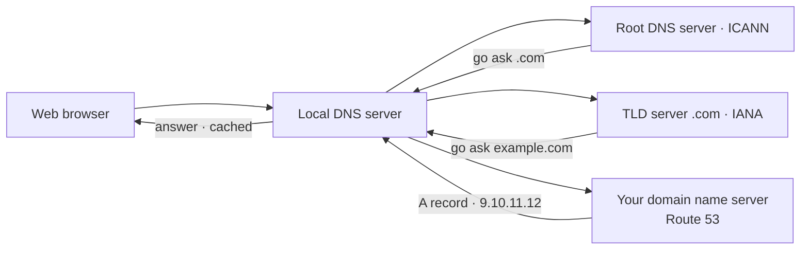
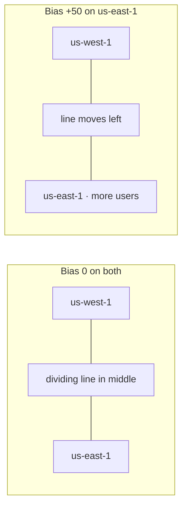
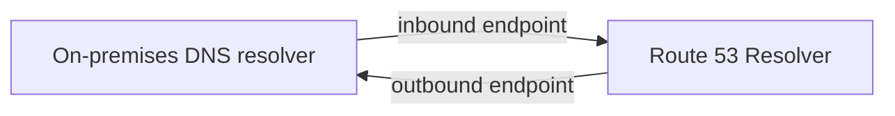
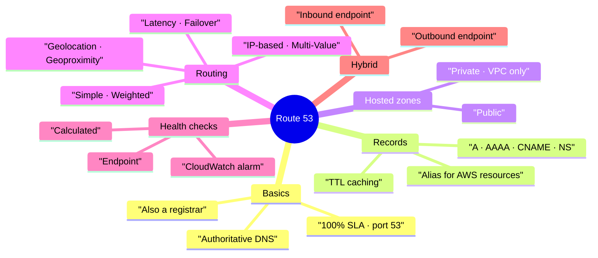

# AWS-06 — Route 53 (DNS)

> **Core idea:** DNS turns a name like `example.com` into an IP address. Route 53 is Amazon's own DNS service where you store those name→IP rules (records), plus it can register domains and check if your servers are alive. The exam mostly tests three things: **Alias vs CNAME**, **the 7 routing policies**, and **health checks**.

---

## 1. What DNS Is

**DNS (Domain Name System)** translates a human-friendly hostname into a server IP address. Your browser cannot connect to a name, only to an IP.

### 1.1 Parts of a name

For `http://api.www.example.com.`

| Part                  | Name                   | Meaning                       |
| --------------------- | ---------------------- | ----------------------------- |
| `.` (last dot)        | Root                   | Top of the whole DNS tree     |
| `.com`                | TLD (top level domain) | `.com`, `.org`, `.gov`, `.in` |
| `example.com`         | Second level domain    | The name you buy              |
| `www.example.com`     | Subdomain              | A name under your domain      |
| `api.www.example.com` | FQDN                   | Fully qualified domain name   |
| `http`                | Protocol               | The whole line is the **URL** |

### 1.2 Words you need

| Term             | Meaning                                      |
| ---------------- | -------------------------------------------- |
| Domain registrar | Where you buy a domain (Route 53, GoDaddy…)  |
| DNS record       | One rule: name → value (A, AAAA, CNAME, NS…) |
| Zone file        | The file holding all records                 |
| Name server      | A server that answers DNS questions          |

### 1.3 How a lookup happens

The browser asks a **local DNS server** (given by your ISP or company). If it does not know, it asks upward until it finds the answer, then caches it.



**Each step does not give the final answer — it gives a server that knows more.**

---

## 2. Route 53 Basics

Route 53 is a **highly available, scalable, fully managed, authoritative DNS**. _Authoritative_ means **you** control the records. It is also a **domain registrar**, and it is the only AWS service with a **100% availability SLA**. The name comes from port **53**, the traditional DNS port.

### 2.1 What a record holds

Domain/subdomain name, record **type**, **value**, **routing policy**, and **TTL**.

### 2.2 Record types to know

| Type      | Maps                            | Example                                   |
| --------- | ------------------------------- | ----------------------------------------- |
| **A**     | hostname → IPv4                 | `example.com` → `1.2.3.4`                 |
| **AAAA**  | hostname → IPv6                 | `example.com` → `2001:db8::1`             |
| **CNAME** | hostname → another hostname     | `www.example.com` → `blabla.anything.com` |
| **NS**    | Name servers of the hosted zone | Controls who answers for your domain      |

> A **CNAME cannot be created at the zone apex** (the bare domain). `www.example.com` is allowed; `example.com` is not.

### 2.3 Hosted zones

A **hosted zone** is a container of records for one domain and its subdomains.

|               | Public hosted zone        | Private hosted zone            |
| ------------- | ------------------------- | ------------------------------ |
| Who can query | Anyone on the internet    | Only resources inside your VPC |
| Answers with  | Public IPs                | Private IPs                    |
| Example       | `app1.mypublicdomain.com` | `db.company.internal`          |

Cost: **$0.50 per hosted zone per month**, and a registered domain costs **minimum $12 per year**.

---

## 3. TTL — Caching the Answer

**TTL (Time To Live)** tells the client how many seconds to cache the answer. During that time the client does **not** ask Route 53 again.

| TTL              | Traffic to Route 53     | Risk                                         |
| ---------------- | ----------------------- | -------------------------------------------- |
| High (e.g. 24 h) | Low traffic, lower cost | Clients keep outdated records for up to 24 h |
| Low (e.g. 60 s)  | More traffic, more cost | Records are outdated for a short time only   |

**Safe way to change a record:** lower the TTL first, wait until all old caches expire, change the value, then raise the TTL back.

> TTL is mandatory for every record **except Alias records**, where Route 53 sets it automatically.

Check a record from a terminal:

```bash
# install the dig and nslookup tools on Amazon Linux
sudo yum install -y bind-utils
```

```bash
# show the record type, value and the remaining TTL
dig demo.example.com
```

`dig` is better than `nslookup` for study because it also prints the TTL counting down.

---

## 4. Alias vs CNAME (exam favourite)

Both point a name to another name. The difference is where they can be used.

|                                    | CNAME        | Alias                          |
| ---------------------------------- | ------------ | ------------------------------ |
| Points to                          | Any hostname | AWS resources only             |
| Works at zone apex (`example.com`) | **No**       | **Yes**                        |
| Cost of queries                    | Charged      | **Free**                       |
| TTL                                | You set it   | Set by Route 53, cannot change |
| Record type                        | CNAME        | **A or AAAA**                  |
| Health check built in              | No           | Yes (evaluate target health)   |
| Follows IP changes of the target   | No           | Yes, automatically             |

**Valid Alias targets:** ELB, CloudFront distributions, API Gateway, Elastic Beanstalk environments, **S3 Websites** (not plain buckets), VPC Interface Endpoints, Global Accelerator, and other Route 53 records in the same hosted zone.

> You **cannot** create an Alias to an **EC2 DNS name**.

If you try a CNAME at the apex the console refuses it: _"CNAME is not permitted at apex of this zone."_ Use an Alias type A instead.

---

## 5. Routing Policies

A routing policy decides **how Route 53 answers a DNS query**. Traffic never flows through DNS — DNS only gives the client an address, and the client connects by itself.

| Policy           | What it does                                                                            | Health check             | Remember                                                                   |
| ---------------- | --------------------------------------------------------------------------------------- | ------------------------ | -------------------------------------------------------------------------- |
| **Simple**       | Returns one resource; if several values are in one record the **client** picks randomly | **No**                   | With an Alias, only one AWS target allowed                                 |
| **Weighted**     | Splits traffic by relative weights (`weight ÷ sum of weights`)                          | Yes                      | Weights need not total 100. Weight `0` = no traffic. All `0` = equal share |
| **Latency**      | Sends the user to the AWS **region with lowest latency** for them                       | Yes                      | Based on measured latency, not distance                                    |
| **Failover**     | Primary + secondary. If primary is unhealthy, answer with secondary                     | **Mandatory on primary** | Exactly one primary and one secondary                                      |
| **Geolocation**  | Based on **where the user is**: continent, country, or US state                         | Yes                      | Most precise match wins. Always create a **default** record                |
| **Geoproximity** | Route by distance between user and resource, shifted by a **bias**                      | Yes                      | Needs **Route 53 Traffic Flow**. Bias up = pull more traffic in            |
| **IP-based**     | Route by the client's IP **CIDR** range                                                 | Yes                      | Use when you know the ISP's IP ranges                                      |
| **Multi-Value**  | Returns up to **8 healthy records**; client picks one                                   | Yes                      | Client-side load balancing, **not** a replacement for an ELB               |

### 5.1 Weighted vs Latency vs Geolocation — pick the right one

| Exam wording                                                 | Answer              |
| ------------------------------------------------------------ | ------------------- |
| "send 10% of traffic to the new version"                     | Weighted            |
| "best performance / fastest response for users"              | Latency             |
| "show French content to users in France" / "block a country" | Geolocation         |
| "shift traffic from one region to another gradually"         | Geoproximity (bias) |
| "automatic disaster recovery to a standby site"              | Failover            |
| "return several healthy IPs, client chooses"                 | Multi-Value         |

### 5.2 Geoproximity bias in one picture



> Increasing the bias of a region pulls **more** users into it. A negative bias pushes users away.

---

## 6. Health Checks

Health checks let Route 53 stop sending users to a broken resource — **automated DNS failover**.

### 6.1 Three kinds

| Kind                 | Monitors                           | Use for                                               |
| -------------------- | ---------------------------------- | ----------------------------------------------------- |
| Endpoint             | A public URL / IP                  | Public ALBs, servers, AWS resources                   |
| **Calculated**       | Other health checks (parent/child) | Combine with **OR, AND, NOT**; up to **256 children** |
| **CloudWatch Alarm** | An alarm state                     | The only way to check **private** resources           |

### 6.2 Endpoint check details

- About **15 health checkers** around the world probe your endpoint.
- Healthy if **more than 18%** of checkers report healthy.
- Interval: **30 s** standard, or **10 s** fast (costs more).
- Protocols: **HTTP, HTTPS, TCP**.
- Passes only on a **2xx or 3xx** status code.
- Can search for text inside the first **5120 bytes** of a text response.
- Your security group must allow the **Route 53 health checker IP ranges**, or you get a connection timeout.

> Health checkers live on the public internet. They cannot reach a private subnet or on-premises server — use a **CloudWatch Metric → Alarm → health check** chain instead.

---

## 7. Registrar vs DNS Service

A **domain registrar** (where you buy the name) and a **DNS service** (where records live) are two different jobs. Most registrars give you both, but you can mix them.

To buy on GoDaddy but manage DNS in Route 53:

1. Create a **public hosted zone** in Route 53 for that domain.
2. Copy the **4 name servers** shown in the hosted zone.
3. On GoDaddy, replace the name servers with those four.

Now Route 53 is the source of truth for your records.

---

## 8. Route 53 Resolver — Hybrid DNS

By default the Route 53 Resolver answers queries for your EC2 local names, private hosted zones and public records — **inside AWS only**. To make DNS work both ways with an on-premises data center you add **resolver endpoints** (a VPN or Direct Connect must already exist).

| Endpoint     | Direction         | Meaning                                            |
| ------------ | ----------------- | -------------------------------------------------- |
| **Inbound**  | On-premises → AWS | On-prem servers can resolve AWS private names      |
| **Outbound** | AWS → On-premises | EC2 can resolve names like `web.onpremise.private` |



---

## 9. Summary



1. DNS converts names to IPs by asking root → TLD → your name server.
2. Route 53 is authoritative DNS plus a registrar, with a 100% availability SLA.
3. Know A, AAAA, CNAME and NS records.
4. Public hosted zone = internet; private hosted zone = inside your VPC only.
5. TTL controls caching; lower it before changing a record.
6. **Alias works at the zone apex, is free, and only targets AWS resources — but never an EC2 DNS name.**
7. Seven routing policies; match the exam wording to the policy.
8. Simple routing cannot use health checks; Multi-Value can, and returns up to 8 healthy records.
9. Failover requires a health check on the primary record.
10. Private resources are health-checked through a CloudWatch Alarm.

---

## 10. Check Yourself

1. Which server is asked first when the local DNS server knows nothing about `example.com`?
2. Why can you not create a CNAME for `example.com` itself?
3. Give three Alias targets, and one thing that can never be an Alias target.
4. You must change an A record tomorrow. What do you do to the TTL today, and why?
5. Which routing policy sends 70% of users to one region on purpose?
6. Which routing policy is based on measured speed, and which on the user's country?
7. How many records can Multi-Value return, and what makes it safer than Simple with many values?
8. What percentage of global health checkers must report healthy for Route 53 to call an endpoint healthy?
9. How do you health-check an EC2 instance in a private subnet?
10. You bought a domain on GoDaddy but want Route 53 records. What two steps do you take?

---

## 11. Key Terms

| Term                    | Meaning                                                               |
| ----------------------- | --------------------------------------------------------------------- |
| Authoritative DNS       | DNS where the customer controls the records                           |
| Hosted zone             | Container of DNS records for a domain                                 |
| Zone apex               | The bare domain, e.g. `example.com`                                   |
| FQDN                    | Full name including all subdomains                                    |
| TTL                     | Seconds a client caches a DNS answer                                  |
| Alias record            | Route 53-only record pointing to an AWS resource, free, works at apex |
| Bias                    | Number in Geoproximity that grows or shrinks a region's area          |
| CIDR                    | An IP address range, used by IP-based routing                         |
| Calculated health check | Parent check combining child checks with AND/OR/NOT                   |
| Resolver endpoint       | Inbound/outbound gateway for DNS between AWS and on-premises          |
| Traffic Flow            | Advanced Route 53 feature required for Geoproximity                   |
