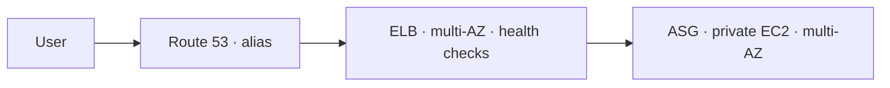
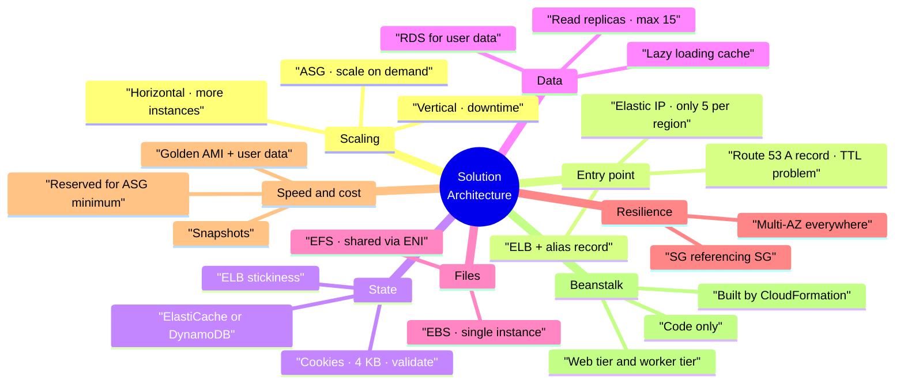

# AWS Solution Architecture Discussions

> **Core idea:** Every AWS architecture grows in the same order: one server → bigger server → many servers → load balancer → auto scaling → multi-AZ → cost saving. The exam gives you a requirement and asks which step fits. Learn the step, not the service list.

---

## 1. The growth path (the 20% that matters)

Start small, then fix one problem at a time. Each fix creates the next problem.

|Step|What you add|Problem it fixes|New problem it creates|
|---|---|---|---|
|1|1 EC2 + Elastic IP|Need a fixed public IP|One server, no scale|
|2|Bigger instance type (T2.micro → M5.large)|Too much load|**Downtime** while resizing|
|3|More instances, each with Elastic IP|Need more capacity|Only 5 Elastic IPs per region per account; users must know every IP|
|4|Route 53 **A record** (TTL 1 hour)|Users use a name, not IPs|If an instance is removed, users keep the old IP for 1 hour|
|5|**ELB** + Route 53 **Alias record**|One entry point, health checks|Adding/removing instances by hand is painful|
|6|**Auto Scaling Group (ASG)**|Scales in and out on demand|Still in one AZ|
|7|**Multi-AZ** ELB + ASG|Survives one AZ failure|Costs more|
|8|**Reserved Instances** for the ASG minimum|Saves money on always-on capacity|—|

> Vertical scaling = make the instance bigger, and it needs a stop/start, so there is downtime. Horizontal scaling = add more instances, no downtime.

**Why A record fails but Alias works:** an A record returns IP addresses, and a load balancer's IP changes over time. An alias record points at the ELB itself, so it always stays correct.

**Security group pattern:** the ELB allows HTTP/HTTPS from anywhere; the EC2 security group allows traffic **only from the ELB security group**. Referencing one security group from another is the exam-correct answer.

**Cost pattern:** reserve the instances that must always run (the ASG minimum). Use On-Demand for extra instances, or Spot if you can accept termination.

---

## 2. Stateless vs stateful

**Stateless** = the server remembers nothing between requests. A time-telling site is stateless, so any instance can answer. **Stateful** = something must be remembered, like a shopping cart. The problem: the ELB may send the next request to a different instance, and that instance does not know the cart.

Four ways to solve it:

|Option|How it works|Good|Bad|
|---|---|---|---|
|**ELB stickiness** (session affinity)|Same user always goes to the same instance|Very easy to enable|Cart is lost if that instance dies|
|**User cookies**|The browser sends the whole cart every request|Fully stateless servers|Requests get heavy; cookie max ~4 KB; attacker can edit it, so **the server must validate it**|
|**Session ID + ElastiCache**|Cookie holds only an ID; the cart lives in ElastiCache|Sub-millisecond; secure, cache is the source of truth|Extra service to run|
|**Session ID + DynamoDB**|Same idea, DynamoDB stores the session|Managed alternative|—|

> Keep the web tier stateless. Move the state out to a cache or database.

**Long-term user data** (name, address) goes in **RDS**, not in a cache.

### 2.1 Scaling reads

|Technique|How|Trade-off|
|---|---|---|
|**RDS Read Replicas**|Master takes writes; replicas take reads; up to **15** replicas|Costs more|
|**Lazy loading cache**|App checks ElastiCache first; on a miss it reads RDS and writes the result into the cache|Less CPU on RDS, faster reads, but you must handle cache maintenance in the application code|

### 2.2 Surviving disasters

|Layer|Multi-AZ answer|
|---|---|
|Route 53|Already highly available — nothing to do|
|ELB|Enable multi-AZ|
|ASG|Span multiple AZs|
|RDS|Multi-AZ = a standby replica that takes over|
|ElastiCache|Multi-AZ available **with Redis**|

This is the classic **3-tier** design: client tier → web tier → database tier.

---

## 3. Shared files: EBS vs EFS

A WordPress site must store uploaded pictures and let **every** instance read them.

- **EBS** is one volume attached to one instance in one AZ. With two instances in two AZs, an image written on volume A cannot be read from volume B.
- **EFS** is a network file system (NFS). It creates an **ENI** (Elastic Network Interface) in each AZ, and all instances mount the same shared storage.

|                          |EBS|EFS|
|---|---|---|
| Shared between instances |No|Yes|
| Works across AZs         |No|Yes|
| Cost                     |Cheaper|More expensive|
| Best for                 |Single-instance apps|Scalable multi-AZ apps|

For the database layer, **Aurora MySQL** is an easier choice than plain RDS: multi-AZ, read replicas, and global databases with less operational work.

---

## 4. Starting applications quickly

Installing software at launch time is slow. Prepare things in advance instead.

|Resource|Fast-start method|What it gives you|
|---|---|---|
|EC2|**Golden AMI**|OS, dependencies and app already installed|
|EC2|**User data** (bootstrapping)|Dynamic config at first boot — database URL, passwords|
|RDS|Restore from **snapshot**|Schema and data ready, no slow inserts|
|EBS|Restore from **snapshot**|Already formatted, with data|

> The common production pattern is a **hybrid**: a golden AMI for the slow static parts, plus user data for the dynamic parts. Elastic Beanstalk works exactly this way.

---

## 5. Elastic Beanstalk

Most web apps use the same shape: ELB + ASG + EC2 + RDS + ElastiCache. Rebuilding it for every app wastes time. **Beanstalk is a managed service that builds that whole stack for you, so the developer only provides the code.**

It handles capacity provisioning, load balancer configuration, scaling, health monitoring and instance configuration. You still keep full control of each component's settings — they are just bundled behind one interface.

**Pricing:** Beanstalk itself is free. You pay for the resources it creates (EC2, ELB, ASG, RDS).

### 5.1 Components

|Component|Meaning|
|---|---|
|**Application**|The collection of environments, versions and configurations|
|**Version**|One iteration of your code (v1, v2, v3)|
|**Environment**|Resources running **one** application version at a time; e.g. dev, test, prod|

Process: create application → upload version → launch environment → manage its lifecycle → upload a new version to update.

### 5.2 Environment tiers

|Tier|Shape|Scales on|
|---|---|---|
|**Web server tier**|ELB → ASG → EC2 web servers|Traffic|
|**Worker tier**|SQS queue → EC2 workers pull messages|Number of SQS messages|

The web tier can push messages into the worker tier's SQS queue.

### 5.3 Deployment modes

| Mode                                     | What you get                                             | Use for                          |
| ---------------------------------------- | -------------------------------------------------------- | -------------------------------- |
| **Single instance**                      | One EC2 with an Elastic IP, optional RDS                 | Development (free tier eligible) |
| **High availability with load balancer** | ELB + ASG across multiple AZs, RDS multi-AZ with standby | Production                       |

### 5.4 What it creates behind the scenes

Beanstalk builds everything through **CloudFormation**. In the CloudFormation console you can watch the stack events and see the resources it created: auto scaling group, launch configuration, security groups, Elastic IP.

Supported platforms include Go, Java SE, Java with Tomcat, .NET Core on Linux, .NET on Windows Server, Node.js, PHP, Python, Ruby, Packer Builder, and single, multi or pre-configured Docker containers.

> **Beanstalk is centred on code and environments. CloudFormation deploys any infrastructure stack at all.** That is the exam distinction.

---

## 6. Summary

1. Vertical scaling causes downtime; horizontal scaling does not.
2. Elastic IPs do not scale — only 5 per region per account by default.
3. Route 53 A records go stale because of TTL; use an **alias record** to an ELB.
4. ELB health checks stop traffic going to broken instances.
5. ASG removes manual instance management and lowers cost by running only what is needed.
6. Multi-AZ on ELB, ASG, RDS and ElastiCache (Redis) survives an AZ failure.
7. Keep the web tier stateless — push session data to ElastiCache or DynamoDB.
8. Scale reads with read replicas or a lazy-loading cache.
9. EBS is per-instance; EFS is shared across instances and AZs.
10. Beanstalk gives a developer-centric wrapper around ELB + ASG + EC2 + RDS, free itself, built by CloudFormation.

---

## 7. Check yourself

1. Why does changing an instance type cause downtime, and what keeps the IP the same?
2. What are the two limits that make many Elastic IPs a bad design?
3. Why can a load balancer not use an A record?
4. A user loses their shopping cart on every click. Name three different fixes.
5. What is the maximum cookie size, and what must the server do with cookie data?
6. How many RDS read replicas can you have?
7. Explain lazy loading in two sentences.
8. Two instances in two AZs must share uploaded images. Which storage service, and why not the other one?
9. Which parts of an architecture do you reserve instances for, and why?
10. When would you pick a Beanstalk worker environment over a web server environment?

---

## 8. Key terms

|Term|Meaning|
|---|---|
|**Vertical scaling**|Replace the instance with a bigger one|
|**Horizontal scaling**|Add more instances|
|**Elastic IP**|A fixed public IP you can attach to an instance; 5 per region per account by default|
|**TTL**|How long a DNS answer is cached by the client|
|**Alias record**|A Route 53 record pointing at an AWS resource such as an ELB|
|**Health check**|ELB test that stops traffic to unhealthy instances|
|**ASG**|Auto Scaling Group — adds and removes instances automatically|
|**Multi-AZ**|Resources spread over several availability zones for resilience|
|**Stickiness**|ELB feature sending one user to the same instance every time|
|**Stateless**|The server keeps no memory between requests|
|**ElastiCache**|Managed in-memory cache with sub-millisecond reads|
|**Read replica**|A read-only copy of an RDS database|
|**Lazy loading**|Cache on first miss, serve from cache afterwards|
|**ENI**|Elastic Network Interface — the network entry point EFS creates in each AZ|
|**EFS**|Shared network file system (NFS) usable by many instances|
|**Golden AMI**|An image with software already installed|
|**User data**|Script run at first boot to configure an instance|
|**Beanstalk environment**|Resources running one version of your application|
|**CloudFormation**|Service that deploys infrastructure stacks; Beanstalk uses it internally|
