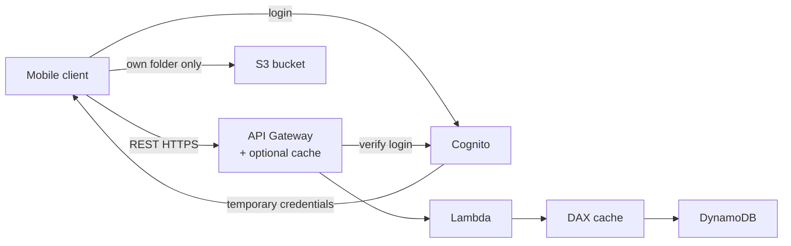
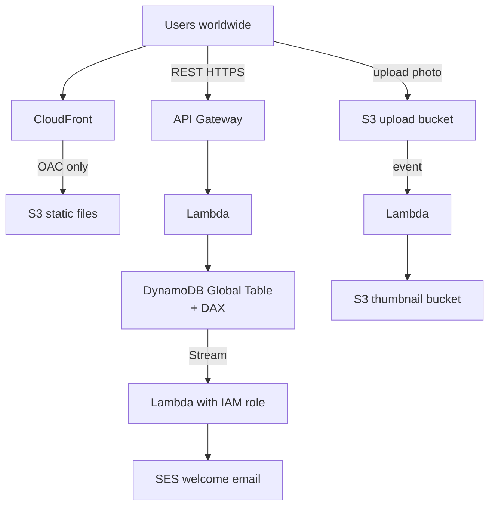
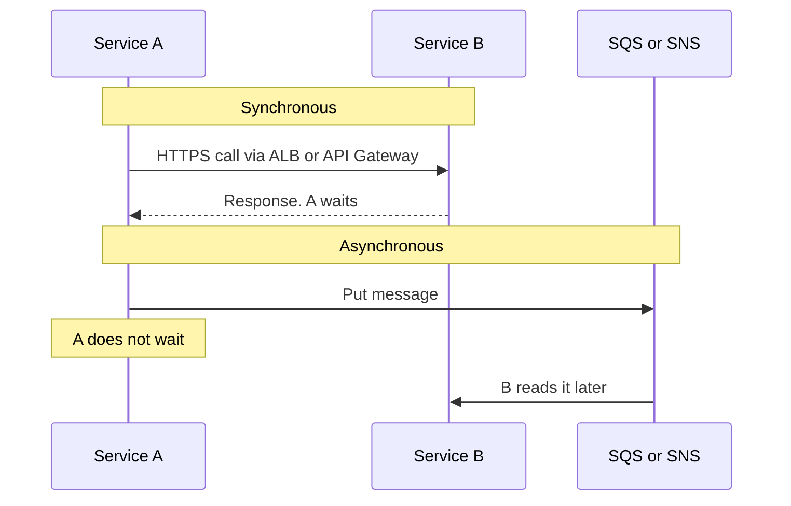
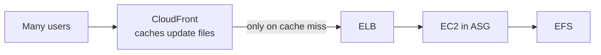
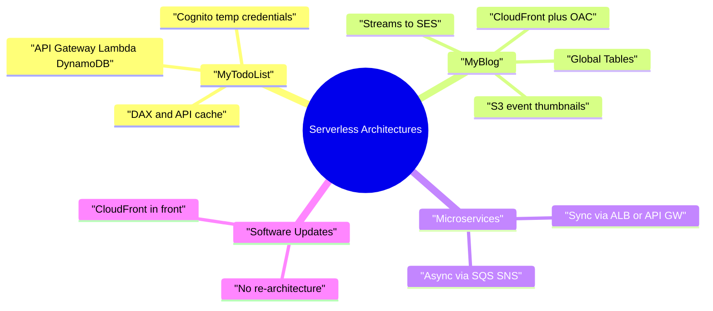

# Serverless Solution Architectures

> **Core idea:** Most serverless apps use the same blocks: **API Gateway → Lambda → DynamoDB**, with **Cognito** for login. Add **caching** (DAX, API Gateway cache, CloudFront) when reads are high. For mostly static content, **CloudFront in front** is often the easiest and cheapest fix.

---

## 1. The Building Blocks

These services appear again and again. Know what each one does.

|Service|Job in the architecture|
|---|---|
|**API Gateway**|Gives a REST API with HTTPS endpoints|
|**Lambda**|Runs your code. No servers. Scales by itself|
|**DynamoDB**|Serverless database. Scales very well|
|**DAX**|Cache in front of DynamoDB. Makes reads faster and cheaper|
|**Cognito**|User login. Gives **temporary AWS credentials**|
|**CloudFront**|Global CDN. Caches content at edge locations|
|**OAC** (Origin Access Control)|Lets only CloudFront read the S3 bucket|
|**DynamoDB Streams**|Sends every table change to Lambda|
|**SES** (Simple Email Service)|Sends emails|
|**S3 Event Notifications**|When a file is added, trigger **Lambda, SQS or SNS**|

> **Serverless = no servers to manage, you pay per use, it scales automatically.**

---

## 2. Case 1 — Mobile App (MyTodoList)

**Needs:** HTTPS REST API, serverless, user login, each user has their own S3 folder, many more reads than writes.

### 2.1 Giving users access to S3

- User logs in to **Cognito**.
- Cognito gives the app **temporary credentials**.
- With these, the app reads and writes only **its own folder** in S3 (restricted policy).

> **Exam trap:** Never store IAM user credentials (access keys) inside a mobile app. Use **Cognito + temporary credentials**.

### 2.2 Making reads cheaper and faster

To-dos are read a lot but rarely changed. So cache them.

|Cache option|Where it sits|When to use|
|---|---|---|
|**DAX**|In front of DynamoDB|Many reads on the same data. Fewer RCUs needed → lower cost|
|**API Gateway cache**|At the API level|API answers almost never change|

**Takeaway: High read throughput on DynamoDB → think DAX.**

---

## 3. Case 2 — Global Serverless Website (MyBlog.com)

**Needs:** Global scale, mostly static files, small REST API, caching, a welcome email for new users, and thumbnails for uploaded photos.

### 3.1 The four parts

|Need|Solution|
|---|---|
|Serve static files globally|**S3 + CloudFront**|
|Keep the bucket private|**OAC + bucket policy** that allows only CloudFront|
|Public REST API|API Gateway → Lambda → DynamoDB (+ DAX). **No Cognito needed** because the API is public|
|Fast data around the world|**DynamoDB Global Tables**|
|Welcome email|**DynamoDB Stream → Lambda → SES**. Lambda needs an **IAM role** to use SES|
|Photo thumbnails|**S3 event → Lambda → thumbnail into another bucket**|

### 3.2 Small but useful facts

- Uploads can go directly to S3, or through edge locations with **S3 Transfer Acceleration**.
- S3 events can trigger **Lambda, SQS or SNS**.
- **Aurora Global Database** also works globally, but it is **not serverless** (it is provisioned). For a serverless answer, pick DynamoDB Global Tables.

---

## 4. Microservices Architecture

**Microservices** = split one big app into many small services. Each service:

- has its own code repository,
- scales on its own,
- can use any design (ECS, Lambda, EC2 + RDS... your choice).

Each service gets its own DNS name in **Route 53**, for example `service1.example.com`.

### 4.1 Two ways services talk

|Pattern|Tools|Caller waits?|
|---|---|---|
|**Synchronous**|API Gateway, Load Balancer (HTTPS)|Yes|
|**Asynchronous**|SQS, SNS, Kinesis, Lambda triggers, S3 events|No|

### 4.2 Problems and how serverless helps

|Microservice problem|Serverless fix|
|---|---|
|Extra work to create each new service|API Gateway and Lambda are quick to set up|
|Hard to use servers efficiently|Lambda scales automatically, pay per use|
|Running many versions at once|Easy to clone APIs and environments in API Gateway|
|Too much client code for many services|Generate a client SDK from API Gateway (Swagger)|

---

## 5. Case 3 — Software Updates Distribution

**Problem:** An app on **EC2 (ELB + ASG, multi-AZ)** serves software update files stored on **EFS**. When a new update is released, everyone downloads at once. CPU and network cost go very high. You **cannot re-architect** the app.

**Solution: put CloudFront in front of the ELB.**

|Why it works|Result|
|---|---|
|Update files are **static** and never change|Perfect for edge caching|
|No change to the app|Meets "do not re-architect"|
|CloudFront is serverless and scales itself|ASG scales less|
|Most downloads come from the edge|Lower EC2, network and EFS cost|

> **Exam rule:** Static content + high load + "no changes to the app" → **add CloudFront**. The simplest answer is often the right one.

---

## 6. Exam Scenario → Answer

|If the question says...|Pick|
|---|---|
|Mobile users need direct, secure access to S3|**Cognito temporary credentials**|
|Store AWS access keys in the app|**Wrong answer**|
|Very high reads on DynamoDB, reduce cost|**DAX**|
|API responses rarely change|**API Gateway caching**|
|Static website, global, secure S3|**CloudFront + OAC + bucket policy**|
|React to new rows in DynamoDB|**DynamoDB Streams → Lambda**|
|Send emails serverlessly|**SES** (Lambda with IAM role)|
|Process files when uploaded to S3|**S3 event → Lambda** (or SQS / SNS)|
|Global serverless database|**DynamoDB Global Tables**|
|Services talk without waiting|**SQS / SNS / Kinesis** (async)|
|Reduce load and cost for static downloads, no re-architecture|**CloudFront**|

---

## 7. Summary

1. Classic serverless API = **API Gateway + Lambda + DynamoDB**, login with **Cognito**.
2. Mobile access to S3 = **Cognito temporary credentials**, never stored keys.
3. **DAX** caches DynamoDB reads → faster and fewer RCUs.
4. **API Gateway cache** helps when responses rarely change.
5. Static global site = **S3 + CloudFront + OAC**.
6. **DynamoDB Streams → Lambda → SES** = serverless welcome email.
7. **S3 events** can trigger Lambda, SQS or SNS.
8. Microservices talk **sync** (HTTPS) or **async** (SQS, SNS, Kinesis).
9. Static downloads overloading EC2 → **add CloudFront**, no code changes.

---

## 8. Check Yourself

1. How should a mobile app get access to its own S3 folder?
2. Why is storing IAM access keys in a mobile app wrong?
3. Name two places you can add caching in a serverless REST API.
4. How do you stop users from reading the S3 bucket directly, bypassing CloudFront?
5. Why did MyBlog's REST API not need Cognito?
6. What chain of services sends a welcome email when a new user is added?
7. What three targets can an S3 event notification trigger?
8. Why is Aurora Global Database not the best answer for a serverless design?
9. What is the difference between sync and async microservice patterns?
10. EC2 servers are overloaded by update downloads. What is the fastest fix without changing the app?

---

## 9. Key Terms

| Term                         | Meaning                                                        |
| ---------------------------- | -------------------------------------------------------------- |
| **Serverless**               | No servers to manage; auto scaling; pay per use                |
| **Cognito**                  | Managed user login; can give temporary AWS credentials         |
| **DAX**                      | In-memory cache for DynamoDB                                   |
| **RCU**                      | Read Capacity Unit — DynamoDB read cost unit                   |
| **OAC**                      | Origin Access Control — only CloudFront can read the S3 bucket |
| **DynamoDB Streams**         | A feed of table changes that can trigger Lambda                |
| **SES**                      | Simple Email Service — sends emails                            |
| **Global Tables**            | DynamoDB tables replicated across Regions                      |
| **S3 Transfer Acceleration** | Upload to S3 through nearby edge locations                     |
| **Microservice**             | Small, independent service with its own code and scaling       |
| **Synchronous**              | Caller waits for the answer                                    |
| **Asynchronous**             | Caller sends a message and does not wait                       |
