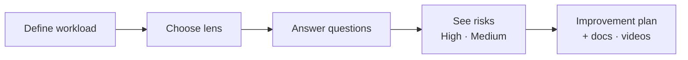
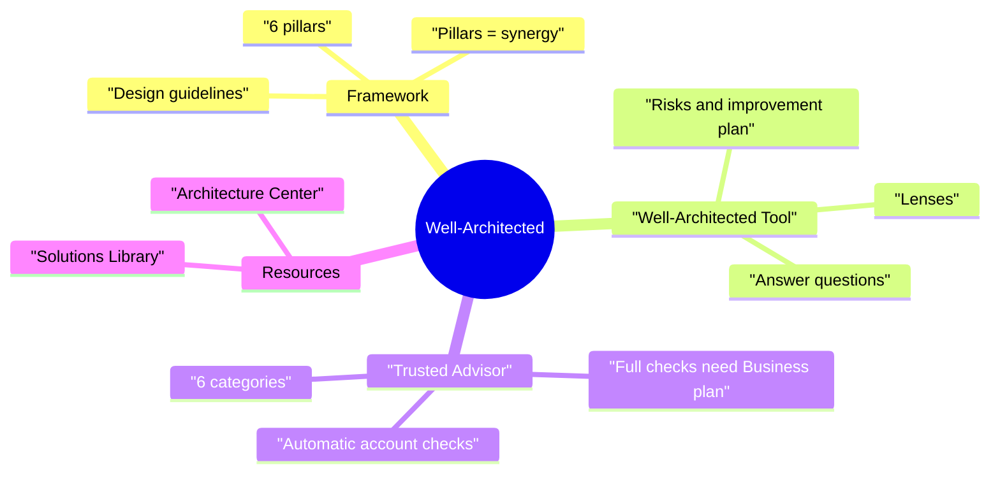

# Well-Architected Framework, Trusted Advisor & Architecture Resources

> **Core idea:** The **Well-Architected Framework** is AWS's set of best practices, built on **6 pillars**. The **Well-Architected Tool** checks _your design_ by asking you questions. **Trusted Advisor** checks _your account_ automatically and gives advice.

---

## 1. The Well-Architected Framework

### 1.1 What is it?

A **framework** = a list of best practices from AWS for building good applications in the cloud.

### 1.2 General design guidelines

|Guideline|Simple meaning|
|---|---|
|**Stop guessing capacity**|Don't guess server size. Use **Auto Scaling**.|
|**Test at production scale**|Build a big test setup, test, then delete it. It is cheap on AWS.|
|**Automate**|Use **CloudFormation** to deploy the same setup many times for experiments.|
|**Evolutionary architectures**|Design can change over time. Example: EC2 + ELB → API Gateway + Lambda.|
|**Drive architecture using data**|Use data to make design decisions.|
|**Improve through game days**|Practice big events (like a flash sale) to find weak points.|

### 1.3 The 6 pillars (memorise the names)

|#|Pillar|Easy meaning|
|---|---|---|
|1|**Operational Excellence**|Run and improve the system well|
|2|**Security**|Protect data and systems|
|3|**Reliability**|System recovers and keeps working|
|4|**Performance Efficiency**|Use resources in a fast, smart way|
|5|**Cost Optimization**|Don't waste money|
|6|**Sustainability**|Reduce environmental impact|

**Memory trick:** **"O-S-R-P-C-S"** → _"Our Servers Run Perfectly, Cheaply, Sustainably."_

> The pillars are **not a trade-off**. They work together (**synergy**). Improving one usually improves others. Example: better operational excellence → often better cost optimization.

---

## 2. AWS Well-Architected Tool

### 2.1 What is it?

A **free tool** in the AWS console. It **reviews your architecture** against the 6 pillars and gives advice.

### 2.2 How it works

|Step|What happens|
|---|---|
|Define workload|Name, owner, environment (e.g. production), Regions|
|Choose **lens**|A lens = a set of questions. Default: Well-Architected Framework lens. Others: Serverless, SaaS, FTR, or your own **custom lens**|
|Answer questions|Questions per pillar (e.g. ~11 on operational excellence, ~10 on security)|
|Get results|Dashboard shows **High risk** and **Medium risk** items|
|Improve|**Improvement plan** links to the exact best-practice section. Track progress with **milestones**|

**Takeaway: Well-Architected Tool = _you answer questions_ about your design → get risks + advice.**

---

## 3. AWS Trusted Advisor

### 3.1 What is it?

A service that gives a **high-level assessment of your AWS account**. Nothing to install. It checks your account **automatically**.

**Example checks:**

- Is an **EBS snapshot** or **RDS snapshot** public?
- Are you using the **root account**?
- Does an **S3 bucket** allow global access?
- Do **security groups** allow unrestricted access to a port?

### 3.2 Six check categories

| Category                   | Example                                                                         |
| -------------------------- | ------------------------------------------------------------------------------- |
| **Cost Optimization**      | Unused resources                                                                |
| **Performance**            | Slow or overloaded resources                                                    |
| **Security**               | Public snapshots, open security groups, root use                                |
| **Fault Tolerance**        | Weak backup or recovery setup                                                   |
| **Service Limits**         | Close to limit on Auto Scaling Groups, CloudFormation stacks, DynamoDB capacity |
| **Operational Excellence** | Operational best practices                                                      |

### 3.3 Support plan decides what you get (exam favourite)

| Support plan                        | What you get                                                                 |
| ----------------------------------- | ---------------------------------------------------------------------------- |
| Basic / Developer _(extra context)_ | **Core checks** only (some security checks + service limits)                 |
| **Business / Enterprise**           | **Full set of checks** + **programmatic access** via the **AWS Support API** |

**Takeaway: Full Trusted Advisor checks or API access → needs Business or Enterprise support plan.**

---

## 4. Well-Architected Tool vs Trusted Advisor

|              | Well-Architected Tool                    | Trusted Advisor                                                      |
| ------------ | ---------------------------------------- | -------------------------------------------------------------------- |
| Checks what? | **Your architecture design**             | **Your AWS account resources**                                       |
| How?         | You **answer questions**                 | **Automatic** scan                                                   |
| Based on     | 6 pillars                                | 6 categories                                                         |
| Cost         | Free                                     | Core free · full needs Business/Enterprise                           |
| Exam phrase  | "review workload against best practices" | "check account for public snapshots / service limits / cost savings" |

---

## 5. Reference Architecture Resources (real-world)

| Resource                    | What it gives                                                                                                                                                                                      |
| --------------------------- | -------------------------------------------------------------------------------------------------------------------------------------------------------------------------------------------------- |
| **AWS Architecture Center** | 2,000+ **reference architectures** and diagrams (PDF/HTML). Example: DR for relational databases, WordPress best practices                                                                         |
| **AWS Solutions Library**   | **Vetted solutions** with diagrams + **CloudFormation templates** + implementation guide + GitHub code. You can **launch them directly**. Example: Live Streaming on AWS, Serverless Image Handler |

**Takeaway: Architecture Center = learn from diagrams. Solutions Library = diagrams + ready-to-deploy templates.**

---

## 6. Summary

1. Well-Architected Framework = AWS best practices.
2. 6 pillars: Operational Excellence, Security, Reliability, Performance Efficiency, Cost Optimization, Sustainability.
3. Pillars work together; they are not a trade-off.
4. Well-Architected Tool reviews your design by asking questions per pillar.
5. A lens is a question set (framework, serverless, SaaS, custom).
6. Trusted Advisor scans your account automatically in 6 categories.
7. Full Trusted Advisor checks + Support API need Business or Enterprise support.
8. Architecture Center = reference diagrams; Solutions Library = deployable solutions.

---

## 7. Check yourself

1. Name the 6 pillars of the Well-Architected Framework.
2. Are the pillars a trade-off? Explain.
3. What is a "lens" in the Well-Architected Tool?
4. What does the Well-Architected Tool give you after you answer questions?
5. Name the 6 Trusted Advisor categories.
6. Which support plans give the full Trusted Advisor checks?
7. How can you access Trusted Advisor programmatically?
8. You want a ready CloudFormation template for a live streaming setup. Which resource?
9. A company wants an automatic check for public EBS snapshots. Which service?

---

## 8. Key terms

|Term|Meaning|
|---|---|
|**Well-Architected Framework**|AWS best-practice guide with 6 pillars|
|**Pillar**|One main area of good design|
|**Well-Architected Tool**|Console tool that reviews a workload by questions|
|**Workload**|The application/system you are reviewing|
|**Lens**|A set of review questions for a type of workload|
|**Improvement plan**|List of risks with steps to fix them|
|**Milestone**|Saved snapshot of review progress|
|**Trusted Advisor**|Automatic account checks with advice|
|**Core checks**|Small set of Trusted Advisor checks for everyone|
|**AWS Support API**|Programmatic access to Trusted Advisor (Business/Enterprise)|
|**Architecture Center**|Library of AWS reference architectures|
|**Solutions Library**|Vetted solutions with deployable CloudFormation templates|
|**Game day**|Practice event that stresses the system to find weak points|
