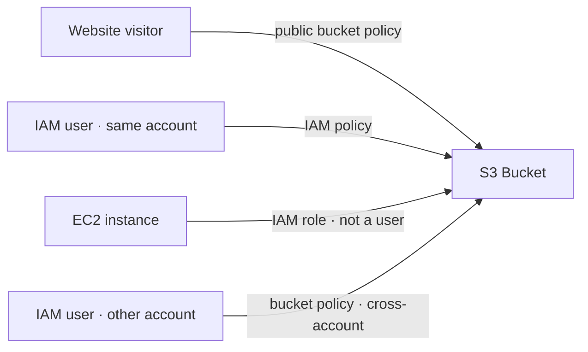
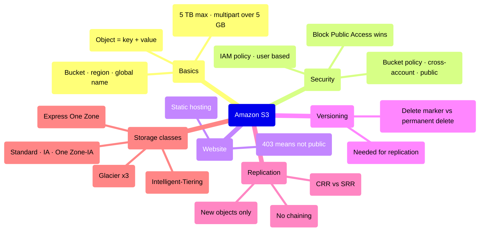

# Amazon S3 Fundamentals

> **Core idea:** S3 is infinite object storage. You put **objects** (files) inside **buckets**. Buckets live in one region but their name is globally unique. Everything in the exam is about four things: security (bucket policy), versioning, replication, and storage classes.

---

## 1. Buckets and Objects

### 1.1 The basics

- **Bucket** = top-level container (like a top-level directory).
- **Object** = the file inside it.

|Item|Rule|
|---|---|
|Bucket name|**Globally unique** across all AWS accounts and regions|
|Bucket location|Created **in one region** (S3 only _looks_ global)|
|Name format|lowercase, no underscore, 3–63 chars, not an IP, starts with lowercase letter or number|

> S3 is a **regional** service with a **global** namespace. This is the classic beginner trap.

### 1.2 Object key — there are no real folders

The **key** is the full path of the object.

```text
s3://my-bucket/my-folder1/another-folder/my_file.txt
                 └──────── prefix ──────┘└ object name ┘
```

S3 has **no directories**. The console _shows_ folders, but a "folder" is just a long key with slashes in it.

|Object part|Meaning|
|---|---|
|Key|Full path = prefix + object name|
|Value|The content (the body of the file)|
|Metadata|Key/value pairs, set by system or user|
|Tags|Up to 10 Unicode key/value pairs — used for security and lifecycle|
|Version ID|Present only if versioning is enabled|

**Size limits to remember:** max object size is **5 TB**. If a file is bigger than **5 GB** you must use **multi-part upload**.

---

## 2. S3 Security

### 2.1 Who can access an object?

An IAM principal can access an S3 object **if**:

```text
(IAM permissions allow it  OR  the resource policy allows it)
AND there is no explicit DENY
```

|Type|What it is|Use it for|
|---|---|---|
|**User-based** (IAM policy)|Attached to a user/role in _your_ account|Normal app and user access|
|**Resource-based** (Bucket policy)|JSON attached to the bucket|Public access, **cross-account** access, forcing encryption|
|Object ACL / Bucket ACL|Fine-grain, legacy, **can be disabled**|Rarely used now|
|Encryption|Encrypt objects with keys|Data protection|

> Cross-account access **requires a bucket policy**. An IAM policy alone cannot do it.

### 2.2 Bucket policy shape

```json
{
  "Version": "2012-10-17",
  "Statement": [{
    "Sid": "PublicRead",
    "Effect": "Allow",
    "Principal": "*",
    "Action": "s3:GetObject",
    "Resource": "arn:aws:s3:::example-bucket/*"
  }]
}
```

|Field|Meaning|
|---|---|
|`Resource`|Which bucket/objects. `/*` means every object inside|
|`Effect`|`Allow` or `Deny`|
|`Action`|The API call, e.g. `s3:GetObject`|
|`Principal`|Who. `*` means anyone (public)|

**The ARN must end with `/*`** because `GetObject` acts on objects, not on the bucket itself.

### 2.3 Block Public Access

An **extra safety layer** created by AWS to stop company data leaks.

> Even if your bucket policy says "public", if Block Public Access is ON the bucket stays private.

It can be set per bucket or for the **whole account**. Turn it off only when you really want a public bucket.

### 2.4 Access patterns



A pre-signed URL carries your credentials inside it, so only you can use it. A plain object URL gives **Access Denied** until the bucket is made public.

---

## 3. Static Website Hosting

S3 can host a **static website** (HTML, images, CSS — no server code).

The endpoint looks like one of these:

```text
bucket-name.s3-website-aws-region.amazonaws.com
bucket-name.s3-website.aws-region.amazonaws.com
```

(Only difference is a dash or a dot. Not worth memorising.)

Steps: enable static website hosting → set an index document (`index.html`) → make objects publicly readable.

> **403 Forbidden on an S3 website = the bucket is not public.** Fix it with a bucket policy allowing `s3:GetObject`.

---

## 4. Versioning

Enabled **at the bucket level**. Each time you upload the same key, you get a new version instead of losing the old file.

|Benefit|How it works|
|---|---|
|Protect from accidental delete|Deleting a file only adds a **delete marker**|
|Easy rollback|Pick an older version ID and restore it|

Two kinds of delete:

|Action|Result|Reversible?|
|---|---|---|
|Delete the **object**|Adds a delete marker on top|Yes — delete the delete marker|
|Delete a **specific version ID**|**Permanent delete**|No|

Two facts the exam likes:

- Files uploaded **before** versioning was enabled have version ID **`null`**.
- **Suspending** versioning does **not** delete existing versions.

---

## 5. Replication (CRR and SRR)

Copy objects automatically from a source bucket to a target bucket.

|Type|Meaning|
|---|---|
|**CRR** — Cross-Region Replication|Source and target in **different** regions|
|**SRR** — Same-Region Replication|Source and target in the **same** region|

Requirements:

1. **Versioning must be ON** in both source and destination.
2. S3 needs an **IAM role** with read/write permission on both buckets.
3. Buckets may be in different AWS accounts. Copying is **asynchronous**.

|Type|Typical use case|
|---|---|
|CRR|Compliance, lower latency for far-away users, copy across accounts|
|SRR|Aggregate logs from many buckets, live prod → test replication|

### 5.1 Rules that are exam favourites

|Rule|Detail|
|---|---|
|Only **new** objects replicate|Existing objects need **S3 Batch Replication**|
|**Delete markers** can replicate|Optional setting, OFF by default|
|**Version-ID deletes do not replicate**|Permanent deletes stay local — stops malicious deletes spreading|
|**No chaining**|Bucket 1 → 2 and 2 → 3 does **not** give 1 → 3|

---

## 6. Storage Classes

### 6.1 Durability vs availability

- **Durability** = chance of losing an object. **11 nines (99.999999999%)** — the **same for every class**. Store 10 million objects and expect to lose one every 10,000 years.
- **Availability** = how often the service is reachable. **This changes by class.** S3 Standard is 99.99% ≈ 53 minutes down per year.

### 6.2 The classes

|Class|Availability|Min storage duration|Use it for|
|---|---|---|---|
|**S3 Standard**|99.99%|—|Frequently used data, big data, content delivery|
|**S3 Standard-IA**|99.9%|30 days|Less often used, but needed fast — backups, DR|
|**S3 One Zone-IA**|99.5%|30 days|Data you can recreate, secondary backup copy. **Lost if the AZ dies**|
|**Glacier Instant Retrieval**|99.9%|**90 days**|Archive accessed ~once a quarter, needed in **milliseconds**|
|**Glacier Flexible Retrieval**|99.99%|**90 days**|Archive, can wait minutes to hours|
|**Glacier Deep Archive**|99.99%|**180 days**|Cheapest, long-term archive, can wait many hours|
|**Intelligent-Tiering**|99.9%|—|You do not know the access pattern|

> Lower cost to store always means **you pay to retrieve**. IA and Glacier classes have retrieval fees.

### 6.3 Glacier retrieval times

|Class|Option|Time|
|---|---|---|
|Flexible Retrieval|Expedited|1–5 minutes|
|Flexible Retrieval|Standard|3–5 hours|
|Flexible Retrieval|Bulk (free)|5–12 hours|
|Deep Archive|Standard|12 hours|
|Deep Archive|Bulk|48 hours|

**Instant = get it now. Flexible = you are willing to wait.**

### 6.4 Intelligent-Tiering

S3 moves objects between tiers for you based on usage. You pay a small **monitoring and auto-tiering fee**, but there are **no retrieval charges**.

|Tier|Moves here when|
|---|---|
|Frequent Access|Default|
|Infrequent Access|Not accessed for 30 days|
|Archive Instant Access|Not accessed for 90 days|
|Archive Access (optional)|Configurable, 90 → 700+ days|
|Deep Archive Access (optional)|Configurable, 180 → 700+ days|

### 6.5 Lifecycle rules

You can set the class when you upload, change it later by hand, or automate it with a **Lifecycle configuration** — for example: Standard → Standard-IA after 30 days → Glacier Flexible Retrieval after 180 days.

---

## 7. S3 Express One Zone

A separate, high-performance class that behaves differently from the rest.

| Point            | Detail                                                                                                                      |
| ---------------- | --------------------------------------------------------------------------------------------------------------------------- |
| Storage location | A special **directory bucket** in **one AZ you choose**                                                                     |
| Performance      | **10x** faster than S3 Standard, single-digit millisecond latency, hundreds of thousands of requests/second                 |
| Cost             | About **50% lower** than S3 Standard                                                                                        |
| Risk             | Lower availability — if that AZ fails, you are affected                                                                     |
| Why it is fast   | Storage sits in the **same AZ as your compute**, cutting latency and network cost                                           |
| Use cases        | Latency-sensitive apps, AI/ML training, financial modelling, media processing, HPC. Works with SageMaker, Athena, EMR, Glue |

---

## 8. Summary



1. Bucket names are globally unique; buckets themselves live in a region.
2. There are no folders — only keys made of a prefix and an object name.
3. Max object 5 TB; use multi-part upload above 5 GB.
4. Access = IAM allow **or** resource policy allow, **and** no explicit deny.
5. Cross-account and public access need a **bucket policy**.
6. Block Public Access overrides a public bucket policy.
7. A 403 on an S3 static website means the bucket is not public.
8. Versioning gives delete markers (undoable) and version deletes (permanent).
9. Replication needs versioning on both sides, copies only new objects, and never chains.
10. Durability is 11 nines everywhere; only **availability**, cost and retrieval time differ between classes.

---

## 9. Check yourself

1. Is an S3 bucket global or regional? What _is_ globally unique?
2. What is the key of a file stored at `images/2024/photo.png`?
3. Above what file size must you use multi-part upload?
4. Which security type is required for cross-account access, and why?
5. You wrote a public bucket policy but the object is still denied. What is the likely cause?
6. What is the difference between deleting an object and deleting a version ID?
7. Name the three requirements for S3 replication to work.
8. Bucket A replicates to B, and B replicates to C. Do A's objects reach C?
9. Which Glacier class gives millisecond retrieval? Which is cheapest?
10. Why is S3 Express One Zone so fast, and what is the trade-off?

---

## 10. Key terms

|Term|Meaning|
|---|---|
|Bucket|Top-level container for objects; globally unique name, created in one region|
|Object|A file in S3 — key, value, metadata, tags, optional version ID|
|Key|Full path of the object = prefix + object name|
|Multi-part upload|Required way to upload files larger than 5 GB|
|Bucket policy|JSON resource-based policy attached to a bucket|
|ACL|Older fine-grain permission on objects or buckets; can be disabled|
|Block Public Access|Bucket/account setting that blocks public access even if a policy allows it|
|Pre-signed URL|A URL containing your credentials, so only you can open the object|
|Static website hosting|Serving HTML and media straight from a bucket|
|Delete marker|Marker added on top of a versioned object instead of really deleting it|
|Permanent delete|Deleting a specific version ID; cannot be undone|
|CRR / SRR|Cross-Region / Same-Region Replication|
|S3 Batch Replication|Feature to replicate objects that already existed|
|Durability|Chance an object is lost — 11 nines for every class|
|Availability|How often the service is reachable — differs by class|
|Lifecycle rule|Automatic movement of objects between storage classes over time|
|Directory bucket|Special single-AZ bucket used by S3 Express One Zone|
