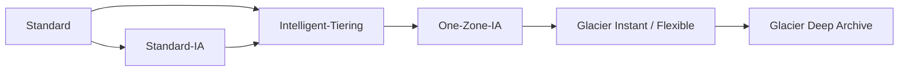
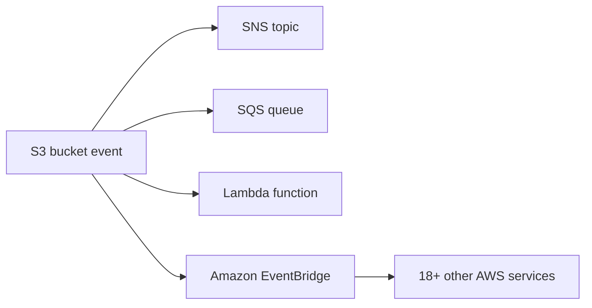
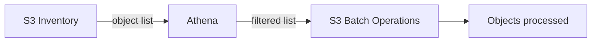
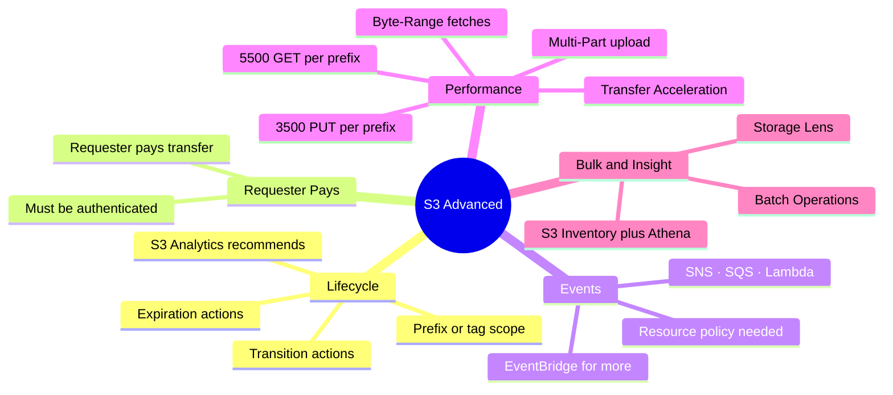

# S3 Advanced Features — Lifecycle, Events, Performance, Analytics

> **Core idea:** S3 is not only storage. It can move objects to cheaper classes by itself (Lifecycle), tell other services when something happens (Event Notifications), go very fast if you use the right upload/download trick (Performance), and show you where your money goes (Analytics, Storage Lens).

---

## 1. Lifecycle Rules — move and delete objects automatically

### 1.1 What a lifecycle rule is

A **lifecycle rule** is a rule you set on a bucket. S3 then moves or deletes objects for you, based on age. No script, no cron job.

A rule has two kinds of actions:

|Action|What it does|Example|
|---|---|---|
|**Transition**|Move object to another storage class|Standard → Standard-IA after 60 days, then → Glacier after 180 days|
|**Expiration**|Delete the object|Delete access logs after 365 days|

Expiration can also be used to:

- delete **old (non-current) versions** when versioning is on
- delete **incomplete multi-part uploads** (for example, older than 2 weeks)

### 1.2 Where a rule applies

A rule can target:

- the **whole bucket**
- a **prefix** (a path, like `thumbnails/`)
- specific **object tags** (for example `department=finance`)

> Prefix is the usual exam trick: one bucket, two different rules, split by folder path.

### 1.3 Allowed transition direction

Objects move **down** to cheaper / colder classes, never back up automatically.

### 1.4 Two exam scenarios to memorise

**Scenario 1 — photos and thumbnails**

Thumbnails can be rebuilt from the source photo. Source photos must be instant for 60 days, after that 6 hours wait is fine.

|Object|Class|Lifecycle rule|
|---|---|---|
|Source images (prefix `images/`)|Standard|Transition to Glacier after 60 days|
|Thumbnails (prefix `thumbnails/`)|One-Zone-IA|Expire (delete) after 60 days|

**Scenario 2 — recover deleted objects**

Rule: deleted objects recoverable **immediately for 30 days**, then **within 48 hours up to 365 days**.

1. Enable **S3 Versioning** (a delete only adds a delete marker, the old version stays).
2. Transition **non-current versions** to Standard-IA.
3. Later transition those non-current versions to **Glacier Deep Archive**.

### 1.5 S3 Analytics — how do I pick the number of days?

**S3 Analytics** watches your access patterns and recommends when to transition objects.

|Point|Detail|
|---|---|
|Works for|Standard and Standard-IA only|
|Does **not** work for|One-Zone-IA, Glacier|
|Output|CSV report in a bucket|
|Timing|Updated daily; 24–48 hours before first data|

> **Exam phrase: "recommendations for lifecycle rules" → S3 Analytics.**

---

## 2. Requester Pays — the downloader pays the bandwidth

Normally the **bucket owner** pays for both storage and data transfer out.

With **Requester Pays** enabled:

|Cost|Who pays (normal)|Who pays (Requester Pays)|
|---|---|---|
|Storage|Owner|Owner|
|Data transfer / download|Owner|**Requester**|

Rules to remember:

- Main use case: **sharing large datasets with other AWS accounts**.
- The requester **must be authenticated in AWS** — anonymous users are not allowed, because AWS needs to know whom to bill.

---

## 3. S3 Event Notifications — react when something happens

### 3.1 The idea

S3 can send a message when an **event** happens: object created, object removed, object restored, replication finished. You can filter, for example only files ending with `.jpg`.

Typical use case: a photo is uploaded → automatically create a thumbnail.

Delivery is usually within seconds, but can take a minute or longer.

### 3.2 Permissions — the most tested part

S3 does **not** use an IAM role here. You attach a **resource access policy** on the _target_.

|Target|Policy you must attach|
|---|---|
|SNS topic|SNS resource (access) policy|
|SQS queue|SQS resource (access) policy|
|Lambda function|Lambda resource policy|

> Without that policy, saving the notification fails with a destination validation error.

### 3.3 EventBridge integration

All S3 events can also go to **Amazon EventBridge**. This gives extra power:

|Feature|Benefit|
|---|---|
|Advanced filtering|Filter by metadata, object size, object name|
|Multiple destinations|Step Functions, Kinesis Data Streams, Firehose, and more|
|EventBridge features|Archive events, replay events, more reliable delivery|

---

## 4. S3 Performance

### 4.1 Baseline performance

S3 scales automatically. First-byte latency is **100–200 ms**.

|Request type|Limit|
|---|---|
|PUT / COPY / POST / DELETE|**3,500 per second per prefix**|
|GET / HEAD|**5,500 per second per prefix**|

There is **no limit on the number of prefixes** in a bucket.

**What is a prefix?** Everything between the bucket name and the file name.

|Object path|Prefix|
|---|---|
|`bucket/folder1/sub1/file`|`/folder1/sub1`|
|`bucket/folder1/sub2/file`|`/folder1/sub2`|

So spreading reads evenly over 4 prefixes gives 4 × 5,500 = **22,000 GET/HEAD per second**.

### 4.2 Speed-up techniques

|Technique|Direction|When to use|How it works|
|---|---|---|---|
|**Multi-Part Upload**|Upload|Recommended > 100 MB, **required > 5 GB**|Splits file into parts, uploads them in parallel, S3 rebuilds the file|
|**Transfer Acceleration**|Upload **and** download|Transfers across long distances / regions|File goes to a nearby **edge location** over public internet, then travels over the fast private AWS network to the bucket|
|**Byte-Range Fetches**|Download|Big files, or you only need part of a file|Request specific byte ranges in parallel; also lets you read only a header (for example first 50 bytes)|

Transfer Acceleration **can be combined with** Multi-Part Upload.

> Remember the direction: Multi-Part = upload only. Byte-Range = download only. Transfer Acceleration = both.

---

## 5. S3 Batch Operations — do one action on millions of objects

**S3 Batch Operations** performs a bulk action on existing objects with a single request.

Common jobs:

- modify object metadata and properties
- copy objects between buckets
- **encrypt all unencrypted objects**
- modify ACLs or tags
- restore many objects from Glacier at once
- invoke a **Lambda function** for any custom action

A job = **list of objects + action + optional parameters**.

Why not just write your own script? Batch Operations gives you retries, progress tracking, completion notifications and reports for free.

**How to build the object list:**

> Classic exam chain: find unencrypted objects with **S3 Inventory**, filter with **Athena**, encrypt them all with **S3 Batch Operations**.

---

## 6. S3 Storage Lens — see your storage across the whole organization

**S3 Storage Lens** analyses and optimises storage across your **entire AWS Organization**: all accounts, regions, buckets, even prefixes.

|Point|Detail|
|---|---|
|Purpose|Find anomalies, find cost savings, apply protection best practices|
|Data|30-day usage and activity metrics|
|Dashboard|A **default dashboard** exists (multi-region, multi-account). You **cannot delete** it, but you can disable it. You can also build your own.|
|Export|CSV or Parquet into an S3 bucket|

### 6.1 Metric categories

|Category|Example metric|Typical use|
|---|---|---|
|Summary|Storage bytes, object count|Find fastest-growing or unused buckets|
|Cost optimization|Non-current version bytes, incomplete multi-part upload bytes|Find waste, find objects to move to cheaper classes|
|Data protection|Versioning enabled count, MFA Delete count, SSE-KMS count, replication rule count|Find buckets breaking best practice|
|Access management|Object ownership settings|Check ownership configuration|
|Event|Buckets with event notifications|Check event setup|
|Performance|Buckets with Transfer Acceleration enabled|Check performance setup|
|Activity|All requests, GET, PUT, bytes downloaded|Understand usage|
|Status code|200 OK, 403 Forbidden|Understand errors|

### 6.2 Free vs Advanced

| |Free metrics|Advanced metrics and recommendations (paid)|
|---|---|---|
|Cost|Free for all customers|Paid|
|Metrics|~28 usage metrics|Adds activity, advanced cost optimization, advanced data protection, status codes|
|Data retention|**14 days**|**15 months**|
|CloudWatch|No|Yes, published at no extra charge|
|Prefix-level metrics|No|Yes|

---

## 7. Summary

1. Lifecycle rules do transitions (to colder classes) and expirations (deletes), scoped by prefix or tag.
2. Versioning + lifecycle on **non-current versions** is the answer for "recover deleted objects for N days".
3. **S3 Analytics** recommends transition days — Standard and Standard-IA only.
4. **Requester Pays** shifts download cost to the requester; requester must be authenticated.
5. Event targets: **SNS, SQS, Lambda, EventBridge** — each needs a resource access policy, not an IAM role.
6. Performance: **3,500 PUT / 5,500 GET per second per prefix**, unlimited prefixes.
7. Multi-Part Upload > 100 MB recommended, > 5 GB required; Byte-Range for downloads; Transfer Acceleration for both.
8. **S3 Inventory → Athena → Batch Operations** is the pattern for bulk fixes like encrypting everything.
9. **Storage Lens** = organization-wide view; free = 14 days, advanced = 15 months + CloudWatch + prefix level.

---

## 8. Check yourself

1. Which two action types can a lifecycle rule contain?
2. How do you make thumbnails delete after 60 days but keep source images archived?
3. Which storage classes does S3 Analytics give recommendations for?
4. In Requester Pays, who pays storage and who pays download?
5. Can an anonymous user download from a Requester Pays bucket?
6. Name the four destinations for S3 Event Notifications.
7. What permission object must you attach so S3 can write to an SQS queue?
8. How many GET requests per second per prefix does S3 support?
9. What is the prefix of `bucket/folder1/sub2/file`?
10. Above what file size is Multi-Part Upload mandatory?
11. Which technique speeds up both upload and download?
12. Which two services help you build the object list for S3 Batch Operations?
13. How long is Storage Lens free-metric data kept?

---

## 9. Key terms

|Term|Meaning|
|---|---|
|Lifecycle rule|Bucket rule that transitions or deletes objects automatically by age|
|Transition|Moving an object to a different (cheaper) storage class|
|Expiration|Deleting an object, an old version, or an incomplete upload|
|Non-current version|An older object version, kept because versioning is on|
|Delete marker|Hidden marker placed over an object when it is "deleted" in a versioned bucket|
|Prefix|The path between the bucket name and the object name|
|S3 Analytics|Service giving CSV recommendations on when to transition objects|
|Requester Pays|Bucket setting making the downloader pay network cost|
|Event Notification|Message S3 sends when an object is created, removed, restored, or replicated|
|Resource access policy|Policy on SNS/SQS/Lambda allowing S3 to send to it|
|EventBridge|AWS event bus that receives all S3 events and routes them to 18+ services|
|Multi-Part Upload|Uploading a file in parallel parts, then reassembled by S3|
|Transfer Acceleration|Using an edge location + AWS private network to speed transfers|
|Byte-Range Fetch|Downloading only chosen byte ranges, in parallel|
|S3 Batch Operations|Bulk action on a list of existing objects, with retries and reports|
|S3 Inventory|Service producing a list of objects in a bucket|
|Athena|Query service used to filter an inventory list|
|S3 Storage Lens|Organization-wide storage analytics and dashboards|
