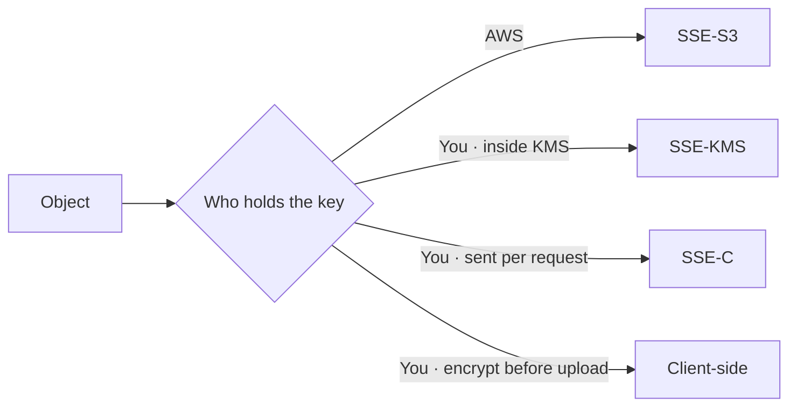
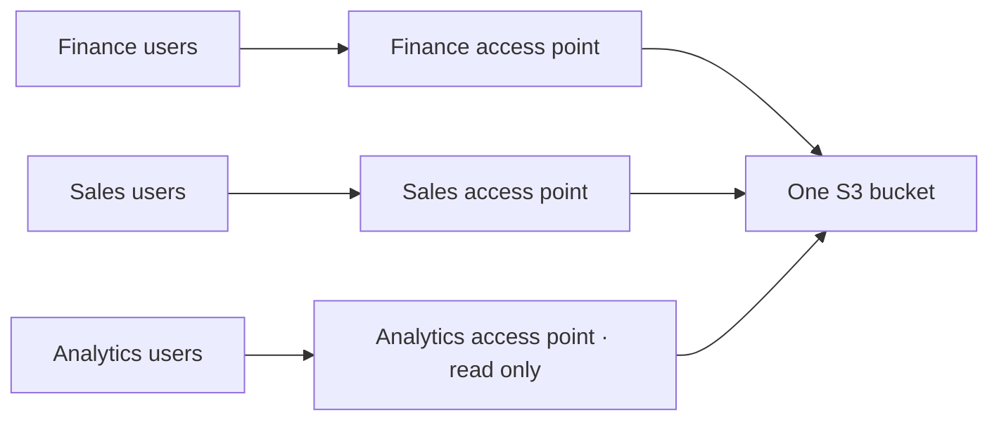
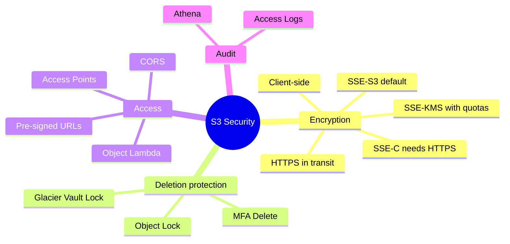

# AWS S3 — Security and Advanced Features

> **Core idea:** S3 protects data in three ways: encrypt it, control who can reach it, and stop it from being deleted. Most exam questions are "which encryption type?" or "which feature stops deletion?" — so learn the differences, not the details.

---

## 1. Encryption of objects

### 1.1 The four types

Encryption means the file is scrambled, so stolen data is useless. S3 gives four ways to do it.

|Type|Who owns the key|Where encryption happens|Header you must send|
|---|---|---|---|
|**SSE-S3**|AWS (you never see it)|AWS side|`x-amz-server-side-encryption: AES256`|
|**SSE-KMS**|You, inside AWS KMS|AWS side|`x-amz-server-side-encryption: aws:kms`|
|**SSE-C**|You, outside AWS|AWS side|key sent in HTTP headers every request|
|**Client-side**|You, outside AWS|On your own computer|none — AWS never knows|

`SSE` means **server-side encryption**: AWS does the scrambling.

**SSE-S3** uses AES-256 and is **on by default** for new buckets and new objects.

**SSE-KMS** gives you control: you create the key, and every use of the key is logged in CloudTrail. To read the object a user needs **two** permissions — access to the object _and_ access to the KMS key.

**SSE-C** sends your key to AWS with each request. AWS uses it, then throws it away — it is never stored. Because the key travels over the network, **HTTPS is mandatory**, and SSE-C can only be used from the **CLI/SDK, not the console**.

**Client-side** encryption happens before upload and decryption happens after download. AWS only ever sees scrambled bytes.

> **Exam trap — SSE-KMS throughput limit:** every upload calls `GenerateDataKey` and every download calls `Decrypt`. These count against the KMS quota of **5,000–30,000 requests per second** (per region, can be raised in Service Quotas). A very busy bucket on SSE-KMS can get throttled. Fix: use **S3 Bucket Keys**, which cut KMS API calls, or move to SSE-S3.

`DSSE-KMS` is just KMS encryption applied twice. Know the name only.

### 1.2 Encryption in transit

A bucket has two endpoints: **HTTP** (not encrypted) and **HTTPS** (encrypted). HTTPS is also called SSL/TLS.

To force HTTPS, attach a bucket policy that **denies** `s3:GetObject` when the condition `aws:SecureTransport` is `false`.

### 1.3 Default encryption vs bucket policy

Default encryption applies automatically to new objects. A bucket policy can go further and **reject uploads** that do not carry the right encryption header.

> **Bucket policies are always evaluated before default encryption settings.**

---

## 2. CORS — Cross-Origin Resource Sharing

An **origin** is scheme + host + port, for example `https://www.example.com` (port 443 implied). Same scheme, same host, same port = same origin.

CORS is a **web browser** security rule. If a page loaded from origin A asks for a file on origin B, the browser first sends a **pre-flight request** (an OPTIONS call) to B. B must answer with the header `Access-Control-Allow-Origin` naming A. Only then does the browser fetch the file.

**On S3:** if a static website in bucket A loads images from bucket B, bucket B needs CORS rules (set in JSON under Permissions). You allow a specific origin, or `*` for all origins.

> Exam phrasing: _"browser blocks a request between two S3 static websites"_ → enable **CORS headers on the bucket holding the asset**.

---

## 3. Protecting data from deletion

### 3.1 MFA Delete

MFA (multi-factor authentication) means a code from a phone app or hardware device.

|Operation|MFA needed?|
|---|---|
|Permanently delete an object version|Yes|
|Suspend versioning|Yes|
|Enable versioning|No|
|List deleted versions|No|

Rules: **versioning must be enabled first**, and only the **root account (bucket owner)** can turn MFA Delete on or off — and only through the **CLI**, not the console.

### 3.2 Glacier Vault Lock and S3 Object Lock

Both give a **WORM** model — Write Once, Read Many. Once written, data cannot be changed or deleted.

|Feature|Scope|Key point|
|---|---|---|
|**Glacier Vault Lock**|Whole vault|Policy is locked forever; no one can edit or delete it, not even AWS|
|**S3 Object Lock**|Each object version|Needs versioning enabled; set a retention period per object|

S3 Object Lock has two retention modes plus one extra switch:

|Mode|Who can delete or change it|
|---|---|
|**Compliance**|Nobody — not even the root user. Retention period can be extended but never shortened|
|**Governance**|Normal users cannot; admins with special IAM permission can|
|**Legal Hold**|Protects the object **forever**, ignoring retention settings. Put or remove it with the `s3:PutObjectLegalHold` permission|

> Remember: **compliance = strict, governance = admins have an escape hatch, legal hold = indefinite and independent.**

---

## 4. Access and auditing

### 4.1 S3 Access Logs

Every request to a bucket — allowed or denied, from any account — can be written as log files into **another** S3 bucket. Logs can then be analysed with **Amazon Athena**.

The logging bucket must be in the **same AWS region**.

> ⚠ Never set the logging bucket to be the same bucket you are monitoring. Each log write creates another log, forever, and the bucket grows without limit.

### 4.2 Pre-signed URLs

A pre-signed URL gives temporary access to **one private object**, without making the bucket public. The person using the URL **inherits the permissions of the user who created it** for that GET or PUT.

|Created with|Maximum expiry|
|---|---|
|Console|12 hours|
|CLI / SDK|168 hours|

Use cases: let only logged-in users download a premium video; let a changing list of users download files; let a user upload to one exact location while the bucket stays private.

### 4.3 S3 Access Points

A big bucket with finance data and sales data would need one huge, growing bucket policy. Access Points split that up.

Each access point has:

- its **own DNS name** (that is how you connect to it),
- its **own access point policy** (looks like a bucket policy),
- a choice of **internet** or **VPC** origin.

Example: a finance access point allows read/write on the `finance` prefix, a sales access point on the `sales` prefix, an analytics access point gives read-only on both. The bucket policy itself stays simple.

For a **VPC origin**, you create a **VPC endpoint** to reach the access point. The VPC endpoint policy must allow access to **both** the access point and the bucket.

### 4.4 S3 Object Lambda

Sometimes different applications need **different versions of the same object**. Copying the bucket is wasteful. Instead, an **S3 Object Lambda Access Point** sits on top of a normal access point and runs a Lambda function that changes the object **as it is retrieved**.

One bucket, many views:

|Application|What it gets|
|---|---|
|E-commerce app|The original object, straight from the bucket|
|Analytics app|A redacted object — PII removed by Lambda|
|Marketing app|An enriched object — Lambda adds data from a loyalty database|

Other uses: converting XML to JSON, resizing images, adding a watermark specific to the requesting user.

---

## 5. Summary

1. SSE-S3 is the default encryption on every new bucket.
2. SSE-KMS adds control and CloudTrail logs, but costs KMS API calls and can be throttled.
3. SSE-C keeps the key outside AWS and forces HTTPS; CLI only.
4. Client-side encryption means AWS never sees plain data.
5. Deny `aws:SecureTransport: false` in a bucket policy to force HTTPS.
6. Bucket policies are evaluated before default encryption.
7. CORS is browser security; put the rules on the bucket holding the asset.
8. MFA Delete needs versioning plus the root account, CLI only.
9. Object Lock: compliance (nobody), governance (admins can), legal hold (forever).
10. Pre-signed URLs share one private file temporarily; Access Points and Object Lambda scale and transform access to one bucket.

---

## 6. Check yourself

1. Which encryption type is on by default, and which algorithm does it use?
2. What two permissions does a user need to read an SSE-KMS object?
3. Why can a high-traffic SSE-KMS bucket get throttled, and what reduces it?
4. Why must SSE-C use HTTPS, and why can it not be set in the console?
5. Which bucket policy condition forces encrypted connections?
6. Which bucket needs the CORS configuration — the one with the web page, or the one with the image?
7. Which two operations require MFA Delete, and who can enable it?
8. What is the difference between compliance mode, governance mode, and legal hold?
9. What is the maximum expiry of a pre-signed URL from the CLI?
10. What mistake turns S3 access logging into an infinite loop?

---

## 7. Key terms

|Term|Meaning|
|---|---|
|SSE|Server-side encryption — AWS encrypts the object|
|KMS|Key Management Service — where you create and control your own keys|
|CloudTrail|Service that logs every AWS API call|
|Bucket Key|Setting that lowers KMS API calls, and so lowers cost|
|SSL / TLS|Encryption of data while it travels over the network|
|`aws:SecureTransport`|Policy condition; true when HTTPS is used|
|Origin|Scheme + host + port of a URL|
|Pre-flight request|Browser's OPTIONS check before a cross-origin call|
|CORS|Browser rule for requests between different origins|
|MFA|Multi-factor authentication — an extra code from a device|
|WORM|Write Once Read Many — data cannot be changed after writing|
|Legal Hold|Indefinite protection of an object, ignoring retention settings|
|Pre-signed URL|Temporary URL carrying the creator's permissions|
|Access Point|Named entry to a bucket with its own policy and DNS name|
|Athena|Service for running SQL queries on files stored in S3|
