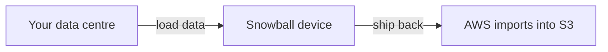
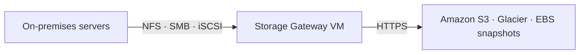
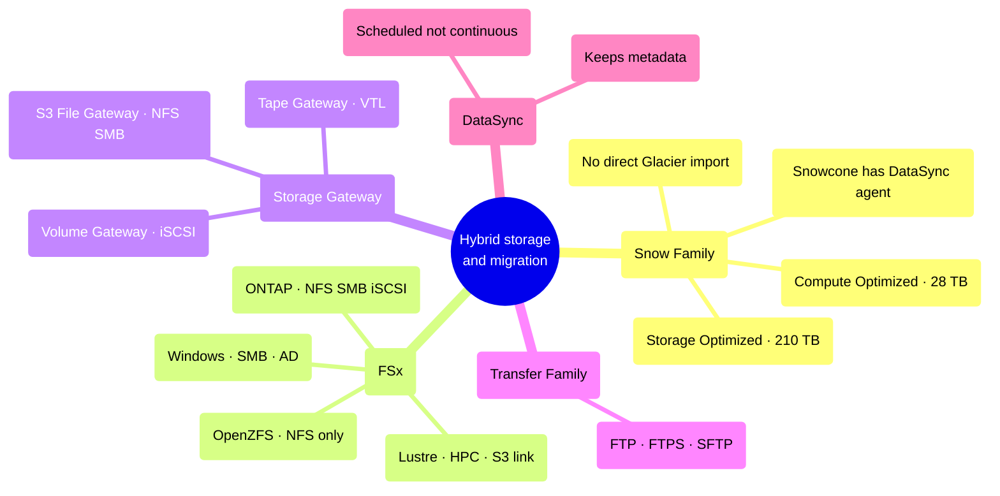

# Hybrid Storage and Data Migration

> **Core idea:** AWS storage is not only in the cloud. Some services move big data into AWS (Snow Family, DataSync), and some connect your own data centre to AWS (Storage Gateway, Transfer Family). FSx gives you ready-made third-party file systems inside AWS. The exam mostly tests _which one to pick_.

---

## 1. Moving large data physically — the Snow Family

### 1.1 Why it exists

Copying data over the internet is slow. Moving **100 TB over a 1 Gbps line takes 12 days**. You also pay high network cost and share bandwidth with your real applications.

> If a transfer over the network would take **more than a week**, use a Snow device instead.

A Snow device is a physical box. AWS ships it to you, you copy data into it, you ship it back, AWS loads the data into Amazon S3.

### 1.2 The two devices

|Device|Storage|Main purpose|
|---|---|---|
|Snowball Edge **Storage Optimized**|210 TB|Large data migration|
|Snowball Edge **Compute Optimized**|28 TB|Edge computing|

### 1.3 Edge computing

Some places have no good internet — a truck, a ship, a mining site. You order a Compute Optimized device and **run EC2 instances or Lambda functions on it**, right where the data is created. Use it to pre-process data, do machine learning, or transcode media at the edge. Later the device is shipped back to AWS.

### 1.4 Two exam facts that always come back

| Scenario                                       | Answer                                                                                               |
| ---------------------------------------------- | ---------------------------------------------------------------------------------------------------- |
| Snowball must load data into Glacier           | **Not possible directly.** Import into S3, then use an **S3 lifecycle policy** to move it to Glacier |
| You want DataSync but have no network capacity | Use **Snowcone** — it ships with the **DataSync agent pre-installed**                                |

**Snow = no network, move data by truck.**

---

## 2. Amazon FSx — managed third-party file systems

FSx is to **file systems** what RDS is to databases: AWS runs a well-known third-party product for you. Four types matter for the exam.

|FSx type|Protocol|Pick it when the question says|
|---|---|---|
|**Windows File Server**|SMB, NTFS|Windows share drive, Active Directory, ACLs, user quotas|
|**Lustre**|Lustre client|**High Performance Computing (HPC)**, machine learning, video processing, financial modelling|
|**NetApp ONTAP**|NFS, SMB, **iSCSI**|Moving an existing ONTAP/NAS workload, **widest OS compatibility**, de-duplication|
|**OpenZFS**|**NFS only**|Moving an existing ZFS workload, up to 1M IOPS, **no de-duplication**|

### 2.1 FSx for Windows File Server

- Supports SMB and Windows NTFS, integrates with **Microsoft Active Directory**.
- Can also be **mounted on Linux EC2 instances** — a common trick question.
- Can join an on-premises Windows File Server using **DFS** (Distributed File System).
- Storage: **SSD** for low latency (databases, media, analytics), **HDD** for cheaper broad workloads (home directories, CMS).
- Can be **Multi-AZ**, accessible from on-premises over a private connection, backed up daily to S3.

### 2.2 FSx for Lustre

The name comes from **Lin**ux + cl**uster**. Scales to hundreds of GB/s, millions of IOPS, sub-millisecond latency.

It has **seamless S3 integration**: you can read an S3 bucket as if it were a file system, and write the result of your computation back to S3.

Two deployment options:

|Option|Data copies|Lose data on server failure?|Use case|
|---|---|---|---|
|**Scratch**|1 copy, no replication|**Yes**|Short-term processing, lowest cost, **6x burst performance**|
|**Persistent**|Replicated **inside the same AZ**|No — files replaced in minutes|Long-term storage of important data|

> FSx for Lustre lives in **one single AZ**. Persistent replicates _within_ that AZ, not across AZs.

### 2.3 ONTAP vs OpenZFS

Both support snapshots, compression, low cost, and **point-in-time instant cloning** (great for making a test copy of a file system). The difference the exam uses:

| |NetApp ONTAP|OpenZFS|
|---|---|---|
|Protocols|NFS, SMB, iSCSI|NFS only|
|De-duplication|**Yes**|**No**|
|Storage grows automatically|Yes|—|

---

## 3. Storage Gateway — the bridge to on-premises

**Hybrid cloud** means part of your infrastructure stays in your own data centre, because of migration time, security, or compliance. S3 is a proprietary API, so an old on-premises server cannot simply mount it. **Storage Gateway is the bridge.**

The gateway is a **VM you install in your own data centre** (VMware, Hyper-V, Linux KVM). You can also run it on EC2, but then the cache sits inside AWS.

|Gateway type|Protocol used on-premises|What it gives you|
|---|---|---|
|**S3 File Gateway**|**NFS / SMB**|Your S3 bucket looks like a normal file share. Most used files are **cached locally**|
|**Volume Gateway**|**iSCSI**|Block volumes backed by S3, backed up as **EBS snapshots**|
|**Tape Gateway**|**iSCSI VTL**|Replaces physical tape backup. Virtual tapes stored in S3 and Glacier|

### 3.1 Details worth remembering

- **S3 File Gateway** supports S3 Standard, Standard-IA, One Zone-IA and Intelligent-Tiering — **not Glacier directly**. To archive, add an **S3 lifecycle policy** to Glacier.
- Each File Gateway needs an **IAM role** to reach the bucket. With SMB you get **Active Directory** user authentication.
- **Volume Gateway** has two modes:

|Mode|Where the data lives|Why|
|---|---|---|
|**Cached volumes**|Main data in S3, recent data cached locally|Low latency on hot data, small local disk|
|**Stored volumes**|**Entire dataset on-premises**|Full local speed, scheduled async backup to S3|

---

## 4. Transfer Family — FTP on top of S3 and EFS

Use it when an application or partner can only speak **FTP**, and you still want the files in S3 or EFS.

|Protocol|Encrypted?|
|---|---|
|**FTP**|No|
|**FTPS** (FTP over SSL)|Yes, in flight|
|**SFTP** (secure FTP)|Yes, in flight|

- Fully managed, scalable, highly available.
- Pricing: **per provisioned endpoint per hour + per GB transferred**.
- Users can be stored inside the service, or authenticated against **Active Directory, LDAP, Okta, Amazon Cognito**, or a custom source.
- Route 53 can give the endpoint your own hostname. An **IAM role** lets the service read and write S3 or EFS.

---

## 5. DataSync — scheduled data synchronisation

DataSync moves **large amounts of data** between on-premises (or another cloud) and AWS, or **between AWS storage services**.

|Question|Answer|
|---|---|
|Sources|NFS, SMB, HDFS servers; other clouds; AWS services|
|Targets|**S3 (any storage class, even Glacier)**, EFS, FSx|
|Agent needed?|**Yes** for NFS/SMB on-premises. **No** for AWS-to-AWS|
|Continuous?|**No — scheduled** hourly, daily or weekly|
|Keeps permissions and metadata?|**Yes** (POSIX and SMB permissions)|
|Speed|Up to **10 Gbps per task**, bandwidth limit can be set|
|Direction|Both ways — on-premises to AWS, and AWS back to on-premises|

> If a question asks to move files **and keep the file permissions and metadata**, the answer is **DataSync**.

---

## 6. Choosing the right storage — decision table

| You need                                                  | Service                                |
| --------------------------------------------------------- | -------------------------------------- |
| Object storage with its own API                           | **Amazon S3**                          |
| Archive objects cheaply                                   | **S3 Glacier**                         |
| Disk attached to one EC2 instance                         | **EBS** (IO1/IO2 support multi-attach) |
| Physical, very high IOPS disk on the host                 | **EC2 Instance Store**                 |
| Network file system for Linux, across multiple AZs, POSIX | **Amazon EFS**                         |
| Windows file share                                        | **FSx for Windows File Server**        |
| HPC / machine learning Linux file system                  | **FSx for Lustre**                     |
| Widest OS compatibility for a network file system         | **FSx for NetApp ONTAP**               |
| Managed ZFS                                               | **FSx for OpenZFS**                    |
| Give on-premises servers file access to S3                | **S3 File Gateway**                    |
| Back up on-premises volumes to the cloud                  | **Volume Gateway**                     |
| Replace physical tape backups                             | **Tape Gateway**                       |
| FTP / FTPS / SFTP interface to S3 or EFS                  | **AWS Transfer Family**                |
| Scheduled sync, keeping metadata                          | **AWS DataSync**                       |
| Move petabytes with no usable network                     | **Snowcone / Snowball**                |

---

## 7. Summary

1. Snow devices are for data that is too big to send over the network.
2. Storage Optimized is 210 TB; Compute Optimized is 28 TB and runs EC2 and Lambda at the edge.
3. Snowball cannot write to Glacier — go through S3 plus a lifecycle policy.
4. FSx runs third-party file systems: Windows, Lustre, NetApp ONTAP, OpenZFS.
5. Lustre means HPC and machine learning, and can read and write S3 directly.
6. Lustre scratch is fast but loses data; persistent replicates inside one AZ.
7. Storage Gateway is a VM in your data centre bridging on-premises to S3.
8. File Gateway uses NFS/SMB, Volume Gateway uses iSCSI, Tape Gateway uses iSCSI VTL.
9. Transfer Family is only about FTP, FTPS and SFTP access to S3 or EFS.
10. DataSync is scheduled, not continuous, and preserves permissions and metadata.

---

## 8. Check yourself

1. How long does 100 TB take over a 1 Gbps link, and what should you use instead?
2. Which Snow device would you order to run Lambda functions on a ship?
3. A question asks to import Snowball data into Glacier. What is the correct two-step answer?
4. Which FSx type is mounted using SMB, and can it be used from Linux?
5. What keyword in a question points to FSx for Lustre?
6. What is the difference between a scratch and a persistent Lustre file system?
7. Which FSx type supports iSCSI and de-duplication?
8. Which Storage Gateway type would an old tape backup server use?
9. What is the difference between cached volumes and stored volumes?
10. Two services can copy files from on-premises to S3. Which one preserves file permissions, and is it continuous?

---

## 9. Key terms

|Term|Meaning|
|---|---|
|**Hybrid cloud**|Part of the infrastructure in AWS, part in your own data centre|
|**Edge computing**|Processing data where it is created, before sending it to the cloud|
|**NFS**|Network file system protocol, used mostly by Linux|
|**SMB**|Windows file sharing protocol|
|**iSCSI**|Protocol that makes remote storage look like a local disk (block storage)|
|**VTL**|Virtual Tape Library — virtual tapes stored in S3 and Glacier|
|**HPC**|High Performance Computing — many machines working on one heavy job|
|**IOPS**|Input/output operations per second — how many reads/writes per second|
|**POSIX permissions**|Standard Linux file owner and permission bits|
|**Lifecycle policy**|S3 rule that moves objects to a cheaper class after some time|
|**DFS**|Microsoft Distributed File System, groups file shares together|
|**Multi-AZ**|Copies kept in two availability zones for high availability|
