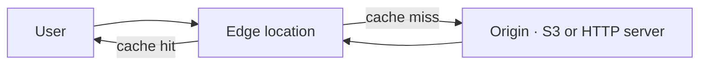
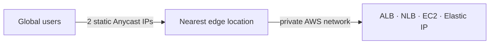
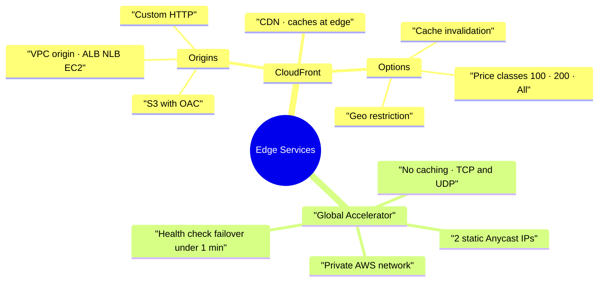

# CloudFront and AWS Global Accelerator

> **Core idea:** Both services use the AWS edge locations around the world to make your app faster for global users. CloudFront **caches** content at the edge (CDN). Global Accelerator does **not** cache — it gives you 2 static IPs and sends traffic over the fast private AWS network to your application.

---

## 1. CloudFront — the CDN

### 1.1 What it is

**CloudFront is a CDN (Content Delivery Network).** It copies ("caches") your content at hundreds of **edge locations** (points of presence) around the world.

- Users get the content from a nearby edge → **lower latency**, better read performance.
- Being spread worldwide also gives **DDoS protection** (works with Shield and WAF).

> In the exam: the word **CDN** means **CloudFront**.

### 1.2 How a request works

First user at an edge → edge has nothing in cache → edge fetches from the **origin** and stores it. Next user at the same edge → served straight from the cache, no trip to the origin.

**Origin = the backend where the real content lives.**

### 1.3 Origin types

| Origin            | Use for                                                          | Note                                                                                     |
| ----------------- | ---------------------------------------------------------------- | ---------------------------------------------------------------------------------------- |
| **S3 bucket**     | Distribute and cache files; also upload files through CloudFront | Secured with **OAC (Origin Access Control)** + a bucket policy. Bucket stays **private** |
| **VPC origin**    | ALB, NLB or EC2 in a **private subnet**                          | Newer and more secure way. Nothing exposed to the internet                               |
| **Custom origin** | Any HTTP backend, inside or outside AWS (e.g. S3 static website) | Must be reachable over HTTP                                                              |

### 1.4 ALB / EC2 as origin: old way vs new way

| |VPC origin (new, preferred)|Public network (old)|
|---|---|---|
|Backend|Private ALB / NLB / EC2|Must be **public**|
|Security|Nothing public, CloudFront connects privately|Security group must allow **all CloudFront public IPs** (list published by AWS)|
|Risk|Low|Someone edits the security group → backend open to everyone|

### 1.5 CloudFront vs S3 Cross-Region Replication

| |CloudFront|S3 Cross-Region Replication|
|---|---|---|
|Network|Global edge network (~216 PoPs)|Set up **per region** you choose|
|Freshness|Cached, e.g. up to 1 day|Near real time, no cache|
|Access|Read from edge|Read-only copy in the other bucket|
|Best for|**Static content**, available everywhere|**Dynamic content**, low latency in a few regions|

---

## 2. CloudFront options that appear in the exam

### 2.1 Geo Restriction

Block or allow users **by country**.

- **Allowlist** = only these countries can access. **Blocklist** = these countries are banned.
- Country is found with a third-party **Geo-IP database** matching the user's IP.
- Main use case: **copyright laws** / licensing of content.
- Console path: Security → CloudFront geographic restrictions → Countries → Edit.

### 2.2 Price Classes

Data-out cost is different per region (example: first 10 TB is $0.085/GB from the US, about $0.17/GB from India). More data transferred → lower price per GB. You can use fewer edge locations to save money.

|Price class|Edge locations used|Performance / cost|
|---|---|---|
|**Price Class All**|All regions worldwide|Best performance, highest cost|
|**Price Class 200**|Most regions, excludes the most expensive ones|Middle|
|**Price Class 100**|Only the cheapest regions (North America + Europe)|Lowest cost|

### 2.3 Cache Invalidation

If you change a file at the origin, the edge locations keep serving the **old** copy until the **TTL** expires. To push the change out now, run a **CloudFront invalidation**.

- Invalidate everything: `*`
- Invalidate a path: `/images/*` or one file: `/index.html`

The file is removed from the edge caches. The next request misses the cache, so the edge fetches the fresh file from the origin.

---

## 3. AWS Global Accelerator

### 3.1 The problem

Your app lives in one region (say India), but users are worldwide. Over the **public internet** their traffic passes many router hops → extra latency and more chance of a lost connection. The goal: enter the **AWS private network as early as possible**.

### 3.2 Unicast vs Anycast IP

| |Unicast IP|Anycast IP|
|---|---|---|
|Idea|One server = one IP|**Many servers share the same IP**|
|Routing|IP decides which exact server|Client is routed to the **nearest** server|

Global Accelerator is built on **Anycast IP**.

### 3.3 How it works

- You get **2 static Anycast IP addresses**, global and unchanging.
- Traffic enters at the closest edge, then travels the **private AWS network** to your app.

|Feature|What it gives you|
|---|---|
|Works with|Elastic IP, EC2, ALB, NLB — public **or** private|
|Performance|Intelligent routing to the lowest-latency edge|
|Health checks|Failover to a healthy endpoint in **under 1 minute**|
|Client cache|No problem — the 2 IPs never change|
|Security|Only 2 IPs for clients to allowlist; DDoS protection via **AWS Shield**|

### 3.4 Setup in short

1. Create the accelerator (type **Standard**, routing IPv4).
2. Add a **listener**: protocol TCP/UDP, port (e.g. 80). _Client affinity_ = none, or by source IP to keep a client on the same backend.
3. Add an **endpoint group per region** (e.g. us-east-1, eu-west-1), with health checks (protocol, path, port, interval, threshold).
4. Add **endpoints** inside each group (ALB, NLB, EC2 instance, Elastic IP) with a **weight** to split traffic.

Global Accelerator is a **global service** — you do not pick a region for it.

---

## 4. CloudFront vs Global Accelerator — the exam table

| |CloudFront|Global Accelerator|
|---|---|---|
|Same for both|Global AWS network, edge locations, Shield DDoS protection||
|Caching|**Yes** — content served from the edge|**No** — packets are proxied to the app|
|Traffic|HTTP/HTTPS: images, video, APIs, dynamic sites|Any **TCP or UDP** application|
|Where requests end|Mostly at the edge|Always at your application, in 1 or more regions|
|Static IPs|No|**Yes — 2 static Anycast IPs**|
|Best for|Cacheable and dynamic web content|Gaming, IoT, VoIP; HTTP needing static IPs; fast regional failover|

---

## 5. Summary

1. CDN in a question = CloudFront.
2. CloudFront caches at edge locations; a cache miss goes to the origin once, then it is cached.
3. S3 origin stays **private** — CloudFront uses **OAC** plus a bucket policy.
4. **VPC origin** is the modern, private way to use ALB / NLB / EC2 as the origin.
5. Geo restriction = allowlist or blocklist by country, typical use case is copyright.
6. Price Class 100 is cheapest (fewest edges), Price Class All is fastest and most expensive.
7. Invalidation forces the edge to drop cached files before the TTL ends.
8. Global Accelerator = 2 static Anycast IPs, no caching, works for TCP/UDP.
9. Need **static IP addresses** or **non-HTTP** traffic → Global Accelerator, not CloudFront.
10. Global Accelerator health checks give automatic regional failover in under a minute.

---

## 6. Check yourself

1. What happens the second time a user asks an edge location for the same file?
2. How does CloudFront read from a private S3 bucket?
3. Why is a VPC origin safer than putting your ALB on the public internet?
4. Which CloudFront feature blocks users from one country, and how is the country found?
5. Which price class gives the lowest cost, and which regions does it keep?
6. You updated `index.html` in S3 but users still see the old page. What do you do?
7. In one sentence, what is an Anycast IP?
8. Your game uses UDP and clients must allowlist fixed IPs. CloudFront or Global Accelerator?
9. Does Global Accelerator cache anything?
10. How fast does Global Accelerator fail over to a healthy region?

---

## 7. Key terms

|Term|Meaning|
|---|---|
|**CDN**|Content Delivery Network — caches content close to users|
|**Edge location / PoP**|AWS site worldwide that serves cached content|
|**Origin**|The backend holding the real content (S3, ALB, EC2, any HTTP server)|
|**OAC**|Origin Access Control — lets CloudFront read a private S3 bucket|
|**VPC origin**|Private link from CloudFront to an ALB, NLB or EC2 in a private subnet|
|**TTL**|Time to live — how long a file stays in the edge cache|
|**Invalidation**|Forced removal of cached files before the TTL ends|
|**Geo restriction**|Allow or block access by the user's country|
|**Price class**|How many edge regions your distribution uses, to control cost|
|**Unicast IP**|One IP belongs to one server|
|**Anycast IP**|One IP shared by many servers; client reaches the nearest one|
|**Listener**|Global Accelerator setting for protocol and port to accept|
|**Endpoint group**|A region inside a Global Accelerator listener|
|**Endpoint**|The actual ALB, NLB, EC2 or Elastic IP receiving traffic|
