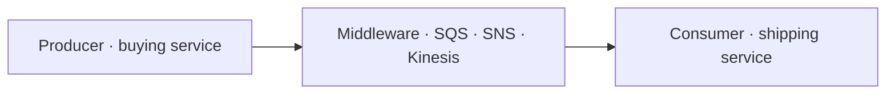
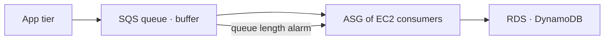
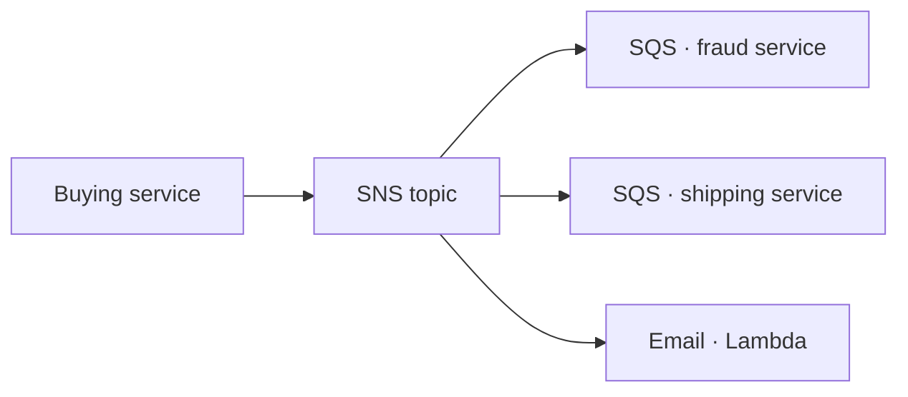
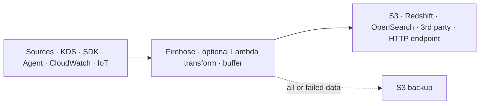
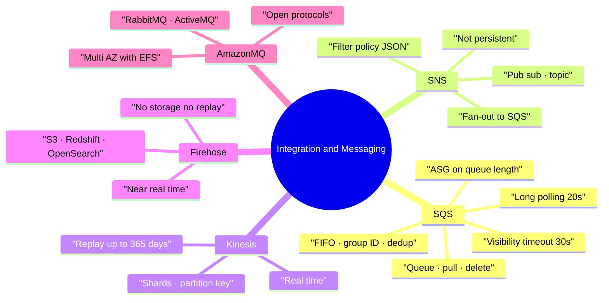

# AWS Integration and Messaging — SQS, SNS, Kinesis, Amazon MQ

> **Core idea:** When two applications talk directly, a traffic spike in one can break the other. Put a middleware between them so each side can scale alone. SQS is a **queue** (one message, one worker). SNS is **pub/sub** (one message, many subscribers). Kinesis is **real-time streaming** data that can be replayed.

---

## 1. Why messaging exists

Two ways applications can talk:

|Pattern|How|Problem|
|---|---|---|
|**Synchronous**|App A calls App B directly|A sudden spike in A overwhelms B → outage|
|**Asynchronous (event-based)**|A writes to a middleware, B reads it later|None of the above — both scale on their own|

> Exam keywords: **decouple**, **sudden spike of traffic**, **timeouts** → think SQS.

---

## 2. Amazon SQS — the queue

**Producers** send messages in. **Consumers** poll messages out, process them, then **delete** them. Deleting is the signal that work is done.

### 2.1 Standard queue facts

|Item|Value|
|---|---|
|Throughput|Unlimited (messages/sec and messages in queue)|
|Retention|4 days default, 14 days max|
|Latency|< 10 ms on publish and receive|
|Message size|256 KB max|
|Delivery|**At least once** → duplicates possible|
|Ordering|**Best effort** → can be out of order|
|Receive|Up to **10 messages** at a time|

Key APIs: `SendMessage`, `ReceiveMessage`, `DeleteMessage`.

**To process faster, add more consumers (horizontal scaling).**

### 2.2 Visibility timeout

When a consumer polls a message, it becomes **invisible to other consumers** for a while. Default **30 seconds**, settable from 0 seconds to **12 hours**.

- Message deleted inside the window → done, gone.
- Not deleted → message returns to the queue and is processed **twice**.
- Need more time? The consumer calls `ChangeMessageVisibility`.

|Setting|Risk|
|---|---|
|Too high (hours)|If consumer crashes, message is stuck for hours|
|Too low (seconds)|Duplicate processing by other consumers|

### 2.3 Long polling

The consumer waits for a message to arrive instead of asking again and again.

- Wait time: **1 to 20 seconds** (20 is preferred)
- Fewer API calls, lower cost, lower latency
- Set at queue level or per call with `WaitTimeSeconds`

> Always prefer long polling over short polling.

### 2.4 FIFO queues

| Item               | Value                                                                              |
| ------------------ | ---------------------------------------------------------------------------------- |
| Name must end with | `.fifo`                                                                            |
| Ordering           | Guaranteed, per **Message Group ID**                                               |
| Throughput         | 300 msg/s, **3,000 msg/s with batching**                                           |
| Duplicates         | Removed via **Deduplication ID** within a 5-minute window (or content-based dedup) |

### 2.5 SQS + Auto Scaling Group (very common exam pattern)

Consumers run on EC2 inside an ASG. Scale the ASG on the CloudWatch metric **ApproximateNumberOfMessages** (queue length) using an alarm.

**SQS as a database write buffer:** instead of writing straight to RDS/DynamoDB (which can overload), write to SQS. A second ASG dequeues and inserts into the database, deleting the message only after a successful insert. No transaction is lost. Works only when the client does not need an instant write confirmation.

### 2.6 SQS security

| Layer       | How                                                                                                                            |
| ----------- | ------------------------------------------------------------------------------------------------------------------------------ |
| In flight   | HTTPS                                                                                                                          |
| At rest     | KMS keys (SSE-SQS by default in console)                                                                                       |
| Client side | Your own code encrypts/decrypts                                                                                                |
| Access      | IAM policies + **SQS access policy** (like an S3 bucket policy) for cross-account and for letting SNS or S3 write to the queue |

---

## 3. Amazon SNS — pub/sub

One message is published to a **topic**, and **every subscriber gets a copy**.

|Item|Value|
|---|---|
|Subscriptions per topic|~12.5 million|
|Topics per account|100,000 (soft limit)|
|Persistence|**None** — not stored; undelivered can be lost|
|Ordering|Best effort (standard)|

Subscriber types: **SQS, Lambda, Kinesis Data Firehose, Email, Email-JSON, HTTP/HTTPS, SMS / mobile push**.

Many AWS services publish into SNS: CloudWatch Alarms, ASG notifications, CloudFormation state changes, Budgets, S3 events, RDS events, DynamoDB, DMS, Lambda.

Security is the same shape as SQS: HTTPS in flight, KMS at rest, client-side option, IAM policies plus an **SNS access policy**.

### 3.1 Fan-out pattern (exam favourite)

Publish **once** to an SNS topic, subscribe **many SQS queues** to it.

- Fully decoupled, **no data loss** — SQS gives persistence, delayed processing and retries.
- Add new queues any time without touching the producer.
- The **SQS access policy must allow the SNS topic to write**.
- Works **cross-region**.
- Solves the S3 limit of one event rule per event-type + prefix: send the S3 event to SNS, fan out to many queues.

### 3.2 SNS FIFO

Same ideas as SQS FIFO: ordering by **Message Group ID**, dedup by **Deduplication ID** or content. Only **SQS queues** can subscribe. Throughput is limited like SQS FIFO. Use when you need fan-out **plus** ordering **plus** deduplication.

### 3.3 Message filtering

A **JSON filter policy** on a subscription. Only matching messages reach that subscriber. No policy = receives everything.

Example: one topic of orders → queue with `State = Placed`, another queue with `State = Cancelled`, an email with the cancelled filter, and a queue with no filter that gets everything.

---

## 4. Kinesis Data Streams — real-time streaming

> Exam keyword: **real time**. Use for click streams, IoT devices, metrics and logs, big data analytics and ETL.

Producers: your app via SDK, **Kinesis Producer Library (KPL)** for high throughput, or the **Kinesis Agent** on servers. Consumers: your app, **Kinesis Client Library (KCL)**, Lambda, Data Firehose, Managed Service for Apache Flink.

|Item|Value|
|---|---|
|Retention|1 to **365 days**|
|Replay|**Yes** — data is persisted|
|Delete|Not possible; data only expires|
|Record size|Up to 1 MB|
|Ordering|At **shard** level, by **Partition Key** (same key → same shard)|
|Security|KMS at rest, HTTPS in flight|

### 4.1 Capacity modes and shards

A **shard** is one unit of stream capacity.

|Mode|How it works|Billing|
|---|---|---|
|**Provisioned**|You choose and scale the shard count manually|Per shard per hour|
|**On-demand**|Scales automatically from observed throughput of the last 30 days; starts ~4,000 records/s or 4 MB/s in|Per stream per hour + data in/out|

Per shard: **1 MB/s or 1,000 records/s in**, **2 MB/s out**. Need 10 MB/s in → 10 shards.

**Enhanced fan-out** gives 2 MB/s per shard **per consumer** (Kinesis pushes to consumers) instead of sharing 2 MB/s across all consumers.

---

## 5. Amazon Data Firehose — near real-time delivery

> Exam keyword: **near real time**. Formerly Kinesis Data Firehose.

It takes streaming data and **loads it into a destination**. Fully managed, serverless, auto-scaling, pay per use. **No storage, no replay.**

- Destinations to remember: **S3, Redshift, OpenSearch**, plus third parties (Datadog, Splunk, New Relic, MongoDB) and any custom HTTP endpoint.
- Optional **Lambda** transform (e.g. CSV → JSON).
- Format conversion to **Parquet or ORC**; compression with GZIP or Snappy.
- Input formats: CSV, JSON, Parquet, Avro, text, binary.
- It is _near_ real time because of the **buffer**, flushed on **size** or **time** (e.g. 1 MB or 60 seconds).

### 5.1 Kinesis Data Streams vs Data Firehose

| |Data Streams|Data Firehose|
|---|---|---|
|Purpose|Collect and store streams|Load streams into a destination|
|Code|You write producer and consumer|Fully managed|
|Speed|Real time|Near real time|
|Storage|1–365 days|None|
|Replay|Yes|No|
|Scaling|Provisioned / on-demand shards|Automatic|

---

## 6. Amazon MQ — for migrated legacy apps

SQS and SNS are **AWS proprietary** APIs. Old on-premises apps use open protocols: **MQTT, AMQP, STOMP, OpenWire, WSS**. Rewriting them is expensive.

**Amazon MQ** is a managed broker for **RabbitMQ** and **ActiveMQ**, so the app keeps its protocol.

- Has **both** queue and topic features in one broker.
- Runs on **servers**, so it does **not** scale like SQS/SNS and can have server problems.
- High availability: **active broker in one AZ, standby in another**, with **Amazon EFS** as shared backend storage so failover keeps the data.

> Exam trigger: _"migrating an existing application that uses AMQP / MQTT"_ → Amazon MQ, not SQS.

---

## 7. Decision table — which service?

|Scenario wording|Answer|
|---|---|
|Decouple apps, buffer a spike, process later|**SQS**|
|Strict ordering, no duplicates|**SQS FIFO**|
|Scale workers on backlog size|SQS + ASG on **ApproximateNumberOfMessages**|
|One event, many receivers|**SNS**|
|One event to many SQS queues|**SNS + SQS fan-out**|
|Send only some messages to a subscriber|SNS **message filtering**|
|Real-time streaming, replay needed|**Kinesis Data Streams**|
|Load streaming data into S3 / Redshift / OpenSearch|**Amazon Data Firehose**|
|Keep MQTT / AMQP after migration|**Amazon MQ**|

---

## 8. Summary

1. SQS = buffer between producers and consumers; a message is consumed by **one** worker and then deleted.
2. SQS standard: unlimited throughput, at-least-once delivery, best-effort ordering.
3. Visibility timeout 30s default; call `ChangeMessageVisibility` if more time is needed.
4. Long polling (up to 20s) cuts API calls and latency.
5. FIFO gives ordering per Message Group ID and 5-minute dedup, at lower throughput.
6. Scale consumers with an ASG on the queue-length CloudWatch metric.
7. SNS = one publish, many subscribers, no persistence.
8. SNS + SQS fan-out adds durability and retries; the queue policy must allow SNS.
9. Kinesis = real time and replayable; Firehose = near real time and no storage.
10. Amazon MQ only when open protocols (MQTT, AMQP) must be kept.

---

## 9. Check yourself

1. What happens to an SQS message if the consumer never deletes it inside the visibility timeout?
2. Which API gives a consumer more processing time?
3. What are the throughput numbers for an SQS FIFO queue with and without batching?
4. Which CloudWatch metric scales an ASG of SQS consumers?
5. Why is SNS alone riskier than SNS + SQS?
6. What must be changed so an SNS topic can write into an SQS queue?
7. How much data can one Kinesis shard take in and send out per second?
8. Which service is "near real time" and why?
9. Name the three main Firehose destinations you must remember.
10. When do you choose Amazon MQ over SQS?

---

## 10. Key terms

|Term|Meaning|
|---|---|
|Producer|Code that sends a message into a queue, topic or stream|
|Consumer|Code that reads and processes messages|
|Decoupling|Removing the direct link between two applications|
|Visibility timeout|Time a polled SQS message stays hidden from other consumers|
|Long polling|Consumer waits up to 20s for a message instead of re-asking|
|Message Group ID|FIFO tag that defines which messages must stay in order|
|Deduplication ID|FIFO tag used to drop duplicates within 5 minutes|
|Dead-letter queue|Queue that collects messages that failed processing|
|Fan-out|One SNS publish delivered to many SQS queues|
|Filter policy|JSON rule limiting which messages a subscriber receives|
|Shard|Unit of Kinesis capacity: 1 MB/s in, 2 MB/s out|
|Partition Key|Value deciding which shard a Kinesis record goes to|
|Enhanced fan-out|Kinesis pushes 2 MB/s per shard **per consumer**|
|Buffer (Firehose)|Data held until a size or time limit, then written out|
|Broker|Server running RabbitMQ or ActiveMQ in Amazon MQ|
