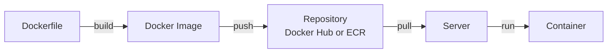
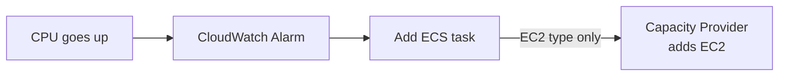
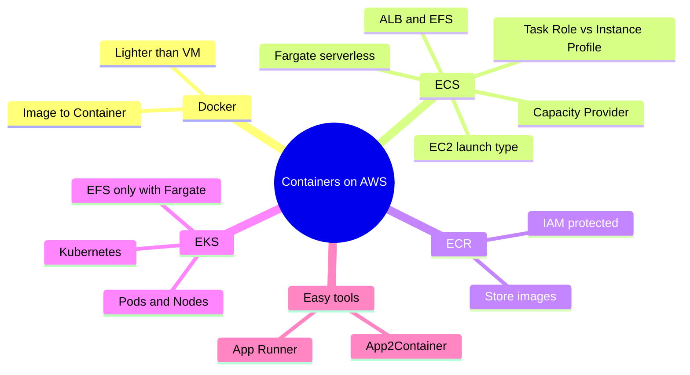

# Containers on AWS — Docker, ECS, Fargate, ECR, EKS, App Runner

> **Core idea:** Docker packs an app into a **container** that runs the same everywhere. On AWS you **store** images in **ECR** and **run** them with **ECS** (AWS's own system) or **EKS** (Kubernetes). **Fargate** = serverless, no servers to manage — the exam loves it.

---

## 1. Docker Basics

### 1.1 What is Docker?

- **Docker** = a platform to package an app into a **container**.
- A container runs **the same way on any machine** → no "works on my laptop" problem.
- Exam keywords: **microservices**, **lift-and-shift** from on-premises to cloud.

**Analogy:** A container is like a **lunchbox**. Food (app) + spoon (libraries) are inside. You can carry it to any table (server) and eat the same way.

### 1.2 Docker flow

|Word|Meaning|
|---|---|
|**Dockerfile**|Recipe that describes the container|
|**Image**|Built package (the recipe, cooked and frozen)|
|**Container**|A running image|
|**Docker Hub**|Public image repository|
|**Amazon ECR**|AWS image repository (private or public)|

### 1.3 Docker vs Virtual Machine

| |Virtual Machine (e.g. EC2)|Docker Container|
|---|---|---|
|Layers|Hardware → Host OS → **Hypervisor** → Guest OS + App|Hardware → Host OS → **Docker Daemon** → Apps|
|Own OS?|Yes, each VM has a full OS|No, containers **share** the host|
|Weight|Heavy|Light|
|Isolation|Strong|A bit less|
|Per server|Few|**Many**|

---

## 2. AWS Container Services — The Map

|Service|Job|One-line memory|
|---|---|---|
|**ECS**|Run containers|AWS's **own** container platform|
|**EKS**|Run containers|AWS-managed **Kubernetes** (open source)|
|**Fargate**|Compute for ECS / EKS|**Serverless** — no EC2 to manage|
|**ECR**|Store images|AWS's Docker Hub|
|**App Runner**|Deploy web app / API|Easiest — zero infra knowledge|
|**App2Container**|Migrate old apps|Java / .NET → containers|

---

## 3. Amazon ECS (Elastic Container Service)

- Running one container (or group) in ECS = an **ECS Task**.
- Tasks run inside an **ECS Cluster**.
- **Task Definition** = blueprint of the task (image, CPU, RAM, ports, role).
- **Service** = keeps N tasks always running (+ can connect to a load balancer).

### 3.1 Launch Types (very important)

| |**EC2 Launch Type**|**Fargate Launch Type**|
|---|---|---|
|Who manages servers?|**You** (provision + maintain EC2)|**AWS** (serverless)|
|Needs ECS Agent?|Yes, on each EC2 instance|No|
|You define|EC2 instances + tasks|Only task definition (CPU + RAM)|
|How to scale|Add EC2 + add tasks|Just **add tasks**|
|Exam favourite?|—|**Yes**|

> **Rule:** If the question says "serverless" or "less management" → **Fargate**.

Extra: **ECS Anywhere** = run ECS tasks on your own data center servers. **FARGATE_SPOT** = cheaper Fargate (spot mode).

### 3.2 IAM Roles for ECS

| Role                     | Used by                      | Launch type         | Used for                                                                                               |
| ------------------------ | ---------------------------- | ------------------- | ------------------------------------------------------------------------------------------------------ |
| **EC2 Instance Profile** | The **ECS Agent**            | EC2 only            | Talk to ECS, send logs to CloudWatch, pull images from ECR, read Secrets Manager / SSM Parameter Store |
| **ECS Task Role**        | **Your app** inside the task | EC2 **and** Fargate | Call AWS services (e.g. Task A → S3, Task B → DynamoDB)                                                |

- Task Role is defined in the **task definition**.
- Each task can get a **different** role → least privilege.

**Analogy:** Instance Profile = badge for the **building manager**. Task Role = badge for **each worker**, giving access only to their own rooms.

### 3.3 Load Balancer Integration

|Load Balancer|Use with ECS?|
|---|---|
|**ALB**|**Best choice** for most cases, works with Fargate|
|**NLB**|Only for very high throughput / performance, or with **AWS PrivateLink**|
|**CLB**|Not recommended; **does not work with Fargate**|

### 3.4 Storage — EFS

- Need **shared, persistent storage** across tasks → **Amazon EFS**.
- Works with **both** EC2 and Fargate launch types.
- Tasks in **any AZ** see the same data.

> **Ultimate serverless combo:** **Fargate** (compute) + **EFS** (storage).

---

## 4. ECS Auto Scaling

### 4.1 Scaling the Tasks (Service Auto Scaling)

Uses **AWS Application Auto Scaling**. Only **3 metrics** to remember:

|Metric|Meaning|
|---|---|
|**CPU Utilization**|Service CPU|
|**Memory Utilization**|Service RAM|
|**ALB Request Count Per Target**|Requests per task, from the ALB|

Scaling types: **Target Tracking**, **Step Scaling**, **Scheduled Scaling** (for predictable changes).

### 4.2 Scaling the EC2 Instances (EC2 launch type only)

> Scaling **tasks** ≠ scaling **EC2 instances**. With Fargate, you only scale tasks — that is why Fargate is easier.

|Option|How it works|Exam pick?|
|---|---|---|
|ASG Scaling|Scale ASG on a metric like CPU|Older way|
|**ECS Cluster Capacity Provider**|Adds EC2 **automatically** when tasks lack CPU/RAM|**Yes — smarter**|

---

## 5. ECS Solution Architectures (exam patterns)

| Pattern               | Flow                                                                              | Result                     |
| --------------------- | --------------------------------------------------------------------------------- | -------------------------- |
| **Event-driven**      | S3 upload → EventBridge → run ECS task (Fargate) → task processes file → DynamoDB | Serverless file processing |
| **Scheduled batch**   | EventBridge schedule (e.g. every 1 hour) → ECS task → batch job on S3             | Serverless cron job        |
| **Queue worker**      | SQS queue → ECS service pulls messages + auto scaling                             | More messages = more tasks |
| **Monitor lifecycle** | ECS task stopped/started → EventBridge → SNS → email admin                        | Alerts on container events |

All first three need an **ECS Task Role** to access S3 / DynamoDB.

---

## 6. Amazon ECR (Elastic Container Registry)

- **Store and manage Docker images** on AWS.
- **Private** (your account) or **Public** (ECR Public Gallery).
- Images are stored in **S3** behind the scenes.
- Access controlled by **IAM** → permission error? **check IAM policies**.
- Extra features: **vulnerability scanning**, versioning, image tags, **lifecycle** policies.

> **Rule:** "Store Docker images" on the exam → **ECR**.

---

## 7. Amazon EKS (Elastic Kubernetes Service)

- **Kubernetes** = open-source system to deploy, scale and manage containers.
- **EKS** = AWS-managed Kubernetes.
- Kubernetes is **cloud-agnostic** (works on Azure, Google Cloud, on-prem).

> **Rule:** Company **already uses Kubernetes** (on-prem or other cloud) or wants to **migrate between clouds** → **EKS**.

ECS vs EKS words:

|ECS|EKS|
|---|---|
|Task|**Pod**|
|Container instance|**Worker Node**|
|AWS-only API|Open-source Kubernetes API|

### 7.1 EKS Node Types

|Type|Who manages nodes|Notes|
|---|---|---|
|**Managed Node Groups**|AWS creates + manages EC2 (in ASG)|On-Demand + Spot|
|**Self-Managed Nodes**|You create + register nodes|More control; can use EKS Optimized AMI; On-Demand + Spot|
|**Fargate**|No nodes at all|Zero maintenance|

### 7.2 EKS Storage

- Define a **StorageClass** manifest; uses a **CSI** (Container Storage Interface) driver.
- Supported: **EBS**, **EFS**, **FSx for Lustre**, **FSx for NetApp ONTAP**.
- **Only EFS works with Fargate.**

---

## 8. App Runner and App2Container

|              | **AWS App Runner**                                            | **AWS App2Container (A2C)**                                                       |
| ------------ | ------------------------------------------------------------- | --------------------------------------------------------------------------------- |
| What         | Fully managed service to deploy web apps / APIs               | **CLI tool** to containerize old apps                                             |
| Input        | Source code **or** container image                            | Running **Java / .NET** web apps (on-prem, VMs)                                   |
| You do       | Set vCPU, RAM, auto scaling, health checks                    | Run CLI → discover → containerize → deploy                                        |
| You get      | URL, auto scaling, load balancing, HA, encryption, VPC access | Image in **ECR** + **CloudFormation** templates, deploy to ECS / EKS / App Runner |
| Code change? | —                                                             | **None** (lift-and-shift)                                                         |
| Exam keyword | "Deploy quickly, no infra knowledge"                          | "Migrate **Java / .NET** app to containers"                                       |

---

## 9. Exam Quick Decision Table

| Question says...                              | Answer                                                   |
| --------------------------------------------- | -------------------------------------------------------- |
| Run containers, serverless, no servers        | **Fargate** (with ECS or EKS)                            |
| Already use Kubernetes / multi-cloud          | **EKS**                                                  |
| Store Docker images                           | **ECR**                                                  |
| Container needs to call S3 / DynamoDB         | **ECS Task Role**                                        |
| Shared persistent storage for tasks, multi-AZ | **EFS**                                                  |
| Scale EC2 for ECS automatically               | **ECS Cluster Capacity Provider**                        |
| Scale ECS tasks on load                       | Application Auto Scaling (CPU / RAM / ALB request count) |
| Run container when file lands in S3           | **EventBridge → ECS task**                               |
| Easiest way to deploy a web app / API         | **App Runner**                                           |
| Migrate Java / .NET app, no code change       | **App2Container**                                        |
| EKS storage with Fargate                      | **EFS** only                                             |

---

## 10. Summary

1. Docker container = app + everything it needs, runs the same anywhere.
2. Containers share the host OS → lighter than VMs, more per server.
3. ECS = AWS's own; EKS = Kubernetes (cloud-agnostic).
4. Fargate = serverless; just set CPU/RAM and number of tasks.
5. Task Role = app permissions; Instance Profile = ECS Agent permissions (EC2 only).
6. ALB is the default load balancer; CLB does not work with Fargate.
7. EFS = shared persistent storage, works with Fargate.
8. Scale tasks on CPU, RAM, or ALB request count; scale EC2 with Capacity Provider.
9. ECR stores images (in S3), protected by IAM.
10. App Runner = easiest deploy; App2Container = Java/.NET migration.

---

## 11. Check Yourself

1. What is the main difference between a Docker container and a VM?
2. Which ECS launch type needs the ECS Agent on each instance?
3. Your ECS task must write to DynamoDB. Which role do you configure, and where?
4. Which load balancer does **not** work with Fargate?
5. Which storage gives multi-AZ shared data to Fargate tasks?
6. Name the 3 metrics for ECS Service Auto Scaling.
7. Best way to auto-add EC2 instances when ECS tasks lack capacity?
8. A company runs Kubernetes on-prem and wants AWS. Which service?
9. Which EKS storage option works with Fargate?
10. You must move a .NET app to containers without code changes. Which tool?

---

## 12. Key Terms

| Term                  | Meaning                                             |
| --------------------- | --------------------------------------------------- |
| **Container**         | Packaged app that runs the same anywhere            |
| **Image**             | Built template used to start containers             |
| **Docker Daemon**     | Program on the host that runs containers            |
| **ECS Task**          | One running unit (container/s) in ECS               |
| **Task Definition**   | Blueprint of a task: image, CPU, RAM, role, ports   |
| **ECS Service**       | Keeps a set number of tasks running                 |
| **ECS Agent**         | Software on EC2 that registers it to an ECS cluster |
| **Fargate**           | Serverless compute for containers                   |
| **Capacity Provider** | Auto-adds compute (EC2 / Fargate) to an ECS cluster |
| **Pod**               | Kubernetes word for a running container group       |
| **Worker Node**       | EC2 machine running pods in EKS                     |
| **CSI driver**        | Plug-in that lets EKS use storage like EBS / EFS    |
| **ECR**               | AWS registry to store Docker images                 |
| **App Runner**        | Deploy web apps / APIs with no infra setup          |
| **App2Container**     | CLI to containerize Java / .NET apps                |
