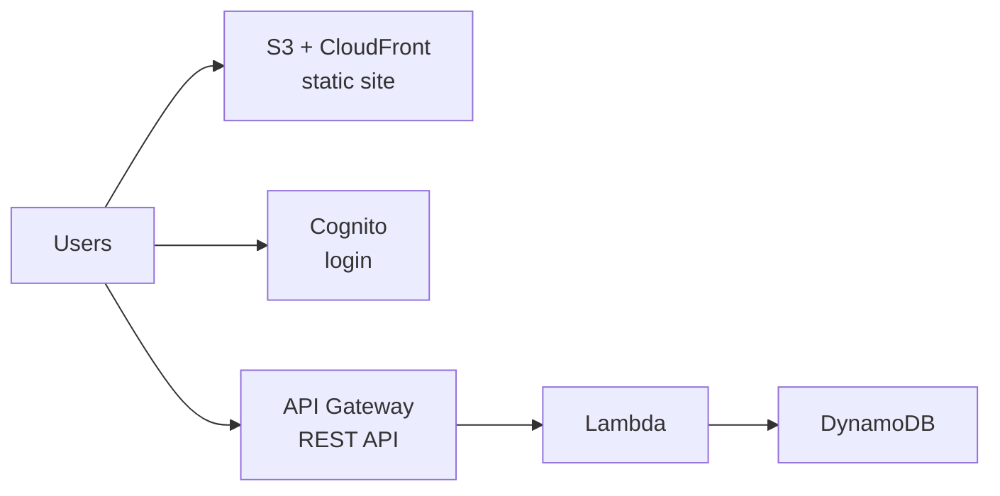
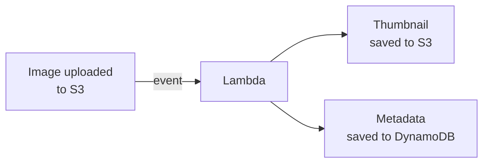
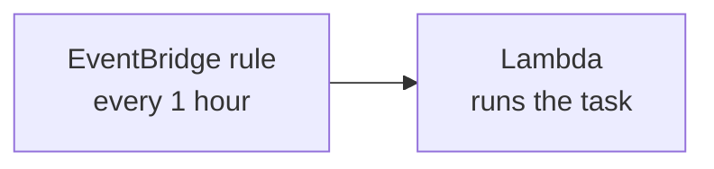
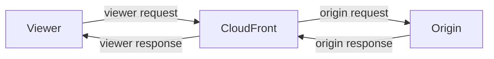
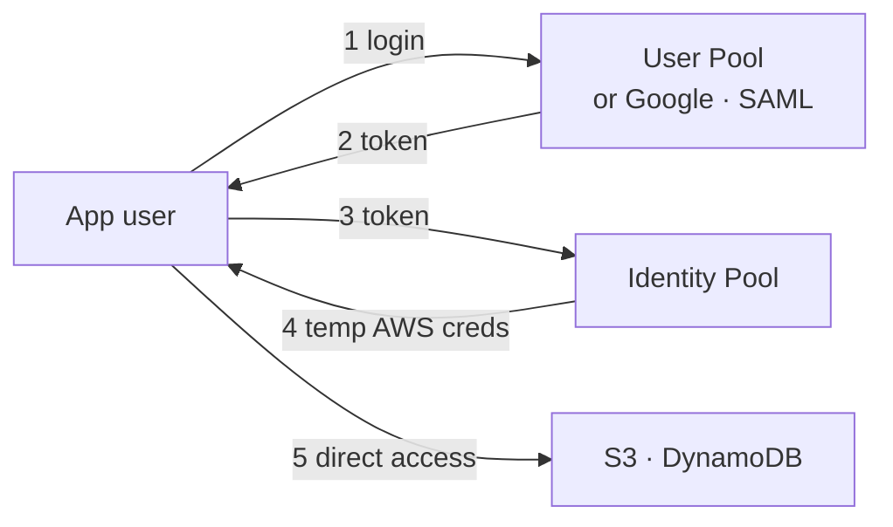
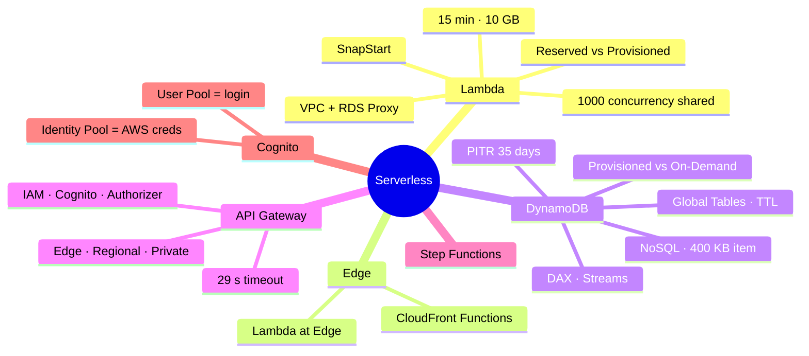

# Serverless on AWS — Lambda, DynamoDB, API Gateway, Step Functions, Cognito

> **Core idea:** **Serverless** means you do not manage servers. You just give code or data, and AWS scales it and bills you only for use. The classic exam stack is **Cognito** (login) → **API Gateway** (REST API) → **Lambda** (code) → **DynamoDB** (database). Most exam questions test **limits**, **concurrency**, and **which service fits a scenario**.

---

## 1. What is Serverless?

- Servers still exist. You just **do not see or provision them**.
- It started as **FaaS** (Function as a Service) with **AWS Lambda**.
- Now it means **any managed service** that scales by itself and has no servers for you.

|Serverless services you know|Why serverless|
|---|---|
|Lambda, DynamoDB, API Gateway, Cognito, S3|No servers, auto scale|
|SNS, SQS, Kinesis Data Firehose|Scale by themselves, pay per use|
|Aurora Serverless|Database scales on demand|
|Step Functions, Fargate|No infrastructure to run|

---

## 2. AWS Lambda — Basics

### 2.1 EC2 vs Lambda

| |EC2|Lambda|
|---|---|---|
|What|Virtual server|Function (just code)|
|Runs|All the time|**Only when invoked** (on demand)|
|Time limit|None|**15 minutes max**|
|Scaling|You set up Auto Scaling|**Automatic**|
|You pay for|Running time of server|**Requests + compute time**|

### 2.2 Key facts

- **Pricing:** pay per request + per duration (1 ms steps).
    - Free tier: **1 million requests** and **400,000 GB-seconds** per month.
    - After that: **$0.20 per 1 million requests**, **$1 per 600,000 GB-seconds**.
- **More RAM = more CPU and network.** You cannot set CPU directly.
- **Languages:** Node.js, Python, Java, C#, Ruby, + others (Go, Rust) via **Custom Runtime API**.
- **Container images** can run on Lambda (must use the Lambda Runtime API). **Exam:** for Docker images, prefer **ECS / Fargate**, not Lambda.
- **Execution role** = IAM role for Lambda (like an EC2 instance role). Basic role only allows writing to **CloudWatch Logs**. Add permissions to reach S3, DynamoDB, etc.
- Logs and metrics go to **CloudWatch**.

### 2.3 Common integrations

| Service                         | What Lambda does                                   |
| ------------------------------- | -------------------------------------------------- |
| API Gateway                     | Backend for a REST API                             |
| S3                              | Runs when a file is uploaded (event notification)  |
| DynamoDB                        | Trigger on table changes (Streams)                 |
| SNS / SQS                       | Reacts to notifications / processes queue messages |
| Kinesis                         | Transforms data on the fly                         |
| CloudFront                      | Lambda@Edge                                        |
| EventBridge / CloudWatch Events | Reacts to events, or runs on a schedule            |
| CloudWatch Logs                 | Streams logs elsewhere                             |
| Cognito                         | Reacts to user events like login                   |

### 2.4 Two classic patterns

**Serverless CRON** = EventBridge schedule + Lambda. No EC2 sitting idle.

---

## 3. Lambda Limits (per region) — exam favourite

|Limit|Value|
|---|---|
|Memory|**128 MB – 10 GB** (64 MB steps)|
|Max run time|**900 s = 15 min**|
|Environment variables|**4 KB**|
|`/tmp` disk space|**10 GB** (for big files)|
|Concurrent executions|**1000** (can raise by support ticket)|
|Deployment zip|**50 MB** zipped, **250 MB** unzipped|

> If a question needs **30 GB RAM**, **30 minutes** of running, or a **3 GB** deploy file → **not Lambda**.

---

## 4. Lambda Concurrency and Cold Starts

### 4.1 Concurrency and throttling

- **Concurrency** = how many copies of a function run at the same time.
- The **1000 limit is shared by ALL functions in the account**.
- **Danger:** one busy function can use all 1000 → **other functions get throttled**.
- **Reserved concurrency** = a limit set **per function** (e.g. max 50). It also protects other functions.
    - Reserve 20 for one function → 980 left for the rest.
    - Reserve **0** → the function is **always throttled** (useful for testing).

**What happens when throttled:**

|Invocation type|Result|
|---|---|
|**Synchronous** (caller waits)|Returns error **429**|
|**Asynchronous** (e.g. S3 events)|Lambda **retries up to 6 hours**, wait grows **1 s → 5 min** (exponential backoff), then **DLQ**|

### 4.2 Cold start fixes

- **Cold start** = a new Lambda copy must load code and run init code (outside the handler). The **first request is slow**.

|Fix|How it works|Cost|Works for|
|---|---|---|---|
|**Provisioned Concurrency**|Keep copies **warm in advance**. Can scale with Application Auto Scaling|**Extra cost**|Any; needs a published **version or alias** (not `$LATEST`)|
|**SnapStart**|On publishing a version, Lambda runs init once and saves a **snapshot** of memory + disk. New copies start from the snapshot|**No extra cost**|**Java, Python, .NET**; up to **10x faster**|

**Memory trick:** _Reserved_ = a **ceiling** (max). _Provisioned_ = a **warm-up** (ready in advance).

---

## 5. Code at the Edge — CloudFront Functions vs Lambda@Edge

Both attach to **CloudFront** and run **close to users**. Both are serverless and deployed globally.

| |CloudFront Functions|Lambda@Edge|
|---|---|---|
|Language|JavaScript|Node.js, Python|
|Scale|**Millions** req/s|**Thousands** req/s|
|Triggers|**Viewer** request/response only|**All 4** (viewer + origin)|
|Max time|**< 1 ms**|**5 – 10 s**|
|Network / SDK / body access|No|**Yes**|
|Where you write it|Inside CloudFront|**us-east-1**, then copied to all locations|
|Use cases|Cache key normalization, header changes, URL rewrite/redirect, JWT check|Heavy logic, 3rd-party libraries, call other AWS services|

> Simple and super fast → **CloudFront Functions**. Needs libraries, network, or origin access → **Lambda@Edge**.

---

## 6. Lambda Networking and RDS

### 6.1 Lambda in a VPC

- **Default:** Lambda runs in an **AWS-owned VPC**.
    - ✅ Can reach the public internet and **DynamoDB** (public AWS service).
    - ❌ Cannot reach **private** resources in your VPC (RDS, ElastiCache, internal ALB).
- **Fix:** launch Lambda **in your VPC** → give **VPC ID + subnets + security group**. Lambda gets an **ENI** in your subnet.

### 6.2 Lambda + RDS Proxy

- **Problem:** many Lambda copies open **too many DB connections** → timeouts.
- **RDS Proxy** pools and shares connections.

|RDS Proxy benefit|Detail|
|---|---|
|Scalability|Pools and shares connections|
|Availability|Failover time cut by **66%**, connections kept|
|Security|Enforce **IAM auth**, store secrets in **Secrets Manager**|

> RDS Proxy is **never public** → Lambda **must be in the VPC** to use it.

### 6.3 RDS invoking Lambda vs RDS Event Notifications

| |Invoke Lambda from DB|RDS Event Notifications|
|---|---|---|
|What you learn|**Data** events (e.g. new row inserted)|Events **about the instance** (created, started, snapshot...)|
|Supported|RDS for PostgreSQL, Aurora MySQL|All RDS|
|Setup|**Inside the database** (not the console)|AWS console|
|Needs|Network path DB → Lambda + **IAM permission** on DB|—|
|Sends to|Lambda directly|**SNS** or **EventBridge** (near real time, up to 5 min)|

> **Trap:** Event Notifications **never** give you the data inside the database.

---

## 7. Amazon DynamoDB — Basics

### 7.1 What it is

- **Fully managed NoSQL** database by AWS. Multi-AZ, highly available.
- **Single-digit millisecond** speed at any scale (millions of req/s).
- **No database to create** — you create **tables** directly.
- Security through **IAM**. No patching, no maintenance.

|Concept|Meaning|
|---|---|
|**Table**|Holds items. Needs a **primary key** chosen at creation|
|**Primary key**|**Partition key** (+ optional **sort key**)|
|**Item**|Like a row. **Max 400 KB**|
|**Attribute**|Like a column. Can be **added anytime** or be null|
|**Table class**|**Standard** or **Standard-IA** (infrequent access)|

> Exam keyword: **"schema must evolve quickly"** → **DynamoDB**, not RDS/Aurora.

### 7.2 Capacity modes

|          | Provisioned (default)                | On-Demand                                          |
| -------- | ------------------------------------ | -------------------------------------------------- |
| Planning | Set **RCU / WCU** in advance         | None                                               |
| Scaling  | Optional **auto scaling** (target %) | **Automatic, instant**                             |
| Cost     | Cheaper                              | **2–3x more expensive**                            |
| Best for | **Predictable**, smooth load         | **Unpredictable**, sudden spikes, or very rare use |

> "1,000 to 1 million transactions in a minute" or "only a few requests a day" → **On-Demand**.

---

## 8. DynamoDB — Advanced Features

### 8.1 DAX (DynamoDB Accelerator)

- **In-memory cache** in front of DynamoDB. **Microsecond** latency.
- **No app code changes** (same DynamoDB API). Default TTL **5 min**.

|DAX|ElastiCache|
|---|---|
|Cache **single items, queries, scans**|Cache **aggregation / computed results**|

They work **together**, not as replacements.

### 8.2 Streams — react to changes (create, update, delete)

| |DynamoDB Streams|Kinesis Data Streams|
|---|---|---|
|Retention|**24 hours**|**Up to 1 year**|
|Consumers|Limited|Many more|
|Process with|**Lambda triggers**, KCL Adapter|Lambda, Firehose, Data Analytics, Glue|

Use cases: welcome email on new user, real-time analytics, copy to another table, cross-region replication.

### 8.3 Other features

| Feature              | Key facts                                                                                            |
| -------------------- | ---------------------------------------------------------------------------------------------------- |
| **Global Tables**    | Replicated in many regions, **active-active** (read + write anywhere). **Requires DynamoDB Streams** |
| **TTL**              | Auto-delete items after an **expiry timestamp**. Classic use: **web session data**                   |
| **PITR backup**      | Continuous, last **35 days**, restore to any moment                                                  |
| **On-demand backup** | Kept until you delete. Use **AWS Backup** for lifecycle + cross-region copy                          |
| **Export to S3**     | **Needs PITR**. No read-capacity used. Then query with **Athena**                                    |
| **Import from S3**   | CSV, JSON, ION. No write-capacity used. Errors → CloudWatch Logs                                     |

> Any **restore** or **import** always creates a **new table**. Backups do **not** slow the table.

---

## 9. API Gateway

### 9.1 Why use it?

Clients need a way to call Lambda. Options: direct call (needs IAM), **ALB**, or **API Gateway**. API Gateway gives much more than an HTTP endpoint:

- Auth, **API keys**, **usage plans**, **throttling**, **caching**
- **Versioning** and **stages** (dev, test, prod)
- **WebSocket** support, request **validation / transformation**
- Import/export **Swagger / OpenAPI**, generate SDKs

### 9.2 Integrations

|Backend|Why|
|---|---|
|**Lambda**|Most common → fully serverless REST API|
|**HTTP**|On-premises API or ALB → add rate limits, caching, auth|
|**AWS Service**|Expose any AWS API (e.g. start Step Functions, send to SQS, put into **Kinesis** without giving AWS credentials)|

- Default **timeout is 29 seconds**, even if Lambda can run 15 min.

### 9.3 Endpoint types

|Type|Who uses it|
|---|---|
|**Edge-Optimized** (default)|**Global** users. Routed through CloudFront edge locations. API still lives in **one region**|
|**Regional**|Users in the **same region**. Can add your own CloudFront|
|**Private**|Only **inside your VPC**, via interface VPC endpoint. Access set by **resource policy**|

### 9.4 Security

|Who calls the API|Use|
|---|---|
|Internal apps (EC2 etc.)|**IAM roles**|
|Web / mobile users|**Cognito**|
|Your own auth logic|**Custom authorizer** (a Lambda function)|

- HTTPS custom domain uses **ACM**: Edge-Optimized → cert in **us-east-1**; Regional → cert in **same region**.
- Point the domain with a Route 53 **CNAME** or **A-Alias** record.

---

## 10. AWS Step Functions

- **Visual, serverless workflow** to orchestrate (mostly) **Lambda** functions.
- Features: **sequence, parallel, conditions, timeouts, error handling**.
- Works with EC2, ECS, on-premises servers, API Gateway, SQS, and many AWS services.
- Supports **human approval** steps.
- Use cases: order fulfilment, data processing, complex workflows.

> Keyword: **"orchestrate Lambda functions"** or **"workflow with human approval"** → **Step Functions**.

---

## 11. Amazon Cognito

Gives identity to **web and mobile app users** (people **outside** AWS). IAM is for your AWS staff. Cognito is for **hundreds or millions of app users**.

| |Cognito **User Pool** (CUP)|Cognito **Identity Pool**|
|---|---|---|
|Purpose|**Sign-in** — a user database|**Temporary AWS credentials**|
|Features|Username/email + password, reset, MFA, email/phone verify, Google/Facebook login|IAM policy per user, default role for guests|
|User then talks to|**API Gateway** or **ALB** (they verify the token)|**AWS directly** (S3, DynamoDB)|

> **Row-level security in DynamoDB:** Identity Pool policy has a condition — the item's **leading key must equal the Cognito user ID**. So each user sees only their own items.

---

## 12. Exam Quick Decision Table

|Scenario says...|Answer|
|---|---|
|Run code, no servers, short tasks|**Lambda**|
|Task > 15 min, > 10 GB RAM|**Not Lambda** → EC2 / ECS / Fargate|
|Run Docker images serverless|**Fargate** (not Lambda)|
|Run a job every hour without EC2|**EventBridge + Lambda**|
|One function uses all concurrency|**Reserved concurrency**|
|First request slow / cold starts|**Provisioned Concurrency** (or **SnapStart** for free)|
|Simple header/URL change at edge, sub-ms|**CloudFront Functions**|
|Edge logic needing libraries / network|**Lambda@Edge**|
|Lambda must reach private RDS|**Lambda in VPC**|
|Too many DB connections from Lambda|**RDS Proxy**|
|Lambda on new row inserted in DB|**Invoke Lambda from RDS PostgreSQL / Aurora MySQL**|
|Fast-changing schema, ms latency, huge scale|**DynamoDB**|
|Sudden traffic spikes on DynamoDB|**On-Demand mode**|
|Microsecond reads on DynamoDB|**DAX**|
|Multi-region read + write DynamoDB|**Global Tables**|
|Auto-delete old sessions|**DynamoDB TTL**|
|Analyze DynamoDB data with SQL|**Export to S3 + Athena**|
|Public REST API in front of Lambda|**API Gateway**|
|API only inside VPC|**Private API Gateway**|
|Orchestrate many Lambda steps|**Step Functions**|
|Login for mobile / web users|**Cognito User Pool**|
|App users access S3 / DynamoDB directly|**Cognito Identity Pool**|

---

## 13. Summary

1. Serverless = no servers to manage, auto scale, pay per use.
2. Lambda: max **15 min**, **10 GB** RAM, more RAM = more CPU.
3. **1000** concurrency is shared by the whole account; use **reserved** concurrency to protect it.
4. Throttled sync → **429**; async → retry **6 h**, then DLQ.
5. Cold start fix: **Provisioned Concurrency** (paid) or **SnapStart** (free, Java/Python/.NET).
6. CloudFront Functions = tiny, viewer only. Lambda@Edge = heavier, all 4 triggers, made in **us-east-1**.
7. Private RDS → Lambda in **VPC**; many connections → **RDS Proxy**.
8. DynamoDB: NoSQL, flexible schema, **400 KB** items, Provisioned vs **On-Demand**.
9. DAX = microsecond cache; Global Tables need Streams; TTL for sessions; PITR 35 days.
10. API Gateway: 3 endpoint types, **29 s** timeout. Cognito: **User Pool = login**, **Identity Pool = AWS credentials**.

---

## 14. Check Yourself

1. A job needs 25 minutes. Can Lambda run it? Why?
2. How do you give a Lambda function more CPU?
3. One function used all 1000 concurrency. What happens to others, and what is the fix?
4. What happens to a throttled **asynchronous** invocation?
5. Provisioned Concurrency vs SnapStart — which costs extra?
6. You need to rewrite URLs at the edge in under 1 ms. Which service?
7. Why must Lambda be in a VPC to use RDS Proxy?
8. Can RDS Event Notifications tell you a new row was inserted?
9. What is the max DynamoDB item size?
10. Which DynamoDB feature must be on before Global Tables? Before exporting to S3?
11. What is API Gateway's default timeout?
12. Which Cognito part gives users temporary AWS credentials?

---

## 15. Key Terms

|Term|Meaning|
|---|---|
|**Serverless**|You don't manage servers; auto scale, pay per use|
|**FaaS**|Function as a Service, like Lambda|
|**Execution role**|IAM role used by a Lambda function|
|**GB-second**|Lambda billing unit = RAM in GB × seconds run|
|**Concurrency**|Number of Lambda copies running at once|
|**Reserved concurrency**|Max concurrency limit for one function|
|**Throttle**|Request rejected because the limit is reached|
|**DLQ**|Dead Letter Queue — where failed events go|
|**Cold start**|Slow first run while a new copy initializes|
|**Provisioned Concurrency**|Copies kept warm in advance (paid)|
|**SnapStart**|Start from a saved snapshot of initialized function|
|**Lambda@Edge**|Lambda running at CloudFront locations|
|**RDS Proxy**|Pools database connections for many clients|
|**Partition key / Sort key**|Parts of the DynamoDB primary key|
|**RCU / WCU**|Read / Write Capacity Units in Provisioned mode|
|**DAX**|In-memory cache for DynamoDB|
|**Global Table**|DynamoDB table replicated across regions, active-active|
|**TTL**|Auto-expire items after a timestamp|
|**PITR**|Point-in-time recovery, last 35 days|
|**Custom authorizer**|Lambda that checks API Gateway requests|
|**User Pool**|Cognito user database for sign-in|
|**Identity Pool**|Cognito service that swaps tokens for AWS credentials|
