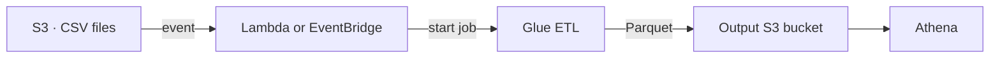
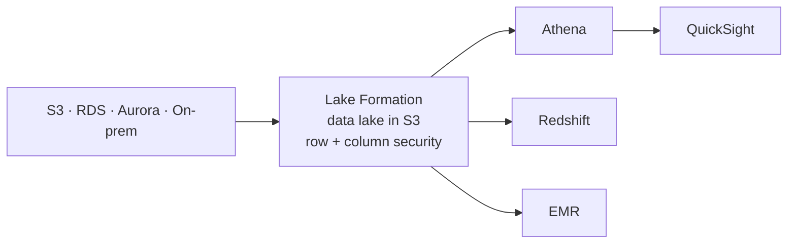
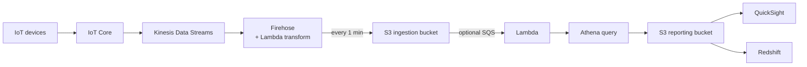
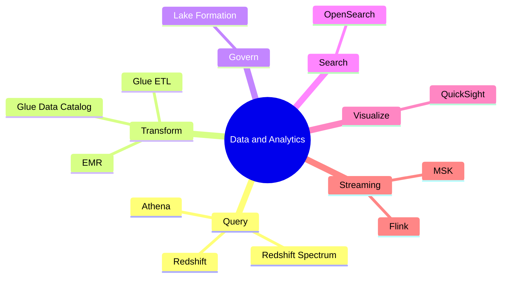

# Data & Analytics on AWS — Athena, Glue, Redshift, EMR, OpenSearch, QuickSight, MSK

> **Core idea:** Big data work has 5 steps: **collect → store → transform → query → visualize**. Each AWS service does one step. **Athena** = SQL on S3 (serverless). **Redshift** = data warehouse. **Glue** = ETL + catalog. **QuickSight** = dashboards. Most exam questions ask: _"which service fits this step?"_

---

## 1. The Big Picture

|Step|Service|One-line job|
|---|---|---|
|Collect (streaming)|**Kinesis Data Streams**, **MSK**|Move real-time data|
|Process streams|**Managed Service for Apache Flink**|Transform streams in real time|
|Transform (ETL)|**Glue**|Clean and convert data|
|Big data cluster|**EMR**|Hadoop / Spark clusters|
|Data lake|**S3** + **Lake Formation**|All data in one place, with central security|
|Query S3|**Athena**|Serverless SQL on S3 files|
|Data warehouse|**Redshift**|Fast analytics on huge data|
|Search|**OpenSearch**|Search any field, partial match|
|Visualize|**QuickSight**|Dashboards and reports|

**Analogy (a library):** S3 is the **bookshelf**. Glue is the **librarian** who sorts books and writes the catalog. Athena is a **reader** who asks questions directly at the shelf. Redshift is a **special study room** where you copy books for very fast work. QuickSight **draws charts** from the answers. Lake Formation is the **security guard** at the door.

---

## 2. Amazon Athena — SQL on S3

### 2.1 Basics

- **Serverless** query service. Analyze data **directly in S3**, without moving it.
- Uses **standard SQL** (built on the **Presto** engine).
- Formats: CSV, JSON, ORC, Avro, Parquet.
- **Pricing:** pay per **TB of data scanned**. No database to provision.
- Use cases: ad-hoc queries, BI, reporting, analyze AWS logs (**VPC Flow Logs, ELB logs, CloudTrail**).
- Often used with **QuickSight** for dashboards.

> **Exam tip:** "Analyze data in S3 with serverless SQL" → **Athena**.

### 2.2 Performance & cost tips (exam favourite)

You pay for data scanned, so **scan less data**.

|Tip|Why it helps|
|---|---|
|Use **columnar** formats: **Parquet** or **ORC**|Scan only the columns you need. Convert with **Glue**|
|**Compress** data|Smaller files → less to read|
|**Partition** data in S3|Query reads only one folder|
|Use **bigger files** (128 MB+)|Many small files = more overhead|

Partition example — Athena reads only the matching folder:

```text
s3://bucket/flight-data/parquet/year=1991/month=1/day=1/
```

### 2.3 Federated Query

- Query data **outside S3**: DynamoDB, RDS, Aurora, Redshift, ElastiCache, DocumentDB, CloudWatch Logs, on-premises DBs.
- Uses a **Data Source Connector** = a **Lambda function** (one per data source).
- Results can be saved to **S3**.

---

## 3. AWS Glue — Serverless ETL

### 3.1 Basics

- **ETL** = **E**xtract, **T**ransform, **L**oad. Glue is **fully serverless**.
- Example: take data from S3 / RDS → clean it → load into **Redshift**.
- Classic exam use: **convert CSV → Parquet** so Athena works better.



### 3.2 Glue Data Catalog

- **Crawlers** scan S3, RDS, DynamoDB, JDBC databases.
- They save **metadata** (tables, columns, data types) into the **Data Catalog**.
- Used by **Athena, Redshift Spectrum, EMR** → the catalog is **central**.

### 3.3 Other Glue features

| Feature                | What it does                                                                      |
| ---------------------- | --------------------------------------------------------------------------------- |
| **Job Bookmarks**      | **Do not reprocess old data** on a new run                                        |
| **Glue DataBrew**      | Clean and normalize data with pre-built steps                                     |
| **Glue Studio**        | GUI to create, run, monitor ETL jobs                                              |
| **Glue Streaming ETL** | Streaming jobs (Spark Structured Streaming) from Kinesis Data Streams, Kafka, MSK |

---

## 4. AWS Lake Formation — Data Lake + Central Security

- **Data lake** = one central place (in **S3**) for all your data.
- Lake Formation builds a data lake in **days, not months**.
- **Blueprints** move data in from S3, RDS, on-prem SQL / NoSQL.
- It is a **layer on top of Glue** (crawlers, ETL, catalog come from Glue).
- **Key feature:** **fine-grained access control — row and column level**, managed in **one place**.



> **Exam tip:** "Centralized permissions" / "row and column level security for the data lake" → **Lake Formation**.

---

## 5. Amazon Redshift — Data Warehouse

### 5.1 Basics

- Based on **PostgreSQL**, but used for **OLAP** (analytics), **not OLTP** (transactions).
- Stores data in **columns** → very fast for analytics. Scales to **petabytes**.
- **Parallel query engine**. SQL interface. Works with QuickSight, Tableau.
- Two modes: **Provisioned** cluster (choose instances, can reserve) or **Serverless**.

### 5.2 Architecture

| Node              | Job                                   |
| ----------------- | ------------------------------------- |
| **Leader node**   | Plans the query, combines results     |
| **Compute nodes** | Run the query, send results to leader |

### 5.3 Athena vs Redshift

|               | Athena              | Redshift                                          |
| ------------- | ------------------- | ------------------------------------------------- |
| Servers       | **Serverless** only | Provisioned cluster or serverless                 |
| Data lives in | S3                  | Loaded into Redshift                              |
| Speed         | Good                | **Faster** queries, joins, aggregations (indexes) |
| Best for      | Ad-hoc SQL on S3    | Heavy, repeated analytics, BI                     |

### 5.4 Snapshots & Disaster Recovery

- Most clusters are **single-AZ** (some types now support Multi-AZ).
- **Snapshots** = point-in-time backups, stored in S3, **incremental**.
- **Automated:** every **8 hours** or every **5 GB** (or a schedule), with retention. **Manual:** kept until you delete.
- **DR:** auto-**copy snapshots to another Region** → restore a new cluster there.

### 5.5 Loading data into Redshift

| Method                    | How                                                                                             |
| ------------------------- | ----------------------------------------------------------------------------------------------- |
| **Kinesis Data Firehose** | Writes to S3, then runs **S3 COPY** for you                                                     |
| **COPY command**          | Load from S3 using an **IAM role**. Add **Enhanced VPC Routing** to keep traffic inside the VPC |
| **JDBC driver**           | From an app (e.g. EC2). Write in **large batches**, not row by row                              |

### 5.6 Redshift Spectrum

- Query data **in S3 without loading** it into Redshift.
- You **must already have a Redshift cluster**.
- Query runs on **thousands of Spectrum nodes** → more power than your cluster.

---

## 6. Amazon EMR — Hadoop Clusters

- **EMR** = Elastic MapReduce. Creates **Hadoop clusters** for big data (can be hundreds of EC2).
- Comes with **Spark, HBase, Presto, Flink** — AWS sets them up for you.
- Auto scaling + **Spot instance** support.
- Use cases: data processing, ML, web indexing, big data.

> **Exam tip:** "Hadoop" / "Spark cluster" / "big data cluster" → **EMR**.

|Node|Job|Must run long?|Best purchase|
|---|---|---|---|
|**Master**|Manages cluster, checks health|Yes|On-Demand / **Reserved**|
|**Core**|Runs tasks + **stores data**|Yes|On-Demand / **Reserved**|
|**Task** (optional)|Runs tasks only|No|**Spot**|

Clusters can be **long-running** (use Reserved) or **transient** (start, do the job, delete).

---

## 7. Amazon OpenSearch — Search (ex-ElasticSearch)

- DynamoDB: query only by **primary key or index**. OpenSearch: **search any field, even partial match**.
- Used as a **complement** to another database. Also does analytics.
- Modes: **managed cluster** or **serverless**.
- Own query language; **SQL only via plugin**.
- Security: Cognito, IAM, encryption. Visuals: **OpenSearch Dashboards**.

### Common patterns

|Source|Path to OpenSearch|Speed|
|---|---|---|
|**DynamoDB**|DynamoDB Stream → Lambda → OpenSearch|Real time|
|**CloudWatch Logs**|Subscription Filter → Lambda|Real time|
|**CloudWatch Logs**|Subscription Filter → Firehose|Near real time|
|**Kinesis Data Streams**|→ Firehose (+ optional Lambda transform)|Near real time|
|**Kinesis Data Streams**|→ Lambda (custom code)|Real time|

DynamoDB pattern: app **searches** OpenSearch → gets item ID → reads the **full item** from DynamoDB.

---

## 8. Amazon QuickSight — Dashboards (BI)

- **Serverless**, ML-powered **Business Intelligence**. Interactive dashboards.
- **Per-session pricing**. Can embed in websites.
- Data sources: RDS, Aurora, **Athena**, **Redshift**, S3, OpenSearch, Timestream, Salesforce, Jira, Teradata, on-prem (JDBC), files (CSV, Excel, JSON...).
- **SPICE** = in-memory engine. Works **only when data is imported** into QuickSight.
- **Column-Level Security (CLS)** — Enterprise edition.
- **Users** (Standard) and **Groups** (Enterprise only) exist **only inside QuickSight**, not IAM.
- **Dashboard** = read-only snapshot of an **analysis**. Publish it, then share with users/groups.

> **Exam tip:** Most common combos: **QuickSight + Athena**, **QuickSight + Redshift**.

---

## 9. Streaming: Flink and MSK

### 9.1 Managed Service for Apache Flink

- Old name: **Kinesis Data Analytics for Apache Flink**.
- Runs **Flink** apps (Java, SQL, Scala) to **process data streams in real time**.
- AWS gives compute, parallel processing, auto scaling, backups (checkpoints / snapshots).
- Reads from **Kinesis Data Streams** and **MSK**.

> **Exam trap:** Flink **cannot read from Amazon Data Firehose**.

### 9.2 Amazon MSK — Managed Kafka

- **Kafka** = open-source alternative to Kinesis for streaming.
- MSK manages **brokers** and **Zookeeper** nodes, in your **VPC**, **multi-AZ (up to 3)**.
- Data stored on **EBS**, **as long as you want**. **MSK Serverless** option exists.
- Flow: **producers** → **topic** (replicated across brokers) → **consumers**.

||Kinesis Data Streams|Amazon MSK|
|---|---|---|
|Message size|**1 MB** limit|1 MB default, **can raise (e.g. 10 MB)**|
|Unit|Shards|Topics with **partitions**|
|Scale|Split / merge shards|**Only add** partitions, never remove|
|In-flight encryption|Yes|Plaintext or TLS|
|Retention|Limited|**As long as you want** (pay for EBS)|

**MSK consumers:** Flink, Glue Streaming ETL, **Lambda**, or your own Kafka consumer on EC2 / ECS / EKS.

---

## 10. Big Data Ingestion Pipeline (serverless)



|Part|Role|
|---|---|
|**IoT Core**|Collects data from many IoT devices|
|**Kinesis Data Streams**|Real-time collection|
|**Firehose**|Near real-time delivery to S3 (**1 minute** is the lowest)|
|**Lambda**|Transforms data, triggers Athena|
|**Athena**|Serverless SQL; results back to S3|
|**QuickSight / Redshift**|Visualize / deeper analytics|

---

## 11. Exam Quick Decision Table

| If the question says...                       | Answer                                          |
| --------------------------------------------- | ----------------------------------------------- |
| Serverless SQL on S3 files                    | **Athena**                                      |
| Make Athena cheaper / faster                  | **Parquet/ORC**, compress, partition, big files |
| Convert CSV to Parquet                        | **Glue ETL**                                    |
| Don't reprocess old data in ETL               | **Glue Job Bookmarks**                          |
| Schema / metadata of data sources             | **Glue Data Catalog** (crawlers)                |
| Central row + column permissions on data lake | **Lake Formation**                              |
| Data warehouse, OLAP, petabytes               | **Redshift**                                    |
| Query S3 from Redshift without loading        | **Redshift Spectrum**                           |
| Redshift DR in another Region                 | **Cross-Region snapshot copy**                  |
| Hadoop / Spark cluster                        | **EMR**                                         |
| Search any field, partial match               | **OpenSearch**                                  |
| Dashboards / BI                               | **QuickSight**                                  |
| Real-time stream processing                   | **Managed Service for Apache Flink**            |
| Managed Kafka                                 | **MSK**                                         |
| Many IoT devices sending data                 | **IoT Core**                                    |

---

## 12. Summary



1. **Athena** = serverless SQL on S3; pay per TB scanned.
2. Save Athena cost: **columnar** (Parquet/ORC), compress, partition, big files.
3. **Glue** = serverless ETL; **Data Catalog** feeds Athena, Spectrum, EMR.
4. **Lake Formation** = data lake on Glue + **row/column security in one place**.
5. **Redshift** = columnar OLAP warehouse; leader + compute nodes; Spectrum queries S3.
6. **EMR** = Hadoop/Spark; Master & Core long-running, Task nodes on **Spot**.
7. **OpenSearch** = search any field; often fed by DynamoDB Streams or CloudWatch Logs.
8. **QuickSight** = BI dashboards; **SPICE** only for imported data; users are not IAM.
9. **Flink** reads Kinesis Data Streams / MSK, **not Firehose**.
10. **MSK** = managed Kafka; bigger messages, unlimited retention, partitions only grow.

---

## 13. Check Yourself

1. Which file formats make Athena cheaper, and why?
2. How does Athena query data in DynamoDB or RDS?
3. What does Glue Job Bookmarks prevent?
4. Which service gives row and column level security across Athena and QuickSight?
5. What is the job of the Redshift leader node?
6. How do you set up Redshift disaster recovery in another Region?
7. What do you need before you can use Redshift Spectrum?
8. Which EMR node type is best for Spot instances, and why?
9. When does QuickSight's SPICE engine work?
10. Which source can Flink **not** read from?
11. In MSK, can you remove partitions from a topic?

---

## 14. Key Terms

| Term                     | Meaning                                              |
| ------------------------ | ---------------------------------------------------- |
| **ETL**                  | Extract, Transform, Load — move and clean data       |
| **OLAP / OLTP**          | Analytics workload / transaction workload            |
| **Columnar format**      | Data stored by column (Parquet, ORC) — scan less     |
| **Partition**            | Folder split (e.g. year/month/day) to read less data |
| **Federated Query**      | Athena querying non-S3 sources via Lambda connectors |
| **Data Catalog**         | Glue store of table and column metadata              |
| **Crawler**              | Glue tool that scans sources and fills the catalog   |
| **Data lake**            | Central store for all data, usually S3               |
| **Blueprint**            | Lake Formation template to ingest data               |
| **Redshift Spectrum**    | Redshift querying S3 data without loading it         |
| **Enhanced VPC Routing** | Keeps Redshift COPY traffic inside the VPC           |
| **SPICE**                | QuickSight in-memory engine for imported data        |
| **CLS**                  | Column-Level Security in QuickSight Enterprise       |
| **Broker**               | A Kafka server that stores topic data                |
| **Topic / Partition**    | Kafka stream / its parallel part (like a shard)      |
