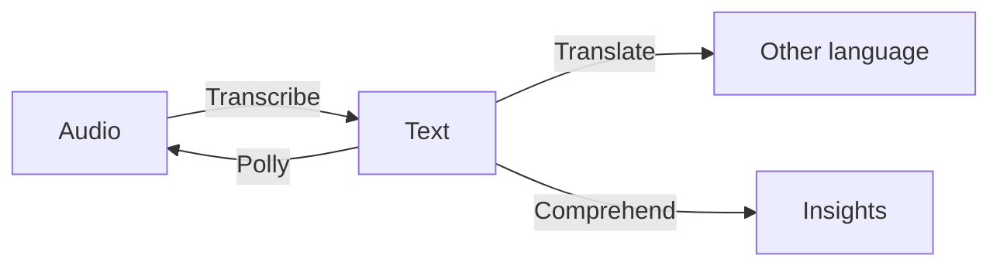
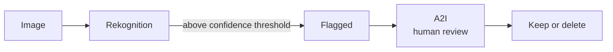
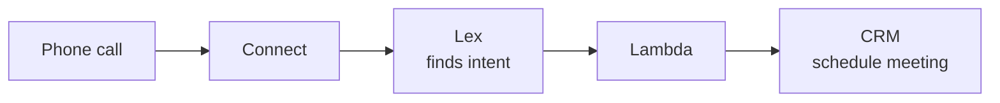
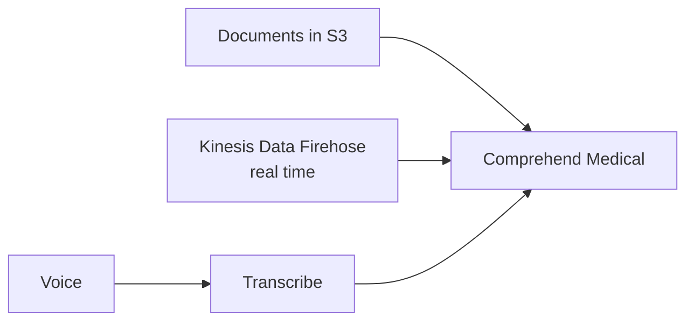
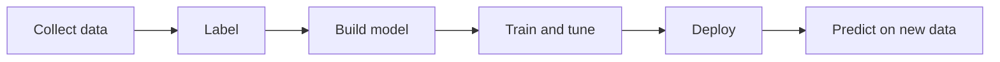
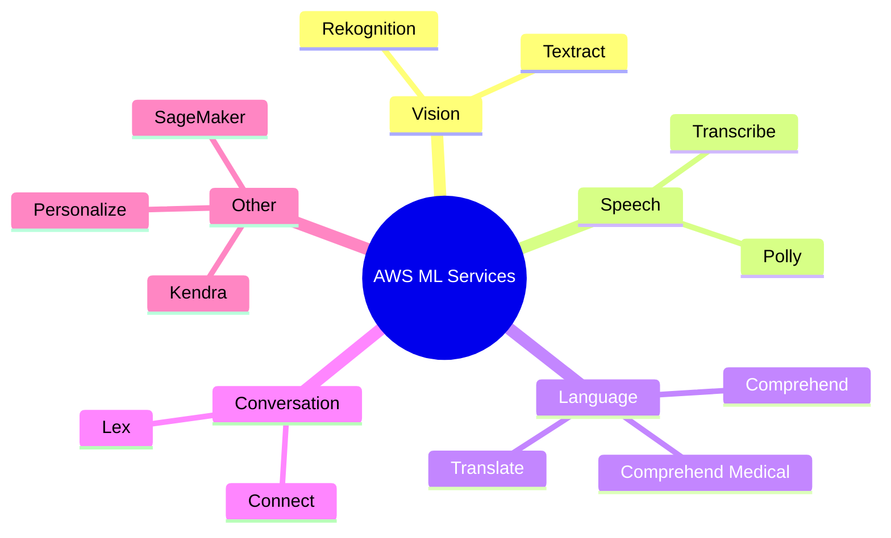

# Machine Learning Services on AWS

> **Core idea:** AWS has many **ready-made ML services**. Each one does **one job**. You don't build any model. You just call the service. The exam gives a scenario keyword, and you pick the matching service. Only **SageMaker** is for building your **own** models.

---

## 1. The Big Picture — Group by Input

The easiest way to remember: **what goes in?**

| Input                        | Service                 | Job (one line)                            |
| ---------------------------- | ----------------------- | ----------------------------------------- |
| Image / Video                | **Rekognition**         | Find faces, objects, text, unsafe content |
| Scanned document             | **Textract**            | Pull text, handwriting, forms, tables out |
| Audio → Text                 | **Transcribe**          | Speech to text                            |
| Text → Audio                 | **Polly**               | Text to speech (opposite of Transcribe)   |
| Text → Text (other language) | **Translate**           | Language translation                      |
| Text (meaning)               | **Comprehend**          | NLP — sentiment, key phrases, topics      |
| Medical text                 | **Comprehend Medical**  | NLP for clinical notes + find PHI         |
| Voice / chat conversation    | **Lex** (+ **Connect**) | Chatbots and call center                  |
| Many documents + question    | **Kendra**              | ML-powered document search                |
| User behavior                | **Personalize**         | Real-time recommendations                 |
| Your own data                | **SageMaker**           | Build, train, deploy your own model       |

---

## 2. Image and Document Services

### 2.1 Amazon Rekognition — images and videos

- Labeling objects and scenes (person, dog, bike).
- **Face detection and analysis** — age range, gender, emotion (smiling, eyes open).
- **Face search and verification** — user verification, your own face database.
- **Celebrity recognition**.
- **Text detection** — e.g. runner numbers in a race.
- **Pathing** — track people moving in a video, e.g. a sports game.

**Content moderation (exam favourite):** find **inappropriate, unwanted, or offensive** content. Used by social networks, media, ads, e-commerce.

|Setting|Effect|
|---|---|
|**Minimum Confidence Threshold**|Lower % → **more** images flagged|
|**Amazon Augmented AI (A2I)**|Optional **human manual review** of flagged images|

> **Exam:** "Unsafe images + human review" → **Rekognition content moderation + A2I**.

### 2.2 Amazon Textract — scanned documents

- Extracts **text, handwriting, and data** from scanned documents.
- Reads **forms and tables**, PDFs, images. Example: driver license → date of birth, document ID.
- Use cases: invoices (finance), medical records and insurance claims (health), tax forms, IDs, passports (public sector).

> **Rekognition = photos/videos. Textract = documents/forms.**

---

## 3. Speech Services

### 3.1 Amazon Transcribe — speech → text

- Uses **ASR** (Automatic Speech Recognition).
- **PII redaction** — automatically hides personal info (name, age, phone, SSN).
- **Automatic language identification** — works with multilingual audio.
- Use cases: transcribe customer service calls, **closed captions / subtitles**, searchable media archive.

### 3.2 Amazon Polly — text → speech

Two customization features. Don't mix them up:

|Feature|Use it for|Example|
|---|---|---|
|**Pronunciation Lexicons**|How a **word or acronym** is said|"AWS" → "Amazon Web Services"; "St3ph4ne" → "Stephane"|
|**SSML** (Speech Synthesis Markup Language)|**How** the speech sounds|Emphasis, pauses/breaks, whispering, breathing, Newscaster style, phonetic pronunciation|

Lexicons are uploaded and used in the `SynthesizeSpeech` operation.

### 3.3 Amazon Translate

- Natural, accurate **language translation**.
- Use: **localize** websites and apps for international users. Handles large volumes of text.

---

## 4. Conversation Services — Lex and Connect

|Service|What it is|
|---|---|
|**Amazon Lex**|Same tech as **Alexa**. ASR + **natural language understanding** (knows the **intent**). Builds **chatbots** and call center bots|
|**Amazon Connect**|Cloud **contact center**. Receive calls, build contact flows. Integrates with CRMs and AWS. **No upfront payment**, ~**80% cheaper** than traditional|

> **Lex = chatbot brain. Connect = call center.**

---

## 5. Text Understanding — Comprehend

### 5.1 Amazon Comprehend

- **NLP** (Natural Language Processing). Fully managed, **serverless**.
- Finds: language, key phrases, places, people, brands, events, **sentiment** (positive/negative), tokens and parts of speech.
- Can **group text files by topic** by itself.
- Use cases: analyze customer emails → what makes a good or bad experience; group articles by topic.

> **Exam:** see "NLP" or "sentiment" → **Comprehend**.

### 5.2 Amazon Comprehend Medical

- NLP for **unstructured clinical text** — doctor notes, discharge summaries, test results.
- **`DetectPHI` API** finds **Protected Health Information**.

---

## 6. Search, Recommendations, and Custom ML

| Service         | What it does                                                                                                                                                                       | Exam keyword                          |
| --------------- | ---------------------------------------------------------------------------------------------------------------------------------------------------------------------------------- | ------------------------------------- |
| **Kendra**      | ML **document search**. Indexes text, PDF, HTML, PowerPoint, Word, FAQs. Natural language answers ("Where is IT desk?" → "1st floor"). **Incremental learning** from user feedback | "document search"                     |
| **Personalize** | **Real-time personalized recommendations**. Same tech as Amazon.com. Input from S3 or the Personalize API. Built in **days, not months** — no need to build/train models           | "recommendations", retail, media      |
| **SageMaker**   | Fully managed platform for **developers and data scientists** to **build their own ML models**                                                                                     | "build / train / deploy custom model" |

### SageMaker workflow

> **All other services are ready-made. SageMaker is "do it yourself" — harder, more control.**

---

## 7. Exam Quick Decision Table

|Scenario says...|Answer|
|---|---|
|Face detection, celebrity, labels in images|**Rekognition**|
|Offensive images, need human review|**Rekognition + A2I**|
|Subtitles, call transcripts, remove PII from audio|**Transcribe**|
|App must talk, read text aloud|**Polly**|
|Pronounce acronym correctly|**Polly Lexicon**|
|Whisper, pause, emphasis|**Polly SSML**|
|Localize website to other languages|**Translate**|
|Chatbot, Alexa-like|**Lex**|
|Cloud call center|**Connect**|
|NLP, sentiment analysis|**Comprehend**|
|Clinical notes, PHI|**Comprehend Medical**|
|Search inside company documents|**Kendra**|
|Product recommendations|**Personalize**|
|Extract data from forms, invoices, IDs|**Textract**|
|Build your own ML model|**SageMaker**|

---

## 8. Summary

1. Each ML service does **one job**. Match the keyword to the service.
2. **Rekognition** = images/videos. Content moderation + **A2I** for human review.
3. **Textract** = scanned documents, forms, tables.
4. **Transcribe** = speech → text, with PII redaction and auto language ID.
5. **Polly** = text → speech. **Lexicon** for word pronunciation, **SSML** for speaking style.
6. **Lex** = chatbot (intent). **Connect** = cloud call center.
7. **Comprehend** = NLP. **Comprehend Medical** = clinical text + `DetectPHI`.
8. **Kendra** = document search. **Personalize** = recommendations.
9. **SageMaker** = build your own model.

---

## 9. Check Yourself

1. Which service detects offensive images, and which service adds human review?
2. If you lower the confidence threshold, do you get more or fewer flagged images?
3. Polly says "A-W-S" but you want "Amazon Web Services". What do you use?
4. Polly must whisper a sentence. What do you use?
5. Which service removes a phone number from a call recording's text?
6. Which two services together build a smart call center?
7. Which API in Comprehend Medical finds protected health information?
8. A company wants employees to ask questions over internal PDFs and Word files. Which service?
9. Which service extracts data from invoices and passports?
10. Which service would a data scientist use to train a custom prediction model?

---

## 10. Key Terms

|Term|Meaning|
|---|---|
|**ML**|Machine Learning — computer learns patterns from data|
|**ASR**|Automatic Speech Recognition — speech to text|
|**NLP**|Natural Language Processing — understanding text meaning|
|**PII**|Personally Identifiable Information (name, phone, SSN)|
|**PHI**|Protected Health Information|
|**Redaction**|Hiding sensitive info|
|**Content moderation**|Finding unsafe or offensive content|
|**Confidence threshold**|Minimum % sure before flagging|
|**A2I**|Amazon Augmented AI — human review step|
|**Lexicon**|Custom pronunciation rules in Polly|
|**SSML**|Markup to control voice style in Polly|
|**Intent**|What the user wants (Lex)|
|**Sentiment**|Positive or negative feeling in text|
|**Incremental learning**|Kendra improves results from user feedback|
|**Labeling**|Marking data with correct answers before training|
