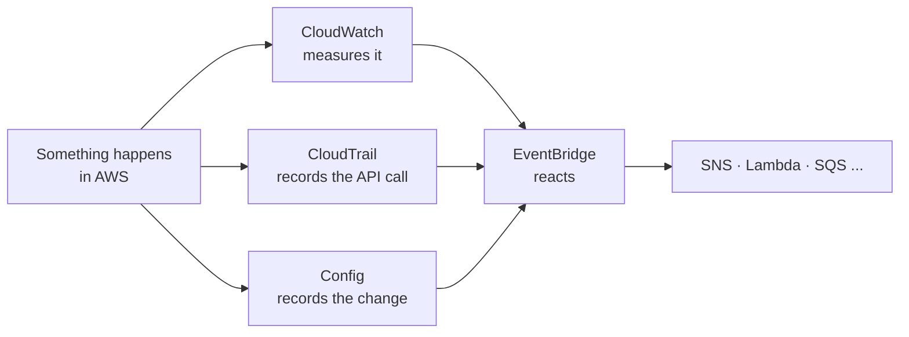
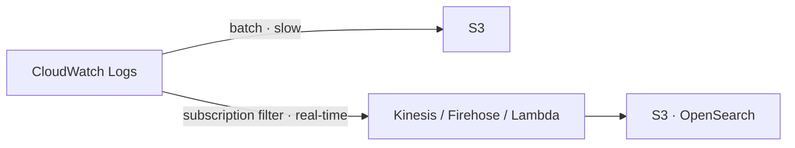
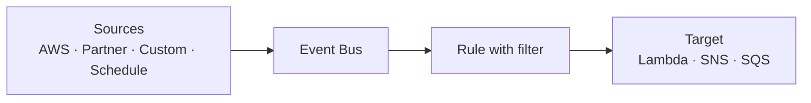
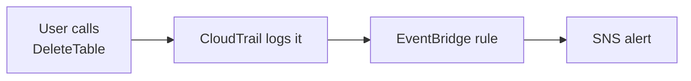
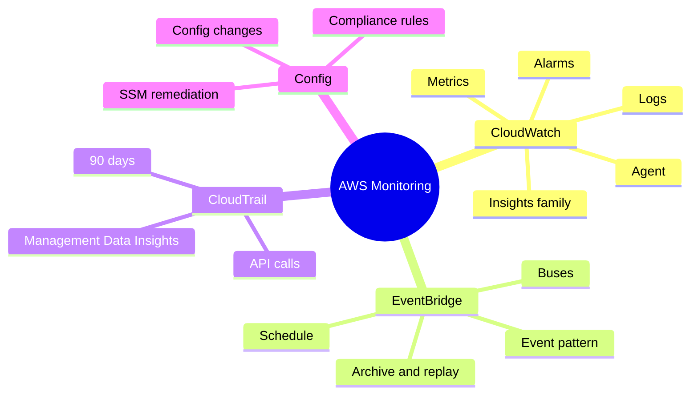

# AWS Monitoring — CloudWatch, EventBridge, CloudTrail, Config

> **Core idea:** **CloudWatch** tells you _how_ your resources are performing (metrics, logs, alarms). **CloudTrail** tells you _who did what_ (API calls). **Config** tells you _what changed and is it allowed_ (configuration + compliance). **EventBridge** _reacts_ to events automatically.

---

## 1. The Big Picture

Think of your AWS account as a **building**:

| Service         | Building analogy                                 | Main question it answers              |
| --------------- | ------------------------------------------------ | ------------------------------------- |
| **CloudWatch**  | Health monitor (temperature, power, smoke alarm) | "Is it working well? Is CPU high?"    |
| **CloudTrail**  | Security camera at every door                    | "**Who** did this, and when?"         |
| **Config**      | Inspector with a rulebook                        | "What changed? Is it **compliant**?"  |
| **EventBridge** | Automatic switch (if X happens → do Y)           | "When this happens, what should run?" |



---

## 2. CloudWatch Metrics

A **metric** is a number you watch over time. Example: `CPUUtilization`, `NetworkIn`, S3 bucket size.

|Term|Meaning|
|---|---|
|**Namespace**|Folder for metrics — one per service (EC2, EBS, ELB...)|
|**Dimension**|Attribute of a metric, e.g. instance ID. **Up to 30** per metric|
|**Timestamp**|Every data point has a time|
|**Dashboard**|See many metrics on one screen|
|**Custom metric**|Your own metric. Classic example: **EC2 memory usage**|

**EC2 monitoring frequency:**

|Mode|Data every|
|---|---|
|Default (basic)|**5 minutes**|
|Detailed monitoring|**1 minute**|

**Metric Streams:** send metrics **near real-time** to **Kinesis Data Firehose** (→ S3, Redshift, OpenSearch) or to third-party tools (Datadog, Splunk, New Relic...). You can filter by namespace.

> **Exam tip:** EC2 gives CPU, disk, network by default — **NOT memory**. Memory needs a custom metric / agent.

---

## 3. CloudWatch Logs

### 3.1 Structure

|Term|Meaning|
|---|---|
|**Log group**|Usually one application|
|**Log stream**|One instance / file / container inside the app|
|**Retention**|Never expire, or **1 day to 10 years**|
|**Encryption**|**On by default**. Can use your own KMS key|

**Who sends logs?** SDK, CloudWatch agents, Elastic Beanstalk, ECS, Lambda, VPC Flow Logs, API Gateway, CloudTrail, Route 53 (DNS queries).

### 3.2 Useful features

|Feature|What it does|
|---|---|
|**Logs Insights**|Query language to search logs. Queries **historical** data only — **not real-time**|
|**Metric filter**|Count a word (e.g. `ERROR`) in logs → make a metric → put an **alarm** on it|
|**Live Tail**|See new log lines live, for debugging|

### 3.3 Sending logs out (very important for exam)

|Method|Speed|Destinations|
|---|---|---|
|**Export to S3** (`CreateExportTask`)|Batch, **up to 12 hours**|S3 only|
|**Subscription filter**|**Real-time**|Kinesis Data Streams, Kinesis Data Firehose, Lambda (→ OpenSearch, S3)|



**Cross-account log aggregation:** use subscription filter → **destination** (in the receiver account) + destination access policy + IAM role.

> **Exam tip:** "real-time" logs → **subscription filter**. "Cheap archive" → **export to S3**.

---

## 4. CloudWatch Agent (for EC2 and on-premises)

By default, **EC2 sends no logs** to CloudWatch. You must install an agent. The EC2 instance needs an **IAM role** to send data.

| |CloudWatch Logs Agent (old)|**CloudWatch Unified Agent** (new)|
|---|---|---|
|Logs|Yes|Yes|
|Extra metrics (RAM, processes, swap, disk, netstat)|No|**Yes**|
|Central config via **SSM Parameter Store**|No|**Yes**|

Both work on **on-premises servers** too.

> **Exam tip:** "Need memory / detailed system metrics from EC2" → **Unified Agent**.

---

## 5. CloudWatch Alarms

An **alarm** watches **one metric** and acts when a threshold is crossed.

**3 states:** `OK` · `INSUFFICIENT_DATA` · `ALARM`

**3 main targets:**

|Target|Example|
|---|---|
|**EC2 action**|Stop, terminate, reboot, **recover**|
|**Auto Scaling**|Scale out / scale in|
|**SNS**|Send notification (→ Lambda → anything)|

### 5.1 Composite Alarm

- Watches **many alarms** together using **AND / OR**.
- Use: **reduce alarm noise**. Example: alert only if CPU high **AND** IOPS high.

### 5.2 EC2 Instance Recovery

Alarm on EC2 **status checks** (instance, system, attached EBS) → recover the instance on new hardware. After recovery you keep the **same private / public / Elastic IP, metadata, placement group**.

### 5.3 Testing an alarm

Use the CLI call `set-alarm-state` to force an alarm into `ALARM` and check the action works.

```bash
# force an alarm into ALARM state to test it
aws cloudwatch set-alarm-state --alarm-name "MyAlarm" --state-value ALARM --state-reason "testing"
```

---

## 6. CloudWatch "Insights" Family (know at high level)

|Service|Use it for|Remember|
|---|---|---|
|**Container Insights**|Metrics + logs from ECS, EKS, Kubernetes on EC2, Fargate|On Kubernetes it uses a **containerized agent**|
|**Lambda Insights**|Detailed Lambda metrics (CPU, memory, cold starts)|Added as a **Lambda layer**|
|**Contributor Insights**|Find **"Top N"** contributors (e.g. top 10 IPs in VPC Flow Logs)|Works on CloudWatch Logs|
|**Application Insights**|Automatic dashboard of app problems + related services|Uses **SageMaker** (ML) inside|
|**Network Synthetic Monitor**|Check network between **on-premises and AWS** (Direct Connect / VPN): packet loss, latency, jitter|**No agent** needed|

> **Exam tip:** see words "**top 10**" or "**heaviest users**" → **Contributor Insights**.

---

## 7. Amazon EventBridge (formerly CloudWatch Events)

EventBridge = **"If this happens → do that."**

### 7.1 Two ways to trigger

|Trigger|Example|
|---|---|
|**Schedule / cron**|Every hour → run a Lambda|
|**Event pattern**|Root user signs in → send SNS email|

**Targets:** Lambda, SNS, SQS, Kinesis, Step Functions, ECS task, AWS Batch, CodePipeline, CodeBuild, SSM Automation, EC2 actions.

### 7.2 Event buses

|Bus|Events come from|
|---|---|
|**Default**|AWS services|
|**Partner**|SaaS partners (Zendesk, Datadog, Auth0...)|
|**Custom**|Your own applications|

### 7.3 Extra features

|Feature|What it does|
|---|---|
|**Archive & Replay**|Store events, replay later (good for debugging after a bug fix)|
|**Schema Registry**|Learns event JSON format, generates code. Schemas can be versioned|
|**Resource-based policy**|Allow other accounts/regions to send events → **central event bus** for an Organization|



---

## 8. AWS CloudTrail

CloudTrail **records every API call** in your account — from Console, SDK, CLI, IAM users/roles and AWS services. It is **enabled by default**.

**Typical question:** "An EC2 instance was terminated. **Who did it?**" → **CloudTrail**.

### 8.1 Event types

|Event type|Examples|Logged by default?|
|---|---|---|
|**Management events**|`AttachRolePolicy`, create subnet. Split into Read / Write|**Yes**|
|**Data events**|S3 `GetObject`, `PutObject`, Lambda `Invoke` (high volume)|**No**|
|**Insights events**|Detects **unusual activity** (burst of IAM actions, hitting limits)|No — paid, must enable|

### 8.2 Retention

- Kept **90 days** only.
- Need longer? → send to **S3** (or CloudWatch Logs), then query with **Athena**.
- A **trail** can cover all regions or one region.

### 8.3 CloudTrail + EventBridge

Every API call also becomes an **event in EventBridge**. So you can alert on a specific API call.



Examples: alert on `DeleteTable` (DynamoDB), `AssumeRole` (IAM), `AuthorizeSecurityGroupIngress` (EC2).

---

## 9. AWS Config

Config **records configuration changes** of resources and **checks them against rules** (compliance).

Example questions Config answers:

- Is there **unrestricted SSH** in my security groups?
- Does any S3 bucket have **public access**?
- Did my ALB configuration change?

### 9.1 Key facts

|Point|Detail|
|---|---|
|Scope|**Per region**. Use an **aggregator** for many regions / accounts|
|Rules|**AWS managed** (75+) or **custom** (with **Lambda**)|
|When rules run|On **configuration change**, or **periodically** (e.g. every 2 hours)|
|Blocks actions?|**NO.** Config only reports. It does not replace IAM|
|Remediation|**SSM Automation documents** (AWS-managed or your own, can call Lambda). Auto-retry possible|
|Notifications|**EventBridge** (non-compliant events) or **SNS** (all changes)|
|Storage|Configuration history to **S3** (query with Athena)|
|Cost|Not free — pay per item recorded and per rule evaluation|

**Resource timeline:** see compliance over time + configuration over time + linked **CloudTrail** API calls.

> **Exam tip:** Config **detects and fixes**, but never **prevents**. To prevent → IAM / SCP.

---

## 10. CloudWatch vs CloudTrail vs Config (most popular exam question)

| |CloudWatch|CloudTrail|Config|
|---|---|---|---|
|Purpose|Performance, logs, alarms|Who made API calls|Config changes + compliance|
|Key word|"metric", "CPU", "alarm", "logs"|"**who**", "audit API calls"|"**compliance**", "config history"|

**Same Load Balancer, three views:**

| Service        | What it does for the ELB                                                          |
| -------------- | --------------------------------------------------------------------------------- |
| **CloudWatch** | Count connections, error codes %, performance dashboard                           |
| **Config**     | Track security group + SSL certificate changes; rule: "must always have SSL cert" |
| **CloudTrail** | Find **who** changed the security group or SSL cert                               |

> All three are **complementary**, not competitors.

---

## 11. Exam Scenario → Service

| Scenario wording                         | Answer                                          |
| ---------------------------------------- | ----------------------------------------------- |
| Who deleted / terminated a resource?     | **CloudTrail**                                  |
| Keep API history longer than 90 days     | **CloudTrail → S3 + Athena**                    |
| Detect unusual API activity              | **CloudTrail Insights**                         |
| Log S3 object-level access               | **CloudTrail data events**                      |
| Alert when a specific API is called      | **CloudTrail + EventBridge → SNS**              |
| Check SSH open to world / public buckets | **AWS Config rule**                             |
| Auto-fix non-compliant resource          | **Config + SSM Automation**                     |
| Get EC2 memory / RAM metric              | **CloudWatch Unified Agent** (custom metric)    |
| Send EC2 / on-prem logs to CloudWatch    | **CloudWatch agent + IAM role**                 |
| Real-time log processing                 | **Logs subscription filter → Kinesis / Lambda** |
| Cheap batch log archive                  | **Export logs to S3**                           |
| Alert on many conditions, less noise     | **Composite alarm**                             |
| EC2 hardware failed, keep same IP        | **Alarm on status check → EC2 recovery**        |
| Run a job every hour (serverless cron)   | **EventBridge schedule → Lambda**               |
| React to SaaS events (Auth0, Zendesk)    | **EventBridge partner bus**                     |
| Top 10 IPs generating traffic            | **Contributor Insights**                        |
| Monitor network on-prem ↔ AWS            | **Network Synthetic Monitor**                   |

---

## 12. Summary



1. **CloudWatch** = performance (metrics, logs, alarms).
2. EC2 default metrics every 5 min; detailed = 1 min; **no memory** by default.
3. Logs: **subscription filter = real-time**, **S3 export = batch (up to 12h)**.
4. **Unified Agent** = logs + extra metrics (RAM), config via SSM Parameter Store.
5. Alarms → EC2 action, Auto Scaling, SNS. **Composite alarms** use AND/OR.
6. **EventBridge** = schedule or event pattern → targets. Buses: default, partner, custom.
7. **CloudTrail** = who did what. On by default, 90 days. Data events off by default.
8. **Config** = changes + compliance, per region. Never blocks actions. Fix with SSM.

---

## 13. Check Yourself

1. What are the three CloudWatch alarm states?
2. Why can't you see EC2 memory usage by default, and how do you fix it?
3. Which is faster: exporting logs to S3, or a subscription filter?
4. Which CloudTrail events are **not** logged by default, and why?
5. How do you keep CloudTrail events for 1 year?
6. Can AWS Config stop a user from opening port 22? What can it do instead?
7. What are the three types of EventBridge event bus?
8. You want an email when someone calls `AssumeRole`. Which services do you combine?
9. What stays the same after EC2 instance recovery?
10. Which tool finds the "top 10 IP addresses" in VPC Flow Logs?

---

## 14. Key Terms

|Term|Meaning|
|---|---|
|Namespace|Group of metrics for one service|
|Dimension|Attribute of a metric (e.g. instance ID)|
|Custom metric|A metric you push yourself|
|Log group / stream|App-level folder / single source inside it|
|Metric filter|Turns matching log lines into a metric|
|Subscription filter|Real-time stream of logs to Kinesis / Lambda|
|Logs Insights|Query language for historical logs|
|Unified Agent|Agent that sends logs + detailed system metrics|
|Composite alarm|Alarm built from other alarms with AND/OR|
|Event bus|Channel where EventBridge receives events|
|Schema Registry|Stores the JSON shape of events|
|Management event|API call that manages resources|
|Data event|High-volume API call on data (S3 objects, Lambda invoke)|
|CloudTrail Insights|Detects unusual API activity|
|Config rule|Check that marks resources compliant / non-compliant|
|Remediation|Automatic or manual fix using SSM Automation|
|Aggregator|Collects Config data from many regions / accounts|
