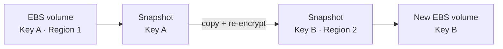
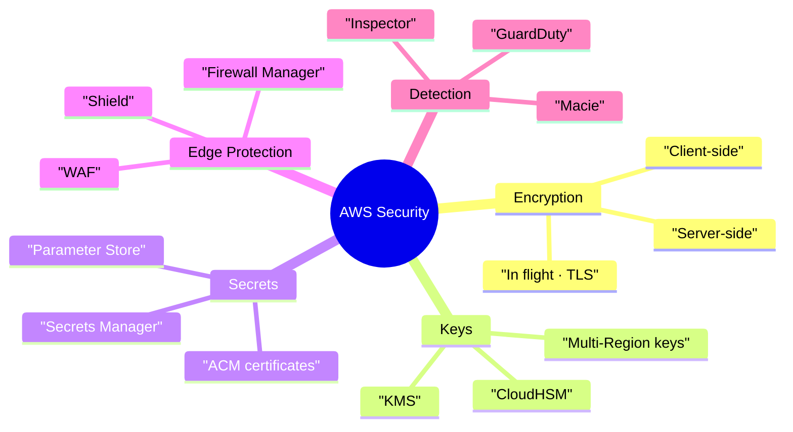

# AWS Security — Encryption, KMS, Secrets, ACM, WAF, Shield, GuardDuty

> **Core idea:** **KMS** manages your encryption keys and is used by almost every AWS service. Store config in **SSM Parameter Store**, store rotating secrets in **Secrets Manager**, and get HTTPS certificates from **ACM**. Protect the edge with **WAF** (Layer 7) and **Shield** (DDoS), and find problems with **GuardDuty**, **Inspector**, and **Macie**.

---

## 1. Three Types of Encryption

|Type|Where data is encrypted|Who holds the key|Example|
|---|---|---|---|
|**In flight** (TLS/SSL)|While moving on the network|Client + server|HTTPS website. Stops **man-in-the-middle** attacks|
|**Server-side at rest**|On the server, after it receives data|Server (data key)|S3 SSE, encrypted EBS|
|**Client-side**|On the client, before sending|**Only the client**|Server cannot read it. You do not trust the server|

> TLS is the newer version of SSL. "HTTPS" = TLS is being used.

---

## 2. AWS KMS (Key Management Service)

**KMS** = AWS manages the encryption keys for you.

- Access controlled by **IAM**.
- Every key use is logged in **CloudTrail** (audit — exam favourite).
- Built into EBS, S3, RDS, SSM, and most services. Just turn it on.
- Never store secrets in plain text in code. Encrypt them with KMS first.

### 2.1 Symmetric vs Asymmetric

| |Symmetric|Asymmetric|
|---|---|---|
|Keys|**One** key: encrypts + decrypts|**Two**: public (encrypt) + private (decrypt)|
|Used by|**All AWS services** integrated with KMS|Encrypt/decrypt or **sign/verify**|
|Can you download it?|Never. Use API calls only|**Public key** can be downloaded. Private key never|
|Use case|Normal AWS encryption|Users **outside AWS** encrypt with the public key|

### 2.2 Who owns the key

| Key kind             | Example                         | Cost           | Rotation                                          |
| -------------------- | ------------------------------- | -------------- | ------------------------------------------------- |
| **AWS owned**        | SSE-S3, DynamoDB default        | Free           | AWS handles it (you never see it)                 |
| **AWS managed**      | `aws/rds`, `aws/ebs`, `aws/ssm` | Free           | **Automatic every 1 year**                        |
| **Customer managed** | Your own key                    | **$1 / month** | Automatic (you set 90–2560 days) or **on-demand** |
| **Imported**         | Key material you bring          | $1 / month     | **Manual only** (use an **alias**)                |

API calls cost about **$0.03 per 10,000 calls**.

### 2.3 KMS keys are **regional**

The same key **cannot** live in two regions. To copy an encrypted EBS snapshot to another region, AWS **re-encrypts** it with a key in the new region.



### 2.4 Key Policies

A **key policy** is like an S3 bucket policy, but for a key. **No key policy = nobody can use the key.**

|Policy|What it does|
|---|---|
|**Default**|Whole account can use it, if IAM allows|
|**Custom**|You pick users, roles, admins. Needed for **cross-account** access|

**Share an encrypted snapshot with another account:**

1. Encrypt snapshot with a **customer managed key** (needed for custom policy).
2. Add a key policy that allows the other account.
3. Share the snapshot.
4. Target account copies it and re-encrypts with **its own** key.

### 2.5 Multi-Region Keys

- One **primary** key, copied to other regions as **replicas**.
- **Same key ID** (`mrk-...`) and **same key material** everywhere.
- Encrypt in one region, decrypt in another. No re-encrypt, no cross-region call.
- **Not global.** Each copy is managed separately (own policy).
- Use only for special cases: **global client-side encryption**, **DynamoDB Global Tables**, **Global Aurora** — e.g. encrypt only the SSN column so even **database admins** cannot read it.

### 2.6 CLI in one line

`aws kms encrypt` turns a file into a ciphertext blob (base64). `aws kms decrypt` turns it back. **Decrypt does not need the key ID** — it is inside the encrypted blob.

---

## 3. Encryption Exam Scenarios

### 3.1 S3 Replication + encryption

|Object type|Replicated by default?|
|---|---|
|Unencrypted, **SSE-S3**|Yes|
|**SSE-C**|Yes (can be replicated)|
|**SSE-KMS**|**No** — must enable option, set target KMS key, key policy, and IAM role|

- Lots of decrypt/encrypt → may hit **KMS throttling** → ask for **service quota** increase.
- Multi-region keys work, but S3 still treats them as **separate keys** (still decrypt + re-encrypt).

### 3.2 Share an encrypted AMI with Account B

1. Add **launch permission** for Account B on the AMI.
2. Share the **KMS key** with Account B (key policy).
3. In Account B, an IAM role/user needs: `DescribeKey`, `ReEncrypt*`, `CreateGrant`, `Decrypt`.
4. Launch EC2. (Optional: re-encrypt with Account B's own key.)

---

## 4. Storing Secrets — Parameter Store vs Secrets Manager

|                        | **SSM Parameter Store**              | **Secrets Manager**                       |
| ---------------------- | ------------------------------------ | ----------------------------------------- |
| Stores                 | Config + secrets                     | **Secrets only**                          |
| Encryption             | Optional (**SecureString** uses KMS) | Always with KMS                           |
| **Automatic rotation** | No                                   | **Yes**, every X days, using a **Lambda** |
| DB integration         | No                                   | **RDS, Aurora**, DocumentDB, Redshift     |
| Multi-region           | No                                   | **Yes** — replicas, can promote for DR    |
| Cost                   | Standard free                        | **$0.40 / secret / month**                |

> Exam trick: see **"rotate"** or **"RDS password"** → **Secrets Manager**.

### 4.1 Parameter Store details

- **Hierarchy** with paths: `/my-app/dev/db-url`, `/my-app/prod/db-password`. Makes IAM policies simple.
- Has **version history**, **CloudFormation** integration, **EventBridge** notifications.
- Can read Secrets Manager secrets through it, and **public parameters** (e.g. latest Amazon Linux 2 AMI).

| Tier         | Max params | Size     | Cost          | Parameter policies                       |
| ------------ | ---------- | -------- | ------------- | ---------------------------------------- |
| **Standard** | 10,000     | **4 KB** | Free          | No                                       |
| **Advanced** | 100,000    | **8 KB** | $0.05 / month | **Yes** (TTL / expiry, no-change alerts) |

```bash
# read a secure parameter and decrypt it
aws ssm get-parameters --names /my-app/dev/db-password --with-decryption

# read every parameter under a path, at all levels
aws ssm get-parameters-by-path --path /my-app/ --recursive
```

`--with-decryption` checks that you also have permission on the KMS key.

---

## 5. ACM (AWS Certificate Manager)

**ACM** gives you **TLS certificates** for HTTPS (in-flight encryption).

- **Public certificates are free.** Private also supported.
- Works with: **ELB (CLB, ALB, NLB)**, **CloudFront**, **API Gateway**.
- **Not EC2** — public certificates cannot be extracted.
- **Validation:** **DNS** (CNAME record, best for automation, Route 53 does it for you) or **Email**.

| Certificate  | Renewal                                                                                                                                                 |
| ------------ | ------------------------------------------------------------------------------------------------------------------------------------------------------- |
| Made by ACM  | **Auto-renew 60 days** before expiry                                                                                                                    |
| **Imported** | **No auto-renew**. ACM sends daily **EventBridge** events from **45 days** before expiry. Or use **AWS Config** rule `acm-certificate-expiration-check` |

- ALB can **redirect HTTP → HTTPS**.
- **API Gateway Edge-optimized** → certificate must be in **us-east-1** (because of CloudFront).
- **API Gateway Regional** → certificate in the **same region** as the API.

---

## 6. CloudHSM vs KMS

**CloudHSM** = AWS gives you a dedicated **hardware** device (HSM). **You** manage the keys, not AWS.

| |KMS|CloudHSM|
|---|---|---|
|Tenancy|Multi-tenant (shared)|**Single-tenant** (dedicated hardware)|
|Who controls keys|AWS software|**You fully**|
|Key kinds|AWS owned, AWS managed, customer managed|**Customer managed only**|
|Access control|**IAM**|Its **own users** in CloudHSM software|
|High availability|Managed by AWS|Cluster across **multiple AZs**|
|Free tier|Yes|**No**|
|Good for|Normal encryption|**SSE-C** on S3, strict compliance (FIPS 140-2 Level 3), SSL acceleration, Oracle TDE|

> **KMS Custom Key Store** = KMS backed by your CloudHSM. You get CloudHSM keys for EBS/S3/RDS, with CloudTrail logs.

---

## 7. WAF, Shield, Firewall Manager

### 7.1 Who does what

| Service              | Job                                                                                                                                                          | Layer       | Cost                     |
| -------------------- | ------------------------------------------------------------------------------------------------------------------------------------------------------------ | ----------- | ------------------------ |
| **WAF**              | Filter bad HTTP requests with **Web ACL** rules                                                                                                              | **Layer 7** | Pay per use              |
| **Shield Standard**  | Basic DDoS (SYN/UDP floods, reflection)                                                                                                                      | Layer 3/4   | **Free, always on**      |
| **Shield Advanced**  | Advanced DDoS for EC2, ELB, CloudFront, Global Accelerator, Route 53 + 24/7 **DDoS Response Team** + **fee protection** + **auto-creates WAF rules**         | 3/4/7       | **$3,000 / month / org** |
| **Firewall Manager** | Manage WAF, Shield, security groups, Network Firewall, DNS Firewall rules for **all accounts** in an Organization. New resources get rules **automatically** | —           | Per policy               |

### 7.2 WAF details

- Deploy on: **ALB, API Gateway, CloudFront, AppSync, Cognito user pools**.
- **Not on NLB** (NLB is Layer 4) — classic exam trap.
- Rules: **IP sets** (up to 10,000 IPs each), headers/body/URI, **SQL injection**, **XSS**, size limits, **geo match**, **rate-based** rules (DDoS).
- Web ACLs are **regional**, except **CloudFront = global**.

> **Fixed IP + WAF?** ALB has no fixed IP, NLB has no WAF. Answer: **Global Accelerator** (fixed IP) → **ALB with WAF**.

### 7.3 DDoS best practices

| Defence               | How                                                                            |
| --------------------- | ------------------------------------------------------------------------------ |
| **Stay at the Edge**  | CloudFront, Global Accelerator, Route 53 — all have Shield                     |
| **Absorb traffic**    | ELB spreads load, **Auto Scaling** adds instances                              |
| **Filter at Layer 7** | WAF rules, rate limits, CloudFront geo-block                                   |
| **Hide the backend**  | Put CloudFront / API Gateway / ELB in front. Attacker cannot see EC2 or Lambda |
| **Lock down**         | Security groups, NACLs, API Gateway burst limits + API keys                    |

---

## 8. Threat Detection — GuardDuty, Inspector, Macie

| Service       | What it finds                                             | Looks at                                                                               | Remember                                                      |
| ------------- | --------------------------------------------------------- | -------------------------------------------------------------------------------------- | ------------------------------------------------------------- |
| **GuardDuty** | **Threats** in your account (ML + anomaly detection)      | **CloudTrail**, **VPC Flow Logs**, **DNS logs** (+ optional S3, EKS, RDS, EBS, Lambda) | One click. **Crypto-mining attacks**                          |
| **Inspector** | **Software vulnerabilities (CVE)** + network reachability | **EC2** (via SSM agent), **ECR images**, **Lambda**                                    | Only these 3. Gives **risk score**. Sends to **Security Hub** |
| **Macie**     | **Sensitive data (PII)**                                  | **S3 buckets only**                                                                    | ML + pattern matching                                         |

All three send findings to **EventBridge** → then Lambda / SNS for automation.

---

## 9. Exam Scenario → Answer

| Question says...                                    | Answer                                |
| --------------------------------------------------- | ------------------------------------- |
| Audit who used an encryption key                    | **KMS + CloudTrail**                  |
| Encrypt in one region, decrypt in another           | **KMS Multi-Region keys**             |
| Copy encrypted snapshot to another account          | **Customer managed key + key policy** |
| Rotate database password automatically              | **Secrets Manager**                   |
| Hierarchical config, cheap or free                  | **SSM Parameter Store**               |
| HTTPS on ALB / CloudFront                           | **ACM**                               |
| Certificate for edge-optimized API / CloudFront     | **ACM in us-east-1**                  |
| Dedicated hardware, you control keys, FIPS 140-2 L3 | **CloudHSM**                          |
| Block SQL injection / XSS / countries               | **WAF**                               |
| Fixed IP + WAF                                      | **Global Accelerator + ALB + WAF**    |
| Big DDoS + 24/7 response team                       | **Shield Advanced**                   |
| Same firewall rules across all accounts             | **Firewall Manager**                  |
| Find compromised instance / crypto mining           | **GuardDuty**                         |
| Scan EC2 / ECR / Lambda for CVEs                    | **Inspector**                         |
| Find PII in S3                                      | **Macie**                             |

---

## 10. Summary



1. Three encryption types: in flight, server-side, client-side.
2. KMS keys are **regional**. AWS managed keys rotate yearly. Customer managed cost $1/month.
3. **No key policy = no access.** Cross-account needs a **customer managed key**.
4. SSE-KMS objects are **not** replicated by default in S3.
5. **Secrets Manager = rotation + RDS.** Parameter Store = config + hierarchy.
6. ACM: free public certs, **not for EC2**, edge certs in **us-east-1**.
7. CloudHSM = your hardware, your keys, single-tenant.
8. WAF = Layer 7, **not on NLB**. Shield Standard is free, Advanced is $3,000/month.
9. GuardDuty = threats, Inspector = CVEs, Macie = PII in S3.

---

## 11. Check Yourself

1. What is the difference between server-side and client-side encryption?
2. Which KMS key type can you download part of?
3. Why must you use a customer managed key to share a snapshot cross-account?
4. Are Multi-Region keys global? What is the same across regions?
5. Which S3 objects are not replicated by default?
6. Name two features Secrets Manager has that Parameter Store does not.
7. What size limit does a Standard parameter have?
8. Can you install an ACM public certificate on an EC2 instance?
9. Where must an ACM certificate live for an edge-optimized API Gateway?
10. You need a fixed IP and WAF. Which architecture?
11. Which three data sources does GuardDuty always use?

---

## 12. Key Terms

| Term             | Meaning                                                |
| ---------------- | ------------------------------------------------------ |
| TLS / SSL        | Protocol for encryption in flight (HTTPS)              |
| Data key         | Key used to encrypt the actual data                    |
| KMS key          | Key managed by KMS (old name: CMK)                     |
| Key policy       | Resource policy that controls who can use a KMS key    |
| Alias            | Friendly name for a key, e.g. `alias/tutorial`         |
| SecureString     | Parameter Store type encrypted with KMS                |
| Parameter policy | TTL / expiry rules for Advanced parameters             |
| HSM              | Hardware Security Module — tamper-resistant key device |
| Custom Key Store | KMS using your CloudHSM keys                           |
| Web ACL          | Set of WAF rules attached to a resource                |
| Rate-based rule  | WAF rule that blocks IPs sending too many requests     |
| DDoS             | Many computers flood you so real users cannot get in   |
| CVE              | Public database of known software vulnerabilities      |
| PII              | Personally identifiable information (name, SSN, etc.)  |
