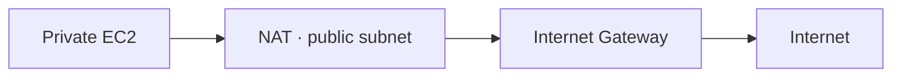
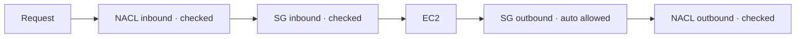
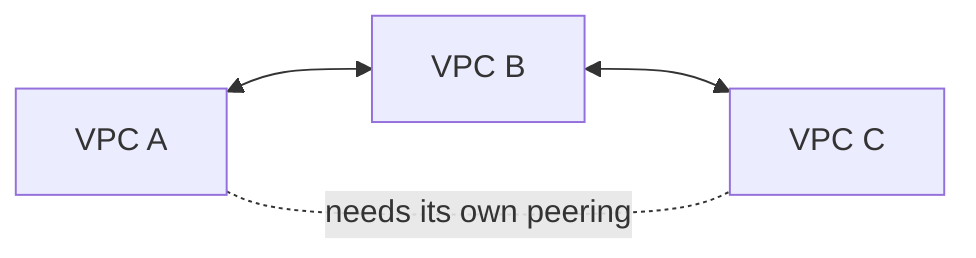
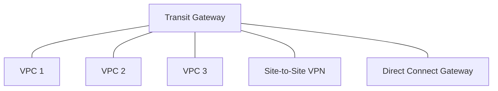
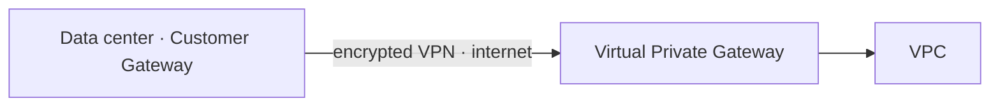
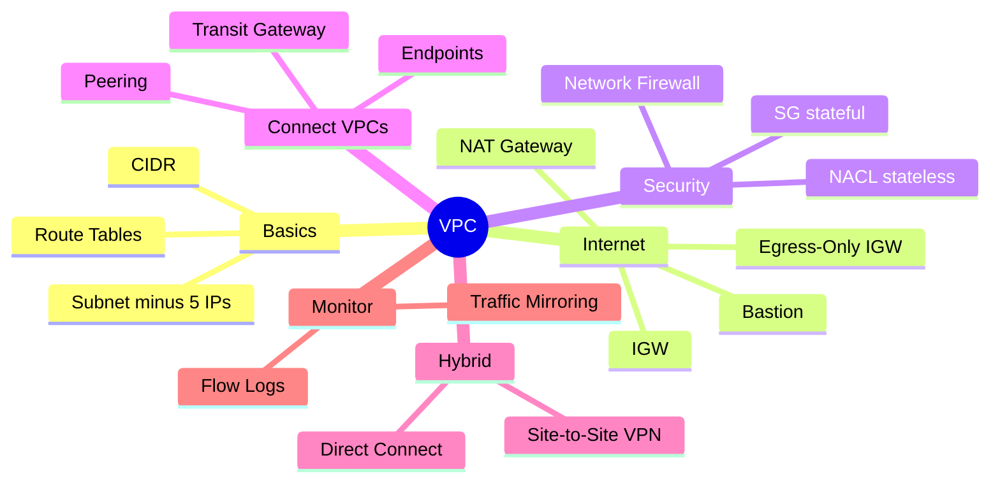

# VPC & Networking

> **Core idea:** A VPC is your own private network in AWS. **Route tables** decide where traffic goes, and **gateways** decide how it leaves (IGW, NAT, endpoints, VPN, Direct Connect). **SG and NACL** decide if the traffic is allowed.

---

## 1. IP Basics: CIDR and Private IPs

**CIDR** is a way to write an IP range: `base IP / number`. The number says how many bits are **fixed**. A smaller number = a bigger range.

|CIDR|Octets that can change|Number of IPs|
|---|---|---|
|`/32`|none|1|
|`/24`|last 1|256|
|`/16`|last 2|65,536|
|`/8`|last 3|16.7 million|
|`/0`|all|all IPs|

**Quick trick:** each step down by 1 doubles the IPs (`/28` = 16, `/27` = 32, `/26` = 64).

**Private IP ranges** (only these are allowed inside a VPC):

|Range|Common use|
|---|---|
|`10.0.0.0/8`|Big company networks|
|`172.16.0.0/12`|**AWS default VPC**|
|`192.168.0.0/16`|Home networks|

All other IPv4 addresses are **public** (internet).

---

## 2. VPC and Subnets

### 2.1 VPC

**VPC (Virtual Private Cloud)** = a private network inside **one region**.

|Rule|Value|
|---|---|
|VPCs per region|5 (soft limit, can increase)|
|CIDRs per VPC|5|
|CIDR size|min `/28` (16 IPs) · max `/16` (65,536 IPs)|
|Allowed IPs|Private ranges only|

> Never let your VPC CIDR **overlap** with other VPCs or your office network. Overlap = you cannot connect them later.

**Default VPC:** every account has one. Instances get a public IP and internet access automatically. Good for beginners, but for production, make your own VPC.

### 2.2 Subnet

**Subnet** = a smaller IP range inside the VPC. **One subnet = one AZ.**

AWS **reserves 5 IPs** in every subnet (example `10.0.0.0/24`):

|IP|Reserved for|
|---|---|
|`.0`|Network address|
|`.1`|VPC router|
|`.2`|Amazon DNS|
|`.3`|Future use|
|`.255`|Broadcast (not supported, so blocked)|

**Exam trap:** You need 29 IPs.

- `/27` = 32 − 5 = **27** → not enough ❌
- `/26` = 64 − 5 = **59** → OK ✅

**Usable IPs = subnet size − 5.**

---

## 3. Getting Internet Access (Public Subnet)

### 3.1 Internet Gateway + Route Table

- **Internet Gateway (IGW):** lets the VPC talk to the internet. Managed, scales, highly available. **1 VPC ↔ 1 IGW.**
- **Route Table:** a list of rules: "traffic to this IP range → go to this target".

An IGW alone does **nothing**. You must add a route.

|Destination|Target|Meaning|
|---|---|---|
|`10.0.0.0/16`|local|Traffic inside the VPC stays inside|
|`0.0.0.0/0`|IGW|Everything else goes to the internet|

> **Public subnet** = its route table has `0.0.0.0/0 → IGW`. **Private subnet** = it does not.

Also turn on **auto-assign public IPv4** in public subnets, so instances get a public IP.

### 3.2 Bastion Host

A **bastion host** is an EC2 in a **public subnet**. You SSH into it first, then SSH from it into private EC2s.

|Security group|Allow|
|---|---|
|Bastion SG|SSH port 22 only from **your company's public IP** (not everywhere)|
|Private EC2 SG|SSH port 22 from the **bastion SG** (or its private IP)|

---

## 4. Private Subnet Going Out: NAT

**NAT (Network Address Translation)** lets private EC2s reach the internet, but the internet **cannot** start a connection to them. NAT rewrites the source IP to its own public IP.

Private route table: `0.0.0.0/0 → NAT`.

### 4.1 NAT Instance vs NAT Gateway

| |NAT Instance (old)|NAT Gateway (use this)|
|---|---|---|
|Who manages|You (patches, failover scripts)|AWS|
|Availability|Not HA by default|HA **inside one AZ**|
|Bandwidth|Depends on EC2 size|5 Gbps → auto up to 100 Gbps|
|Security group|Yes, you manage it|Not used|
|Special setting|**Disable source/destination check**|None|
|Elastic IP|Yes|Yes|
|Can be a bastion|Yes|No|
|Cost|EC2 per hour + data|Per hour + per GB|

> NAT Gateway needs an **IGW**, and must be in a **different subnet** than the EC2s using it.

**For real HA:** create **one NAT Gateway per AZ**. Each private subnet routes to the NAT in its own AZ.

---

## 5. Security: Security Group vs NACL

### 5.1 Stateful vs Stateless

- **Stateful (SG):** if traffic is allowed in, the reply is **automatically allowed** out.
- **Stateless (NACL):** inbound and outbound are **checked separately every time**.

### 5.2 Comparison

| |Security Group|NACL|
|---|---|---|
|Level|Instance (ENI)|Subnet|
|Rules|Allow only|**Allow + Deny**|
|State|Stateful|Stateless|
|Rule order|All rules checked|Lowest number first, **first match wins**|
|Applies to|EC2s you attach it to|All EC2s in the subnet|

### 5.3 NACL facts

- Rule numbers 1 to 32766. Lower number = higher priority. Add in steps of 100.
- Last rule `*` = deny all.
- **Default NACL** = allows everything in and out. Don't edit it; create a custom one.
- **New custom NACL** = denies everything.
- Best use: **block one specific IP** at the subnet level.

### 5.4 Ephemeral Ports

When a client connects to a server, the client opens a **random temporary port** to receive the reply.

|OS|Ephemeral range|
|---|---|
|Linux|32768 – 60999|
|Windows 10|49152 – 65535|

Because NACL is stateless, you must **allow the ephemeral port range** for return traffic (for example `1024–65535`).

### 5.5 AWS Network Firewall

Protects the **whole VPC**, Layer 3 to Layer 7.

- Inspects traffic: VPC↔VPC, internet in/out, Direct Connect, VPN.
- Filter by IP, port, protocol, **domain**, regex. Actions: allow, drop, alert.
- Has intrusion prevention. Uses Gateway Load Balancer inside (managed by AWS).
- Manage rules across accounts with **Firewall Manager**. Logs go to S3, CloudWatch Logs, Firehose.

| Tool                 | Protects                                |
| -------------------- | --------------------------------------- |
| Security Group       | One instance                            |
| NACL                 | One subnet                              |
| WAF                  | HTTP requests (ALB, CloudFront, API GW) |
| Shield               | DDoS                                    |
| **Network Firewall** | **Entire VPC**                          |

---

## 6. Connecting VPCs Together

### 6.1 VPC Peering

Connects **2 VPCs** privately over the AWS network. Works across accounts and regions.

- CIDRs **must not overlap**.
- **Not transitive:** A↔B and B↔C does **not** give A↔C.
- Must **update route tables on both sides**.
- Can reference a peered VPC's SG (cross-account, same region).

### 6.2 Transit Gateway

A **hub** that connects thousands of VPCs + VPN + Direct Connect. **Transitive.**

- Regional, can peer across regions, share across accounts with **RAM**.
- Its own route tables control who talks to whom.
- **Only service that supports IP multicast.**
- **ECMP:** use multiple VPN connections to multiply VPN bandwidth.

|VPN target|Reach|Bandwidth|
|---|---|---|
|Virtual Private Gateway|1 VPC|1.5 Gbps max per VPN connection|
|Transit Gateway + ECMP|Many VPCs|2.5 Gbps per VPN, add more VPNs to multiply|

- Can **share one Direct Connect** across many accounts/VPCs.

|            | VPC Peering | Transit Gateway         |
| ---------- | ----------- | ----------------------- |
| Shape      | One-to-one  | Hub and spoke           |
| Transitive | No          | Yes                     |
| Best for   | Few VPCs    | Many VPCs + on-premises |

---

## 7. Private Access to AWS Services: VPC Endpoints

**VPC Endpoint** lets EC2s reach AWS services (S3, DynamoDB, SNS...) **without** the internet, IGW or NAT. Powered by **AWS PrivateLink**.

| |Gateway Endpoint|Interface Endpoint|
|---|---|---|
|Services|**S3 and DynamoDB only**|Almost all services|
|How|A **target in a route table**|An **ENI** (private IP) in your subnet|
|Security group|No|Yes|
|Cost|**Free**|Per hour + per GB|
|Use from on-prem / other VPC|No|Yes|

> Exam: for S3/DynamoDB, choose **Gateway Endpoint** (free). Choose Interface only for on-premises (VPN/DX) or another VPC access.

If an endpoint does not work: check **VPC DNS resolution** settings and **route tables**. (CLI tip: set the correct `--region`.)

**PrivateLink (Endpoint Service):** share **your own service** with thousands of other VPCs. Uses **NLB** on your side and **ENI** on the customer side. No peering, no IGW, no NAT.

---

## 8. Connecting to On-Premises (Hybrid)

### 8.1 Site-to-Site VPN

Encrypted connection **over the public internet**. Fast to set up.

|Part|Side|What|
|---|---|---|
|**Virtual Private Gateway (VGW)**|AWS|Attached to the VPC|
|**Customer Gateway (CGW)**|Your office|Software or hardware device|

Exam points:

- CGW IP = its **public IP**. If it is behind NAT (NAT-T), use the **NAT device's public IP**.
- Enable **route propagation** in the subnets' route tables, or it won't work.
- Ping from on-prem fails? Allow **ICMP inbound** in the SG.
- **VPN CloudHub:** many sites connect to one VGW → sites can talk to each other (hub and spoke, over VPN).

### 8.2 Direct Connect (DX)

A **dedicated private physical line** from your data center to AWS. Does **not** use the internet.

- More bandwidth, more stable, lower cost for big data.
- **Private VIF** → private resources (EC2 in VPC via VGW).
- **Public VIF** → public AWS services (S3, Glacier).
- **Not encrypted** (but private). Add a **VPN on top** for IPsec encryption.
- **Setup takes more than 1 month.** Need data moved in 1 week? DX is the wrong answer.

|Connection type|Speed|Notes|
|---|---|---|
|Dedicated|1, 10, 100 Gbps|Physical port just for you|
|Hosted|50 Mbps → 10 Gbps|Via partner, change capacity on demand|

**Direct Connect Gateway:** connect one DX to **many VPCs in different regions**.

### 8.3 DX Resiliency

|Level|Setup|
|---|---|
|High resiliency|2 DX locations, 1 connection each|
|**Maximum resiliency**|2 DX locations, **2 connections each** (separate devices)|
|Cheap backup|Primary DX + **Site-to-Site VPN as backup**|

### 8.4 VPN vs Direct Connect

| |Site-to-Site VPN|Direct Connect|
|---|---|---|
|Path|Public internet|Private line|
|Encrypted|Yes|No (add VPN)|
|Setup time|Minutes|> 1 month|
|Stability|Varies|Consistent|
|Cost|Low|High|

---

## 9. Monitoring the Network

### 9.1 VPC Flow Logs

Capture **metadata** about IP traffic (not the content). Levels: **VPC, subnet, ENI**. Also covers ELB, RDS, NAT GW, TGW...

- Send to: **S3, CloudWatch Logs, Kinesis Data Firehose**.
- Query: **Athena** on S3 (batch SQL), **CloudWatch Logs Insights** (streaming).
- Key fields: source/destination IP and port, **action (ACCEPT / REJECT)**.
- Needs an **IAM role** to write to CloudWatch Logs.

**Troubleshooting with the action field:**

|Inbound|Outbound|Problem is|
|---|---|---|
|REJECT|—|NACL **or** SG|
|ACCEPT|REJECT|**NACL** (SG is stateful)|

Same logic for outgoing requests: outbound ACCEPT + inbound REJECT → **NACL**.

Common setups: Flow Logs → CloudWatch → metric filter (lots of SSH/RDP) → alarm → SNS. Or Flow Logs → S3 → Athena → QuickSight.

### 9.2 Traffic Mirroring

**Copies real traffic** from source ENIs to a target (ENI or **NLB**) running security tools. Does not disturb the source. Optional filter. Use for content inspection, threat monitoring.

| |Flow Logs|Traffic Mirroring|
|---|---|---|
|Captures|Metadata only|Full packet copy|
|Use|Who talked, accepted or rejected|Deep inspection|

---

## 10. IPv6 in a VPC

- IPv6 = huge address space. **Every IPv6 in AWS is public.**
- **IPv4 cannot be disabled.** You can add IPv6 → **dual-stack** (private IPv4 + public IPv6).
- **Exam trap:** cannot launch EC2 in an IPv6 subnet? The problem is **no IPv4 left**. Fix: add a new **IPv4 CIDR** to the subnet.

### 10.1 Egress-Only Internet Gateway

Like a **NAT Gateway, but for IPv6**: private instances can go out over IPv6, the internet cannot come in.

|Destination|Public subnet target|Private subnet target|
|---|---|---|
|local IPv4 / IPv6|local|local|
|`0.0.0.0/0` (all IPv4)|IGW|**NAT Gateway**|
|`::/0` (all IPv6)|IGW|**Egress-Only IGW**|

---

## 11. Networking Costs

**Simple rules:** traffic **into** AWS is free. Traffic **out** costs money.

|Traffic|Cost per GB|
|---|---|
|Into EC2|Free|
|Same AZ, **private IP**|Free|
|Different AZ, private IP|$0.01|
|Different AZ, public / Elastic IP|$0.02|
|Different region|$0.02|
|S3 → internet|$0.09|
|S3 → CloudFront|Free|
|CloudFront → internet|$0.085 (+ cheaper requests, caching)|
|S3 Transfer Acceleration|+$0.04 – $0.08|
|S3 Cross-Region Replication|$0.02|

Cost tips:

- Use **private IPs** between instances.
- Same AZ = cheapest, but **less HA**. Balance cost vs availability.
- Keep processing **inside AWS**; send only small results out.
- DX location in the **same region** = lower egress cost.
- **S3 from private subnet:** NAT Gateway ($0.045/hour + $0.045/GB) vs **Gateway Endpoint (free)** → endpoint is much cheaper.

---

## 12. Exam Decision Table

|Scenario says...|Answer|
|---|---|
|Private EC2 needs internet (IPv4)|**NAT Gateway**|
|Private EC2 needs internet (IPv6)|**Egress-Only IGW**|
|SSH into private EC2|**Bastion Host**|
|Block one bad IP|**NACL** deny rule|
|Private access to S3 / DynamoDB, cheap|**Gateway Endpoint**|
|Private access to other AWS services|**Interface Endpoint**|
|Expose my service to 1000s of VPCs|**PrivateLink** (NLB + ENI)|
|Connect 2 VPCs|**VPC Peering**|
|Connect many VPCs + on-prem, transitive|**Transit Gateway**|
|IP multicast|**Transit Gateway**|
|More VPN bandwidth|**Transit Gateway + ECMP**|
|Quick encrypted link to office|**Site-to-Site VPN**|
|Private, stable, high bandwidth link|**Direct Connect**|
|DX + encryption|**DX + VPN**|
|DX to VPCs in many regions|**Direct Connect Gateway**|
|Connect many branch offices via VPN|**VPN CloudHub**|
|Debug accepted/rejected traffic|**VPC Flow Logs**|
|Copy packets for inspection|**Traffic Mirroring**|
|Firewall for the whole VPC, domain filtering|**AWS Network Firewall**|

---

## 13. Summary

1. CIDR: smaller `/number` = bigger range. VPC size `/16` to `/28`.
2. Each subnet loses **5 IPs**. One subnet = one AZ.
3. Public subnet = route `0.0.0.0/0 → IGW`.
4. Private subnet out: **NAT Gateway** (IPv4), **Egress-Only IGW** (IPv6). One NAT GW per AZ for HA.
5. **SG = stateful, allow only. NACL = stateless, allow + deny, first match wins.** Remember ephemeral ports.
6. Peering is **not transitive**. Transit Gateway **is**.
7. Gateway Endpoint = S3 + DynamoDB, free, route table target.
8. VPN = internet, encrypted, fast setup. DX = private, not encrypted, > 1 month.
9. Flow Logs: inbound ACCEPT + outbound REJECT = **NACL problem**.
10. Use private IPs and same AZ to save cost; Gateway Endpoint beats NAT for S3.

---

## 14. Check Yourself

1. You need 60 usable IPs in a subnet. Which is the smallest CIDR you can choose?
2. You attached an IGW but the EC2 still has no internet. What did you forget?
3. Why must you disable source/destination check on a NAT instance?
4. Your NAT Gateway's AZ fails. How do you avoid this problem?
5. Flow logs show inbound ACCEPT and outbound REJECT. Is it SG or NACL? Why?
6. VPC A is peered with B, B with C. Can A reach C?
7. Cheapest way for private EC2s to reach S3?
8. You must move data to AWS within one week, privately. Is Direct Connect a good answer?
9. Which service supports IP multicast?
10. EC2 launch fails in a subnet with IPv6 enabled. What is the real cause?

---

## 15. Key Terms

|Term|Meaning|
|---|---|
|CIDR|A way to write an IP range, like `10.0.0.0/16`|
|VPC|Your private network in one AWS region|
|Subnet|Part of a VPC, inside one AZ|
|Route Table|Rules that send traffic to a target|
|IGW|Internet Gateway: connects VPC to internet|
|NAT Gateway|Lets private IPv4 instances go out only|
|Egress-Only IGW|Lets private IPv6 instances go out only|
|Bastion Host|Public EC2 used to SSH into private EC2s|
|Security Group|Stateful firewall on an instance|
|NACL|Stateless firewall on a subnet|
|Ephemeral Port|Temporary client port for a reply|
|VPC Peering|Private link between 2 VPCs, not transitive|
|Transit Gateway|Hub connecting many VPCs and on-prem, transitive|
|VPC Endpoint|Private access to AWS services without internet|
|PrivateLink|Tech behind interface endpoints; share your service via NLB|
|VGW|Virtual Private Gateway, AWS side of VPN/DX|
|CGW|Customer Gateway, office side of VPN|
|Direct Connect|Dedicated private physical line to AWS|
|VIF|Virtual interface on DX: private or public|
|ECMP|Use many paths at once to add bandwidth|
|Flow Logs|Records of IP traffic metadata|
|Traffic Mirroring|Copies real packets for inspection|
|Network Firewall|Managed L3–L7 firewall for the whole VPC|
|Egress / Ingress|Traffic out of / into AWS|
