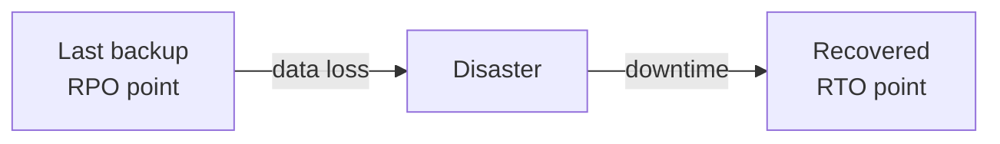
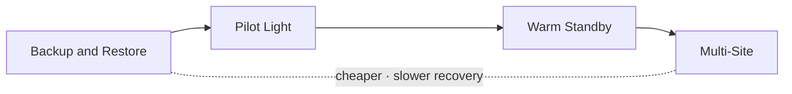
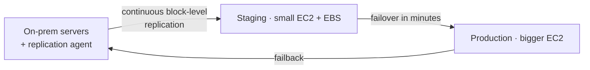
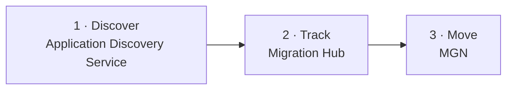
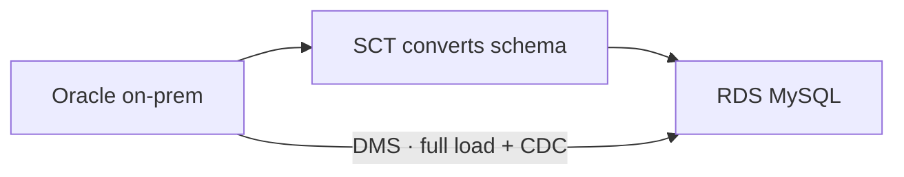
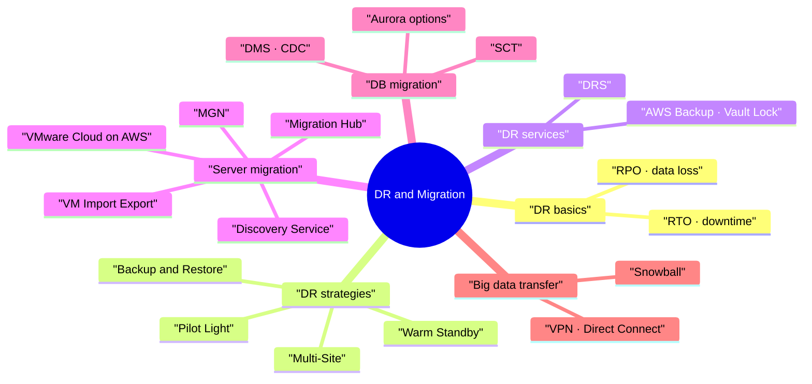

# Disaster Recovery and Migrations

> **Core idea:** Disaster recovery (DR) is about two numbers: **RPO** (how much data you can lose) and **RTO** (how long you can be down). Smaller numbers cost more money. For migrations, pick the tool by _what_ you move: servers → **MGN**, databases → **DMS** (+ **SCT** if the engine changes), huge one-time data → **Snowball**.

---

## 1. Disaster Recovery Basics

### 1.1 What is a disaster?

A **disaster** is any event that hurts the business or its money. **Disaster recovery** = preparing for it and recovering from it.

|DR type|Main site → Backup site|Cost|
|---|---|---|
|Traditional|On-premises → On-premises|Very expensive|
|Hybrid|On-premises → AWS Cloud|Medium|
|Full cloud|AWS Region A → AWS Region B|Flexible|

### 1.2 RPO and RTO (most important exam terms)

|Term|Question it answers|Example|
|---|---|---|
|**RPO** · Recovery Point Objective|How much **data** can we lose?|Backup every 1 hour → lose up to 1 hour of data|
|**RTO** · Recovery Time Objective|How much **time** can we be down?|App back in 1 minute or 24 hours|

**Easy trick:** RP**O** = data **P**oint (past). RT**O** = **T**ime to come back (future).

> Smaller RPO and RTO = higher cost.

---

## 2. The Four DR Strategies

Think of it like a backup restaurant kitchen:

- **Backup & Restore** = you only keep the recipes. Build a kitchen after the fire.
- **Pilot Light** = only the gas pilot flame is on (database). Turn on the rest later.
- **Warm Standby** = a small kitchen is already cooking. Make it bigger when needed.
- **Multi-Site** = two full kitchens running all the time.

| Strategy                  | What runs in AWS before disaster                             | RPO / RTO                   | Cost        |
| ------------------------- | ------------------------------------------------------------ | --------------------------- | ----------- |
| **Backup & Restore**      | Nothing. Only backups (S3, Glacier, snapshots)               | High / High                 | Lowest      |
| **Pilot Light**           | Only the **critical core** (e.g., RDS with data replication) | Lower / Lower               | Low         |
| **Warm Standby**          | **Full system at minimum size** (ELB + small ASG + RDS)      | Low / Low                   | Medium-high |
| **Multi-Site / Hot Site** | **Full production scale**, active-active                     | Lowest / Minutes or seconds | Highest     |

Key details per strategy:

- **Backup & Restore:** Snowball once a week → RPO ≈ 1 week. Snapshots → RPO = snapshot frequency. Restore with AMIs and snapshots (slow).
- **Pilot Light:** Data is live in RDS. EC2 is created only at disaster. **Route 53** fails over.
- **Warm Standby:** Route 53 fails over to the ELB. Auto Scaling grows to production load.
- **Multi-Site:** Route 53 sends traffic to **both** sites at once. All-cloud version = multi-region with **Aurora Global Database**.

> Exam keyword: "only critical core running" → **Pilot Light**. "Full system, minimum size" → **Warm Standby**. "Active-active, lowest RTO" → **Multi-Site**.

---

## 3. DR Tips (Real-Life Checklist)

| Area                  | AWS tools                                                                                                                                    |
| --------------------- | -------------------------------------------------------------------------------------------------------------------------------------------- |
| **Backup**            | EBS snapshots, RDS automated backups → S3 / S3 IA / Glacier, Lifecycle policy, Cross-Region Replication. On-prem → Snowball, Storage Gateway |
| **High availability** | Route 53 failover between regions, RDS / ElastiCache Multi-AZ, EFS, S3. Direct Connect down → **Site-to-Site VPN** as backup                 |
| **Replication**       | RDS cross-region replicas, Aurora Global Database, Storage Gateway                                                                           |
| **Automation**        | CloudFormation, Elastic Beanstalk (rebuild environments), CloudWatch alarms (reboot/recover EC2), Lambda                                     |
| **Chaos testing**     | Break things on purpose to prove you survive. Netflix "Simian Army" kills EC2 instances randomly **in production**                           |

---

## 4. DR and Backup Services

### 4.1 AWS Elastic Disaster Recovery (DRS)

Old name: **CloudEndure Disaster Recovery**. Recovers physical, virtual, and cloud servers into AWS.

- Use for: critical databases (Oracle, MySQL, SQL Server), SAP, **ransomware protection**.
- **Failback** = move back to your data center after it is fixed.

### 4.2 AWS Backup

A **fully managed, central place** to automate backups across AWS services. No custom scripts.

|Feature|Meaning|
|---|---|
|Supported services|EC2, EBS, S3, RDS, Aurora, DynamoDB, DocumentDB, Neptune, EFS, FSx (Lustre, Windows), Storage Gateway (Volume Gateway)|
|Cross-region / cross-account|Copy backups to another region or account|
|Point-in-time recovery|For supported services like Aurora|
|**Backup Plan**|Frequency (cron, 12h, weekly…), backup window, move to cold storage, retention period|
|Tag-based assignment|e.g., back up everything with tag `environment = production`|
|**Backup Vault Lock**|**WORM** (Write Once Read Many). Backups **cannot be deleted** — not even by the **root user**|

> Exam keyword: "central backup for many services" → **AWS Backup**. "Backups must never be deleted, even by root" → **Vault Lock**.

---

## 5. Migrating Servers and VMs

### 5.1 The migration path

### 5.2 Services

|Service|What it does|
|---|---|
|**Application Discovery Service**|Scans on-prem servers to **plan** migration: utilization + **dependency mapping**|
|↳ Agentless (Connector)|VM info, config, CPU / memory / disk history|
|↳ Agent-based|More detail from inside VM: processes, **network connections** (better dependency map)|
|**AWS Migration Hub**|Central place to view and **track** migration|
|**Application Migration Service (MGN)**|**Lift-and-shift (rehost)**. Old name: CloudEndure Migration. Continuous replication → staging → **cutover**. Minimal downtime|
|**VM Import/Export**|Move existing VMs into EC2, and export back to on-prem|
|**Amazon Linux 2 ISO**|Run Amazon Linux 2 as a VM on-prem (VMware, KVM, VirtualBox, Hyper-V)|
|**VMware Cloud on AWS**|Extend your **VMware vSphere** data center to AWS and manage both with the same VMware tools. Good for migration, hybrid, and DR|

_Extra context:_ the older **Server Migration Service (SMS)** is replaced by **MGN**. On the exam, prefer MGN.

> **DRS vs MGN:** same technology (continuous replication). **DRS** = disaster recovery (failover + failback). **MGN** = one-time migration (cutover).

---

## 6. Migrating Databases

### 6.1 DMS · Database Migration Service

Moves databases to AWS. **Source DB stays available** during migration. Resilient and self-healing.

- Runs on a **replication instance** (EC2) — or **Serverless** mode (no instance to size).
- Task types: **full load** · **full load + CDC** · **CDC only**.
- **CDC** = Change Data Capture = keep copying new changes (continuous replication).
- **Multi-AZ**: standby replica in another AZ (synchronous). Survives AZ failure, fewer I/O freezes.
- Sources: on-prem/EC2 DBs, Azure SQL, RDS/Aurora, S3, DocumentDB.
- Targets: almost any AWS DB — RDS, Redshift, DynamoDB, S3, OpenSearch, Kinesis, Kafka, DocumentDB, Neptune, Redis.

### 6.2 SCT · Schema Conversion Tool

Converts the **schema** when engines are **different**.

|Migration|Engine|Need SCT?|
|---|---|---|
|On-prem PostgreSQL → RDS PostgreSQL|Same (homogeneous)|**No**|
|Oracle → PostgreSQL / Aurora|Different (heterogeneous)|**Yes**|
|Teradata / Oracle → Redshift|Different|**Yes**|

> RDS is only a platform. The **engine** (PostgreSQL, MySQL…) decides if SCT is needed.

### 6.3 Migrating to Aurora

| From                   | Option                                                  | Notes                                  |
| ---------------------- | ------------------------------------------------------- | -------------------------------------- |
| RDS MySQL / PostgreSQL | **Snapshot → restore as Aurora**                        | Simple, some downtime                  |
| RDS MySQL / PostgreSQL | **Aurora Read Replica → promote** when lag = 0          | Continuous, takes longer, network cost |
| External MySQL         | **Percona XtraBackup** → S3 → import to Aurora          | Only Percona supported                 |
| External MySQL         | `mysqldump` → pipe into Aurora                          | Slow, no S3                            |
| External PostgreSQL    | Backup → S3 → import with **`aws_s3` Aurora extension** |                                        |
| Any running DB         | **DMS**                                                 | Continuous replication                 |

---

## 7. Transferring Large Datasets

Example: **200 TB** of data.

|Method|Setup time|Transfer time|Best for|
|---|---|---|---|
|Internet / Site-to-Site VPN (100 Mbps)|Immediate|~185 days|Small data, ongoing changes|
|Direct Connect (1 Gbps)|~1 month (one-time)|~18.5 days|Ongoing, large regular traffic|
|**Snowball**|Order device|**~1 week end-to-end**|**One-time huge transfer**|

- Snowball + **DMS**: ship the bulk on Snowball, then DMS copies the remaining changes.
- Ongoing replication: Site-to-Site VPN, Direct Connect, DMS, DataSync.

---

## 8. Exam Decision Table

|Question says…|Answer|
|---|---|
|"Cheapest DR, can accept long downtime"|Backup & Restore|
|"Only core DB running in DR"|Pilot Light|
|"Scaled-down full copy ready"|Warm Standby|
|"Lowest RTO, active-active"|Multi-Site / Hot Site|
|"Recover servers to AWS in minutes, failback"|Elastic Disaster Recovery (DRS)|
|"Central, automated backups across services"|AWS Backup|
|"Backups can't be deleted, even by root"|Backup Vault Lock|
|"Plan migration, find server dependencies"|Application Discovery Service|
|"Track migration progress"|Migration Hub|
|"Lift-and-shift servers to AWS"|Application Migration Service (MGN)|
|"Move VMs to EC2 and back"|VM Import/Export|
|"Keep using VMware tools, extend to AWS"|VMware Cloud on AWS|
|"Migrate DB with minimal downtime"|DMS (+ CDC)|
|"Oracle → Aurora / different engine"|DMS + SCT|
|"External MySQL → Aurora via S3"|Percona XtraBackup|
|"Hundreds of TB, one-time, slow internet"|Snowball|
|"Backup network if Direct Connect fails"|Site-to-Site VPN|

---

## 9. Summary

1. RPO = how much data you lose. RTO = how long you are down.
2. Lower RPO/RTO = more money.
3. DR order (cheap → expensive): Backup & Restore → Pilot Light → Warm Standby → Multi-Site.
4. DRS = continuous replication for disaster recovery, with failback.
5. AWS Backup = central backups. Vault Lock = WORM, even root cannot delete.
6. Plan with Discovery Service, track with Migration Hub, move with MGN.
7. DMS migrates databases while the source stays online. CDC = continuous changes.
8. Different engine → add SCT. Same engine → no SCT.
9. One-time huge data + slow internet → Snowball.

---

## 10. Check Yourself

1. Backups run every 6 hours. What is the RPO?
2. Which DR strategy keeps only the database running in AWS?
3. What is the difference between Warm Standby and Multi-Site?
4. What feature stops even the root user from deleting backups?
5. What is the difference between DRS and MGN?
6. Which service shows dependency mapping between on-prem servers?
7. You move on-prem PostgreSQL to RDS PostgreSQL. Do you need SCT? Why?
8. What does CDC mean in DMS?
9. Name two ways to migrate RDS MySQL to Aurora.
10. 200 TB over 100 Mbps takes how long? What is better?

---

## 11. Key Terms

|Term|Meaning|
|---|---|
|RPO|Max data loss allowed (time since last backup)|
|RTO|Max downtime allowed|
|Pilot Light|Only critical core runs in DR site|
|Warm Standby|Full system at minimum size|
|Multi-Site / Hot Site|Full production in two places, active-active|
|Failover / Failback|Switch to DR site / switch back to main site|
|DRS|Elastic Disaster Recovery, server DR into AWS|
|AWS Backup|Central managed backup service|
|Backup Plan|Rules: frequency, window, cold storage, retention|
|Vault Lock|WORM lock, backups can't be deleted|
|MGN|Application Migration Service, lift-and-shift|
|Cutover|Final switch from old servers to AWS|
|DMS|Database Migration Service|
|SCT|Schema Conversion Tool for different engines|
|CDC|Change Data Capture, continuous replication|
|Homogeneous / Heterogeneous|Same engine / different engine|
|Percona XtraBackup|Tool to back up external MySQL for Aurora import|
