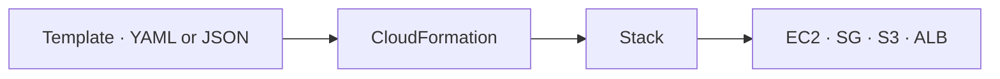
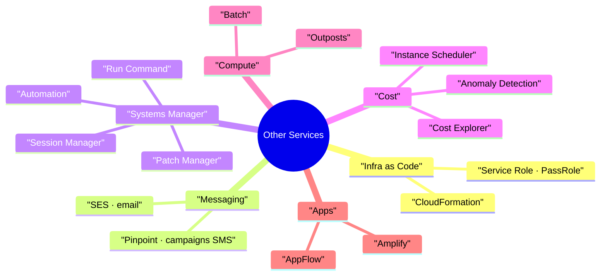

# Other AWS Services (Exam Quick Hits)

> **Core idea:** Each service here gives only 1–2 easy exam questions. You do not need deep detail. You only need to match the **exam keyword** to the **right service**.

---

## 1. CloudFormation — Infrastructure as Code

### 1.1 What it is

**CloudFormation** = you write a **template** (YAML or JSON) that says _what_ you want. AWS creates it all for you, **in the right order**. This is called **declarative** — you say _what_, not _how_.

A running template is called a **stack**.

### 1.2 Why use it

|Benefit|Meaning|
|---|---|
|Infrastructure as code|No manual clicks. Changes go through code review|
|Repeatable|Same setup in many **environments, regions, accounts**|
|Cost|Every resource in a stack gets the same **tag**. Easy cost estimate|
|Save money|Delete stack at 5 PM, recreate at 8 AM|
|Visual|**Infrastructure Composer** draws a diagram of the template|
|Not supported resource?|Use a **custom resource**|

### 1.3 Updates and delete

- On update, a **change set** shows what will be added, modified, or **replaced**. Replacement = old resource deleted, new one created. Data on it can be lost.
- To remove everything: **delete the stack**. Do not delete resources by hand.

### 1.4 Service Role (security)

A **service role** is an IAM role given to CloudFormation. CloudFormation uses this role (not the user's own rights) to create resources.

|Who|Needs|
|---|---|
|User|CloudFormation permissions + **`iam:PassRole`**|
|Service role|Real resource permissions (e.g. `s3:*`)|

> Use it for **least privilege**: the user cannot create S3 buckets directly, but can do it through CloudFormation.

---

## 2. Sending Messages to Customers

### 2.1 SES vs Pinpoint

|                                   | **Amazon SES**                                                         | **Amazon Pinpoint**                                      |
| --------------------------------- | ---------------------------------------------------------------------- | -------------------------------------------------------- |
| Sends                             | **Email only**                                                         | Email, **SMS**, push, voice, in-app                      |
| Direction                         | Outbound + inbound                                                     | Two-way (receives replies)                               |
| Who manages audience and schedule | **Your app**                                                           | **Pinpoint** (segments, templates, campaigns)            |
| Use case                          | Transactional, marketing, bulk email                                   | Marketing **campaigns**, transactional SMS               |
| Extras                            | Reputation dashboard, bounces, opens, DKIM, SPF, shared / dedicated IP | Events go to SNS, Kinesis Data Firehose, CloudWatch Logs |

> **Pinpoint = the next level of SNS + SES** for full marketing campaigns.

---

## 3. Systems Manager (SSM) — Manage Many Servers

All SSM features work through the **SSM Agent** on the server, and the server needs an **IAM role** (policy `AmazonSSMManagedInstanceCore`). Works on **EC2 and on-premises**, Linux / macOS / Windows.

### 3.1 Session Manager

A secure shell **without SSH**: no port 22, no SSH keys, no bastion host. Session logs can go to **S3 or CloudWatch Logs**.

| Way to connect to EC2   | Port 22 open? | SSH keys?      |
| ----------------------- | ------------- | -------------- |
| SSH                     | Yes           | Yes            |
| EC2 Instance Connect    | Yes           | No (temporary) |
| **SSM Session Manager** | **No**        | **No**         |

### 3.2 Other SSM features

| Feature                 | What it does                                                                                                                       |
| ----------------------- | ---------------------------------------------------------------------------------------------------------------------------------- |
| **Run Command**         | Run a script/command on many servers at once. No SSH. Output → S3 / CloudWatch Logs, status → SNS. Can be triggered by EventBridge |
| **Patch Manager**       | Auto-patch OS, apps, security. On-demand or scheduled. Gives a **patch compliance report**                                         |
| **Maintenance Windows** | A schedule: _when_, _how long_, _which instances_, _which tasks_                                                                   |
| **Automation**          | **Runbooks** for common tasks: restart instances, create AMI, EBS snapshots. Can fix **AWS Config** non-compliant resources        |

---

## 4. Saving Money

| Service                       | Keyword in exam                                    | What it does                                                                  |
| ----------------------------- | -------------------------------------------------- | ----------------------------------------------------------------------------- |
| **Cost Explorer**             | Visualize costs, **forecast**, Savings Plan advice | Reports by month / hour / resource. Forecast up to **12 months**              |
| **Cost Anomaly Detection**    | **Unusual spend**, machine learning                | Learns your pattern. **No thresholds needed**. Root cause + alerts via SNS    |
| **Instance Scheduler on AWS** | **Stop instances outside business hours**          | A _solution_ (not a service), deployed by CloudFormation. Saves up to **70%** |

**Instance Scheduler** supports EC2, Auto Scaling Groups, RDS. Schedules live in **DynamoDB**, and **Lambda** functions start/stop the resources. Works cross-account and cross-region.

---

## 5. Compute: Outposts and Batch

### 5.1 AWS Outposts

**Hybrid cloud** = a company uses both its own data center and the cloud. **Outposts** = AWS puts **its own server racks inside your data center**. You use the same AWS APIs and tools there.

- Benefits: **low latency** to on-prem systems, **local data processing**, **data residency** (data never leaves).
- Services: EC2, EBS, S3, EKS, ECS, RDS, EMR.
- **You** are responsible for the **physical security** of the rack.

### 5.2 AWS Batch

A **batch job** has a start and an end (e.g. 1 AM to 3 AM). **AWS Batch** runs many batch jobs. It launches **EC2 or Spot Instances** for you. A job = **Docker image + task definition on ECS**.

|            | **Lambda**            | **Batch**                 |
| ---------- | --------------------- | ------------------------- |
| Time limit | **15 min**            | **No limit**              |
| Runtime    | Few languages         | **Any** (Docker image)    |
| Disk       | Small temporary space | EBS / instance store      |
| Type       | Serverless            | Managed, runs on real EC2 |

> Long job or custom runtime → **Batch**. Short event job → **Lambda**.

---

## 6. Integration and Developer Tools

| Service            | Simple idea                                                                                                                                                                                        | Exam keyword                                    |
| ------------------ | -------------------------------------------------------------------------------------------------------------------------------------------------------------------------------------------------- | ----------------------------------------------- |
| **Amazon AppFlow** | Move data from **SaaS apps** to AWS. Sources: **Salesforce**, SAP, Zendesk, Slack, ServiceNow. Targets: S3, Redshift, Snowflake, Salesforce. Schedule / event / on-demand. Can use **PrivateLink** | "Salesforce data to S3"                         |
| **AWS Amplify**    | One place to build **web and mobile apps**: auth, storage, API, CI/CD, hosting                                                                                                                     | "**Elastic Beanstalk for web and mobile apps**" |

---

## 7. Summary

1. **CloudFormation** = infrastructure as code; repeat setups across regions and accounts.
2. Service role + `iam:PassRole` = least privilege for CloudFormation.
3. **SES** = email. **Pinpoint** = full marketing campaigns, SMS.
4. **Session Manager** = shell without SSH or port 22.
5. **Run Command / Patch Manager / Automation** = manage fleets without SSH.
6. **Cost Explorer** = see and forecast cost. **Anomaly Detection** = ML finds weird spend.
7. **Instance Scheduler** = stop instances at night to save cost.
8. **Outposts** = AWS racks in your data center.
9. **Batch** = long batch jobs on EC2/Spot; **no 15-min limit** like Lambda.
10. **AppFlow** = SaaS (Salesforce) → AWS. **Amplify** = web/mobile app builder.

---

## 8. Check Yourself

1. What does "declarative" mean in CloudFormation?
2. Which IAM permission must a user have to give a role to CloudFormation?
3. You must send SMS marketing campaigns to customer segments. SES or Pinpoint?
4. How can you get a shell on EC2 with port 22 closed?
5. Which SSM feature gives a patch compliance report?
6. Which service forecasts your AWS bill for the next 12 months?
7. You want alerts on unusual spend without setting thresholds. Which service?
8. Data must stay on-premises but you want AWS APIs. Which service?
9. A job runs for 3 hours with a custom runtime. Lambda or Batch? Why?
10. You need to copy Salesforce data into S3 daily. Which service?

---

## 9. Key Terms

|Term|Meaning|
|---|---|
|Stack|Resources created from one CloudFormation template|
|Change set|Preview of what an update will change|
|`iam:PassRole`|Permission to hand a role to an AWS service|
|SSM Agent|Small program on a server that lets SSM control it|
|Runbook|Predefined SSM Automation steps|
|Maintenance window|Schedule for running tasks on instances|
|Hybrid cloud|On-premises + cloud used together|
|Batch job|Job with a clear start and end|
|DKIM / SPF|Email security standards (prove sender is real)|
|SaaS|Software as a Service, e.g. Salesforce, Slack|
